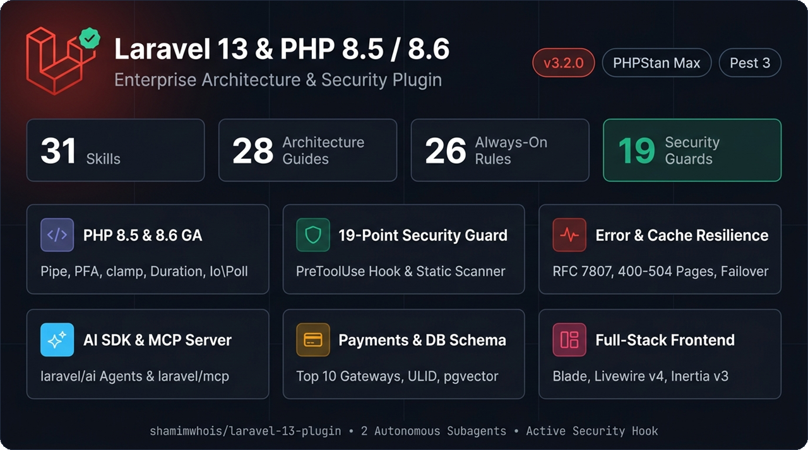
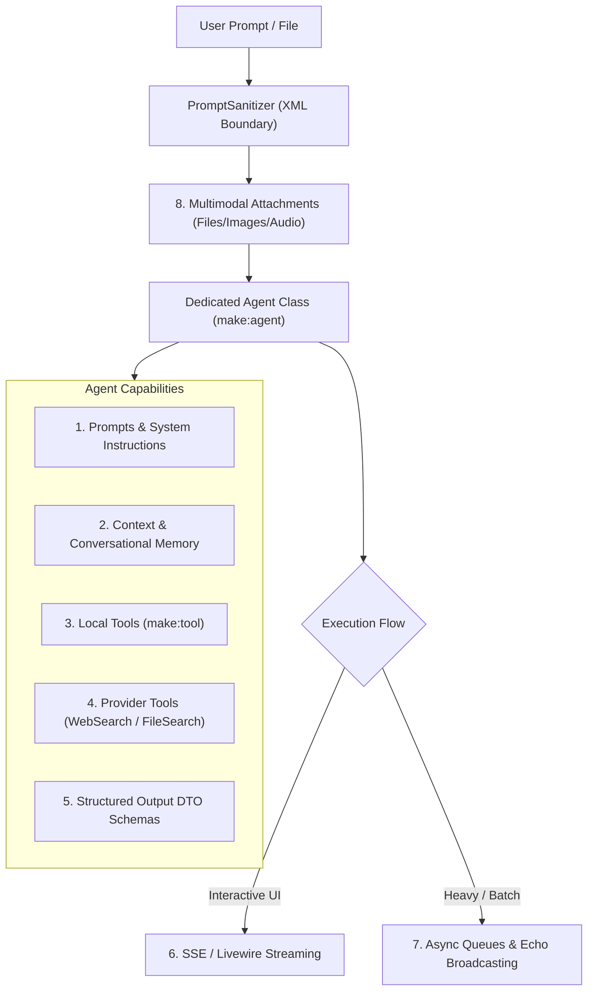
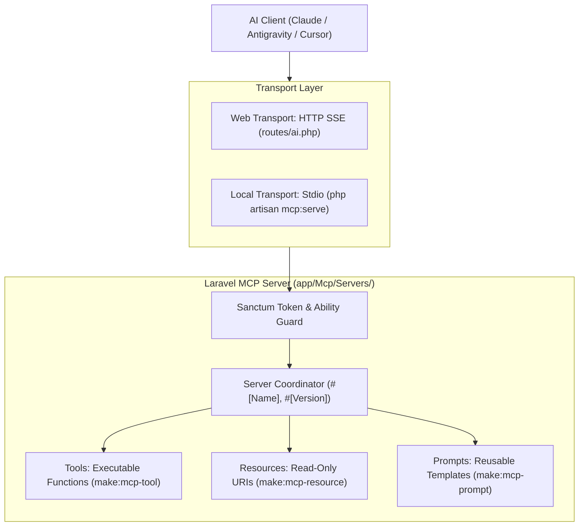
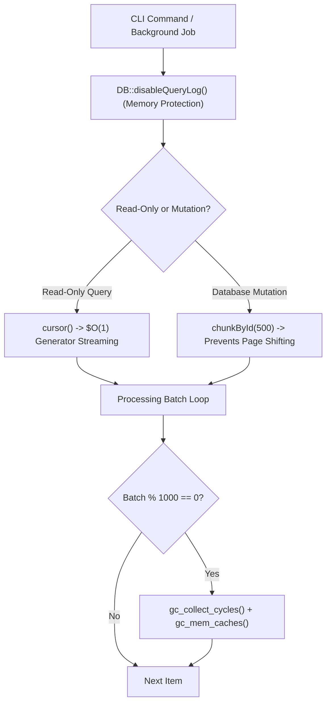

<p align="center">
  
</p>

<h1 align="center">Laravel 13 &amp; Modern PHP 8.5+ / 8.6+ Antigravity Plugin</h1>

<p align="center">
  <a href="https://github.com/shamimwhois/laravel-13-plugin"></a>
  <a href="https://github.com/shamimwhois/laravel-13-plugin/releases"></a>
  <a href="LICENSE"></a>
  <a href="https://laravel.com"></a>
  <a href="https://php.net"></a>
  <a href="https://pestphp.com"></a>
  <a href="https://phpstan.org"></a>
  <a href="https://modelcontextprotocol.io"></a>
</p>

<p align="center">
  An enterprise-grade, comprehensive toolkit, architectural framework, and autonomous agent skill pack for developing, refactoring, and architecting modern PHP (<strong>PHP 8.4, PHP 8.5 &amp; PHP 8.6+</strong>) and <strong>Laravel 13</strong> applications with the Antigravity AI assistant.
</p>

---

## 📑 Table of Contents

- [Executive Overview](#-executive-overview)
- [Quick Installation](#-quick-installation)
  - [1. Global Machine-Local Installation](#1-global-machine-local-installation)
  - [2. Workspace / Team-Shared Installation](#2-workspace--team-shared-installation)
- [The 31 Registered Skills](#-the-31-registered-skills)
- [The 26 Always-On Quality & Security Rules](#-the-26-always-on-quality--security-rules)
- [The 28 Master Architectural Guides](#-the-28-master-architectural-guides)
- [Full-Stack Frontend Architecture (Blade, Livewire, Inertia.js v3)](#-full-stack-frontend-architecture-blade-livewire-inertiajs-v3)
  - [The Canonical 4-Tier Frontend Directory Standard](#-the-canonical-4-tier-frontend-directory-standard)
- [First-Party AI SDK (`laravel/ai`) - The 8 Core Pillars](#-first-party-ai-sdk-laravelai---the-8-core-pillars)
- [Model Context Protocol (`laravel/mcp`) Architecture](#-model-context-protocol-laravelmcp-architecture)
- [High-Throughput & Memory Safety Standards](#-high-throughput--memory-safety-standards)
- [Dedicated Autonomous Subagents & Active Security Hook](#-dedicated-autonomous-subagents--active-security-hook)
- [Directory Tree](#-directory-tree)
- [License](#-license)

---

## 🌟 Executive Overview

This plugin transforms the Antigravity AI assistant into an expert **Principal Laravel 13 & PHP 8.6+ Software Architect**. It provides:

- **Merged 19-Point Laravel Security Guard (`hooks.json` + Static Scanner + `laravel-security-auditor`)**: Full integration of `shamimwhois/laravel-security-guard` covering all 19 vulnerability classes (SQLi, XSS, CSRF, BAC/IDOR, SSRF, Path Traversal, Command Injection, Mass Assignment, Open Redirect, Leaked Secrets, CVEs, Debug Mode/Assets, Broken Auth, Deserialization/`phar://`, XXE, SSTI, Clickjacking, CORS, HTTP Request Smuggling + TLS verification), active `PreToolUse` real-time write guard hook, zero-dependency Node.js static scanner, and Pest 3 security regression suite.
- **Error Handling, Error Pages & HTTP/HTTPS Transport Components**: Unified `bootstrap/app.php` exception handling (`withExceptions()`) and Inertia v3 `Inertia::handleExceptionsUsing()`, RFC 7807 Problem Details, ULID `X-Request-Id` Trace IDs, complete `400`–`504` error pages (Blade, Livewire v3/v4, Inertia v3 Vue 3 / React 19 / Svelte 5), isolated zero-DB `layouts/error`, accessible UI validation/boundary error components, and HTTP/HTTPS transport error components (`419` CSRF refresh, `429` countdown, HTTPS enforcement, `networkError`/`httpException` hooks).
- **Resilient Request & Cache Handling**: Inbound `AttachRequestContextMiddleware`, Form Requests + DTOs + `JsonSchema::rules()`, atomic `Idempotency-Key` locks, tiered `RateLimiter`, outbound `Http::` timeouts/jittered retries/SSRF/TLS/Circuit Breakers, Laravel 13 `failover` cache stores (`redis -> database -> array`), `LockTimeoutException` recovery, versioned multi-tenant cache keys, and HTTP `Cache-Control` / `ETag` / `no-store` headers.
- **Frontend Design Craft & Anti-AI-Slop Standards**: Synthesizes the core principles of Paul Bakaus's Impeccable (`pbakaus/impeccable`), Leon Lin's Taste Skill (`Leonxlnx/taste-skill`), and Hassan El Mghari's Hallmark (`nutlope/hallmark`) into Blade, Livewire v3/v4, and Inertia.js v3 (Vue 3, React 19, Svelte 5). Enforces the Hero Viewport Invariant (headline, 1 sentence, and CTA at 1280x800 without scrolling), strict ban on cliché purple-to-blue gradients and identical 3-card grids, asymmetric Bento layouts, themed native browser surfaces (`::selection`, `caret-color`, custom scrollbars, `:focus-visible`), and automated verification via `npx impeccable detect` and `sloplint`.
- **Database Architecture & Schema Standards**: Comprehensive schema design with PHP 8 attributes (`#[Table]`, `#[Fillable]`, `#[Hidden]`, `#[UseEloquentBuilder]`, `#[ScopedBy]`), typed relationship generics, ULID primary keys, explicit FK cascade behaviors (`cascadeOnDelete()`, `restrictOnDelete()`, `nullOnDelete()`), Leftmost Prefix / ESR composite indexing, and pgvector HNSW vector search.
- **Fintech & Payment Gateway Architecture**: Multi-driver architecture supporting Top 10 gateways (Stripe, bKash Tokenized Checkout, Binance Pay Crypto Web3, PayPal, Razorpay, Paddle, Mollie, Adyen, Square, SSLCommerz) with constant-time HMAC webhook verification, replay attack defense ($\pm 300\text{s}$ window + nonces), double-entry bookkeeping ledgers, payment FSMs, and PCI-DSS compliance.
- **Architectural Base Directory Blueprints**: Production-grade folder hierarchy standards for Action-Driven Monoliths, Service-Class Oriented Monoliths, Modular Monoliths, Domain-Driven Design (DDD), Hexagonal (Ports & Adapters), and CQRS architectures with Pest 3 boundary tests.
- **Strict Modern PHP 8.5.0 GA & PHP 8.6.0 GA Syntax**: Enforces `declare(strict_types=1);`, zero inline backslashes, PHP 8.6 Partial Function Application (`?` & `...`), native `clamp()`, `#[Override]` on constants & enum cases, Readonly property defaults, `Time\Duration`, global `SortDirection` enum, `Io\Poll\Context` + `StreamPollHandle`, `StreamErrorMode::Exception`, Parameter DocComments, `WeakMap` reference assignment, PHP 8.5 pipe operator (`|>`), `clone($obj, [...])`, `#[NoDiscard]` + `(void)` cast, `#[DelayedTargetValidation]`, `#[Override]` on properties, `final` promotion, static asymmetric visibility, constant-expression closures/FCCs, and native `Uri\Rfc3986\Uri` / `Uri\WhatWg\Url`.
- **4-Tier Frontend Directory Organization**: Strict separation of Layouts (`app`, `admin`, `customer`, `auth`), Domain Chrome (`components/app/*`), UI Primitives (`components/ui/*`, `icon/*`), and Pages (`pages/*`) across Blade, Livewire, Vue 3, React 19, and Svelte 5.
- **JSON Schema Validation (`JsonSchema::rules()`)**: Bridges `laravel/ai` and `laravel/mcp` tool parameter schemas directly into native Laravel validation rules without duplicating constraints.
- **Declarative Queue Attributes (`#[RetryFor]`)**: Declares job and listener retry windows cleanly via PHP attributes (`#[RetryFor(hours: 4)]`), eliminating legacy `retryUntil()` boilerplate.
- **Full-Stack Frontend Architecture**: Server-rendered Blade components, Alpine.js, Livewire v3 & v4 reactive state, and `wire:stream` real-time AI token streaming.
- **Inertia.js v3 SPAs (`v3.11.0` / `inertia-laravel v3.8.0`)**: Multi-stack SPAs with Vue 3 (TypeScript), **React 19+** (TypeScript), and **Svelte 5+** (Runes), leveraging `@inertiajs/vite` zero-config & Dev SSR, built-in XHR client & `http` interceptors (Axios removed), `useHttp()`, Optimistic Updates, Instant Visits, Layout Props (`setLayoutProps`), `<Form>` with built-in Precognition, Deferred (`#rescue`) / Optional / Once / Live Props, `<InfiniteScroll>`, `<WhenMounted>`, `QUERY` method, and Blade `<x-inertia::head>` / `<x-inertia::app />`.
- **First-Party AI Integration**: Complete support for `composer require laravel/ai` (Prompts, Context, Tools, Provider Tools, Structured Outputs, SSE Streaming, Async Queues, and Attachments).
- **First-Party Model Context Protocol**: Complete support for `composer require laravel/mcp` (Servers, Tools, Resources, Prompts, Web SSE, and stdio transports).
- **Zero N+1 Queries & Memory Safety**: $O(1)$ database streaming with `cursor()`, mutation chunking with `chunkById()`, WeakMap caching, and query log deactivation (`DB::disableQueryLog()`).
- **Ruthless Dead Code Elimination & Hygiene**: Automated eradication of unused imports, dead methods/classes, commented-out logic, orphaned routes/views, and legacy skeleton files with Rector (`SetList::DEAD_CODE`), Laravel Pint (`no_unused_imports`), `composer-unused`, and Pest 3 boundary enforcement.
- **Enterprise Security & Concurrency**: 2026 CVE supply-chain management, OWASP Top 10 mitigation, SSRF defense, constant-time cryptography, and ACID deadlock recovery (`attempts: 3`).

---

## 🚀 Quick Installation

### 1. Global Machine-Local Installation
Applies across all projects opened in Antigravity on your machine:

```bash
# Windows (PowerShell)
git clone https://github.com/shamimwhois/laravel-13-plugin.git "$env:USERPROFILE\.gemini\config\plugins\laravel"

# macOS / Linux
git clone https://github.com/shamimwhois/laravel-13-plugin.git ~/.gemini/config/plugins/laravel
```

### 2. Workspace / Team-Shared Installation
Checked directly into your repository so everyone on your engineering team shares identical skills and rules:

```bash
mkdir -p .agents/plugins
git clone https://github.com/shamimwhois/laravel-13-plugin.git .agents/plugins/laravel
git add .agents/plugins/laravel
git commit -m "chore: add Laravel 13 & Modern PHP 8.6+ Antigravity plugin"
```

---

## 🧩 The 31 Registered Skills

Every skill adheres to progressive disclosure—loaded into context only when needed:

| # | Skill Name | Path | Primary Purpose |
| :-: | :--- | :--- | :--- |
| **1** | **`architectural-decision-matrix`** | [`skills/architectural-decision-matrix/SKILL.md`](skills/architectural-decision-matrix/SKILL.md) | Evaluates Top 10 patterns (MVC, Action-Driven, Modular Monolith, DDD, Hexagonal, CQRS). |
| **2** | **`artisan-make-commands`** | [`skills/artisan-make-commands/SKILL.md`](skills/artisan-make-commands/SKILL.md) | Catalog of all 30+ `make:*` generator commands with PHP 8.5+ stubs & options. |
| **3** | **`laravel-ai-sdk`** | [`skills/laravel-ai-sdk/SKILL.md`](skills/laravel-ai-sdk/SKILL.md) | Official `laravel/ai` SDK: Prompts, Context, Tools, Streaming, and Attachments. |
| **4** | **`laravel-api-design`** | [`skills/laravel-api-design/SKILL.md`](skills/laravel-api-design/SKILL.md) | Production RESTful API design, RFC 7807 problem details, Sanctum token abilities, idempotency. |
| **5** | **`laravel-auth-and-access-guard`** | [`skills/laravel-auth-and-access-guard/SKILL.md`](skills/laravel-auth-and-access-guard/SKILL.md) | Security deep-dive: CSRF, Broken Access Control/IDOR, Livewire `#[Locked]`, Mass Assignment, Open Redirect, Broken Auth. |
| **6** | **`laravel-best-practices`** | [`skills/laravel-best-practices/SKILL.md`](skills/laravel-best-practices/SKILL.md) | Request lifecycle, Actions, Form Requests, thin controllers, and Pest 3 tests. |
| **7** | **`laravel-console-and-scheduling`** | [`skills/laravel-console-and-scheduling/SKILL.md`](skills/laravel-console-and-scheduling/SKILL.md) | `make:command`, `Isolatable` overlap locking, Prompts, $O(1)$ memory safety, `routes/console.php`. |
| **8** | **`laravel-controllers-and-middleware`** | [`skills/laravel-controllers-and-middleware/SKILL.md`](skills/laravel-controllers-and-middleware/SKILL.md) | Single-Action Invokables (`__invoke`), fluent middleware in `bootstrap/app.php`, terminables. |
| **9** | **`laravel-database-architecture`** | [`skills/laravel-database-architecture/SKILL.md`](skills/laravel-database-architecture/SKILL.md) | Database schema design, PHP 8 attributes, relationship generics, ULID PKs, FK cascade rules, composite indexes, and pgvector. |
| **10** | **`laravel-dead-code-elimination`** | [`skills/laravel-dead-code-elimination/SKILL.md`](skills/laravel-dead-code-elimination/SKILL.md) | Purge dead code, zombie logic, unused imports, unused composer packages, and legacy skeleton files via Rector, Pint, & Pest 3. |
| **11** | **`laravel-edge-and-supply-chain-guard`** | [`skills/laravel-edge-and-supply-chain-guard/SKILL.md`](skills/laravel-edge-and-supply-chain-guard/SKILL.md) | Security deep-dive: SSRF (DNS A+AAAA + IP pinning), Leaked Secrets, CVEs, Debug Mode/Assets, Clickjacking CSP, CORS, HTTP Request Smuggling. |
| **12** | **`laravel-eloquent-orm`** | [`skills/laravel-eloquent-orm/SKILL.md`](skills/laravel-eloquent-orm/SKILL.md) | PHP 8 attributes, custom query builders, casts, AI vector similarity search. |
| **13** | **`laravel-error-handling-and-pages`** | [`skills/laravel-error-handling-and-pages/SKILL.md`](skills/laravel-error-handling-and-pages/SKILL.md) | `bootstrap/app.php` exceptions, RFC 7807, custom `400`–`504` error pages, reusable UI error components, and HTTP/HTTPS transport error components. |
| **14** | **`laravel-frontend-blade-livewire`** | [`skills/laravel-frontend-blade-livewire/SKILL.md`](skills/laravel-frontend-blade-livewire/SKILL.md) | Blade component architecture, slots, Alpine.js, Livewire v3/v4 reactive state, `wire:stream` AI token streaming, `#[Locked]` tampering defense. |
| **15** | **`laravel-frontend-design-craft`** | [`skills/laravel-frontend-design-craft/SKILL.md`](skills/laravel-frontend-design-craft/SKILL.md) | Anti-AI-slop design craft (synthesizing Impeccable, Taste Skill, and Hallmark), Hero viewport invariant, Bento grids, and themed browser surfaces. |
| **16** | **`laravel-frontend-layouts-and-pages`** | [`skills/laravel-frontend-layouts-and-pages/SKILL.md`](skills/laravel-frontend-layouts-and-pages/SKILL.md) | Standardized 4-tier directory hierarchy (`layouts/`, `components/app/*`, `components/ui/*`, `components/error/*`, `errors/`, `pages/*`) across Blade, Livewire, Vue 3, React 19, Svelte 5. |
| **17** | **`laravel-inertia-spa`** | [`skills/laravel-inertia-spa/SKILL.md`](skills/laravel-inertia-spa/SKILL.md) | Inertia.js v3 SPAs (`v3.11` / `inertia-laravel v3.8`) with Vue 3, React 19+, Svelte 5+, `@inertiajs/vite` Dev SSR, built-in XHR, `useHttp()`, Optimistic Updates, Instant Visits, Layout Props, `<Form>` Precognition & Live Props. |
| **18** | **`laravel-injection-and-input-guard`** | [`skills/laravel-injection-and-input-guard/SKILL.md`](skills/laravel-injection-and-input-guard/SKILL.md) | Security deep-dive: SQLi, XSS, Path Traversal & Zip Slip, Command Injection, Deserialization/`phar://`, XXE, SSTI. |
| **19** | **`laravel-mcp`** | [`skills/laravel-mcp/SKILL.md`](skills/laravel-mcp/SKILL.md) | Official `laravel/mcp`: Tools, Resources, Prompts, Web SSE, and stdio transports. |
| **20** | **`laravel-memory-safety`** | [`skills/laravel-memory-safety/SKILL.md`](skills/laravel-memory-safety/SKILL.md) | Octane concurrency safety, $O(1)$ cursor streaming, WeakMap caching, worker recycling. |
| **21** | **`laravel-payment-gateways`** | [`skills/laravel-payment-gateways/SKILL.md`](skills/laravel-payment-gateways/SKILL.md) | Multi-driver architecture for Top 10 payment gateways (Stripe, bKash Tokenized, Binance Pay Crypto, PayPal, Razorpay) with replay defense, double-entry ledger, FSM, and PCI-DSS compliance. |
| **22** | **`laravel-performance-and-caching`** | [`skills/laravel-performance-and-caching/SKILL.md`](skills/laravel-performance-and-caching/SKILL.md) | Redis compression (`igbinary`, `zstd`), `Cache::flexible()` stampede defense, locks. |
| **23** | **`laravel-project-structure`** | [`skills/laravel-project-structure/SKILL.md`](skills/laravel-project-structure/SKILL.md) | Architectural base directory tree patterns (Action-Driven, Service-Class Monolith, Modular, DDD, Hexagonal, CQRS) & Pest 3 Arch tests. |
| **24** | **`laravel-request-and-cache-handling`** | [`skills/laravel-request-and-cache-handling/SKILL.md`](skills/laravel-request-and-cache-handling/SKILL.md) | Inbound `X-Request-Id` context, Form Requests + DTOs, Idempotency-Key locks, outbound `Http::` resilience & Circuit Breaker, `failover` cache store, `LockTimeoutException` recovery, HTTP cache headers. |
| **25** | **`laravel-routing`** | [`skills/laravel-routing/SKILL.md`](skills/laravel-routing/SKILL.md) | 5 routing styles: Invokable mapping, grouping, scoped bindings, `whereUlid`, rate limiting. |
| **26** | **`laravel-scaffolding`** | [`skills/laravel-scaffolding/SKILL.md`](skills/laravel-scaffolding/SKILL.md) | End-to-end blueprint for scaffolding all 6 layers of a feature (Migration $\rightarrow$ Route). |
| **27** | **`laravel-security-and-hardening`** | [`skills/laravel-security-and-hardening/SKILL.md`](skills/laravel-security-and-hardening/SKILL.md) | OWASP Top 10 defense, SSRF private IP filters, `hash_equals()`, safe uploads, IDOR (cross-linked to 19-point Security Guard). |
| **28** | **`laravel-security-guard`** | [`skills/laravel-security-guard/SKILL.md`](skills/laravel-security-guard/SKILL.md) | Master 19-point security audit & hardening runbook with bundled zero-dependency static scanner (`laravel-security-scan.mjs`) and Pest 3 security suite. |
| **29** | **`pest-testing`** | [`skills/pest-testing/SKILL.md`](skills/pest-testing/SKILL.md) | Pest 3 test suite: feature tests, architectural boundary tests (`arch()`), fakes. |
| **30** | **`php-modern-syntax`** | [`skills/php-modern-syntax/SKILL.md`](skills/php-modern-syntax/SKILL.md) | Verified PHP 8.5.0 GA & PHP 8.6.0 GA syntax: PFA (`?`/`...`), `\|>`, `clone($obj, [...])`, `#[NoDiscard]` + `(void)`, `Uri\*`, `clamp()`, `#[Override]` on props/consts/enum cases, Readonly defaults, `Time\Duration`, `SortDirection`, `Io\Poll\*`, `StreamErrorMode`, & 8.4→8.5→8.6 deprecations. |
| **31** | **`phpstan-larastan`** | [`skills/phpstan-larastan/SKILL.md`](skills/phpstan-larastan/SKILL.md) | PHPStan Level 8 / max configuration, generic Eloquent typing, CI workflows. |

---

## 🛡️ The 26 Always-On Quality & Security Rules

All agent interactions automatically enforce the strict standards codified in [`rules/AGENTS.md`](rules/AGENTS.md):

1. **Strict Typing & Modern Syntax**: `declare(strict_types=1);` mandatory. Explicit top-level imports; zero inline leading backslashes (`\App\...`, `#[\Override]`). Mark classes `final` by default. Promoted constructor properties (`final` promotion & static asymmetric visibility). Verified PHP 8.5.0 GA (`|>`, `clone($obj, [...])`, `#[NoDiscard]` + `(void)`, `#[DelayedTargetValidation]`, `Uri\*`, `array_first`/`last`, `Closure::getCurrent()`, `FILTER_THROW_ON_FAILURE`, `IntlListFormatter`) and PHP 8.6.0 GA (PFA `?` & `...`, `clamp()`, Readonly defaults, `#[Override]` on constants & enum cases, `Time\Duration`, `SortDirection`, `Io\Poll\*`, `StreamErrorMode::Exception`) plus cumulative 8.5/8.6 deprecation hygiene.
2. **Thin Controllers**: No business logic or queries in controllers. Mandatory Form Requests (`app/Http/Requests`). Use `JsonSchema::rules()` to dynamically derive validation rules from schemas without duplicated constraints. API Resources (`JsonResource`) mandatory for all responses.
3. **Canonical Routing**: Kebab-case URLs (`/user-profiles`), dot notation names (`admin.users.index`), plural resources, singular parameters (`{user}`).
4. **RESTful Semantics**: `POST` $\rightarrow$ 201 Created; `PUT`/`PATCH` $\rightarrow$ 200 OK; `DELETE` $\rightarrow$ 204 No Content; Validation failure $\rightarrow$ 422 with RFC 7807 problem details.
5. **Eloquent Model Attributes**: Use `#[Table]`, `#[Fillable]`, `#[Hidden]`, and `#[UseEloquentBuilder]`. Method-based attribute casts (`casts(): array`).
6. **Anonymous Migrations**: `return new class extends Migration`. Typed blueprints, ULIDs/UUIDs, explicit cascades, and composite indexes.
7. **Idempotent Factories & Seeders**: Realistic defaults via `fake()`. Explicit state methods. Never loop queries in seeders.
8. **Strict Eager Loading**: Zero N+1 queries. Global enforcement of `Model::preventLazyLoading(!app()->isProduction())`.
9. **PHPStan Level 8 / Max**: 100% parameter and return type declarations. Generic annotations for Collections (`Collection<int, Model>`) and Builders (`Builder<Model>`).
10. **Queues, Caching & Events**: Declare queue configurations with `#[WithQueue]` and declarative retry windows with `#[RetryFor(hours: ...)]` (prohibiting legacy `retryUntil()` methods). Atomic distributed locks (`Cache::lock`). Stale-While-Revalidate caching via `Cache::flexible()`.
11. **Pest 3 Architecture Testing**: Boundary tests verifying controllers are invokable and models extend Eloquent.
12. **Memory Safety & Streaming**: $O(1)$ cursor streaming via generators (`cursor()`), mutation chunking (`chunkById()`), Octane state safety, and streaming file downloads.
13. **Security Hardening & 19-Point Vulnerability Defense Guard (Merged `laravel-security-guard`)**: Complete 19-class AppSec enforcement (SQLi, XSS, CSRF, BAC/IDOR, SSRF DNS+IP pinning, Path Traversal/Zip Slip, Command Injection, Mass Assignment, Open Redirect, Leaked Secrets, CVEs, Debug Mode/Assets, Broken Auth, Insecure Deserialization/`phar://`, XXE, SSTI, Clickjacking CSP, CORS, HTTP Request Smuggling + strict outbound TLS).
14. **Laravel AI SDK Standards**: Encapsulated Agent classes, scoped conversation memory, typed tool schemas with `JsonSchema::rules()` validation, structured output DTOs, SSE streaming, XML prompt injection boundaries (`<user_input>`), and Pest fakes (`Agent::fake()`).
15. **Model Context Protocol Standards**: Canonical `app/Mcp/` directories, `routes/ai.php` web SSE routing with Sanctum authentication, stdio CLI execution, and typed tool schemas validated with `JsonSchema::rules()`.
16. **Console Commands & Scheduling**: `#[AsCommand]` attributes, `implements Isolatable` to eliminate overlapping crons, `DB::disableQueryLog()` memory protection, and `laravel/prompts`.
17. **Database Transactions & Concurrency**: Mandatory `DB::transaction(..., attempts: 3)` with deadlock retry, pessimistic row locking (`lockForUpdate()`), **strict prohibition of external HTTP inside transactions**, and post-commit `afterCommit` hooks.
18. **Modern Frontend Architecture**: Blade components with `@props`, Livewire `#[Locked]` state tampering defense, Form Objects, `wire:stream` AI token streaming, Alpine.js micro-interactions, Inertia v3 (`@inertiajs/vite` Dev SSR, built-in XHR + `http` interceptors, `useHttp()`, Optimistic Updates, Instant Visits, `setLayoutProps()`, `<Form>` Precognition, `Inertia::defer(..., rescue: true)` / `optional()` / `live()`, Vue 3, React 19+, Svelte 5+ Runes), and Pest 3 assertions (`loadDeferredProps()`, `hasFlash()`).
19. **Canonical Frontend Directory Organization**: Strict 4-tier directory scoping across Blade, Livewire, and Inertia.js (`layouts/`, `components/app/<domain>/`, `components/ui/`, `components/error/`, `components/icon/`, `errors/`, `pages/<domain>/<feature>/index`), total prohibition of view root sprawl, and controller dot-notation resolution (`view('pages.admin.dashboard.index')` / `Inertia::render('admin/dashboard/Index')`).
20. **Dead Code Elimination, Zombie Logic Hunting & Codebase Hygiene**: Zero tolerance for commented-out code, unused `use` imports (`laravel/pint`), and unused Composer dependencies (`composer-unused`). Immediate deletion of legacy Laravel skeleton files (`app/Http/Kernel.php`, `app/Console/Kernel.php`, `app/Exceptions/Handler.php`, `app/Providers/RouteServiceProvider.php`). Automated dead code purging with Rector `SetList::DEAD_CODE` and Pest 3 boundary tests forbidding legacy class revival.
21. **Architectural Base Project Directory Tree Patterns & Placement Guidelines**: Mandatory adherence to standardized architectural directory patterns (Action-Driven Monolith or Service-Class Oriented Monolith by default, Modular Monolith for multi-team platforms, DDD for core banking/fintech, Hexagonal for framework-agnostic engines). Strict canonical folder placement and Pest 3 architectural boundary tests in `tests/Arch/`.
22. **Payment Gateway Architecture, Webhook Security & Fintech Rules**: Mandatory PCI-DSS compliance, constant-time HMAC webhook signature comparison (`hash_equals()`), replay attack mitigation ($\pm 300\text{s}$ window + Redis nonces), zero-float integer cents / BCMath, atomic idempotency, payment FSM transition guards, and checkout rate limiting.
23. **Database Schema Design, Eloquent Attributes, Indexing & FK Architecture Rules**: Native PHP 8 attributes (`#[Table]`, `#[Fillable]`, `#[Hidden]`, `#[UseEloquentBuilder]`, `#[ScopedBy]`), typed relationship generics, ULID primary keys, explicit FK cascades, B-Tree Leftmost Prefix / ESR composite indexing, partial indexes, and pgvector HNSW indexing.
24. **Frontend Design Craft, Anti-AI-Slop & Aesthetic Taste Rules**: Anti-AI-slop craft standards (synthesizing Impeccable, Taste Skill, and Hallmark): zero purple-to-blue gradients, zero identical 3-card grids, zero eyebrow pill badges, Hero Viewport Invariant at 1280x800, material honesty, restrained GPU motion, themed browser surfaces, and SVG-only icons.
25. **Error Handling, Error Pages & HTTP/HTTPS Error Component Rules**: Unified `bootstrap/app.php` `withExceptions()`, RFC 7807 Problem Details with ULID `X-Request-Id` Trace IDs, strict `Cache-Control: no-store, private` on `4xx`/`5xx`, zero stack-trace leaks, complete `400`–`504` error pages with isolated zero-DB `layouts/error`, accessible UI validation/boundary error components, and HTTP/HTTPS transport error components (`419` refresh, `429` countdown, HTTPS enforcement, offline/TLS alerts).
26. **Resilient Request Handling & Cache Handling Rules**: Inbound `AttachRequestContextMiddleware`, Form Request normalization + DTOs, atomic `Idempotency-Key` locks, tiered `RateLimiter`, outbound `Http::` timeouts/jittered retries/SSRF/TLS/Circuit Breakers, Laravel 13 `failover` cache stores, explicit `LockTimeoutException` handling, versioned multi-tenant cache keys invalidated `DB::afterCommit()`, and HTTP `Cache-Control` / `ETag` headers.

---

## 📚 The 28 Master Architectural Guides

Located in [`docs/architecture/`](docs/architecture/):

1. **[`php-8-6-modern-syntax-and-migration.md`](docs/architecture/php-8-6-modern-syntax-and-migration.md)**: Authoritative PHP 8.5.0 GA & PHP 8.6.0 GA syntax & standard library handbook (Pipe `|>`, `clone($obj, [...])`, `#[NoDiscard]` + `(void)`, `#[DelayedTargetValidation]`, `final` promotion, static asymmetric visibility, `Uri\Rfc3986\Uri` & `Uri\WhatWg\Url`, PFA `?`/`...`, `clamp()`, Readonly defaults, `#[Override]` on props/consts/enum cases, `Time\Duration`, `SortDirection`, `Io\Poll\*`, `StreamErrorMode`, Parameter DocComments, Sodium IPcrypt/XOF/PQ-KEM, engine optimizations, and cumulative PHP 8.4 → 8.5 → 8.6 migration runbook).
2. **[`Architectural.md`](docs/architecture/Architectural.md)**: Executive Decision Matrix for the Top 10 Software Architecture Patterns.
3. **[`error-handling-pages-and-components.md`](docs/architecture/error-handling-pages-and-components.md)**: End-to-end Laravel 13 exception handling (`bootstrap/app.php`), RFC 7807 Problem Details, `400`–`504` error pages (Blade, Livewire, Vue 3, React 19, Svelte 5), reusable UI & HTTP/HTTPS transport error components, and Pest 3 tests.
4. **[`request-and-cache-resilience.md`](docs/architecture/request-and-cache-resilience.md)**: Inbound request lifecycle (`X-Request-Id`, Form Requests/DTOs, Idempotency-Key, RateLimiter, HTTPS/TrustProxies), outbound `Http::` Circuit Breakers & TLS/SSRF resilience, Laravel 13 `failover` cache store, `LockTimeoutException` recovery, and HTTP cache headers.
5. **[`payment-gateways-and-fintech-integrations.md`](docs/architecture/payment-gateways-and-fintech-integrations.md)**: Master fintech guide covering Top 10 payment gateways (Stripe, bKash Tokenized, Binance Pay Crypto, PayPal, Razorpay, Paddle, Mollie, Adyen, Square, SSLCommerz), replay attack defense, double-entry ledger, payment FSM, and Pest 3 tests.
6. **[`database-schema-design-and-indexing.md`](docs/architecture/database-schema-design-and-indexing.md)**: Production guide to database schema design, PHP 8 attributes, relationship generics, primary key strategies (ULID vs BigInt), foreign key cascades, Leftmost Prefix / ESR indexing, partial indexes, and pgvector HNSW search.
7. **[`project-directory-tree-patterns.md`](docs/architecture/project-directory-tree-patterns.md)**: Standardized codebase directory blueprints, namespace mappings, boundary invariants, and Pest 3 boundary suites across Action-Driven, Service-Class Monolith, Modular Monolith, DDD, Hexagonal, and CQRS architectures.
8. **[`frontend-design-craft-and-anti-ai-slop.md`](docs/architecture/frontend-design-craft-and-anti-ai-slop.md)**: Production guide to frontend design craft, anti-AI-slop rules, surface modes (Persuade, Operate, Read, Experience), Hero viewport invariant, Bento grids, themed browser surfaces, and Impeccable/Hallmark CLI audits.
9. **[`frontend-layouts-components-and-pages.md`](docs/architecture/frontend-layouts-components-and-pages.md)**: Standardized 4-tier frontend hierarchy, domain layout shells, UI design tokens, SVG icon primitives, and multi-tenant layout isolation.
10. **[`blade-and-livewire.md`](docs/architecture/blade-and-livewire.md)**: Server-rendered Blade components, slots, Alpine.js, Livewire v3/v4 reactive state, and `wire:stream` AI streaming.
11. **[`inertia-and-frontend-stacks.md`](docs/architecture/inertia-and-frontend-stacks.md)**: Inertia.js v3 (`v3.11.0` / `inertia-laravel v3.8.0`) SPAs with Vue 3 (TS), React 19+ (TS), Svelte 5+ (Runes), `@inertiajs/vite` Dev SSR, Built-in XHR, `useHttp()`, Optimistic Updates, Instant Visits, Live Props, and v2 → v3 migration runbook.
12. **[`ai-sdk-and-llm-integration.md`](docs/architecture/ai-sdk-and-llm-integration.md)**: First-party `laravel/ai` SDK architecture & 8 Core Pillars.
13. **[`mcp-and-ai-protocols.md`](docs/architecture/mcp-and-ai-protocols.md)**: First-party Model Context Protocol (`laravel/mcp`) server & client architecture.
14. **[`console-commands-and-scheduling.md`](docs/architecture/console-commands-and-scheduling.md)**: Concurrency isolation (`Isolatable`), Laravel Prompts, memory safety, and `routes/console.php`.
15. **[`database-transactions-and-concurrency.md`](docs/architecture/database-transactions-and-concurrency.md)**: ACID boundaries, deadlock retries, row locks, and `afterCommit` hooks.
16. **[`controllers-and-middleware.md`](docs/architecture/controllers-and-middleware.md)**: Single-Action Invokables (`__invoke`), fluent middleware in `bootstrap/app.php`, terminables.
17. **[`caching-and-performance.md`](docs/architecture/caching-and-performance.md)**: Redis compression (igbinary + zstd), `Cache::flexible()`, and Cached Repositories.
18. **[`memory-safety-and-performance.md`](docs/architecture/memory-safety-and-performance.md)**: Octane concurrency, $O(1)$ cursor streaming, WeakMap caching, worker recycling.
19. **[`security-and-hacker-protection.md`](docs/architecture/security-and-hacker-protection.md)**: OWASP Top 10 defenses, SSRF IP filtering, timing attacks, and hardened file uploads.
20. **[`cve-management.md`](docs/architecture/cve-management.md)**: 2026 CVE scanning (`composer audit`, OSV-Scanner, Semgrep), CVSS SLAs, and supply chain security.
21. **[`clean-code-and-concerns.md`](docs/architecture/clean-code-and-concerns.md)**: DRY principles, trait organization (`app/Concerns/`), DTOs, and Pint formatting.
22. **[`oop-pillars-and-organization.md`](docs/architecture/oop-pillars-and-organization.md)**: OOP 4 pillars, Composition over Inheritance, domain directory architecture.
23. **[`namespace-import-class-standards.md`](docs/architecture/namespace-import-class-standards.md)**: PSR-4, explicit root class imports, zero inline backslashes, Pint rules.
24. **[`enums.md`](docs/architecture/enums.md)**: Domain-based backed enums, PHP 8.6 native `SortDirection` & `__debugInfo(): array`, state transitions, traits, and `php artisan make:enum`.
25. **[`codebase-organization-and-maintenance.md`](docs/architecture/codebase-organization-and-maintenance.md)**: Exception handling, replacing `helpers.php` with `app/Support/`, model pruning.
26. **[`senior-developer-code-review-and-refactoring.md`](docs/architecture/senior-developer-code-review-and-refactoring.md)**: Dead code purging, arrow-code flattening, Rector automation, code smells.
27. **[`routing.md`](docs/architecture/routing.md)**: Master routing patterns, prefixes, and constraints in Laravel 13.
28. **[`patterns.md`](docs/architecture/patterns.md)**: Detailed blueprints for Modular Monolith, DDD, Hexagonal, and CQRS.

---

## 🎨 Full-Stack Frontend Architecture (Blade, Livewire, Inertia.js v3)

The plugin supports two modern, production-grade frontend paradigms:


- **Blade & Alpine.js**: Reusable UI primitives (`resources/views/components/`) using `@props` and `$attributes->class()`.
- **Livewire v3 & v4**: Server-driven reactivity with Form Objects (`Livewire\Form`), `#[Locked]` state tampering defense, and `wire:stream` real-time token streaming with `laravel/ai`.
- **Inertia.js v3 (`@inertiajs/*` v3.11.0 & `inertia-laravel` v3.8.0)**: Single-Page Applications with zero client-side routing boilerplate:
  - **Vue 3**: Composition API with `<script setup lang="ts">`, typed `createForm<T>()`, Layout Props (`setLayoutProps`), `<Deferred>` (`#rescue`), `<InfiniteScroll>`, and `useProp()`.
  - **React 19+**: Strict TypeScript JSX (React 18 dropped), `<Form<T>>`, `useHttp()`, optimistic updates, and array-wrapped persistent layouts (`Page.layout = [AppLayout]`).
  - **Svelte 5+**: Modern reactive Runes (`let { user }: Props = $props();`, `$state()`, `$derived()`) and module-level `export const layout = [AppLayout, { ... }]`.
  - **Zero-Config Vite & Realtime**: `@inertiajs/vite` automatic page resolution & out-of-the-box Dev SSR, built-in XHR client & `http` interceptors (Axios removed), `Inertia::optional()`, `Inertia::live()` + Echo/Pusher, `QUERY` HTTP method, and `<x-inertia::head>` / `<x-inertia::app />` Blade components.

### 📂 The Canonical 4-Tier Frontend Directory Standard

All frontend assets in Laravel 13 (Blade/Livewire in `resources/views/` and Inertia in `resources/js/`) are strictly partitioned into 4 distinct tiers:

| Tier | Directory | Purpose | Canonical Examples |
| :--- | :--- | :--- | :--- |
| **Tier 1: Layouts** | `layouts/` | Master application shells | `layouts/app.blade.php`, `layouts/auth.blade.php`, `layouts/customer.blade.php`, `layouts/admin.blade.php` |
| **Tier 2: Domain Chrome** | `components/app/<domain>/` | Scoped navigation chrome | `admin/` (`header`, `nav`, `footer`, `sidebar`), `customer/` (`header`, `nav`, `footer`, `sidebar`), `auth/` (`header`, `nav`, `footer`), `public/` (`header`, `nav`, `footer`) |
| **Tier 3: UI Primitives** | `components/ui/` & `icon/` | Reusable design tokens & SVG glyphs | `ui/` (`button`, `input`, `modal`, `card`, `badge`, `table`, `dropdown`), `icon/` (`search`, `user`, `chevron-down`, `check`, `alert-circle`) |
| **Tier 4: Feature Pages** | `pages/<domain>/<feature>/` | Concrete page entrypoints matching controllers 1:1 | `pages/admin/dashboard/index`, `pages/customer/dashboard/index`, `pages/home/index` |

---

## 🤖 First-Party AI SDK (`laravel/ai`) - The 8 Core Pillars



1. **Prompts**: Dedicated Agent classes implementing `Laravel\Ai\Contracts\Agent` using `Promptable`.
2. **Context**: Multi-turn chat memory persisted via `RemembersConversations` and `Conversational`.
3. **Tools**: Local application function calling scaffolded with `php artisan make:tool`.
4. **Provider Tools**: Cloud-side provider tools (`WebSearch`, `WebFetch`, `FileSearch`, `CodeExecution`).
5. **Structured Output**: `HasStructuredOutput` schemas hydrated into PHP 8.5+ immutable DTOs (`final readonly class`).
6. **Streaming**: Real-time token streaming with `stream()` via SSE, Livewire, or Vercel Data Protocol.
7. **Async Queues**: Heavy model executions pushed to queues (`#[WithQueue]`) with exponential retry backoff.
8. **Attachments**: Multimodal inputs with `Laravel\Ai\Files\Image`, `Document`, and `Audio`.

---

## 🔌 Model Context Protocol (`laravel/mcp`) Architecture



- **Tools**: Callable functions defining parameter schemas with `schema(JsonSchema $schema)` and executed via `handle()`.
- **Resources**: Read-only contextual URIs implementing `HasUriTemplate` (e.g. `orders://{id}/details`).
- **Prompts**: Standardized conversation templates for repeatable prompt engineering.
- **Dual Transports**: Web SSE registered in `routes/ai.php` via `Mcp::web()`, and stdio CLI via `php artisan mcp:serve`.

---

## ⚡ High-Throughput & Memory Safety Standards



- **Query Logging**: Always disable SQL query logging (`DB::disableQueryLog()`) in batch CLI commands to eliminate memory bloat.
- **Safe Database Streaming**: Never use `Model::all()` or `$query->get()`. Use `$query->cursor()` for read streaming or `$query->chunkById()` for updates.
- **Octane Concurrency**: Zero request-scoped state stored in static properties or singletons; use `WeakMap` for garbage-collectible caches.

---

## 🤖 Dedicated Autonomous Subagents & Active Security Hook

The plugin includes **2 dedicated autonomous subagents** plus an **active `PreToolUse` real-time security guard hook** and **bundled 19-point static scanner** (merged from `shamimwhois/laravel-security-guard`):

1. **`laravel-architect`** (`agents/laravel-architect.md`): Deep architectural audits covering 6-layer feature harmony, error/request/cache resilience, `laravel/mcp`, `laravel/ai`, console concurrency, ACID transactions, and PHPStan Level 8 / max coverage.
2. **`laravel-security-auditor`** (`agents/laravel-security-auditor.md`): Dedicated AppSec auditor executing the 19-point vulnerability runbook, running the static scanner + `composer audit`, implementing hardened fixes, and writing Pest 3 security regression tests.
3. **Active `PreToolUse` Write Guard (`hooks.json` + `scripts/pre-write-guard.mjs`)**: Automatically inspects edits to Laravel `.php`, `.blade.php`, `.env*`, and proxy `.conf` files before writing and prompts for confirmation if high-confidence security hazards (raw SQL interpolation, XSS `{!! $request !!}`, wildcard CSRF, SSRF, Path Traversal, Command Injection, `$guarded = []`, Open Redirect, hardcoded secrets, `APP_DEBUG=true`, weak `md5`/`sha1` password hashes, `unserialize()`, `LIBXML_NOENT`, `Blade::render($...)`, wildcard credentialed CORS, `TrustProxies = '*'`, or disabled TLS `withoutVerifying()`) are introduced.

```bash
# Run the bundled 19-point zero-dependency static security scanner manually:
node ~/.gemini/config/plugins/laravel/skills/laravel-security-guard/scripts/laravel-security-scan.mjs /path/to/laravel-app --fail-on-high
```

---

## 📂 Directory Tree

```text
~/.gemini/config/plugins/laravel/
├── plugin.json
├── hooks.json
├── README.md
├── assets/
│   ├── banner.png
│   └── logo.svg
├── scripts/
│   └── pre-write-guard.mjs
├── agents/
│   ├── laravel-architect.md
│   └── laravel-security-auditor.md
├── rules/
│   └── AGENTS.md
├── docs/
│   ├── Route.md
│   ├── api/
│   │   └── design.md
│   ├── testing/
│   │   ├── assertions.md
│   │   └── database-testing.md
│   └── architecture/
│       ├── routing.md
│       ├── patterns.md
│       ├── Architectural.md
│       ├── clean-code-and-concerns.md
│       ├── oop-pillars-and-organization.md
│       ├── namespace-import-class-standards.md
│       ├── enums.md
│       ├── codebase-organization-and-maintenance.md
│       ├── senior-developer-code-review-and-refactoring.md
│       ├── memory-safety-and-performance.md
│       ├── caching-and-performance.md
│       ├── security-and-hacker-protection.md
│       ├── cve-management.md
│       ├── controllers-and-middleware.md
│       ├── ai-sdk-and-llm-integration.md
│       ├── mcp-and-ai-protocols.md
│       ├── console-commands-and-scheduling.md
│       ├── database-transactions-and-concurrency.md
│       ├── blade-and-livewire.md
│       ├── inertia-and-frontend-stacks.md
│       ├── frontend-design-craft-and-anti-ai-slop.md
│       ├── frontend-layouts-components-and-pages.md
│       ├── error-handling-pages-and-components.md
│       ├── request-and-cache-resilience.md
│       ├── payment-gateways-and-fintech-integrations.md
│       ├── database-schema-design-and-indexing.md
│       ├── php-8-6-modern-syntax-and-migration.md
│       └── project-directory-tree-patterns.md
└── skills/
    ├── architectural-decision-matrix/SKILL.md
    ├── artisan-make-commands/SKILL.md
    ├── laravel-ai-sdk/SKILL.md
    ├── laravel-api-design/SKILL.md
    ├── laravel-auth-and-access-guard/SKILL.md
    ├── laravel-best-practices/SKILL.md
    ├── laravel-console-and-scheduling/SKILL.md
    ├── laravel-controllers-and-middleware/SKILL.md
    ├── laravel-database-architecture/SKILL.md
    ├── laravel-dead-code-elimination/SKILL.md
    ├── laravel-edge-and-supply-chain-guard/SKILL.md
    ├── laravel-eloquent-orm/SKILL.md
    ├── laravel-error-handling-and-pages/SKILL.md
    ├── laravel-frontend-blade-livewire/SKILL.md
    ├── laravel-frontend-design-craft/SKILL.md
    ├── laravel-frontend-layouts-and-pages/SKILL.md
    ├── laravel-inertia-spa/SKILL.md
    ├── laravel-injection-and-input-guard/SKILL.md
    ├── laravel-mcp/SKILL.md
    ├── laravel-memory-safety/SKILL.md
    ├── laravel-payment-gateways/SKILL.md
    ├── laravel-performance-and-caching/SKILL.md
    ├── laravel-project-structure/SKILL.md
    ├── laravel-request-and-cache-handling/SKILL.md
    ├── laravel-routing/SKILL.md
    ├── laravel-scaffolding/SKILL.md
    ├── laravel-security-and-hardening/SKILL.md
    ├── laravel-security-guard/
    │   ├── SKILL.md
    │   ├── references/pest-security-tests.md
    │   └── scripts/laravel-security-scan.mjs
    ├── pest-testing/SKILL.md
    ├── php-modern-syntax/SKILL.md
    └── phpstan-larastan/SKILL.md
```

---

## 📄 License

This open-source plugin is licensed under the [MIT License](LICENSE). Contributions, issues, and feature requests are welcome on [GitHub](https://github.com/shamimwhois/laravel-13-plugin).
