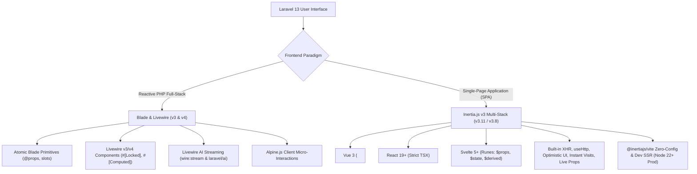
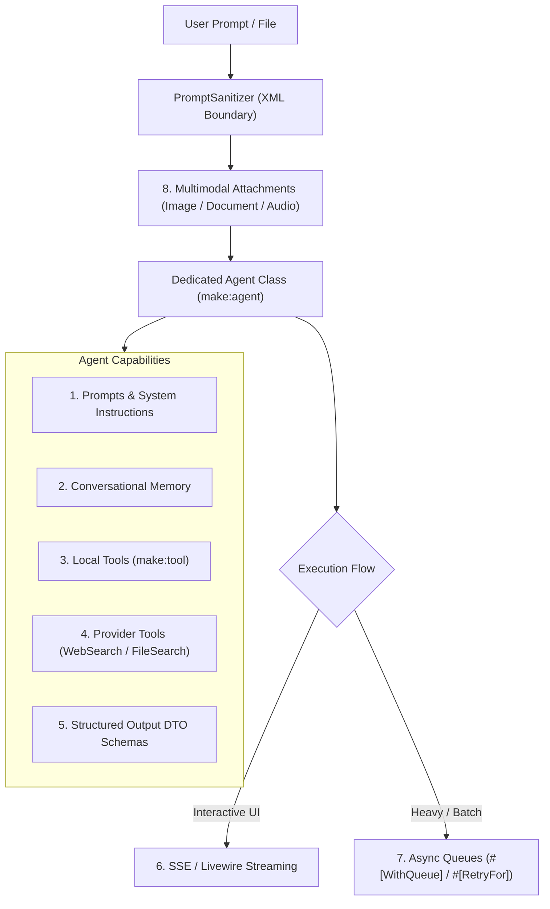
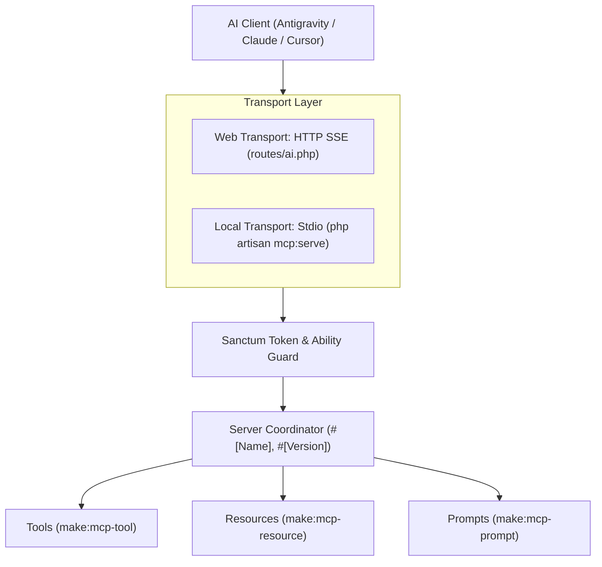
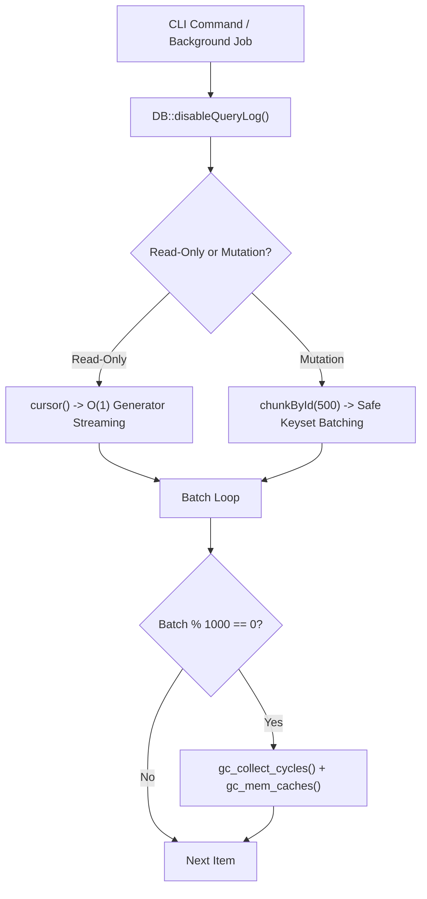

<p align="center">
  
</p>

<h1 align="center">Laravel 13 &amp; Modern PHP 8.5+ / 8.6+ Antigravity Plugin</h1>

<p align="center">
  <a href="https://github.com/shamimwhois/laravel-13-plugin"></a>
  <a href="https://github.com/shamimwhois/laravel-13-plugin/releases"></a>
  <a href="https://laravel.com"></a>
  <a href="https://php.net"></a>
  <a href="https://inertiajs.com"></a>
  <a href="https://pestphp.com"></a>
  <a href="https://phpstan.org"></a>
  <a href="https://modelcontextprotocol.io"></a>
  <a href="#license"></a>
</p>

<p align="center">
  An enterprise-grade architecture toolkit, autonomous agent skill pack, and real-time 19-point AppSec guard for building, modernizing, and auditing <strong>Laravel 13</strong>, <strong>PHP 8.5 / 8.6</strong>, and <strong>Inertia.js v3</strong> applications with Antigravity.
</p>

<p align="center">
  <a href="#quick-installation">Quick Start</a> ·
  <a href="#core-capabilities">Capabilities</a> ·
  <a href="#the-31-registered-skills">31 Skills</a> ·
  <a href="#the-26-always-on-rules">26 Rules</a> ·
  <a href="#the-28-master-architectural-guides">28 Guides</a> ·
  <a href="#full-stack-frontend-architecture">Frontend</a> ·
  <a href="#ai-sdk--model-context-protocol">AI &amp; MCP</a> ·
  <a href="#autonomous-subagents--active-security-hook">Security &amp; Agents</a> ·
  <a href="#directory-tree">Directory Tree</a> ·
  <a href="CHANGELOG.md">Changelog</a>
</p>

---

## At a Glance

| Component | Count | Highlights |
| :--- | :-: | :--- |
| **Registered Skills** | **31** | Progressive-disclosure playbooks covering PHP 8.5/8.6, Inertia v3, Livewire v3/v4, Security, Payments, DB, AI SDK & MCP |
| **Master Architectural Guides** | **28** | Deep-dive engineering blueprints with verified API synopses, Mermaid diagrams, and Pest 3 test suites |
| **Always-On Quality Rules** | **26** | Version-gated PHP 8.5/8.6 typing, Laravel 13 architecture, 19-point AppSec guardrails, and resilience rules |
| **Autonomous Agents & Guards** | **2 + Hook** | `laravel-architect` + `laravel-security-auditor` subagents, active `PreToolUse` write guard, and zero-dependency static scanner |

### Verified Stack Baseline (`v3.2.0`)

| Layer | Verified Target |
| :--- | :--- |
| **Backend** | Laravel `13.x` · PHP `8.5.0 GA` & `8.6.0 GA` · PHPStan / Larastan Level 8 / `max` · Pest 3 |
| **Frontend SPAs** | **Inertia.js v3** (`@inertiajs/* v3.11.0`, `inertiajs/inertia-laravel v3.8.0`) · Vue 3 · **React 19+** · **Svelte 5+** (Runes) · Vite 7/8 · Node 22+ SSR |
| **Server-Driven UI** | Blade Components (`@props`, `<x-inertia::head>`, `<x-inertia::app />`) · Livewire `v3 / v4` (`#[Locked]`, `wire:stream`) · Alpine.js |
| **AI & Security** | `laravel/ai` · `laravel/mcp` · Merged 19-point [`laravel-security-guard`](https://github.com/shamimwhois/laravel-security-guard) + TLS guard |

> **What's New in `v3.2.0` & `v3.1.0`** ([Full Changelog](CHANGELOG.md)):
> - **`v3.2.0` — Inertia.js v3 (`v3.11.0` / `inertia-laravel v3.8.0`)**: `@inertiajs/vite` zero-config & Dev SSR, built-in XHR client & `http` interceptors (Axios removed), `useHttp()`, Optimistic Updates, Instant Visits, Layout Props (`setLayoutProps`), `<Form>` with built-in Precognition, `Inertia::optional()`, `Inertia::defer(..., rescue: true)`, `Inertia::live()` (`PrivateChannel` + `configureEcho`), `QUERY` method, `<InfiniteScroll>`, `<WhenMounted>`, `Inertia::handleExceptionsUsing()`, and `<x-inertia::head>` / `<x-inertia::app />`.
> - **`v3.1.0` — Verified PHP 8.5.0 GA & PHP 8.6.0 GA**: Complete syntax & cumulative `8.4 → 8.5 → 8.6` migration guide (PFA `?`/`...`, `clamp()`, Readonly defaults, `#[Override]` on constants/enum cases, `Time\Duration`, global `SortDirection`, `Io\Poll\Context`, `StreamErrorMode::Exception`, Parameter DocComments, Pipe `|>`, `clone($obj, [...])`, `#[NoDiscard]` + `(void)`, `Uri\Rfc3986\Uri` / `Uri\WhatWg\Url`, Sodium IPcrypt/XOF/PQ-KEM) and repo-wide zero-inline-backslash hygiene.

---

## Quick Installation

### 1. Global Machine-Local Installation
Applies automatically across all Antigravity workspaces on your machine:

```powershell
# Windows (PowerShell)
git clone https://github.com/shamimwhois/laravel-13-plugin.git "$env:USERPROFILE\.gemini\config\plugins\laravel"
```

```bash
# macOS / Linux
git clone https://github.com/shamimwhois/laravel-13-plugin.git ~/.gemini/config/plugins/laravel
```

### 2. Workspace / Team-Shared Installation
Commit into your repository so every engineer and agent shares the exact same rules, skills, and hooks:

```bash
mkdir -p .agents/plugins
git clone https://github.com/shamimwhois/laravel-13-plugin.git .agents/plugins/laravel
git add .agents/plugins/laravel
git commit -m "chore: add Laravel 13 & Modern PHP 8.5+/8.6+ Antigravity plugin"
```

### 3. Run the Bundled 19-Point Static Security Scanner
Zero dependencies — works immediately on any Laravel repository or CI gate:

```bash
node ~/.gemini/config/plugins/laravel/skills/laravel-security-guard/scripts/laravel-security-scan.mjs /path/to/laravel-app --fail-on-high
```

---

## Core Capabilities

| Pillar | What the Plugin Enforces & Scaffolds |
| :--- | :--- |
| **Modern PHP 8.5 & 8.6 GA** | `declare(strict_types=1);`, zero inline leading backslashes, version-gated PHP 8.6 PFA (`?`/`...`), `clamp()`, Readonly defaults, `#[Override]` on props/constants/enum cases, `Time\Duration`, `SortDirection`, `Io\Poll\*`, `StreamErrorMode::Exception`, PHP 8.5 `|>`, `clone($obj, [...])`, `#[NoDiscard]` + `(void)`, `Uri\*`, and `8.4 → 8.5 → 8.6` deprecation hygiene. |
| **Inertia.js v3, Livewire & Design Craft** | Inertia v3 (`@inertiajs/vite` Dev SSR, built-in XHR, `useHttp()`, Optimistic Updates, Instant Visits, Layout Props, `<Form>` Precognition, Live Props), Blade/Livewire v3–v4 (`#[Locked]`, `wire:stream`), strict **4-tier frontend directory scoping**, and anti-AI-slop design craft (Impeccable, Taste Skill, Hallmark). |
| **19-Point Security Guard & Resilience** | Active `PreToolUse` write guard (`hooks.json`), static scanner, `laravel-security-auditor`, all 19 OWASP/Laravel vulnerability classes + TLS checks, unified `bootstrap/app.php` + `Inertia::handleExceptionsUsing()`, RFC 7807 Problem Details, `400`–`504` error pages, HTTP/HTTPS transport components, `Idempotency-Key`, Circuit Breakers, and `failover` cache stores. |
| **First-Party AI SDK & MCP** | Complete `laravel/ai` architecture (Prompts, Context, Tools, Provider Tools, `HasStructuredOutput`, `JsonSchema::rules()`, SSE Streaming, Queues, Multimodal Attachments, XML prompt injection guards) and `laravel/mcp` servers (Tools, Resources, Prompts, Web SSE, stdio). |
| **Fintech Payments & Database Design** | Top 10 payment gateways (Stripe, bKash Tokenized, Binance Pay Crypto, PayPal, Razorpay, Paddle, Mollie, Adyen, Square, SSLCommerz) with constant-time HMAC, replay defense ($\pm 300\text{s}$ + nonces), double-entry ledgers, payment FSMs, PHP 8 model attributes, ULIDs, ESR composite indexes, and `pgvector` HNSW. |
| **Architecture, Performance & Hygiene** | 6 base directory tree blueprints (Action-Driven, Service-Oriented, Modular Monolith, DDD, Hexagonal, CQRS), $O(1)$ `cursor()`/`chunkById()` memory safety, Octane concurrency safety, `#[WithQueue]`/`#[RetryFor]`, `Cache::flexible()`, and Rector/Pint/Pest 3 dead-code elimination. |

---

## The 31 Registered Skills

Every skill follows progressive disclosure — loaded on demand only when relevant to your task.

### Core Laravel 13, Modern PHP & Testing (9 Skills)

| # | Skill | Purpose |
| :-: | :--- | :--- |
| 1 | [`php-modern-syntax`](skills/php-modern-syntax/SKILL.md) | Verified PHP 8.5.0 GA & PHP 8.6.0 GA syntax, standard library APIs, and `8.4 → 8.5 → 8.6` deprecation checklists. |
| 2 | [`laravel-best-practices`](skills/laravel-best-practices/SKILL.md) | Request lifecycle, thin invokable controllers, Form Requests, Actions, API Resources, and Pest 3 testing. |
| 3 | [`laravel-controllers-and-middleware`](skills/laravel-controllers-and-middleware/SKILL.md) | Single-action `__invoke` controllers, fluent `bootstrap/app.php` middleware, and terminable middleware. |
| 4 | [`laravel-routing`](skills/laravel-routing/SKILL.md) | Canonical kebab-case URLs, dot-notation names, scoped bindings, `whereUlid`, and burst rate limiting. |
| 5 | [`laravel-api-design`](skills/laravel-api-design/SKILL.md) | RESTful HTTP semantics, RFC 7807 Problem Details, Sanctum token abilities, and `Idempotency-Key` protection. |
| 6 | [`laravel-scaffolding`](skills/laravel-scaffolding/SKILL.md) | End-to-end 6-layer feature blueprint (Migration → Model → Factory → Seeder → Controller/Request/Resource → Route). |
| 7 | [`artisan-make-commands`](skills/artisan-make-commands/SKILL.md) | Exhaustive catalog of 30+ `php artisan make:*` commands with modern PHP 8.5+/8.6+ stubs and flags. |
| 8 | [`phpstan-larastan`](skills/phpstan-larastan/SKILL.md) | PHPStan / Larastan Level 8 & `max` rules, generic Eloquent/Collection annotations, and CI enforcement. |
| 9 | [`pest-testing`](skills/pest-testing/SKILL.md) | Pest 3 feature tests, datasets, fakes, and architectural boundary enforcement (`arch()`). |

### Full-Stack Frontend, Inertia.js v3 & Design Craft (4 Skills)

| # | Skill | Purpose |
| :-: | :--- | :--- |
| 10 | [`laravel-inertia-spa`](skills/laravel-inertia-spa/SKILL.md) | **Inertia.js v3** (`v3.11` / `v3.8`) with Vue 3, React 19+, Svelte 5+, `@inertiajs/vite` Dev SSR, built-in XHR, `useHttp()`, Optimistic Updates, Instant Visits, Layout Props, `<Form>` Precognition & Live Props. |
| 11 | [`laravel-frontend-blade-livewire`](skills/laravel-frontend-blade-livewire/SKILL.md) | Atomic Blade components (`@props`, slots), Alpine.js, Livewire v3/v4 (`#[Locked]`, `#[Computed]`, Form Objects, `wire:stream`). |
| 12 | [`laravel-frontend-layouts-and-pages`](skills/laravel-frontend-layouts-and-pages/SKILL.md) | Canonical 4-tier directory scoping (`layouts/`, `components/app/*`, `components/ui/*`, `components/error/*`, `errors/`, `pages/*`). |
| 13 | [`laravel-frontend-design-craft`](skills/laravel-frontend-design-craft/SKILL.md) | Anti-AI-slop design craft (Impeccable, Taste Skill, Hallmark), Hero viewport invariant, asymmetric Bento grids & themed native surfaces. |

### 19-Point Security Guard, Error Handling & Resilience (7 Skills)

| # | Skill | Purpose |
| :-: | :--- | :--- |
| 14 | [`laravel-security-guard`](skills/laravel-security-guard/SKILL.md) | Master 19-point AppSec audit & hardening runbook with bundled static scanner (`laravel-security-scan.mjs`) and Pest 3 security tests. |
| 15 | [`laravel-injection-and-input-guard`](skills/laravel-injection-and-input-guard/SKILL.md) | Deep-dive defenses for SQLi, XSS, Path Traversal & Zip Slip, Command Injection, Deserialization/`phar://`, XXE, and SSTI. |
| 16 | [`laravel-auth-and-access-guard`](skills/laravel-auth-and-access-guard/SKILL.md) | Deep-dive defenses for CSRF, Broken Access Control / IDOR, Livewire `#[Locked]`, Mass Assignment, Open Redirect, and Broken Auth. |
| 17 | [`laravel-edge-and-supply-chain-guard`](skills/laravel-edge-and-supply-chain-guard/SKILL.md) | Deep-dive defenses for SSRF (DNS A+AAAA + IP pinning), Leaked Secrets, CVEs, Debug Mode, Clickjacking CSP, CORS, and HTTP Smuggling. |
| 18 | [`laravel-security-and-hardening`](skills/laravel-security-and-hardening/SKILL.md) | OWASP Top 10 hardening, `hash_equals()`, safe binary uploads, and cross-linked 19-point guard workflows. |
| 19 | [`laravel-error-handling-and-pages`](skills/laravel-error-handling-and-pages/SKILL.md) | `bootstrap/app.php` + `Inertia::handleExceptionsUsing()`, RFC 7807, `400`–`504` error pages, UI error components, and HTTP/HTTPS transport hooks (`networkError` / `httpException`). |
| 20 | [`laravel-request-and-cache-handling`](skills/laravel-request-and-cache-handling/SKILL.md) | `X-Request-Id` Context, `Idempotency-Key`, outbound `Http::` Circuit Breakers, `failover` cache store, `LockTimeoutException`, and HTTP cache headers. |

### AI SDK, Model Context Protocol & Console (3 Skills)

| # | Skill | Purpose |
| :-: | :--- | :--- |
| 21 | [`laravel-ai-sdk`](skills/laravel-ai-sdk/SKILL.md) | Official `laravel/ai` SDK: Prompts, Conversational Memory, Tools, Provider Tools, `HasStructuredOutput`, SSE Streaming, Queues, and Attachments. |
| 22 | [`laravel-mcp`](skills/laravel-mcp/SKILL.md) | Official `laravel/mcp` server architecture: Tools, Resources, Prompts, Web SSE (`routes/ai.php`), Sanctum auth, and stdio transport. |
| 23 | [`laravel-console-and-scheduling`](skills/laravel-console-and-scheduling/SKILL.md) | `#[AsCommand]`, `Isolatable` overlap prevention, Laravel Prompts, `DB::disableQueryLog()`, and `routes/console.php` schedules. |

### Architecture, Database, Payments, Performance & Hygiene (8 Skills)

| # | Skill | Purpose |
| :-: | :--- | :--- |
| 24 | [`architectural-decision-matrix`](skills/architectural-decision-matrix/SKILL.md) | Evaluates Top 10 architecture patterns (Action-Driven, Service-Oriented, Modular Monolith, DDD, Hexagonal, CQRS). |
| 25 | [`laravel-project-structure`](skills/laravel-project-structure/SKILL.md) | Canonical folder blueprints, namespace mappings, and Pest 3 `tests/Arch/` boundary suites across 6 architectures. |
| 26 | [`laravel-database-architecture`](skills/laravel-database-architecture/SKILL.md) | Schema design, PHP 8 model attributes, ULID PKs, explicit FK cascades, Leftmost Prefix / ESR indexes, and `pgvector` HNSW. |
| 27 | [`laravel-eloquent-orm`](skills/laravel-eloquent-orm/SKILL.md) | `#[Table]`, `#[Fillable]`, `#[Hidden]`, `#[UseEloquentBuilder]`, typed relationship generics, strict eager loading, and vector search. |
| 28 | [`laravel-payment-gateways`](skills/laravel-payment-gateways/SKILL.md) | Multi-driver fintech architecture for Top 10 gateways (Stripe, bKash, Binance Pay, PayPal, Razorpay, etc.), double-entry ledgers, FSMs & PCI-DSS. |
| 29 | [`laravel-performance-and-caching`](skills/laravel-performance-and-caching/SKILL.md) | Redis/Valkey `igbinary` + `zstd` compression, `Cache::flexible()` SWR, `Cache::touch()`, atomic locks, and cached repositories. |
| 30 | [`laravel-memory-safety`](skills/laravel-memory-safety/SKILL.md) | Octane concurrency safety, $O(1)$ `cursor()` streaming, `chunkById()` mutations, `WeakMap` caches, and worker recycling. |
| 31 | [`laravel-dead-code-elimination`](skills/laravel-dead-code-elimination/SKILL.md) | Eradicating unused imports, dead classes, commented-out code, unused Composer packages, and legacy Laravel skeleton files. |

---

## The 26 Always-On Rules

Automatically enforced across every generation, edit, and code review via [`rules/AGENTS.md`](rules/AGENTS.md):

| Group | Rules Enforced |
| :--- | :--- |
| **1–11 · PHP Typing, Laravel Core & Testing** | **1.** Strict typing (`declare(strict_types=1);`), zero inline backslashes, version-gated PHP 8.5/8.6 syntax · **2.** Thin controllers, mandatory Form Requests (`JsonSchema::rules()`), `JsonResource` · **3.** Canonical kebab-case/dot-notation routing · **4.** Strict RESTful HTTP semantics + RFC 7807 · **5.** Eloquent PHP 8 attributes & `casts(): array` · **6.** Anonymous typed migrations, ULIDs, explicit FKs · **7.** Idempotent factories & seeders · **8.** Strict eager loading (`preventLazyLoading`) · **9.** PHPStan Level 8 / `max` · **10.** Declarative `#[WithQueue]`, `#[RetryFor]`, `Cache::flexible()` & atomic locks · **11.** Pest 3 `arch()` tests. |
| **12–17 · Memory, Security, AI, CLI & ACID** | **12.** $O(1)$ `cursor()` / `chunkById()` & Octane state safety · **13.** 19-point Laravel Security Guard + strict outbound TLS · **14.** `laravel/ai` encapsulated agents, `<user_input>` boundaries & `Agent::fake()` · **15.** `laravel/mcp` canonical `app/Mcp/` & Sanctum-guarded SSE · **16.** `#[AsCommand]`, `Isolatable`, `DB::disableQueryLog()` · **17.** `DB::transaction(..., attempts: 3)`, `lockForUpdate()`, zero external HTTP inside transactions, `DB::afterCommit()`. |
| **18–20 · Frontend, Directory Scoping & Hygiene** | **18.** Blade `@props`, Livewire v3/v4 `#[Locked]`/`wire:stream`, **Inertia.js v3** (`@inertiajs/vite` Dev SSR, built-in XHR, `useHttp()`, Optimistic UI, `<Form>` Precognition, `Inertia::optional()`/`live()`, Vue 3 / React 19+ / Svelte 5+) · **19.** 4-tier frontend directory organization (`layouts/`, `components/app/*`, `components/ui/*`, `pages/*`) · **20.** Zero dead code, zero commented-out code, delete legacy `Kernel.php`/`Handler.php` skeletons. |
| **21–26 · Architecture, Fintech, DB & Resilience** | **21.** Standardized architectural directory trees + `tests/Arch/` · **22.** Fintech payment security (`hash_equals()`, $\pm 300\text{s}$ replay guard, integer cents, ledger & FSM) · **23.** Schema design, ULID PKs, FK cascades, ESR indexes & `pgvector` · **24.** Anti-AI-slop craft (Hero viewport invariant, no cliché gradients/eyebrows/3-card dumps, themed browser surfaces) · **25.** Unified error handling (`withExceptions()` + `Inertia::handleExceptionsUsing()`), `400`–`504` pages & HTTP/HTTPS transport components · **26.** Inbound `X-Request-Id`/`Idempotency-Key`, outbound `Http::` Circuit Breakers, authoritative idempotency store & `failover` cache. |

---

## The 28 Master Architectural Guides

Located in [`docs/architecture/`](docs/architecture/) (plus [`docs/Route.md`](docs/Route.md), [`docs/api/design.md`](docs/api/design.md), [`docs/testing/assertions.md`](docs/testing/assertions.md), and [`docs/testing/database-testing.md`](docs/testing/database-testing.md)):

### Modern PHP, Core Architecture & Code Craft (10 Guides)
| # | Guide | Focus |
| :-: | :--- | :--- |
| 1 | [`php-8-6-modern-syntax-and-migration.md`](docs/architecture/php-8-6-modern-syntax-and-migration.md) | Complete PHP 8.5.0 GA & PHP 8.6.0 GA syntax, standard library synopses, engine optimizations & `8.4 → 8.5 → 8.6` runbook. |
| 2 | [`Architectural.md`](docs/architecture/Architectural.md) | Executive decision matrix across Top 10 software architecture patterns. |
| 3 | [`patterns.md`](docs/architecture/patterns.md) | Deep blueprints for Action-Driven, Service-Oriented, Modular Monolith, DDD, Hexagonal & CQRS. |
| 4 | [`project-directory-tree-patterns.md`](docs/architecture/project-directory-tree-patterns.md) | Canonical directory trees, namespace maps, and Pest 3 boundary suites. |
| 5 | [`controllers-and-middleware.md`](docs/architecture/controllers-and-middleware.md) | Single-action invokables (`__invoke`), fluent `bootstrap/app.php` middleware & terminables. |
| 6 | [`routing.md`](docs/architecture/routing.md) | Master Laravel 13 routing styles, prefixes, constraints & throttling. |
| 7 | [`enums.md`](docs/architecture/enums.md) | Domain backed enums, PHP 8.6 global `SortDirection`, `__debugInfo(): array`, `#[Override]` & FSMs. |
| 8 | [`clean-code-and-concerns.md`](docs/architecture/clean-code-and-concerns.md) | DRY traits (`app/Concerns/`), immutable DTOs (`clone($obj, [...])`), PFA pipelines & Pint. |
| 9 | [`oop-pillars-and-organization.md`](docs/architecture/oop-pillars-and-organization.md) | Modern OOP pillars, Composition over Inheritance & domain folder layout. |
| 10 | [`namespace-import-class-standards.md`](docs/architecture/namespace-import-class-standards.md) | PSR-4, explicit top-level root imports, zero inline backslashes & Parameter DocComments. |

### Frontend, Inertia.js v3 & Design Craft (4 Guides)
| # | Guide | Focus |
| :-: | :--- | :--- |
| 11 | [`inertia-and-frontend-stacks.md`](docs/architecture/inertia-and-frontend-stacks.md) | **Inertia.js v3** (`v3.11.0` / `v3.8.0`) with Vue 3, React 19+, Svelte 5+, `@inertiajs/vite` Dev SSR, Built-in XHR, `useHttp()`, Optimistic Updates, Live Props & v2 → v3 runbook. |
| 12 | [`blade-and-livewire.md`](docs/architecture/blade-and-livewire.md) | Blade components, slots, Alpine.js, Livewire v3/v4 & `wire:stream` AI streaming. |
| 13 | [`frontend-layouts-components-and-pages.md`](docs/architecture/frontend-layouts-components-and-pages.md) | 4-tier frontend hierarchy, multi-tenant layout isolation & SVG icon primitives. |
| 14 | [`frontend-design-craft-and-anti-ai-slop.md`](docs/architecture/frontend-design-craft-and-anti-ai-slop.md) | Anti-AI-slop rules, surface modes (`Persuade`/`Operate`/`Read`/`Experience`), Hero invariant & Impeccable CLI audits. |

### Security, Error Handling, Resilience & Maintenance (7 Guides)
| # | Guide | Focus |
| :-: | :--- | :--- |
| 15 | [`error-handling-pages-and-components.md`](docs/architecture/error-handling-pages-and-components.md) | `bootstrap/app.php` + `Inertia::handleExceptionsUsing()`, RFC 7807, `400`–`504` pages & HTTP/HTTPS transport components. |
| 16 | [`request-and-cache-resilience.md`](docs/architecture/request-and-cache-resilience.md) | Inbound `X-Request-Id` / `Idempotency-Key`, outbound `Http::` Circuit Breakers, `failover` cache & `LockTimeoutException`. |
| 17 | [`security-and-hacker-protection.md`](docs/architecture/security-and-hacker-protection.md) | OWASP Top 10 defenses, SSRF IP pinning, constant-time crypto & hardened uploads. |
| 18 | [`cve-management.md`](docs/architecture/cve-management.md) | Supply-chain scanning (`composer audit`, OSV-Scanner, Semgrep) & CVSS remediation SLAs. |
| 19 | [`caching-and-performance.md`](docs/architecture/caching-and-performance.md) | Redis `igbinary` + `zstd` compression, `Cache::flexible()` SWR & Cached Repository Decorators. |
| 20 | [`memory-safety-and-performance.md`](docs/architecture/memory-safety-and-performance.md) | Octane concurrency, $O(1)$ `cursor()` streaming, `WeakMap` caches & worker recycling. |
| 21 | [`codebase-organization-and-maintenance.md`](docs/architecture/codebase-organization-and-maintenance.md) | Exception hierarchy, `app/Support/` replacing `helpers.php` & model pruning. |

### Database, Fintech, AI SDK, MCP, CLI & Refactoring (7 Guides)
| # | Guide | Focus |
| :-: | :--- | :--- |
| 22 | [`database-schema-design-and-indexing.md`](docs/architecture/database-schema-design-and-indexing.md) | Schema attributes, ULID PKs, FK cascades, Leftmost Prefix / ESR indexes & `pgvector` HNSW. |
| 23 | [`database-transactions-and-concurrency.md`](docs/architecture/database-transactions-and-concurrency.md) | ACID boundaries, deadlock retries (`attempts: 3`), canonical `lockForUpdate()` & `afterCommit`. |
| 24 | [`payment-gateways-and-fintech-integrations.md`](docs/architecture/payment-gateways-and-fintech-integrations.md) | Top 10 payment gateways, HMAC replay defense, double-entry ledger, payment FSM & Pest 3 tests. |
| 25 | [`ai-sdk-and-llm-integration.md`](docs/architecture/ai-sdk-and-llm-integration.md) | First-party `laravel/ai` SDK architecture & 8 Core Pillars. |
| 26 | [`mcp-and-ai-protocols.md`](docs/architecture/mcp-and-ai-protocols.md) | First-party Model Context Protocol (`laravel/mcp`) server & client architecture. |
| 27 | [`console-commands-and-scheduling.md`](docs/architecture/console-commands-and-scheduling.md) | `Isolatable` commands, Laravel Prompts, memory protection & `routes/console.php`. |
| 28 | [`senior-developer-code-review-and-refactoring.md`](docs/architecture/senior-developer-code-review-and-refactoring.md) | Dead code purging, guard-clause flattening, Rector automation & code smells. |

---

## Full-Stack Frontend Architecture



### Canonical 4-Tier Frontend Directory Standard

| Tier | Directory | Purpose | Canonical Examples |
| :--- | :--- | :--- | :--- |
| **Tier 1 · Layouts** | `layouts/` | Master application shells | `layouts/app`, `layouts/auth`, `layouts/customer`, `layouts/admin`, `layouts/error` |
| **Tier 2 · Domain Chrome** | `components/app/<domain>/` | Scoped navigation chrome | `admin/`, `customer/`, `auth/`, `public/` (`header`, `nav`, `footer`, `sidebar`) |
| **Tier 3 · UI & Error Primitives** | `components/{ui,error,icon}/` | Design tokens, transport errors & SVG icons | `ui/` (`button`, `input`, `modal`, `table`), `error/` (`http-status`, `https-transport`), `icon/` |
| **Tier 4 · Feature Pages** | `pages/<domain>/<feature>/` | Concrete page entrypoints mapped 1:1 to routes | `pages/admin/dashboard/index`, `pages/errors/Index`, `pages/home/index` |

---

## AI SDK & Model Context Protocol

### First-Party AI SDK (`laravel/ai`) — 8 Core Pillars



### Model Context Protocol (`laravel/mcp`) — Dual Transports



---

## High-Throughput & Memory Safety Standards



---

## Autonomous Subagents & Active Security Hook

1. **[`laravel-architect`](agents/laravel-architect.md)**: Principal architect auditing 6-layer feature harmony, version-gated PHP 8.5/8.6 syntax, Inertia.js v3, error/request/cache resilience, `laravel/mcp`, `laravel/ai`, console concurrency, ACID transactions, and PHPStan Level 8 / `max`.
2. **[`laravel-security-auditor`](agents/laravel-security-auditor.md)**: Dedicated AppSec auditor executing the 19-point vulnerability runbook, running the static scanner + `composer audit`, implementing hardened remediations, and writing Pest 3 regression suites.
3. **Active `PreToolUse` Security Write Guard** ([`hooks.json`](hooks.json) + [`scripts/pre-write-guard.mjs`](scripts/pre-write-guard.mjs)): Automatically inspects edits to Laravel `.php`, `.blade.php`, `.env*`, and proxy `.conf` files before writing and prompts for confirmation on high-confidence hazards across all 19 vulnerability classes plus disabled TLS (`withoutVerifying()`, `verify => false`, `CURLOPT_SSL_VERIFYPEER => false`).

---

## Directory Tree

<details>
<summary>Expand full plugin repository tree (31 skills · 28 guides · 2 agents · active hook &amp; scanner)</summary>

```text
~/.gemini/config/plugins/laravel/
├── plugin.json
├── hooks.json
├── README.md
├── CHANGELOG.md
├── .github/
│   └── pull_request_template.md
├── assets/
│   ├── banner.png
│   └── logo.svg
├── scripts/
│   └── pre-write-guard.mjs
├── agents/
│   ├── laravel-architect.md
│   └── laravel-security-auditor.md
├── rules/
│   └── AGENTS.md
├── docs/
│   ├── Route.md
│   ├── api/
│   │   └── design.md
│   ├── testing/
│   │   ├── assertions.md
│   │   └── database-testing.md
│   └── architecture/
│       ├── Architectural.md
│       ├── ai-sdk-and-llm-integration.md
│       ├── blade-and-livewire.md
│       ├── caching-and-performance.md
│       ├── clean-code-and-concerns.md
│       ├── codebase-organization-and-maintenance.md
│       ├── console-commands-and-scheduling.md
│       ├── controllers-and-middleware.md
│       ├── cve-management.md
│       ├── database-schema-design-and-indexing.md
│       ├── database-transactions-and-concurrency.md
│       ├── enums.md
│       ├── error-handling-pages-and-components.md
│       ├── frontend-design-craft-and-anti-ai-slop.md
│       ├── frontend-layouts-components-and-pages.md
│       ├── inertia-and-frontend-stacks.md
│       ├── mcp-and-ai-protocols.md
│       ├── memory-safety-and-performance.md
│       ├── namespace-import-class-standards.md
│       ├── oop-pillars-and-organization.md
│       ├── patterns.md
│       ├── payment-gateways-and-fintech-integrations.md
│       ├── php-8-6-modern-syntax-and-migration.md
│       ├── project-directory-tree-patterns.md
│       ├── request-and-cache-resilience.md
│       ├── routing.md
│       ├── security-and-hacker-protection.md
│       └── senior-developer-code-review-and-refactoring.md
└── skills/
    ├── architectural-decision-matrix/SKILL.md
    ├── artisan-make-commands/SKILL.md
    ├── laravel-ai-sdk/SKILL.md
    ├── laravel-api-design/SKILL.md
    ├── laravel-auth-and-access-guard/SKILL.md
    ├── laravel-best-practices/SKILL.md
    ├── laravel-console-and-scheduling/SKILL.md
    ├── laravel-controllers-and-middleware/SKILL.md
    ├── laravel-database-architecture/SKILL.md
    ├── laravel-dead-code-elimination/SKILL.md
    ├── laravel-edge-and-supply-chain-guard/SKILL.md
    ├── laravel-eloquent-orm/SKILL.md
    ├── laravel-error-handling-and-pages/SKILL.md
    ├── laravel-frontend-blade-livewire/SKILL.md
    ├── laravel-frontend-design-craft/SKILL.md
    ├── laravel-frontend-layouts-and-pages/SKILL.md
    ├── laravel-inertia-spa/SKILL.md
    ├── laravel-injection-and-input-guard/SKILL.md
    ├── laravel-mcp/SKILL.md
    ├── laravel-memory-safety/SKILL.md
    ├── laravel-payment-gateways/SKILL.md
    ├── laravel-performance-and-caching/SKILL.md
    ├── laravel-project-structure/SKILL.md
    ├── laravel-request-and-cache-handling/SKILL.md
    ├── laravel-routing/SKILL.md
    ├── laravel-scaffolding/SKILL.md
    ├── laravel-security-and-hardening/SKILL.md
    ├── laravel-security-guard/
    │   ├── SKILL.md
    │   ├── references/pest-security-tests.md
    │   └── scripts/laravel-security-scan.mjs
    ├── pest-testing/SKILL.md
    ├── php-modern-syntax/SKILL.md
    └── phpstan-larastan/SKILL.md
```

</details>

---

## License

This open-source plugin is released under the **MIT License**. See [CHANGELOG.md](CHANGELOG.md) for full release history. Contributions, issues, and feature requests are welcome on [GitHub](https://github.com/shamimwhois/laravel-13-plugin).
