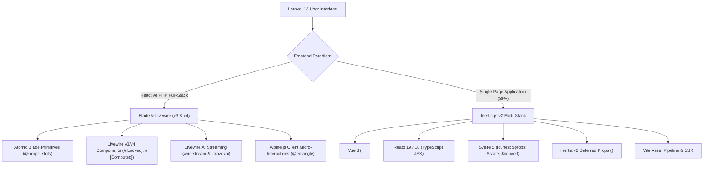
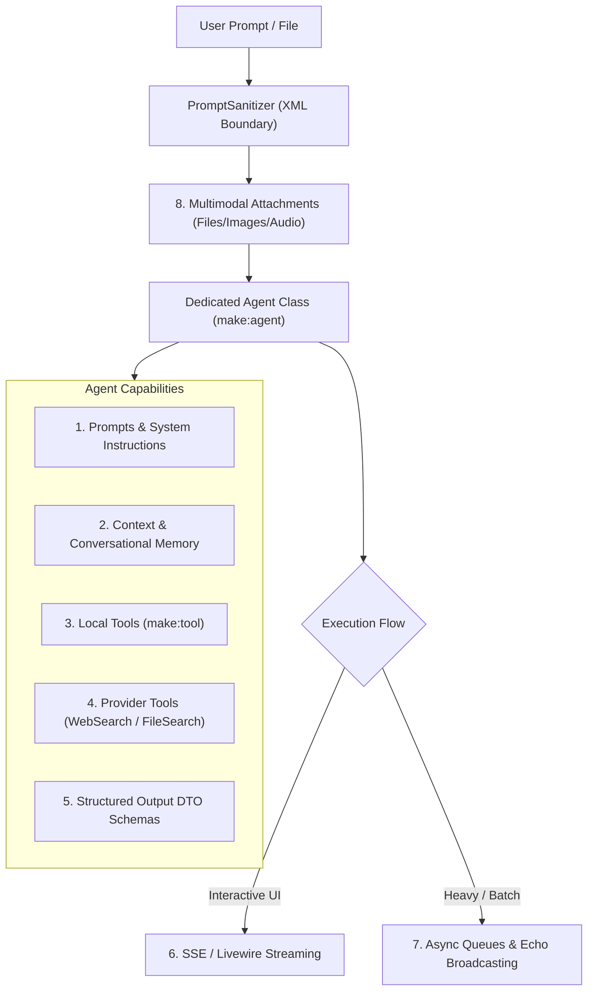
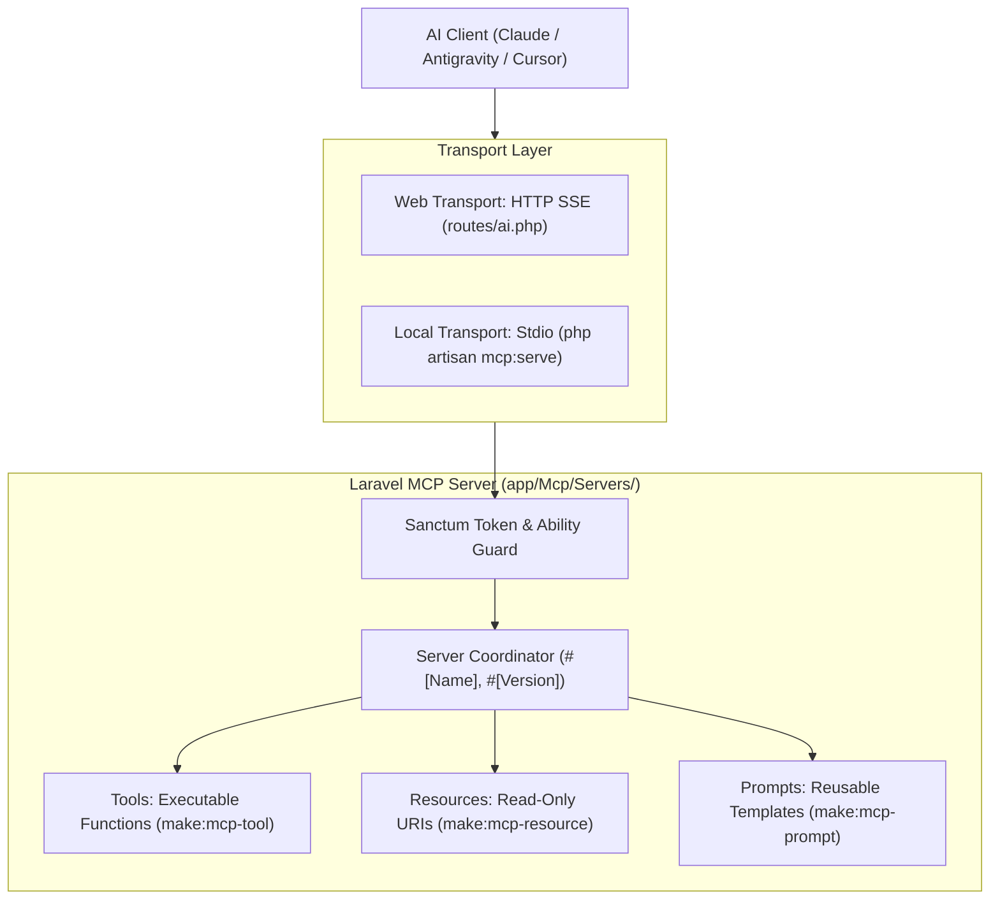
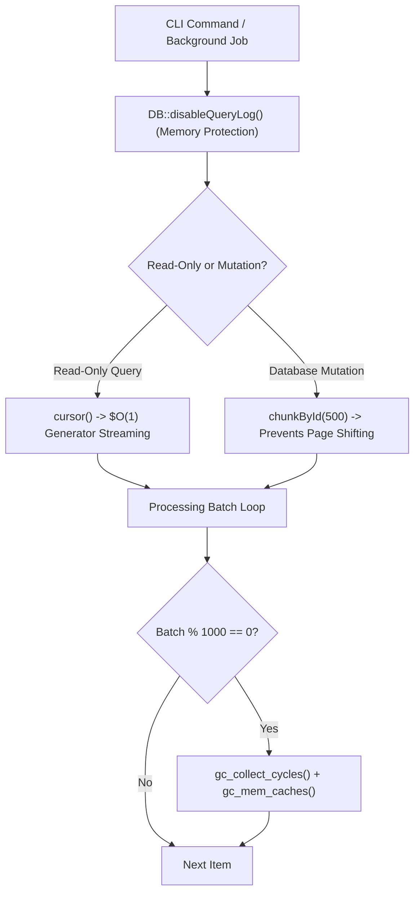

# Laravel 13 & Modern PHP 8.6+ Antigravity Plugin

[](https://github.com/shamimwhois/laravel-13-plugin)
[](https://github.com/shamimwhois/laravel-13-plugin/releases)
[](LICENSE)
[](https://laravel.com)
[](https://php.net)
[](https://pestphp.com)
[](https://phpstan.org)
[](https://modelcontextprotocol.io)

An enterprise-grade, comprehensive toolkit, architectural framework, and autonomous agent skill pack for developing, refactoring, and architecting modern PHP (**PHP 8.4, PHP 8.5 & PHP 8.6+**) and **Laravel 13** applications with the Antigravity AI assistant.

---

## 📑 Table of Contents

- [Executive Overview](#-executive-overview)
- [Quick Installation](#-quick-installation)
  - [1. Global Machine-Local Installation](#1-global-machine-local-installation)
  - [2. Workspace / Team-Shared Installation](#2-workspace--team-shared-installation)
- [The 22 Registered Skills](#-the-22-registered-skills)
- [The 21 Always-On Quality & Security Rules](#-the-21-always-on-quality--security-rules)
- [The 22 Master Architectural Guides](#-the-22-master-architectural-guides)
- [Full-Stack Frontend Architecture (Blade, Livewire, Inertia.js v2)](#-full-stack-frontend-architecture-blade-livewire-inertiajs-v2)
  - [The Canonical 4-Tier Frontend Directory Standard](#-the-canonical-4-tier-frontend-directory-standard)
- [First-Party AI SDK (`laravel/ai`) - The 8 Core Pillars](#-first-party-ai-sdk-laravelai---the-8-core-pillars)
- [Model Context Protocol (`laravel/mcp`) Architecture](#-model-context-protocol-laravelmcp-architecture)
- [High-Throughput & Memory Safety Standards](#-high-throughput--memory-safety-standards)
- [Dedicated Autonomous Subagent (`laravel-architect`)](#-dedicated-autonomous-subagent-laravel-architect)
- [Directory Tree](#-directory-tree)
- [License](#-license)

---

## 🌟 Executive Overview

This plugin transforms the Antigravity AI assistant into an expert **Principal Laravel 13 & PHP 8.6+ Software Architect**. It provides:

- **Architectural Base Directory Blueprints**: Production-grade folder hierarchy standards for Action-Driven Monoliths, Modular Monoliths, Domain-Driven Design (DDD), Hexagonal (Ports & Adapters), and CQRS architectures with Pest 3 boundary tests.
- **Strict Modern PHP 8.6+ Syntax**: Enforces `declare(strict_types=1);`, Partial Function Application (`?`), native `clamp()`, `#[Override]` on class constants, Readonly property defaults, `Time\Duration`, pipe operators (`|>`), `clone $obj with (...)`, and `#[\NoDiscard]`.
- **4-Tier Frontend Directory Organization**: Strict separation of Layouts (`app`, `admin`, `customer`, `auth`), Domain Chrome (`components/app/*`), UI Primitives (`components/ui/*`, `icon/*`), and Pages (`pages/*`) across Blade, Livewire, Vue 3, React 19, and Svelte 5.
- **JSON Schema Validation (`JsonSchema::rules()`)**: Bridges `laravel/ai` and `laravel/mcp` tool parameter schemas directly into native Laravel validation rules without duplicating constraints.
- **Declarative Queue Attributes (`#[RetryFor]`)**: Declares job and listener retry windows cleanly via PHP attributes (`#[RetryFor(hours: 4)]`), eliminating legacy `retryUntil()` boilerplate.
- **Full-Stack Frontend Architecture**: Server-rendered Blade components, Alpine.js, Livewire v3 & v4 reactive state, and `wire:stream` real-time AI token streaming.
- **Inertia.js v2 SPAs**: Multi-stack Single-Page Applications with Vue 3 (TypeScript), React 19/18 (TypeScript), and Svelte 5 (Runes), leveraging Deferred Props (`Inertia::defer`), prefetching, and Vite SSR.
- **First-Party AI Integration**: Complete support for `composer require laravel/ai` (Prompts, Context, Tools, Provider Tools, Structured Outputs, SSE Streaming, Async Queues, and Attachments).
- **First-Party Model Context Protocol**: Complete support for `composer require laravel/mcp` (Servers, Tools, Resources, Prompts, Web SSE, and stdio transports).
- **Zero N+1 Queries & Memory Safety**: $O(1)$ database streaming with `cursor()`, mutation chunking with `chunkById()`, WeakMap caching, and query log deactivation (`DB::disableQueryLog()`).
- **Ruthless Dead Code Elimination & Hygiene**: Automated eradication of unused imports, dead methods/classes, commented-out logic, orphaned routes/views, and legacy skeleton files with Rector (`SetList::DEAD_CODE`), Laravel Pint (`no_unused_imports`), `composer-unused`, and Pest 3 boundary enforcement.
- **Enterprise Security & Concurrency**: 2026 CVE supply-chain management, OWASP Top 10 mitigation, SSRF defense, constant-time cryptography, and ACID deadlock recovery (`attempts: 3`).

---

## 🚀 Quick Installation

### 1. Global Machine-Local Installation
Applies across all projects opened in Antigravity on your machine:

```bash
# Windows (PowerShell)
git clone https://github.com/shamimwhois/laravel-13-plugin.git "$env:USERPROFILE\.gemini\config\plugins\laravel"

# macOS / Linux
git clone https://github.com/shamimwhois/laravel-13-plugin.git ~/.gemini/config/plugins/laravel
```

### 2. Workspace / Team-Shared Installation
Checked directly into your repository so everyone on your engineering team shares identical skills and rules:

```bash
mkdir -p .agents/plugins
git clone https://github.com/shamimwhois/laravel-13-plugin.git .agents/plugins/laravel
git add .agents/plugins/laravel
git commit -m "chore: add Laravel 13 & Modern PHP 8.5+ Antigravity plugin"
```

---

## 🧩 The 22 Registered Skills

Every skill adheres to progressive disclosure—loaded into context only when needed:

| # | Skill Name | Path | Primary Purpose |
| :-: | :--- | :--- | :--- |
| **1** | **`architectural-decision-matrix`** | [`skills/architectural-decision-matrix/SKILL.md`](skills/architectural-decision-matrix/SKILL.md) | Evaluates Top 10 patterns (MVC, Action-Driven, Modular Monolith, DDD, Hexagonal, CQRS). |
| **2** | **`artisan-make-commands`** | [`skills/artisan-make-commands/SKILL.md`](skills/artisan-make-commands/SKILL.md) | Catalog of all 30+ `make:*` generator commands with PHP 8.5+ stubs & options. |
| **3** | **`laravel-ai-sdk`** | [`skills/laravel-ai-sdk/SKILL.md`](skills/laravel-ai-sdk/SKILL.md) | Official `laravel/ai` SDK: Prompts, Context, Tools, Streaming, and Attachments. |
| **4** | **`laravel-api-design`** | [`skills/laravel-api-design/SKILL.md`](skills/laravel-api-design/SKILL.md) | Production RESTful API design, RFC 7807 problem details, Sanctum token abilities, idempotency. |
| **5** | **`laravel-best-practices`** | [`skills/laravel-best-practices/SKILL.md`](skills/laravel-best-practices/SKILL.md) | Request lifecycle, Actions, Form Requests, thin controllers, and Pest 3 tests. |
| **6** | **`laravel-console-and-scheduling`** | [`skills/laravel-console-and-scheduling/SKILL.md`](skills/laravel-console-and-scheduling/SKILL.md) | `make:command`, `Isolatable` overlap locking, Prompts, $O(1)$ memory safety, `routes/console.php`. |
| **7** | **`laravel-controllers-and-middleware`** | [`skills/laravel-controllers-and-middleware/SKILL.md`](skills/laravel-controllers-and-middleware/SKILL.md) | Single-Action Invokables (`__invoke`), fluent middleware in `bootstrap/app.php`, terminables. |
| **8** | **`laravel-dead-code-elimination`** | [`skills/laravel-dead-code-elimination/SKILL.md`](skills/laravel-dead-code-elimination/SKILL.md) | Purge dead code, zombie logic, unused imports, unused composer packages, and legacy skeleton files via Rector, Pint, & Pest 3. |
| **9** | **`laravel-eloquent-orm`** | [`skills/laravel-eloquent-orm/SKILL.md`](skills/laravel-eloquent-orm/SKILL.md) | PHP 8 attributes, custom query builders, casts, AI vector similarity search. |
| **10** | **`laravel-frontend-blade-livewire`** | [`skills/laravel-frontend-blade-livewire/SKILL.md`](skills/laravel-frontend-blade-livewire/SKILL.md) | Blade component architecture, slots, Alpine.js, Livewire v3/v4 reactive state, `wire:stream` AI token streaming, `#[Locked]` tampering defense. |
| **11** | **`laravel-frontend-layouts-and-pages`** | [`skills/laravel-frontend-layouts-and-pages/SKILL.md`](skills/laravel-frontend-layouts-and-pages/SKILL.md) | Standardized 4-tier directory hierarchy (`layouts/`, `components/app/*`, `components/ui/*`, `pages/*`) across Blade, Livewire, Vue 3, React 19, Svelte 5. |
| **12** | **`laravel-inertia-spa`** | [`skills/laravel-inertia-spa/SKILL.md`](skills/laravel-inertia-spa/SKILL.md) | Inertia.js v2 SPAs with Vue 3 (TS), React 19/18 (TS), Svelte 5 (Runes), Deferred Props (`Inertia::defer`), and Vite SSR. |
| **13** | **`laravel-mcp`** | [`skills/laravel-mcp/SKILL.md`](skills/laravel-mcp/SKILL.md) | Official `laravel/mcp`: Tools, Resources, Prompts, Web SSE, and stdio transports. |
| **14** | **`laravel-memory-safety`** | [`skills/laravel-memory-safety/SKILL.md`](skills/laravel-memory-safety/SKILL.md) | Octane concurrency safety, $O(1)$ cursor streaming, WeakMap caching, worker recycling. |
| **15** | **`laravel-performance-and-caching`** | [`skills/laravel-performance-and-caching/SKILL.md`](skills/laravel-performance-and-caching/SKILL.md) | Redis compression (`igbinary`, `zstd`), `Cache::flexible()` stampede defense, locks. |
| **16** | **`laravel-project-structure`** | [`skills/laravel-project-structure/SKILL.md`](skills/laravel-project-structure/SKILL.md) | Architectural base directory tree patterns (Action-Driven, Modular, DDD, Hexagonal, CQRS) & Pest 3 Arch tests. |
| **17** | **`laravel-routing`** | [`skills/laravel-routing/SKILL.md`](skills/laravel-routing/SKILL.md) | 5 routing styles: Invokable mapping, grouping, scoped bindings, `whereUlid`, rate limiting. |
| **18** | **`laravel-scaffolding`** | [`skills/laravel-scaffolding/SKILL.md`](skills/laravel-scaffolding/SKILL.md) | End-to-end blueprint for scaffolding all 6 layers of a feature (Migration $\rightarrow$ Route). |
| **19** | **`laravel-security-and-hardening`** | [`skills/laravel-security-and-hardening/SKILL.md`](skills/laravel-security-and-hardening/SKILL.md) | OWASP Top 10 defense, SSRF private IP filters, `hash_equals()`, safe uploads, IDOR. |
| **20** | **`pest-testing`** | [`skills/pest-testing/SKILL.md`](skills/pest-testing/SKILL.md) | Pest 3 test suite: feature tests, architectural boundary tests (`arch()`), fakes. |
| **21** | **`php-modern-syntax`** | [`skills/php-modern-syntax/SKILL.md`](skills/php-modern-syntax/SKILL.md) | PHP 8.6 Partial Function Application (`?`), `clamp()`, `#[Override]` on constants, Readonly defaults, `Time\Duration`, PHP 8.5 pipe operator (`\|>`), `#[NoDiscard]`. |
| **22** | **`phpstan-larastan`** | [`skills/phpstan-larastan/SKILL.md`](skills/phpstan-larastan/SKILL.md) | PHPStan Level 8 / max configuration, generic Eloquent typing, CI workflows. |

---

## 🛡️ The 21 Always-On Quality & Security Rules

All agent interactions automatically enforce the strict standards codified in [`rules/AGENTS.md`](rules/AGENTS.md):

1. **Strict Typing & Modern Syntax**: `declare(strict_types=1);` mandatory. Explicit top-level imports; zero inline leading backslashes (`\App\...`). Mark classes `final` by default. Promoted constructor properties. PHP 8.6 Partial Function Application (`?`), native `clamp()`, Readonly property defaults, and `#[Override]` on class constants.
2. **Thin Controllers**: No business logic or queries in controllers. Mandatory Form Requests (`app/Http/Requests`). Use `JsonSchema::rules()` to dynamically derive validation rules from schemas without duplicated constraints. API Resources (`JsonResource`) mandatory for all responses.
3. **Canonical Routing**: Kebab-case URLs (`/user-profiles`), dot notation names (`admin.users.index`), plural resources, singular parameters (`{user}`).
4. **RESTful Semantics**: `POST` $\rightarrow$ 201 Created; `PUT`/`PATCH` $\rightarrow$ 200 OK; `DELETE` $\rightarrow$ 204 No Content; Validation failure $\rightarrow$ 422 with RFC 7807 problem details.
5. **Eloquent Model Attributes**: Use `#[Table]`, `#[Fillable]`, `#[Hidden]`, and `#[UseEloquentBuilder]`. Method-based attribute casts (`casts(): array`).
6. **Anonymous Migrations**: `return new class extends Migration`. Typed blueprints, ULIDs/UUIDs, explicit cascades, and composite indexes.
7. **Idempotent Factories & Seeders**: Realistic defaults via `fake()`. Explicit state methods. Never loop queries in seeders.
8. **Strict Eager Loading**: Zero N+1 queries. Global enforcement of `Model::preventLazyLoading(!app()->isProduction())`.
9. **PHPStan Level 8 / Max**: 100% parameter and return type declarations. Generic annotations for Collections (`Collection<int, Model>`) and Builders (`Builder<Model>`).
10. **Queues, Caching & Events**: Declare queue configurations with `#[WithQueue]` and declarative retry windows with `#[RetryFor(hours: ...)]` (prohibiting legacy `retryUntil()` methods). Atomic distributed locks (`Cache::lock`). Stale-While-Revalidate caching via `Cache::flexible()`.
11. **Pest 3 Architecture Testing**: Boundary tests verifying controllers are invokable and models extend Eloquent.
12. **Memory Safety & Streaming**: $O(1)$ cursor streaming via generators (`cursor()`), mutation chunking (`chunkById()`), Octane state safety, and streaming file downloads.
13. **Security Hardening**: PDO parameter bindings, whitelisted dynamic order columns, SSRF private IP validation, constant-time `hash_equals()`, and MIME magic bytes inspection.
14. **Laravel AI SDK Standards**: Encapsulated Agent classes, scoped conversation memory, typed tool schemas with `JsonSchema::rules()` validation, structured output DTOs, SSE streaming, XML prompt injection boundaries (`<user_input>`), and Pest fakes (`Agent::fake()`).
15. **Model Context Protocol Standards**: Canonical `app/Mcp/` directories, `routes/ai.php` web SSE routing with Sanctum authentication, stdio CLI execution, and typed tool schemas validated with `JsonSchema::rules()`.
16. **Console Commands & Scheduling**: `#[AsCommand]` attributes, `implements Isolatable` to eliminate overlapping crons, `DB::disableQueryLog()` memory protection, and `laravel/prompts`.
17. **Database Transactions & Concurrency**: Mandatory `DB::transaction(..., attempts: 3)` with deadlock retry, pessimistic row locking (`lockForUpdate()`), **strict prohibition of external HTTP inside transactions**, and post-commit `afterCommit` hooks.
18. **Modern Frontend Architecture**: Blade components with `@props`, Livewire `#[Locked]` state tampering defense, Form Objects, `wire:stream` AI token streaming, Alpine.js micro-interactions, Inertia v2 Deferred Props (`Inertia::defer`), Vue 3 / React TypeScript interfaces, Svelte 5 Runes, and Pest 3 component assertions.
19. **Canonical Frontend Directory Organization**: Strict 4-tier directory scoping across Blade, Livewire, and Inertia.js (`layouts/`, `components/app/<domain>/`, `components/ui/`, `components/icon/`, `pages/<domain>/<feature>/index`), total prohibition of view root sprawl, and controller dot-notation resolution (`view('pages.admin.dashboard.index')` / `Inertia::render('admin/dashboard/Index')`).
20. **Dead Code Elimination, Zombie Logic Hunting & Codebase Hygiene**: Zero tolerance for commented-out code, unused `use` imports (`laravel/pint`), and unused Composer dependencies (`composer-unused`). Immediate deletion of legacy Laravel skeleton files (`app/Http/Kernel.php`, `app/Console/Kernel.php`, `app/Exceptions/Handler.php`, `app/Providers/RouteServiceProvider.php`). Automated dead code purging with Rector `SetList::DEAD_CODE` and Pest 3 boundary tests forbidding legacy class revival.
21. **Architectural Base Project Directory Tree Patterns & Placement Guidelines**: Mandatory adherence to standardized architectural directory patterns (Action-Driven Monolith by default, Modular Monolith for multi-team platforms, DDD for core banking/fintech, Hexagonal for framework-agnostic engines). Strict canonical folder placement: actions in `app/Actions/<Domain>/`, immutable DTOs in `app/Data/<Domain>/`, query builders in `app/Builders/`, single-action invokables in `app/Http/Controllers/`, pure static helpers in `app/Support/`, first-party AI/MCP in `app/Ai/` and `app/Mcp/`, and 4-tier frontend scoping (`layouts/`, `components/app/<domain>/`, `components/ui/`, `components/icon/`, `pages/<domain>/<feature>/`). Mandatory Pest 3 architectural boundary tests in `tests/Arch/`.

---

## 📚 The 22 Master Architectural Guides

Located in [`docs/architecture/`](docs/architecture/):

1. **[`Architectural.md`](docs/architecture/Architectural.md)**: Executive Decision Matrix for the Top 10 Software Architecture Patterns.
2. **[`project-directory-tree-patterns.md`](docs/architecture/project-directory-tree-patterns.md)**: Standardized codebase directory blueprints, namespace mappings, boundary invariants, and Pest 3 boundary suites across Action-Driven, Modular Monolith, DDD, Hexagonal, and CQRS architectures.
3. **[`frontend-layouts-components-and-pages.md`](docs/architecture/frontend-layouts-components-and-pages.md)**: Standardized 4-tier frontend hierarchy, domain layout shells, UI design tokens, SVG icon primitives, and multi-tenant layout isolation.
4. **[`blade-and-livewire.md`](docs/architecture/blade-and-livewire.md)**: Server-rendered Blade components, slots, Alpine.js, Livewire v3/v4 reactive state, and `wire:stream` AI streaming.
5. **[`inertia-and-frontend-stacks.md`](docs/architecture/inertia-and-frontend-stacks.md)**: Inertia.js v2 SPAs with Vue 3 (TS), React 19/18 (TS), Svelte 5 (Runes), Deferred Props, and Vite SSR.
6. **[`ai-sdk-and-llm-integration.md`](docs/architecture/ai-sdk-and-llm-integration.md)**: First-party `laravel/ai` SDK architecture & 8 Core Pillars.
7. **[`mcp-and-ai-protocols.md`](docs/architecture/mcp-and-ai-protocols.md)**: First-party Model Context Protocol (`laravel/mcp`) server & client architecture.
8. **[`console-commands-and-scheduling.md`](docs/architecture/console-commands-and-scheduling.md)**: Concurrency isolation (`Isolatable`), Laravel Prompts, memory safety, and `routes/console.php`.
9. **[`database-transactions-and-concurrency.md`](docs/architecture/database-transactions-and-concurrency.md)**: ACID boundaries, deadlock retries, row locks, and `afterCommit` hooks.
10. **[`controllers-and-middleware.md`](docs/architecture/controllers-and-middleware.md)**: Single-Action Invokables (`__invoke`), fluent middleware in `bootstrap/app.php`, terminables.
11. **[`caching-and-performance.md`](docs/architecture/caching-and-performance.md)**: Redis compression (igbinary + zstd), `Cache::flexible()`, and Cached Repositories.
12. **[`memory-safety-and-performance.md`](docs/architecture/memory-safety-and-performance.md)**: Octane concurrency, $O(1)$ cursor streaming, WeakMap caching, worker recycling.
13. **[`security-and-hacker-protection.md`](docs/architecture/security-and-hacker-protection.md)**: OWASP Top 10 defenses, SSRF IP filtering, timing attacks, and hardened file uploads.
14. **[`cve-management.md`](docs/architecture/cve-management.md)**: 2026 CVE scanning (`composer audit`, OSV-Scanner, Semgrep), CVSS SLAs, and supply chain security.
15. **[`clean-code-and-concerns.md`](docs/architecture/clean-code-and-concerns.md)**: DRY principles, trait organization (`app/Concerns/`), DTOs, and Pint formatting.
16. **[`oop-pillars-and-organization.md`](docs/architecture/oop-pillars-and-organization.md)**: OOP 4 pillars, Composition over Inheritance, domain directory architecture.
17. **[`namespace-import-class-standards.md`](docs/architecture/namespace-import-class-standards.md)**: PSR-4, explicit root class imports, zero inline backslashes, Pint rules.
18. **[`enums.md`](docs/architecture/enums.md)**: Domain-based backed enums, state transitions, traits, and `php artisan make:enum`.
19. **[`codebase-organization-and-maintenance.md`](docs/architecture/codebase-organization-and-maintenance.md)**: Exception handling, replacing `helpers.php` with `app/Support/`, model pruning.
20. **[`senior-developer-code-review-and-refactoring.md`](docs/architecture/senior-developer-code-review-and-refactoring.md)**: Dead code purging, arrow-code flattening, Rector automation, code smells.
21. **[`routing.md`](docs/architecture/routing.md)**: Master routing patterns, prefixes, and constraints in Laravel 13.
22. **[`patterns.md`](docs/architecture/patterns.md)**: Detailed blueprints for Modular Monolith, DDD, Hexagonal, and CQRS.

---

## 🎨 Full-Stack Frontend Architecture (Blade, Livewire, Inertia.js v2)

The plugin supports two modern, production-grade frontend paradigms:



- **Blade & Alpine.js**: Reusable UI primitives (`resources/views/components/`) using `@props` and `$attributes->class()`.
- **Livewire v3 & v4**: Server-driven reactivity with Form Objects (`Livewire\Form`), `#[Locked]` state tampering defense, and `wire:stream` real-time token streaming with `laravel/ai`.
- **Inertia.js v2**: Single-Page Applications with zero client-side routing boilerplate:
  - **Vue 3**: Composition API with `<script setup lang="ts">`, typed props, and `<Deferred>`.
  - **React 19 / 18**: Hooks, `useForm()`, TypeScript JSX, and `<Deferred>`.
  - **Svelte 5**: Modern reactive Runes (`let { user }: Props = $props();`, `$state()`, `$derived()`).
  - **Performance**: Deferred Props (`Inertia::defer()`), prefetching, and Server-Side Rendering (SSR).

### 📂 The Canonical 4-Tier Frontend Directory Standard

All frontend assets in Laravel 13 (Blade/Livewire in `resources/views/` and Inertia in `resources/js/`) are strictly partitioned into 4 distinct tiers:

| Tier | Directory | Purpose | Canonical Examples |
| :--- | :--- | :--- | :--- |
| **Tier 1: Layouts** | `layouts/` | Master application shells | `layouts/app.blade.php`, `layouts/auth.blade.php`, `layouts/customer.blade.php`, `layouts/admin.blade.php` |
| **Tier 2: Domain Chrome** | `components/app/<domain>/` | Scoped navigation chrome | `admin/` (`header`, `nav`, `footer`, `sidebar`), `customer/` (`header`, `nav`, `footer`, `sidebar`), `auth/` (`header`, `nav`, `footer`), `public/` (`header`, `nav`, `footer`) |
| **Tier 3: UI Primitives** | `components/ui/` & `icon/` | Reusable design tokens & SVG glyphs | `ui/` (`button`, `input`, `modal`, `card`, `badge`, `table`, `dropdown`), `icon/` (`search`, `user`, `chevron-down`, `check`, `alert-circle`) |
| **Tier 4: Feature Pages** | `pages/<domain>/<feature>/` | Concrete page entrypoints matching controllers 1:1 | `pages/admin/dashboard/index`, `pages/customer/dashboard/index`, `pages/home/index` |

---

## 🤖 First-Party AI SDK (`laravel/ai`) - The 8 Core Pillars



1. **Prompts**: Dedicated Agent classes implementing `Laravel\Ai\Contracts\Agent` using `Promptable`.
2. **Context**: Multi-turn chat memory persisted via `RemembersConversations` and `Conversational`.
3. **Tools**: Local application function calling scaffolded with `php artisan make:tool`.
4. **Provider Tools**: Cloud-side provider tools (`WebSearch`, `WebFetch`, `FileSearch`, `CodeExecution`).
5. **Structured Output**: `HasStructuredOutput` schemas hydrated into PHP 8.5+ immutable DTOs (`final readonly class`).
6. **Streaming**: Real-time token streaming with `stream()` via SSE, Livewire, or Vercel Data Protocol.
7. **Async Queues**: Heavy model executions pushed to queues (`#[WithQueue]`) with exponential retry backoff.
8. **Attachments**: Multimodal inputs with `Laravel\Ai\Files\Image`, `Document`, and `Audio`.

---

## 🔌 Model Context Protocol (`laravel/mcp`) Architecture



- **Tools**: Callable functions defining parameter schemas with `schema(JsonSchema $schema)` and executed via `handle()`.
- **Resources**: Read-only contextual URIs implementing `HasUriTemplate` (e.g. `orders://{id}/details`).
- **Prompts**: Standardized conversation templates for repeatable prompt engineering.
- **Dual Transports**: Web SSE registered in `routes/ai.php` via `Mcp::web()`, and stdio CLI via `php artisan mcp:serve`.

---

## ⚡ High-Throughput & Memory Safety Standards



- **Query Logging**: Always disable SQL query logging (`DB::disableQueryLog()`) in batch CLI commands to eliminate memory bloat.
- **Safe Database Streaming**: Never use `Model::all()` or `$query->get()`. Use `$query->cursor()` for read streaming or `$query->chunkById()` for updates.
- **Octane Concurrency**: Zero request-scoped state stored in static properties or singletons; use `WeakMap` for garbage-collectible caches.

---

## 🤖 Dedicated Autonomous Subagent (`laravel-architect`)

The plugin includes a dedicated autonomous subagent (`agents/laravel-architect.md`) that you can invoke for deep architectural audits:

```bash
# Example user prompt triggering the subagent:
"Audit my checkout flow using the laravel-architect subagent"
```

The architect audits:
- Feature layer harmony (Migration $\rightarrow$ Route).
- Model Context Protocol (`laravel/mcp`) server and tool schemas.
- Autonomous agent guardrails & prompt injection boundaries (`laravel/ai`).
- Console command concurrency isolation (`Isolatable`) and memory leaks.
- Database transaction boundaries, deadlock retries, and lock ordering.
- AppSec, OWASP Top 10, SSRF defenses, and supply chain CVEs.
- PHPStan Level 8 / max type coverage.

---

## 📂 Directory Tree

```text
~/.gemini/config/plugins/laravel/
├── plugin.json
├── README.md
├── agents/
│   └── laravel-architect.md
├── rules/
│   └── AGENTS.md
├── docs/
│   ├── Route.md
│   ├── api/
│   │   └── design.md
│   ├── testing/
│   │   ├── assertions.md
│   │   └── database-testing.md
│   └── architecture/
│       ├── routing.md
│       ├── patterns.md
│       ├── Architectural.md
│       ├── clean-code-and-concerns.md
│       ├── oop-pillars-and-organization.md
│       ├── namespace-import-class-standards.md
│       ├── enums.md
│       ├── codebase-organization-and-maintenance.md
│       ├── senior-developer-code-review-and-refactoring.md
│       ├── memory-safety-and-performance.md
│       ├── caching-and-performance.md
│       ├── security-and-hacker-protection.md
│       ├── cve-management.md
│       ├── controllers-and-middleware.md
│       ├── ai-sdk-and-llm-integration.md
│       ├── mcp-and-ai-protocols.md
│       ├── console-commands-and-scheduling.md
│       ├── database-transactions-and-concurrency.md
│       ├── blade-and-livewire.md
│       ├── inertia-and-frontend-stacks.md
│       ├── frontend-layouts-components-and-pages.md
│       └── project-directory-tree-patterns.md
└── skills/
    ├── architectural-decision-matrix/SKILL.md
    ├── artisan-make-commands/SKILL.md
    ├── laravel-ai-sdk/SKILL.md
    ├── laravel-api-design/SKILL.md
    ├── laravel-best-practices/SKILL.md
    ├── laravel-console-and-scheduling/SKILL.md
    ├── laravel-controllers-and-middleware/SKILL.md
    ├── laravel-dead-code-elimination/SKILL.md
    ├── laravel-eloquent-orm/SKILL.md
    ├── laravel-frontend-blade-livewire/SKILL.md
    ├── laravel-frontend-layouts-and-pages/SKILL.md
    ├── laravel-inertia-spa/SKILL.md
    ├── laravel-mcp/SKILL.md
    ├── laravel-memory-safety/SKILL.md
    ├── laravel-performance-and-caching/SKILL.md
    ├── laravel-project-structure/SKILL.md
    ├── laravel-routing/SKILL.md
    ├── laravel-scaffolding/SKILL.md
    ├── laravel-security-and-hardening/SKILL.md
    ├── pest-testing/SKILL.md
    ├── php-modern-syntax/SKILL.md
    └── phpstan-larastan/SKILL.md
```

---

## 📄 License

This open-source plugin is licensed under the [MIT License](LICENSE). Contributions, issues, and feature requests are welcome on [GitHub](https://github.com/shamimwhois/laravel-13-plugin).
