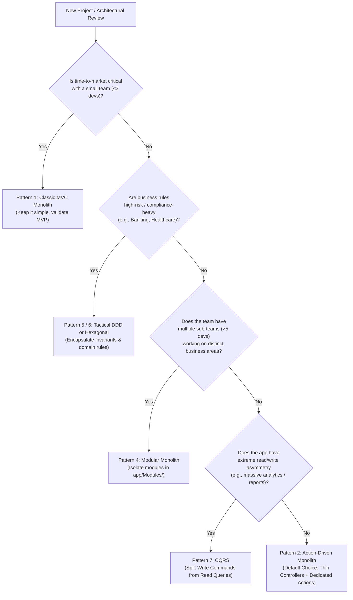
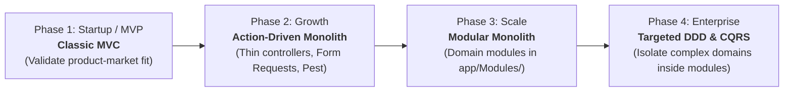

# Laravel 13 — Architectural Decision Matrix (`Architectural.md`)

> **Document**: `docs/architecture/Architectural.md`  
> **Target Framework**: Laravel 13 (PHP 8.5+)  
> **Purpose**: Systematic evaluation, tradeoff analysis, and decision framework for enterprise software architecture patterns.

---

## 1. Executive Architectural Decision Matrix

This matrix evaluates the **Top 10 Architectural Patterns** across 9 critical software engineering dimensions:

| # | Architecture Pattern | Complexity | Velocity (TTM) | Maintainability | Testability | Blast Radius | Team Size | Scalability | Best Fit |
| :- | :--- | :--- | :--- | :--- | :--- | :--- | :--- | :--- | :--- |
| **1** | **Classic MVC Monolith** | ⭐ (1/5) | ⭐⭐⭐⭐⭐ (5/5) | ⭐⭐ (2/5) | ⭐⭐ (2/5) | High (Entire App) | 1 – 3 devs | Low | MVPs, proof-of-concepts, simple CRUD. |
| **2** | **Action-Driven Monolith** | ⭐⭐ (2/5) | ⭐⭐⭐⭐⭐ (5/5) | ⭐⭐⭐⭐⭐ (5/5) | ⭐⭐⭐⭐⭐ (5/5) | Medium | 2 – 8 devs | High | **Recommended Standard** for most SaaS apps. |
| **3** | **Service-Layer Monolith** | ⭐⭐⭐ (3/5) | ⭐⭐⭐⭐ (4/5) | ⭐⭐⭐ (3/5) | ⭐⭐⭐⭐ (4/5) | Medium | 3 – 10 devs | Medium | Multi-step 3rd-party integrations (Stripe, CRM). |
| **4** | **Modular Monolith** | ⭐⭐⭐ (3/5) | ⭐⭐⭐⭐ (4/5) | ⭐⭐⭐⭐⭐ (5/5) | ⭐⭐⭐⭐⭐ (5/5) | Low (Per Module) | 5 – 25 devs | Very High | **Recommended Enterprise** for scaling platforms. |
| **5** | **Tactical DDD** | ⭐⭐⭐⭐⭐ (5/5) | ⭐⭐ (2/5) | ⭐⭐⭐⭐⭐ (5/5) | ⭐⭐⭐⭐⭐ (5/5) | Isolated | 8 – 30+ devs | Maximum | High-risk financial, healthcare, core calculations. |
| **6** | **Hexagonal (Ports/Adapters)**| ⭐⭐⭐⭐ (4/5) | ⭐⭐⭐ (3/5) | ⭐⭐⭐⭐⭐ (5/5) | ⭐⭐⭐⭐⭐ (5/5) | Isolated | 5 – 20 devs | High | Framework-agnostic engines, multi-driver tools. |
| **7** | **CQRS Architecture** | ⭐⭐⭐⭐ (4/5) | ⭐⭐⭐ (3/5) | ⭐⭐⭐⭐ (4/5) | ⭐⭐⭐⭐ (4/5) | Medium | 5 – 20 devs | Maximum | Asymmetric read/write workloads (20:1 reads). |
| **8** | **Event-Driven (EDA)** | ⭐⭐⭐⭐ (4/5) | ⭐⭐⭐ (3/5) | ⭐⭐⭐⭐ (4/5) | ⭐⭐⭐⭐ (4/5) | Very Low | 5 – 25 devs | Maximum | Asynchronous pipelines, webhooks, audit trails. |
| **9** | **Clean / Onion Architecture** | ⭐⭐⭐⭐⭐ (5/5) | ⭐⭐ (2/5) | ⭐⭐⭐⭐⭐ (5/5) | ⭐⭐⭐⭐⭐ (5/5) | Isolated | 5 – 20 devs | High | Strict compliance, multi-delivery channels (API/CLI). |
| **10**| **Local Package (Mono-repo)** | ⭐⭐⭐⭐ (4/5) | ⭐⭐⭐ (3/5) | ⭐⭐⭐⭐ (4/5) | ⭐⭐⭐⭐⭐ (5/5) | Low (Per Package)| 10 – 50+ devs| Very High | Shared corporate libraries across multiple apps. |

---

## 2. Interactive Decision Tree: Which Architecture to Choose?

Follow this decision tree to identify the optimal architecture based on your application's constraints:

---

## 3. Deep Architectural Evaluation Profiles

### 1. Classic MVC Monolith
- **When to Choose**: Prototypes, hackathons, internal utilities, team of 1–2 developers.
- **When to Avoid**: When business logic exceeds basic CRUD; when multiple developers commit to the same controllers simultaneously.
- **Tradeoff**: Immediate delivery velocity at the expense of long-term maintainability.

### 2. Action-Driven Monolith (Recommended Default)
- **When to Choose**: 90% of standard web and SaaS applications.
- **When to Avoid**: When code reuse across separate applications requires independent composer versioning.
- **Tradeoff**: Generates more files, but yields near-zero controller maintenance overhead and straightforward Pest unit testing.

### 3. Service-Layer Monolith
- **When to Choose**: Workflows coordinating multiple third-party services (e.g., Stripe, SendGrid, Twilio, Shipping carriers).
- **When to Avoid**: Simple CRUD features where services become redundant pass-through wrappers.
- **Tradeoff**: Centralizes complex external workflows, but risks creating bloated "God Services" if boundaries are not enforced.

### 4. Modular Monolith (Recommended Enterprise)
- **When to Choose**: Large-scale applications with multiple distinct business domains (Orders, Identity, Billing, Inventory) managed by 5–25 developers.
- **When to Avoid**: Small applications where creating separate module folders adds unnecessary cognitive overhead.
- **Tradeoff**: Offers the clean domain boundaries of microservices without the operational tax (no network latency, no distributed transactions, no Kubernetes overhead).

### 5. Domain-Driven Design (Tactical DDD)
- **When to Choose**: High-complexity business domains where domain logic must remain pure and free from framework lock-in.
- **When to Avoid**: Standard CRUD applications; teams unfamiliar with DDD aggregate and entity patterns.
- **Tradeoff**: High upfront cognitive load and boilerplate, in exchange for impenetrable business rule invariants.

### 6. Hexagonal Architecture (Ports & Adapters)
- **When to Choose**: Applications that must run seamlessly against multiple drivers (e.g., SQLite in testing, DynamoDB in production, CLI and REST delivery).
- **When to Avoid**: Rapidly evolving applications where database schemas change daily.
- **Tradeoff**: Complete infrastructure decoupling, but requires writing extensive interface (port) and adapter mapping layers.

### 7. CQRS Architecture
- **When to Choose**: Systems where read traffic dwarfs write traffic (20:1+), requiring specialized read databases or pre-aggregated projections.
- **When to Avoid**: Standard transactional applications where synchronous immediate consistency is required.
- **Tradeoff**: Unmatched read query performance, balanced against eventual consistency synchronization complexity.

### 8. Event-Driven Architecture (EDA)
- **When to Choose**: Systems requiring asynchronous task processing, external webhooks, audit trails, or loose inter-system coupling.
- **When to Avoid**: Linear synchronous user journeys requiring instant atomic feedback.
- **Tradeoff**: Extreme decoupling, but requires distributed tracing tools to debug asynchronous message failures.

### 9. Clean / Onion Architecture
- **When to Choose**: Enterprise systems with strict corporate architectural compliance policies and multi-decade lifespans.
- **When to Avoid**: Fast-paced startup environments leveraging Laravel's rapid application development features.
- **Tradeoff**: Framework agnosticism, but directly resists Laravel's ActiveRecord ergonomics.

### 10. Local Package Architecture
- **When to Choose**: Corporate mono-repos where multiple distinct Laravel applications share core private business libraries.
- **When to Avoid**: Single standalone applications.
- **Tradeoff**: Physical isolation enforced by Composer, but introduces local dependency resolution maintenance.

---

## 4. The Pragmatic Evolution Pathway

Do not over-engineer prematurely. Enterprise architectures should evolve naturally as team size and business complexity demand:

---

## 5. Team Topology & Conway's Law Mapping

According to **Conway's Law**, software architecture inevitably mirrors the communication structure of the organization:

| Team Structure | Engineering Organization | Recommended Architectural Pattern |
| :--- | :--- | :--- |
| **Solo Founder / Duo** | 1–2 Fullstack Developers | **Action-Driven Monolith** (Speed + Maintainability) |
| **Single Agile Squad** | 3–6 Developers, 1 Product Manager | **Action-Driven Monolith** with Form Requests & DTOs |
| **Multiple Feature Squads** | 2–5 Squads (10–25 Devs) split by domain | **Modular Monolith** (`app/Modules/{Domain}`) |
| **Cross-Functional Business Units** | Separate teams (Identity, Checkout, Logistics) | **Modular Monolith** or **Local Packages** |
| **Enterprise Platform & Core Teams** | Dedicated Core Team + Multiple Consumer Apps | **DDD / Hexagonal Core** with **Local Packages** |

---

### Reference Links
- 🏛️ **Architecture Patterns Deep Dive**: [docs/architecture/patterns.md](file:///C:/Users/SHAMIM.IT/.gemini/config/plugins/laravel/docs/architecture/patterns.md)
- 🌐 **Enterprise Modular Routing**: [docs/architecture/routing.md](file:///C:/Users/SHAMIM.IT/.gemini/config/plugins/laravel/docs/architecture/routing.md)
- 📄 **Route Implementation Guide**: [docs/Route.md](file:///C:/Users/SHAMIM.IT/.gemini/config/plugins/laravel/docs/Route.md)
- 👉 **[Open Plugin Settings](customization://laravel)**
