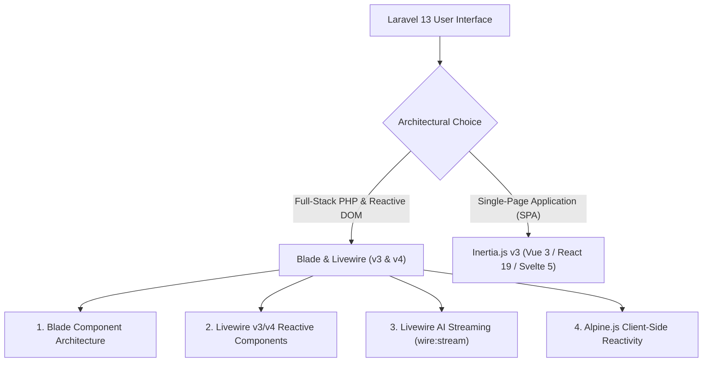

# Laravel 13 & Modern PHP 8.5+ Blade & Livewire (v3 & v4) Architecture

This document defines the enterprise frontend architecture for building server-rendered, component-driven, and full-stack reactive user interfaces using modern Blade and **Livewire (v3 & v4)** in Laravel 13.

---

## 1. Executive Frontend Stack Decision Matrix

Laravel offers two primary modern frontend paradigms:



---

## 2. Modern Blade Component Architecture

Modern Blade promotes atomic, reusable, testable components using attribute bags, slots, and `@props`.

### 2.1 Anatomy of a Production Blade Component (`resources/views/components/input.blade.php`)

```blade
@props([
    'disabled' => false,
    'label' => null,
    'error' => null,
    'name' => null,
    'id' => null,
])

@php
    $inputId = $id ?? $name ?? 'input-' . str()->random(8);
@endphp

<div {{ $attributes->only('class')->class(['space-y-1.5']) }}>
    @if ($label)
        <label for="{{ $inputId }}" class="block text-sm font-medium text-slate-700 dark:text-slate-200">
            {{ $label }}
            @if ($attributes->has('required'))
                <span class="text-rose-500">*</span>
            @endif
        </label>
    @endif

    <div class="relative rounded-md shadow-sm">
        <input
            id="{{ $inputId }}"
            name="{{ $name }}"
            {{ $disabled ? 'disabled' : '' }}
            {{ $attributes->except('class')->class([
                'block w-full rounded-lg border px-3.5 py-2 text-sm shadow-xs transition duration-150 ease-in-out sm:text-sm',
                'border-slate-300 dark:border-slate-700 bg-white dark:bg-slate-900 text-slate-900 dark:text-slate-100 placeholder-slate-400 focus:border-indigo-500 focus:ring-2 focus:ring-indigo-500/20' => ! $error,
                'border-rose-500 text-rose-900 placeholder-rose-400 focus:border-rose-500 focus:ring-2 focus:ring-rose-500/20 dark:border-rose-500' => $error,
                'opacity-60 cursor-not-allowed bg-slate-100 dark:bg-slate-800' => $disabled,
            ]) }}
        />

        @if ($error)
            <div class="pointer-events-none absolute inset-y-0 right-0 flex items-center pr-3">
                <svg class="h-5 w-5 text-rose-500" viewBox="0 0 20 20" fill="currentColor">
                    <path fill-rule="evenodd" d="M18 10a8 8 0 11-16 0 8 8 0 0116 0zm-8-5a.75.75 0 01.75.75v4.5a.75.75 0 01-1.5 0v-4.5A.75.75 0 0110 5zm0 10a1 1 0 100-2 1 1 0 000 2z" clip-rule="evenodd" />
                </svg>
            </div>
        @endif
    </div>

    @if ($error)
        <p class="text-xs text-rose-600 dark:text-rose-400" id="{{ $inputId }}-error">{{ $error }}</p>
    @endif
</div>
```

### 2.2 Modal Component with Named & Scoped Slots (`resources/views/components/modal.blade.php`)

```blade
@props([
    'name',
    'show' => false,
    'maxWidth' => '2xl'
])

@php
$maxWidthClass = match ($maxWidth) {
    'sm' => 'sm:max-w-sm',
    'md' => 'sm:max-w-md',
    'lg' => 'sm:max-w-lg',
    'xl' => 'sm:max-w-xl',
    '2xl' => 'sm:max-w-2xl',
    default => 'sm:max-w-2xl',
};
@endphp

<div
    x-data="{ show: @js($show) }"
    x-on:open-modal.window="$event.detail == '{{ $name }}' ? show = true : null"
    x-on:close-modal.window="$event.detail == '{{ $name }}' ? show = false : null"
    x-on:keydown.escape.window="show = false"
    x-show="show"
    class="fixed inset-0 z-50 overflow-y-auto px-4 py-6 sm:px-0"
    style="display: none;"
>
    <!-- Backdrop with blur -->
    <div
        x-show="show"
        x-transition:enter="ease-out duration-300"
        x-transition:enter-start="opacity-0"
        x-transition:enter-end="opacity-100"
        x-transition:leave="ease-in duration-200"
        x-transition:leave-start="opacity-100"
        x-transition:leave-end="opacity-0"
        class="fixed inset-0 bg-slate-900/60 backdrop-blur-xs transition-opacity"
        x-on:click="show = false"
    ></div>

    <!-- Dialog Panel -->
    <div
        x-show="show"
        x-transition:enter="ease-out duration-300"
        x-transition:enter-start="opacity-0 translate-y-4 sm:translate-y-0 sm:scale-95"
        x-transition:enter-end="opacity-100 translate-y-0 sm:scale-100"
        x-transition:leave="ease-in duration-200"
        x-transition:leave-start="opacity-100 translate-y-0 sm:scale-100"
        x-transition:leave-end="opacity-0 translate-y-4 sm:translate-y-0 sm:scale-95"
        class="relative mb-6 transform rounded-xl bg-white dark:bg-slate-900 text-left shadow-2xl transition-all sm:my-8 sm:w-full {{ $maxWidthClass }} sm:mx-auto border border-slate-200 dark:border-slate-800"
    >
        @if (isset($title))
            <div class="border-b border-slate-200 dark:border-slate-800 px-6 py-4 flex items-center justify-between">
                <h3 class="text-base font-semibold text-slate-900 dark:text-slate-100">
                    {{ $title }}
                </h3>
                <button x-on:click="show = false" class="text-slate-400 hover:text-slate-500">
                    <span class="sr-only">Close</span>
                    <svg class="h-5 w-5" viewBox="0 0 20 20" fill="currentColor">
                        <path fill-rule="evenodd" d="M4.293 4.293a1 1 0 011.414 0L10 8.586l4.293-4.293a1 1 0 111.414 1.414L11.414 10l4.293 4.293a1 1 0 01-1.414 1.414L10 11.414l-4.293 4.293a1 1 0 01-1.414-1.414L8.586 10 4.293 5.707a1 1 0 010-1.414z" clip-rule="evenodd" />
                    </svg>
                </button>
            </div>
        @endif

        <div class="px-6 py-4">
            {{ $slot }}
        </div>

        @if (isset($footer))
            <div class="border-t border-slate-200 dark:border-slate-800 bg-slate-50 dark:bg-slate-800/50 px-6 py-3 rounded-b-xl flex justify-end gap-3">
                {{ $footer }}
            </div>
        @endif
    </div>
</div>
```

---

## 3. Livewire (v3 & v4) Reactive Component Architecture

Livewire components are PHP classes acting as full-stack reactive state coordinators without custom JavaScript API endpoints.

### 3.1 Livewire Component (`app/Livewire/Orders/OrderManager.php`)

```php
declare(strict_types=1);

namespace App\Livewire\Orders;

use App\Actions\Orders\CancelOrderAction;
use App\Models\Order;
use App\Models\User;
use Illuminate\Contracts\Pagination\LengthAwarePaginator;
use Illuminate\Contracts\View\View;
use Illuminate\Support\Facades\Auth;
use Livewire\Attributes\Computed;
use Livewire\Attributes\Lazy;
use Livewire\Attributes\Locked;
use Livewire\Attributes\Url;
use Livewire\Component;
use Livewire\WithPagination;

#[Lazy]
final class OrderManager extends Component
{
    use WithPagination;

    #[Url(history: true)]
    public string $search = '';

    #[Url]
    public string $status = 'all';

    #[Locked]
    public ?string $selectedOrderId = null;

    public bool $showCancelModal = false;

    public function updatedSearch(): void
    {
        $this->resetPage();
    }

    public function updatedStatus(): void
    {
        $this->resetPage();
    }

    #[Computed]
    public function orders(): LengthAwarePaginator
    {
        /** @var User $user */
        $user = Auth::user();

        return Order::query()
            ->where('team_id', $user->current_team_id)
            ->when($this->search !== '', fn ($q) => $q->where('reference_code', 'like', "%{$this->search}%"))
            ->when($this->status !== 'all', fn ($q) => $q->where('status', $this->status))
            ->latest()
            ->paginate(10);
    }

    public function confirmCancel(string $orderId): void
    {
        $this->selectedOrderId = $orderId;
        $this->showCancelModal = true;
    }

    public function cancelOrder(CancelOrderAction $action): void
    {
        if ($this->selectedOrderId === null) {
            return;
        }

        /** @var User $user */
        $user = Auth::user();

        $order = Order::query()
            ->where('team_id', $user->current_team_id)
            ->where('id', $this->selectedOrderId)
            ->firstOrFail();

        $action->execute($order, reason: 'Cancelled by customer via portal');

        $this->showCancelModal = false;
        $this->selectedOrderId = null;
        unset($this->orders); // Clears memoized #[Computed] property

        $this->dispatch('notify', [
            'type' => 'success',
            'message' => 'Order was cancelled successfully.',
        ]);
    }

    public function placeholder(): View
    {
        return view('livewire.orders.skeleton');
    }

    public function render(): View
    {
        return view('livewire.orders.order-manager');
    }
}
```

---

## 4. Livewire Real-Time AI Streaming (`wire:stream`)

Livewire v3/v4 seamlessly bridges with the **Laravel AI SDK (`laravel/ai`)** to stream tokens incrementally over HTTP without WebSockets:

### 4.1 AI Streaming Component (`app/Livewire/Ai/AiChatAssistant.php`)

```php
declare(strict_types=1);

namespace App\Livewire\Ai;

use App\Ai\Agents\SupportAssistant;
use Illuminate\Contracts\View\View;
use Livewire\Attributes\Validate;
use Livewire\Component;

final class AiChatAssistant extends Component
{
    #[Validate('required|string|max:1000')]
    public string $prompt = '';

    public string $currentResponse = '';

    public bool $isGenerating = false;

    public function askAi(): void
    {
        $this->validate();
        $this->isGenerating = true;
        $this->currentResponse = '';

        $userPrompt = $this->prompt;
        $this->prompt = '';

        // Real-time token streaming using Livewire wire:stream
        $stream = (new SupportAssistant())->stream($userPrompt);

        foreach ($stream as $chunk) {
            $text = $chunk->content;
            if ($text === '') {
                continue;
            }

            $this->currentResponse .= $text;
            $this->stream('chat-output', $text);
        }

        $this->isGenerating = false;
    }

    public function render(): View
    {
        return view('livewire.ai.chat-assistant');
    }
}
```

### 4.2 Blade View (`resources/views/livewire/ai/chat-assistant.blade.php`)

```blade
<div class="rounded-xl border border-slate-200 bg-white p-6 shadow-xs dark:border-slate-800 dark:bg-slate-900">
    <div class="mb-4 min-h-[160px] rounded-lg bg-slate-50 p-4 dark:bg-slate-800/50">
        <h4 class="mb-2 text-xs font-semibold tracking-wider text-slate-500 uppercase">AI Assistant</h4>
        
        <div wire:stream="chat-output" class="prose prose-slate dark:prose-invert text-sm">
            {!! nl2br(e($currentResponse)) !!}
        </div>

        @if ($isGenerating)
            <div class="mt-2 flex items-center gap-2 text-xs text-indigo-500">
                <svg class="h-4 w-4 animate-spin" viewBox="0 0 24 24" fill="none">
                    <circle class="opacity-25" cx="12" cy="12" r="10" stroke="currentColor" stroke-width="4"></circle>
                    <path class="opacity-75" fill="currentColor" d="M4 12a8 8 0 018-8V0C5.373 0 0 5.373 0 12h4z"></path>
                </svg>
                Streaming tokens...
            </div>
        @endif
    </div>

    <form wire:submit="askAi" class="flex gap-2">
        <input
            wire:model="prompt"
            type="text"
            placeholder="Ask a technical support question..."
            class="flex-1 rounded-lg border border-slate-300 px-3.5 py-2 text-sm focus:border-indigo-500 focus:ring-2 focus:ring-indigo-500/20 dark:border-slate-700 dark:bg-slate-800 dark:text-white"
            @disabled($isGenerating)
        />
        <button
            type="submit"
            class="inline-flex items-center gap-2 rounded-lg bg-indigo-600 px-4 py-2 text-sm font-semibold text-white shadow-xs hover:bg-indigo-500 focus:outline-hidden disabled:opacity-50"
            @disabled($isGenerating)
        >
            Send
        </button>
    </form>
</div>
```

---

## 5. Livewire SPA Navigation (`wire:navigate`)

Livewire provides single-page application navigation without frontend JavaScript routers:

```blade
<!-- Instant prefetch on hover with smooth morph replacement -->
<a href="/orders" wire:navigate.hover class="text-sm font-medium text-slate-700 hover:text-indigo-600">
    Orders
</a>
```

---

## 6. Testing Livewire with Pest 3

```php
declare(strict_types=1);

use App\Actions\Orders\CancelOrderAction;
use App\Livewire\Orders\OrderManager;
use App\Models\Order;
use App\Models\User;
use Livewire\Livewire;

it('searches and cancels orders successfully', function (): void {
    $user = User::factory()->create(['current_team_id' => 'team_1']);
    $order = Order::factory()->create([
        'team_id' => 'team_1',
        'reference_code' => 'ORD-9821',
        'status' => 'pending',
    ]);

    $this->actingAs($user);

    Livewire::test(OrderManager::class)
        ->set('search', 'ORD-9821')
        ->assertSee('ORD-9821')
        ->call('confirmCancel', $order->id)
        ->assertSet('showCancelModal', true)
        ->call('cancelOrder')
        ->assertSet('showCancelModal', false)
        ->assertDispatched('notify');

    expect($order->fresh()->status)->toBe('cancelled');
});
```
