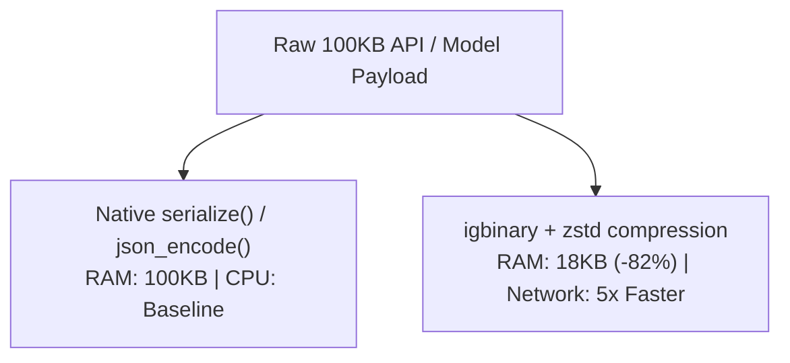

# Modern PHP 8.5+ & Laravel 13 Caching Architecture, Compression & Performance Tuning

> **Document**: `docs/architecture/caching-and-performance.md`  
> **Framework**: Laravel 13 & PHP 8.5+  
> **Key Topics**: High-Speed Execution, Redis/Valkey Payload Compression (`igbinary`, `zstd`), Cache Stampede Defense, `Cache::flexible()`, OPcache & JIT, and Refactoring Messy Code.

---

## 🏛️ Executive Summary

Application performance in modern Laravel 13 is determined by three interconnected factors:
1. **PHP Execution Velocity**: OPcache preloading, PHP 8.5 Tracing JIT, classmap optimization, and Laravel Octane.
2. **Enterprise Caching & Compression**: Minimizing Redis network I/O and RAM costs by compressing payloads with `igbinary` + `zstd` (up to 80% RAM savings), atomic locking, and Stale-While-Revalidate (`Cache::flexible`).
3. **Clean Code Hygiene**: Untangling messy, procedural caching spaghetti into structured Cache Repositories and Decorators.

---

## 1. High-Performance Cache Compression (Redis & Valkey)

Storing raw JSON or native PHP `serialize()` strings in Redis wastes massive amounts of RAM and saturates network bandwidth.



### A. Configuring `igbinary` and `zstd` in PhpRedis
In `config/database.php`, enable binary serialization and compression:

```php
// config/database.php
use Redis;

return [
    'redis' => [
        'client' => env('REDIS_CLIENT', 'phpredis'),

        'options' => [
            'cluster' => env('REDIS_CLUSTER', 'redis'),
            'prefix' => env('REDIS_PREFIX', Str::slug(env('APP_NAME', 'laravel'), '_').'_database_'),
            
            // 1. igbinary serialization: 50% smaller than PHP serialize()
            'serializer' => defined('Redis::SERIALIZER_IGBINARY') 
                ? Redis::SERIALIZER_IGBINARY 
                : Redis::SERIALIZER_PHP,

            // 2. zstd (Zstandard) compression: 70-85% payload reduction
            'compression' => defined('Redis::COMPRESSION_ZSTD') 
                ? Redis::COMPRESSION_ZSTD 
                : Redis::COMPRESSION_NONE,
            'compression_level' => 3, // Optimal trade-off between CPU and ratio
        ],

        'default' => [
            'url' => env('REDIS_URL'),
            'host' => env('REDIS_HOST', '127.0.0.1'),
            'port' => env('REDIS_PORT', '6379'),
            'database' => env('REDIS_DB', '0'),
        ],

        'cache' => [
            'url' => env('REDIS_URL'),
            'host' => env('REDIS_HOST', '127.0.0.1'),
            'port' => env('REDIS_PORT', '6379'),
            'database' => env('REDIS_CACHE_DB', '1'),
        ],
    ],
];
```

---

## 2. Cache Maintenance & Advanced Concurrency Patterns

### A. Stale-While-Revalidate: `Cache::flexible()`
When a high-traffic cache key expires, dozens of concurrent requests hit the database simultaneously (the **Thundering Herd / Cache Stampede** problem).

Laravel 11, 12, and 13 solve this with `Cache::flexible()`, serving a stale value instantly while refreshing the cache in the background:

```php
use App\Models\Product;
use Illuminate\Support\Facades\Cache;
use NoDiscard;

#[NoDiscard]
public function getPopularProducts(): mixed
{
    // [Fresh TTL: 5 minutes, Stale Grace Period: 30 minutes]
    return Cache::flexible('products:trending', [300, 1800], function (): array {
        return Product::query()
            ->with(['category', 'tags'])
            ->orderByDesc('sales_count')
            ->limit(20)
            ->get()
            ->toArray();
    });
}
```
- **0–5 minutes**: Returns fresh cache immediately.
- **5–30 minutes**: Returns stale cache **immediately** to the user ($0$ latency penalty) and asynchronously triggers an event to regenerate the fresh value in the background.
- **30+ minutes**: Value has expired completely; regenerates synchronously.

---

### B. Atomic Locks: Preventing Dog-Piling on Expensive Operations
For expensive external API fetches or batch aggregations, use distributed Redis locks:

```php
use Illuminate\Support\Facades\Cache;
use NoDiscard;

#[NoDiscard]
public function generateQuarterlyFinancialReport(): ReportDto
{
    $lockKey = 'locks:quarterly_report';
    $cacheKey = 'reports:quarterly';

    // Try acquiring lock for 10 seconds; block waiting requests for up to 5 seconds
    return Cache::lock($lockKey, 10)->block(5, function () use ($cacheKey): ReportDto {
        // Double-check cache inside lock
        if ($cached = Cache::get($cacheKey)) {
            return $cached;
        }

        $report = $this->calculateHeavyReport();

        Cache::put($cacheKey, $report, now()->addHours(6));

        return $report;
    });
}
```

---

### C. TTL Refreshing Without Deserialization: `Cache::touch()`
To keep active user sessions, tokens, or frequently accessed models hot without deserializing and re-writing the data payload:

```php
use Illuminate\Support\Facades\Cache;

// Refreshes the expiration to 1 hour without pulling data over the network
Cache::touch("user:session:{$sessionId}", 3600);
```

---

## 3. Execution Speed: PHP 8.5 OPcache, JIT & Production Optimization

### A. Production OPcache & JIT Configuration (`php.ini`)
```ini
; OPcache Configuration
opcache.enable=1
opcache.enable_cli=1
opcache.memory_consumption=256
opcache.interned_strings_buffer=32
opcache.max_accelerated_files=30000
opcache.validate_timestamps=0       ; Zero disk stats in production
opcache.save_comments=1             ; Required for PHP 8 attributes!

; PHP 8.5 Tracing JIT Compiler
opcache.jit=tracing
opcache.jit_buffer_size=128M
```

---

### B. The Production Cache Optimization Pipeline
Before deploying to production, compile and cache all framework configurations, routes, and views:

```bash
# 1. Optimize configuration loading
php artisan config:cache

# 2. Compile and serialize route tree
php artisan route:cache

# 3. Precompile Blade templates
php artisan view:cache

# 4. Cache event and listener mappings
php artisan event:cache

# 5. Authoritative classmap autoloader (zero filesystem lookups)
composer dump-autoload -o --classmap-authoritative
```

---

## 4. Refactoring Messy Caching Code into Clean Architecture

### ❌ The Anti-Pattern: Scattered Procedural Caching
Controllers or models littered with inline `Cache::get()` and `Cache::put()` calls:

```php
// ❌ Controller coupled with caching logic, keys, and serialization
final class ProductController
{
    public function show(string $id)
    {
        $key = 'product_' . $id;
        $product = Cache::get($key);
        if (! $product) {
            $product = Product::find($id);
            if (! $product) {
                abort(404);
            }
            Cache::put($key, $product, 3600);
        }
        return response()->json($product);
    }
}
```

---

### ✅ The Clean Pattern: Decorator / Cached Repository Pattern
Decouple caching from HTTP controllers and business logic by using a **Cached Repository Decorator**:

#### 1. Define Contract
```php
namespace App\Contracts;

use App\Models\Product;

interface ProductRepositoryInterface
{
    public function findById(string $id): ?Product;
}
```

#### 2. Clean Database Implementation
```php
namespace App\Repositories;

use App\Contracts\ProductRepositoryInterface;
use App\Models\Product;

final class DatabaseProductRepository implements ProductRepositoryInterface
{
    public function findById(string $id): ?Product
    {
        return Product::query()->find($id);
    }
}
```

#### 3. Cached Decorator Implementation
```php
namespace App\Repositories;

use App\Contracts\ProductRepositoryInterface;
use App\Models\Product;
use Illuminate\Support\Facades\Cache;

final readonly class CachedProductRepository implements ProductRepositoryInterface
{
    public function __construct(
        private ProductRepositoryInterface $inner,
        private int $ttl = 3600,
    ) {}

    public function findById(string $id): ?Product
    {
        return Cache::remember("products:{$id}", $this->ttl, function () use ($id): ?Product {
            return $this->inner->findById($id);
        });
    }
}
```

#### 4. Clean Service Provider Binding
```php
// app/Providers/AppServiceProvider.php
public function register(): void
{
    $this->app->bind(ProductRepositoryInterface::class, function () {
        $database = new DatabaseProductRepository();

        return new CachedProductRepository(
            inner: $database,
            ttl: 3600,
        );
    });
}
```

#### 5. Razor-Thin Controller
```php
final class ShowProductController
{
    public function __invoke(string $id, ProductRepositoryInterface $products): JsonResponse
    {
        $product = $products->findById($id) ?? abort(404, 'Product not found');

        return ProductResource::make($product)->response();
    }
}
```

---

## 📌 Performance & Caching Engineering Checklist

1. ✅ **Compression Active**: Enable `igbinary` and `zstd` in `config/database.php` for Redis/Valkey.
2. ✅ **Prevent Stampedes**: Use `Cache::flexible()` for read-heavy keys.
3. ✅ **Atomic Locks**: Protect expensive write computations with `Cache::lock()->block()`.
4. ✅ **Decoupled Caching**: Use the Decorator Pattern (`CachedRepository`) rather than inline controller caching.
5. ✅ **OPcache & JIT**: Configure `opcache.jit=tracing` and `opcache.validate_timestamps=0` in production.
6. ✅ **Production Warm-up**: Run `config:cache`, `route:cache`, `view:cache`, and `composer dump-autoload --classmap-authoritative`.
7. ✅ **Touch Active TTL**: Use `Cache::touch()` to renew expirations without payload re-writing.
