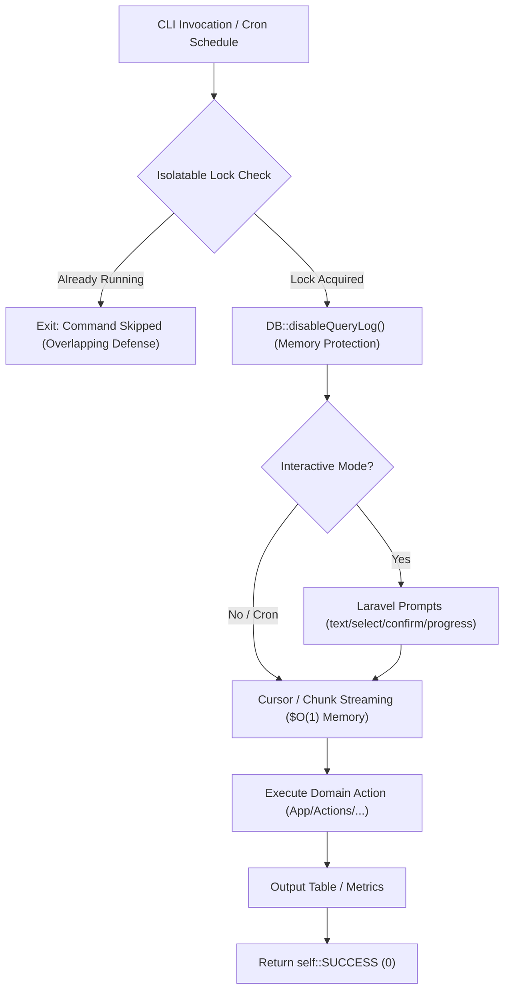

# Laravel 13 & Modern PHP 8.5+ Console Commands & Scheduling Architecture

This document defines the production engineering standards for authoring, isolating, streaming, and scheduling Artisan console commands in Laravel 13 and PHP 8.5+.

---

## 1. Artisan Command Scaffolding

Generate console commands using the Artisan `make:command` generator:

```bash
# Standard command
php artisan make:command SyncCatalogCommand

# Command with custom signature pre-populated
php artisan make:command SyncCatalogCommand --command=catalog:sync
```

Scaffolded commands are located in `app/Console/Commands/` and are automatically discovered by Laravel without manual registration.

---

## 2. Signature Syntax & Parameter Specifications

The `$signature` property defines command names, arguments, options, and help text in a concise, expressive DSL.

| Syntax Pattern | Description | Example Signature | Invocation Example |
| :--- | :--- | :--- | :--- |
| **Command Name** | Colon-separated namespace and action | `catalog:sync` | `php artisan catalog:sync` |
| **Required Argument** | Mandatory positional argument | `users:process {user}` | `php artisan users:process 42` |
| **Optional Argument** | Positional argument with `?` | `users:process {user?}` | `php artisan users:process` |
| **Argument with Default** | Fallback value if omitted | `report:generate {type=summary}` | `php artisan report:generate` |
| **Array Argument** | Collects multiple arguments into array | `mail:send {users*}` | `php artisan mail:send 1 2 3` |
| **Boolean Option / Flag** | True if present, false if omitted | `cache:clear {--force}` | `php artisan cache:clear --force` |
| **Value Option** | Requires user-provided value | `queue:work {--queue=}` | `php artisan queue:work --queue=high` |
| **Option with Default** | Has fallback value if not specified | `billing:run {--limit=100}` | `php artisan billing:run` |
| **Option Shortcut** | Single letter alias with pipe `|` | `db:seed {--c|--class=}` | `php artisan db:seed -c UsersSeeder` |
| **Array Option** | Can be supplied multiple times | `deploy:servers {--host=*}` | `php artisan deploy:servers --host=a --host=b` |
| **Inline Description** | Document parameter help text with `:` | `{user : The ID of the target user}` | `php artisan command --help` |

### Full Composite Signature Example

```php
protected $signature = 'catalog:sync 
                        {provider : The third-party catalog provider (e.g. stripe, shopify)}
                        {tenant? : Specific tenant ULID to restrict sync}
                        {--b|--batch=500 : Number of records to stream per chunk}
                        {--dry-run : Simulate sync without committing database mutations}
                        {--force : Force execution even if external API reports rate warnings}';
```

---

## 3. Production Command Architecture (PHP 8.5+)



### Complete Implementation Blueprint

```php
declare(strict_types=1);

namespace App\Console\Commands;

use App\Actions\Catalog\SyncProviderCatalogAction;
use App\Data\Catalog\SyncCatalogOptions;
use App\Models\Tenant;
use Illuminate\Console\Command;
use Illuminate\Contracts\Console\Isolatable;
use Illuminate\Support\Facades\DB;
use Symfony\Component\Console\Attribute\AsCommand;
use Symfony\Component\Console\Command\Command as SymfonyCommand;
use Throwable;
use function Laravel\Prompts\confirm;
use function Laravel\Prompts\error;
use function Laravel\Prompts\info;
use function Laravel\Prompts\progress;
use function Laravel\Prompts\select;
use function Laravel\Prompts\spin;

#[AsCommand(
    name: 'catalog:sync',
    description: 'Synchronize products, inventory, and pricing from third-party catalog providers.'
)]
final class SyncCatalogCommand extends Command implements Isolatable
{
    protected $signature = 'catalog:sync
                            {provider? : The provider name (stripe, shopify, printful)}
                            {--t|--tenant= : Specific tenant ULID}
                            {--b|--batch=500 : Batch size for database mutations}
                            {--dry-run : Simulate operations without writing to database}';

    /**
     * How long the command isolation lock is held (in seconds).
     */
    public int $isolationLockExpiresAt = 300;

    public function handle(SyncProviderCatalogAction $action): int
    {
        // 1. Memory Safety: Disable SQL query logging for high-throughput batch operations
        DB::disableQueryLog();

        // 2. Resolve or prompt for missing parameters
        $provider = (string) ($this->argument('provider') ?? select(
            label: 'Which catalog provider would you like to sync?',
            options: ['stripe' => 'Stripe Products', 'shopify' => 'Shopify Store', 'printful' => 'Printful API'],
            default: 'stripe'
        ));

        $tenantId = (string) ($this->option('tenant') ?? '');
        $batchSize = max((int) ($this->option('batch') ?? 500), 100);
        $isDryRun = (bool) $this->option('dry-run');

        if ($isDryRun) {
            info('Running in DRY-RUN mode. No database records will be modified.');
        }

        // 3. Confirm in interactive production environments
        if (app()->isProduction() && ! $this->option('no-interaction')) {
            $confirmed = confirm(
                label: "Are you sure you want to run catalog sync for [{$provider}] in PRODUCTION?",
                default: false
            );

            if (! $confirmed) {
                $this->warn('Catalog sync aborted by user.');
                return SymfonyCommand::SUCCESS;
            }
        }

        $options = new SyncCatalogOptions(
            provider: $provider,
            tenantId: $tenantId !== '' ? $tenantId : null,
            batchSize: $batchSize,
            dryRun: $isDryRun,
        );

        // 4. Execute with interactive spinner for API calls
        $payload = spin(
            callback: fn (): array => $action->fetchCatalogPayload($options),
            message: "Fetching catalog records from [{$provider}] API..."
        );

        $totalItems = count($payload);
        if ($totalItems === 0) {
            $this->warn("No remote catalog items found for provider [{$provider}].");
            return SymfonyCommand::SUCCESS;
        }

        info("Discovered {$totalItems} catalog items. Beginning ingestion...");

        // 5. Interactive Progress Bar with $O(1) memory cursor streaming
        $progress = progress(label: 'Syncing catalog items', steps: $totalItems);
        $progress->start();

        try {
            foreach ($payload as $item) {
                $action->syncSingleItem($item, $options);
                $progress->advance();
            }

            $progress->finish();
        } catch (Throwable $e) {
            $progress->finish();
            error("Catalog sync failed unexpectedly: {$e->getMessage()}");
            $this->output->writeln($e->getTraceAsString());

            return SymfonyCommand::FAILURE;
        }

        $this->table(
            headers: ['Metric', 'Value'],
            rows: [
                ['Provider', $provider],
                ['Processed Items', (string) $totalItems],
                ['Batch Size', (string) $batchSize],
                ['Dry Run', $isDryRun ? 'Yes' : 'No'],
                ['Peak Memory', sprintf('%.2f MB', memory_get_peak_usage(true) / 1024 / 1024)],
            ]
        );

        info('Catalog sync completed successfully.');

        return SymfonyCommand::SUCCESS;
    }
}
```

---

## 4. Concurrency Defense: `Isolatable` Commands

Commands triggered on tight schedules (e.g., every minute or every 5 minutes) risk overlapping if a single run takes longer than the schedule interval. This causes race conditions, duplicate database writes, and thread exhaustion.

### Implementing Command Isolation

Implement the `Illuminate\Contracts\Console\Isolatable` interface:

```php
use Illuminate\Console\Command;
use Illuminate\Contracts\Console\Isolatable;

final class ProcessTransactionsCommand extends Command implements Isolatable
{
    /**
     * Seconds before the isolation lock automatically expires if worker dies.
     */
    public int $isolationLockExpiresAt = 600;

    /**
     * Customize the lock key (defaults to command name).
     */
    public function isolationKey(): string
    {
        return 'command:process-transactions:' . ($this->argument('tenant') ?? 'global');
    }
}
```

When an isolated command is triggered while an existing instance is active, Laravel gracefully exits with exit code `Command::SUCCESS` without executing duplicate work.

---

## 5. Interactive Prompts (`laravel/prompts`)

Laravel includes first-party interactive prompts providing beautiful terminal UX:

```php
use function Laravel\Prompts\text;
use function Laravel\Prompts\select;
use function Laravel\Prompts\multiselect;
use function Laravel\Prompts\confirm;
use function Laravel\Prompts\password;
use function Laravel\Prompts\suggest;
use function Laravel\Prompts\spin;
use function Laravel\Prompts\progress;
use function Laravel\Prompts\table;

// Text input with validation
$name = text(
    label: 'What is the project name?',
    placeholder: 'my-project',
    required: true,
    validate: fn (string $val) => preg_match('/^[a-z0-9-]+$/', $val) ? null : 'Use kebab-case only.'
);

// Select dropdown
$role = select(
    label: 'Select user role',
    options: ['admin' => 'Administrator', 'editor' => 'Editor', 'viewer' => 'Read-Only Viewer'],
    default: 'editor'
);

// Multiselect checkboxes
$permissions = multiselect(
    label: 'Select granted permissions',
    options: ['users.create', 'users.update', 'users.delete', 'billing.read'],
    default: ['billing.read']
);

// Confirmation prompt
$proceed = confirm(label: 'Do you wish to run migrations now?', default: true);

// Password masked input
$apiKey = password(label: 'Enter third-party API secret key', required: true);

// Autocomplete suggestions
$country = suggest(
    label: 'Enter target country',
    options: ['United States', 'Canada', 'United Kingdom', 'Germany', 'Australia']
);
```

---

## 6. Memory Safety in Long-Running CLI Commands

CLI commands running batch exports, data migrations, or third-party syncs can consume gigabytes of RAM if not carefully guarded.

### The 4 Mandatory CLI Memory Rules

1. **Disable Query Log Immediately**: By default, Laravel logs every executed SQL query in RAM when running locally or during tests. In large loops, this causes fatal Out of Memory (OOM) errors:
   ```php
   DB::disableQueryLog();
   ```
2. **Never Use `all()` or Unbounded `get()`**: Stream records via PDO generators using `$query->cursor()` for read-only passes, or `$query->chunkById(500)` for record updates.
3. **Explicit Garbage Collection**: In loops iterating over 5,000+ items, unset large arrays and call garbage collection:
   ```php
   if ($processed % 1000 === 0) {
       gc_collect_cycles();
       gc_mem_caches();
   }
   ```
4. **Log Peak Memory Usage**: Always log or display peak memory on completion using `memory_get_peak_usage(true)`.

---

## 7. Scheduling Commands (`routes/console.php`)

In Laravel 13, all scheduled commands and tasks are defined in `routes/console.php` using the fluent `Schedule` facade:

```php
declare(strict_types=1);

use App\Console\Commands\CleanExpiredSessionsCommand;
use App\Console\Commands\SyncCatalogCommand;
use Illuminate\Support\Facades\Schedule;

// Run every 10 minutes, isolated to prevent overlap, executed in the background
Schedule::command(SyncCatalogCommand::class, ['stripe'])
    ->everyTenMinutes()
    ->withoutOverlapping(expiresAt: 15) // Minutes
    ->runInBackground()
    ->onOneServer()
    ->evenInMaintenanceMode()
    ->appendOutputTo(storage_path('logs/catalog-sync.log'))
    ->emailOutputOnFailure('devops@example.com');

// Daily cleanup command
Schedule::command(CleanExpiredSessionsCommand::class)
    ->dailyAt('03:00')
    ->withoutOverlapping()
    ->onOneServer();
```

---

## 8. Deterministic Testing with Pest 3

Test console commands thoroughly without hitting live networks or writing ad-hoc terminal tests:

```php
declare(strict_types=1);

use App\Actions\Catalog\SyncProviderCatalogAction;
use App\Console\Commands\SyncCatalogCommand;
use Mockery\MockInterface;
use Symfony\Component\Console\Command\Command;

it('executes catalog sync successfully in dry-run mode', function (): void {
    $this->mock(SyncProviderCatalogAction::class, function (MockInterface $mock): void {
        $mock->shouldReceive('fetchCatalogPayload')
            ->once()
            ->andReturn([
                ['id' => 'prod_1', 'name' => 'T-Shirt'],
                ['id' => 'prod_2', 'name' => 'Hoodie'],
            ]);

        $mock->shouldReceive('syncSingleItem')
            ->twice();
    });

    $this->artisan('catalog:sync', [
        'provider' => 'stripe',
        '--dry-run' => true,
    ])
        ->expectsOutputToContain('Running in DRY-RUN mode')
        ->expectsOutputToContain('Discovered 2 catalog items')
        ->expectsOutputToContain('Catalog sync completed successfully.')
        ->assertExitCode(Command::SUCCESS);
});

it('handles interactive confirmation cancellation gracefully', function (): void {
    $this->artisan('catalog:sync', ['provider' => 'stripe'])
        ->expectsConfirmation('Are you sure you want to run catalog sync for [stripe] in PRODUCTION?', 'no')
        ->expectsOutputToContain('Catalog sync aborted by user.')
        ->assertExitCode(Command::SUCCESS);
});
```

---

## 9. Architectural Checklist for Console Commands

| Dimension | Production Standard | Anti-Pattern |
| :--- | :--- | :--- |
| **Command Naming** | Noun-first namespace: `catalog:sync`, `orders:prune` | Unnamespaced verbs: `sync`, `prune-orders` |
| **Concurrency** | Implement `Isolatable` with `$isolationLockExpiresAt` | Overlapping cron jobs causing deadlocks and duplicates |
| **Memory** | Call `DB::disableQueryLog()` + `cursor()` streaming | Unbounded `Model::all()` causing OOM fatal errors |
| **Interactive UX** | Use `laravel/prompts` (`select()`, `confirm()`, `spin()`) | Ugly procedural `readline()` or messy raw ANSI codes |
| **Scheduling** | Centralized in `routes/console.php` with `onOneServer()` | Distributed crontabs on multiple web servers |
| **Exit Codes** | Explicit `Command::SUCCESS` (0) / `Command::FAILURE` (1) | Returning boolean `true`/`false` or missing returns |
| **Test Coverage** | Assert exit codes and outputs with Pest 3 | Untested commands tested only manually on production |
