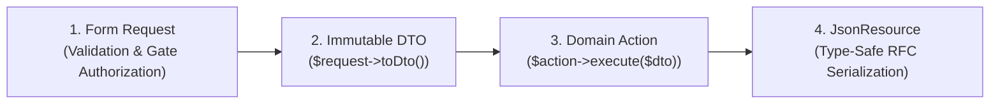
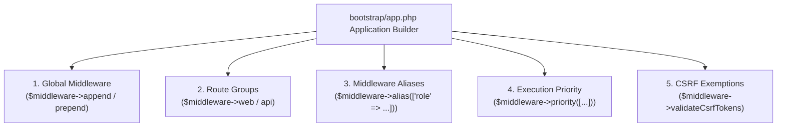

# Modern Laravel 13 & PHP 8.5+ Controller & Middleware Architecture

> **Document**: `docs/architecture/controllers-and-middleware.md`  
> **Framework**: Laravel 13 & PHP 8.5+  
> **Core Focus**: Thin Controllers, Single-Action Invokables, Fluent Middleware in `bootstrap/app.php`, Terminable Middleware, and Pest 3 Testing.

---

## 🏛️ Executive Summary

In modern enterprise Laravel 13 applications:
1. **Controllers are Razor-Thin Orchestrators**: They unpack request data via **Form Requests**, convert payloads into immutable **DTOs**, invoke single-purpose **Actions**, and return **JsonResources**. They contain **zero** SQL queries, zero business algorithms, and zero inline `$request->validate()` calls.
2. **Single-Action Invokable Controllers (`__invoke`) are the Standard**: One class represents one route and one test file. Bloated 1,500-line God controllers are strictly prohibited.
3. **Middleware is Configured Fluently in `bootstrap/app.php`**: The legacy `app/Http/Kernel.php` is dead. All middleware appending, prepending, aliasing, priority, and CSRF exclusions are configured in the application builder.
4. **Terminable Middleware Eliminates User Latency**: Heavy operations (audit logging, analytics, metric tracking) are deferred to `terminate()`, running after the HTTP response has been flushed to the client.

---

## 1. Controller Architecture & Best Practices



---

### A. The Single-Action Invokable Standard (`__invoke`)

Single-Action Invokable Controllers are the recommended pattern for enterprise Laravel projects:
- **High Cohesion**: A single class handles a single HTTP endpoint.
- **Scattered Dependencies Eliminated**: Constructor injection is restricted to what this exact action requires, avoiding constructor bloat.
- **Trivial Testing**: 1 route $\leftrightarrow$ 1 controller $\leftrightarrow$ 1 Pest test file.

```php
<?php

declare(strict_types=1);

namespace App\Http\Controllers\Api\V1\Orders;

use App\Actions\Orders\CreateOrderAction;
use App\Http\Requests\Api\V1\Orders\StoreOrderRequest;
use App\Http\Resources\Orders\OrderResource;
use Illuminate\Http\JsonResponse;
use Symfony\Component\HttpFoundation\Response;

final class StoreOrderController
{
    public function __invoke(
        StoreOrderRequest $request,
        CreateOrderAction $action,
    ): JsonResponse {
        $order = $action->execute($request->toDto());

        return OrderResource::make($order)
            ->response()
            ->setStatusCode(Response::HTTP_CREATED)
            ->header('Location', route('api.v1.orders.show', ['order' => $order->id]));
    }
}
```

---

### B. Resourceful Controllers (The 7 Standard Verbs Only)

When building standard CRUD administration panels where multiple actions naturally belong together, use resourceful controllers adhering strictly to the **7 canonical HTTP verbs**:

```text
The 7 Canonical Resourceful Verbs:
├── index()   - GET    /resources
├── create()  - GET    /resources/create (HTML forms only)
├── store()   - POST   /resources
├── show()    - GET    /resources/{resource}
├── edit()    - GET    /resources/{resource}/edit (HTML forms only)
├── update()  - PUT/PATCH /resources/{resource}
└── destroy() - DELETE /resources/{resource}
```

> [!CAUTION]
> **Strict Prohibition on Custom Controller Verbs**: Never add non-standard methods like `cancel()`, `approve()`, `reorder()`, or `export()` to a resourceful controller. Always extract them into dedicated Single-Action Invokable Controllers:
> - `CancelOrderController` (`POST /orders/{order}/cancel`)
> - `ApproveOrderController` (`POST /orders/{order}/approve`)
> - `ExportOrdersCsvController` (`GET /orders/export`)

---

### C. Pure `final` Controllers (No Monolithic Base Controller)

In Laravel 11, 12, and 13, the base `App\Http\Controllers\Controller` class is empty. Controllers do not need to inherit bloated base classes or traits:

```php
// ✅ Clean, independent final class
final class ShowInvoiceController
{
    public function __invoke(Invoice $invoice): JsonResponse
    {
        return InvoiceResource::make($invoice)->response();
    }
}
```

---

## 2. Middleware Architecture in `bootstrap/app.php`

Laravel 13 replaces `app/Http/Kernel.php` with fluent closures inside `bootstrap/app.php`.



### Complete `bootstrap/app.php` Middleware Configuration:

```php
<?php

use App\Http\Middleware\EnsureJsonRequest;
use App\Http\Middleware\EnsureUserHasRole;
use App\Http\Middleware\EnsureUserIsSubscribed;
use App\Http\Middleware\SecurityHeadersMiddleware;
use Illuminate\Cookie\Middleware\EncryptCookies;
use Illuminate\Foundation\Application;
use Illuminate\Foundation\Configuration\Middleware;
use Illuminate\Session\Middleware\StartSession;

return Application::configure(basePath: dirname(__DIR__))
    ->withRouting(
        web: __DIR__.'/../routes/web.php',
        api: __DIR__.'/../routes/api.php',
        commands: __DIR__.'/../routes/console.php',
        health: '/up',
    )
    ->withMiddleware(function (Middleware $middleware): void {
        // 1. Global Middleware (Executed on every request)
        $middleware->append(SecurityHeadersMiddleware::class);
        $middleware->prepend(EnsureJsonRequest::class);

        // 2. Route Middleware Aliases
        $middleware->alias([
            'role' => EnsureUserHasRole::class,
            'subscribed' => EnsureUserIsSubscribed::class,
        ]);

        // 3. Execution Priority Ordering
        $middleware->priority([
            EnsureJsonRequest::class,
            EncryptCookies::class,
            StartSession::class,
            SecurityHeadersMiddleware::class,
            EnsureUserHasRole::class,
        ]);

        // 4. API & Stateful Configuration
        $middleware->statefulApi(); // Sanctum SPA support
        $middleware->throttleApi(); // Rate limiting

        // 5. CSRF Exemptions for Webhook endpoints
        $middleware->validateCsrfTokens(except: [
            'stripe/*',
            'webhooks/*',
            'api/v1/payments/callback',
        ]);
    })
    ->create();
```

---

## 3. Middleware Lifecycles & Types

### A. Before Middleware: Pre-Condition & Guard Checking
Runs before the request hits the controller. Returns early if preconditions fail:

```php
<?php

declare(strict_types=1);

namespace App\Http\Middleware;

use Closure;
use Illuminate\Http\Request;
use Symfony\Component\HttpFoundation\Response;

final class EnsureFeatureIsEnabled
{
    public function handle(Request $request, Closure $next, string $feature): Response
    {
        if (! config("features.{$feature}", false)) {
            abort(Response::HTTP_FORBIDDEN, "Feature [{$feature}] is not enabled.");
        }

        return $next($request);
    }
}
```

---

### B. After Middleware: Inspecting & Modifying Responses
Runs after the controller action has completed:

```php
<?php

declare(strict_types=1);

namespace App\Http\Middleware;

use Closure;
use Illuminate\Http\Request;
use Symfony\Component\HttpFoundation\Response;

final class SecurityHeadersMiddleware
{
    public function handle(Request $request, Closure $next): Response
    {
        /** @var Response $response */
        $response = $next($request);

        $response->headers->set('X-Frame-Options', 'DENY');
        $response->headers->set('X-Content-Type-Options', 'nosniff');
        $response->headers->set('Referrer-Policy', 'strict-origin-when-cross-origin');

        return $response;
    }
}
```

---

### C. Terminable Middleware: Zero-Latency Background Work

> [!TIP]
> **Zero User Latency**: If an operation does not affect the HTTP response returned to the client (such as audit logging, usage counting, or metrics tracking), implement `terminate()`. The response is sent immediately to the user, and the work executes in the background before the process recycles.

```php
<?php

declare(strict_types=1);

namespace App\Http\Middleware;

use App\Jobs\RecordApiMetricJob;
use Closure;
use Illuminate\Http\Request;
use Symfony\Component\HttpFoundation\Response;

final class TrackApiUsageMetricMiddleware
{
    private float $startTime;

    public function handle(Request $request, Closure $next): Response
    {
        $this->startTime = microtime(true);

        return $next($request);
    }

    /**
     * Executes AFTER the HTTP response has been sent to the client browser.
     */
    public function terminate(Request $request, Response $response): void
    {
        $durationMs = (microtime(true) - $this->startTime) * 1000;

        // Dispatched asynchronously without delaying client response time
        RecordApiMetricJob::dispatch(
            endpoint: $request->path(),
            statusCode: $response->getStatusCode(),
            durationMs: $durationMs,
            userId: $request->user()?->id,
        );
    }
}
```

---

### D. Parameterized Middleware: Variadic Domain Checks

Allow passing configuration parameters directly in route declarations:

```php
// In routes/web.php or routes/api.php
Route::get('/admin/audit', ShowAuditLogsController::class)
    ->middleware('role:super-admin,compliance-officer');
```

```php
namespace App\Http\Middleware;

use Closure;
use Illuminate\Http\Request;
use Symfony\Component\HttpFoundation\Response;

final class EnsureUserHasRole
{
    /**
     * @param string ...$roles
     */
    public function handle(Request $request, Closure $next, string ...$roles): Response
    {
        $user = $request->user();

        if ($user === null || ! in_array($user->role->value, $roles, strict: true)) {
            abort(Response::HTTP_FORBIDDEN, 'Unauthorized role access.');
        }

        return $next($request);
    }
}
```

---

## 4. Pest 3 Testing Suite for Controllers & Middleware

### A. Testing Single-Action Controllers
```php
describe('POST /api/v1/orders', function () {
    test('invokable controller delegates to action and returns 201 Created', function () {
        $user = User::factory()->create();
        $product = Product::factory()->create(['price_cents' => 3000]);

        $response = $this->actingAs($user)
            ->postJson(route('api.v1.orders.store'), [
                'items' => [['product_id' => $product->id, 'quantity' => 1]],
                'payment_token' => 'tok_visa_valid',
            ]);

        $response->assertCreated()
            ->assertHeader('Location')
            ->assertJsonPath('data.total_cents', 3000);
    });
});
```

---

### B. Unit Testing Middleware in Isolation
You do not need to trigger full HTTP requests to test middleware logic:

```php
use App\Http\Middleware\EnsureFeatureIsEnabled;
use Illuminate\Http\Request;
use Symfony\Component\HttpFoundation\Response;
use Symfony\Component\HttpKernel\Exception\HttpException;

test('feature middleware blocks disabled features', function () {
    config()->set('features.beta_dashboard', false);

    $middleware = new EnsureFeatureIsEnabled();
    $request = Request::create('/beta', 'GET');

    $this->expectException(HttpException::class);
    $this->expectExceptionMessage('Feature [beta_dashboard] is not enabled.');

    $middleware->handle($request, fn() => new Response());
});

test('feature middleware allows enabled features', function () {
    config()->set('features.beta_dashboard', true);

    $middleware = new EnsureFeatureIsEnabled();
    $request = Request::create('/beta', 'GET');

    $response = $middleware->handle($request, fn() => new Response('OK'));

    expect($response->getContent())->toBe('OK');
});
```

---

### C. Architectural Boundary Tests with Pest 3
```php
// tests/Feature/ControllerMiddlewareArchTest.php

arch('controllers must be thin, final, and invokable')
    ->expect('App\Http\Controllers')
    ->classes()
    ->toBeFinal()
    ->toHaveSuffix('Controller')
    ->toBeInvokable();

arch('controllers must never query database directly')
    ->expect('App\Http\Controllers')
    ->not->toUse('Illuminate\Support\Facades\DB');

arch('middleware classes must implement handle method')
    ->expect('App\Http\Middleware')
    ->classes()
    ->toBeFinal()
    ->toHaveMethod('handle');
```

---

## 📌 Controller & Middleware Rules Checklist

| Category | Standard | Anti-Pattern to Avoid |
| :--- | :--- | :--- |
| **Controllers** | Single-Action Invokables (`__invoke`) | 1,000-line God controllers with 20 methods |
| **Validation** | Dedicated Form Requests (`rules()`, `toDto()`) | Calling `$request->validate()` inside controller |
| **Queries** | Handled inside Domain Actions | Executing `Model::where()` directly in controller |
| **Middleware Config** | Fluent in `bootstrap/app.php` | Creating legacy `app/Http/Kernel.php` |
| **Heavy Logging** | Terminable middleware (`terminate()`) | Blocking the client HTTP response with logging |
| **Custom Verbs** | Separate invokable controller (`CancelOrderController`) | Adding `cancelOrder()` to a resource controller |
| **Architecture Tests**| Enforced via Pest 3 `arch()` in CI | Unchecked architectural erosion |
