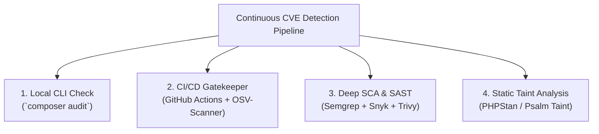

# 2026 CVE Management, Vulnerability Auditing & Supply Chain Security

> **Document**: `docs/architecture/cve-management.md`  
> **Framework**: Laravel 13 & PHP 8.5+  
> **Standards Compliance**: CVE (Common Vulnerabilities and Exposures), CVSS v3.1/v4.0, NIST NVD, OpenSSF, OWASP Top 10.

---

## 🏛️ Executive Summary

Modern software supply chain attacks target third-party dependencies rather than proprietary application code. In 2026, maintaining security requires an automated, proactive strategy to:
1. **Find all CVEs continuously**: Automating dependency vulnerability scanning in development, CI/CD, and production.
2. **Understand the 2026 PHP/Laravel Threat Landscape**: Identifying common CVE vectors (deserialization, SSRF, Zip Slip, ReDoS, SQLi).
3. **Enforce Remediation SLAs**: Establishing strict turnaround times based on Common Vulnerability Scoring System (CVSS) severity.
4. **Prevent Supply Chain Poisoning**: Lockfile hashing, abandoned package audits, and automated dependabot integration.

---

## 1. Finding & Scanning for CVEs in Laravel 13



---

### A. Native Dependency Auditing: `composer audit`
Composer includes a native security vulnerability scanner integrated directly with the FriendsOfPHP Security Advisory Database and the GitHub Advisory Database:

```bash
# 1. Standard scan: Check all installed dependencies for known CVEs
composer audit

# 2. Strict CI scan: Fail build on known CVEs OR abandoned packages
composer audit --abandoned=fail --format=table

# 3. Machine-readable JSON output for automated reporting
composer audit --format=json > security-audit.json
```

**Sample Output When Vulnerabilities Are Found**:
```text
Found 1 security vulnerability advisory affecting 1 package:
+-------------------+-----------------------------------------------------------------+
| Package           | guzzlehttp/psr7                                                 |
| CVE               | CVE-2023-29197                                                  |
| Title             | Header injection in Guzzle PSR-7                                |
| URL               | https://github.com/advisories/GHSA-wxmh-65f7-jcvw               |
| Affected versions | >= 1.0.0, < 1.9.1                                               |
+-------------------+-----------------------------------------------------------------+
```

---

### B. Automated OSV-Scanner (Open Source Vulnerabilities)
Google's `osv-scanner` checks `composer.lock` against the distributed Open Source Vulnerabilities database:

```bash
# Scan lockfile against global OpenSSF database
osv-scanner --lockfile=composer.lock
```

---

### C. Container & Filesystem Scanning with Trivy
```bash
# Scan entire project filesystem including PHP runtime and OS libraries
trivy fs --severity HIGH,CRITICAL --security-checks vuln .
```

---

### D. Static Application Security Testing (SAST) with Semgrep
Semgrep scans Laravel code for insecure coding patterns that lead to CVEs:

```bash
# Run official Laravel security ruleset
semgrep --config p/laravel --error
```

---

## 2. The 2026 PHP/Laravel CVE Threat Landscape

Understanding the root cause of historical and emerging CVEs enables developers to design proactive defenses:

| CVE Category | Typical Vector | CVSS Severity | Architectural Defense |
| :--- | :--- | :--- | :--- |
| **PHP Object Injection** | Untrusted `unserialize()` calls | **Critical (9.8)** | Ban `unserialize()`; strictly use `json_decode()` with `JSON_THROW_ON_ERROR`. |
| **Server-Side Request Forgery (SSRF)** | Fetching unvalidated URLs in cURL / Guzzle | **High (8.6)** | Validate IP addresses via `filter_var()`; block private RFC 1918 subnets. |
| **Path Traversal / Zip Slip** | Extracting uploaded archives without path sanitization | **High (7.5)** | Validate canonical paths using `realpath()` before file extraction. |
| **Second-Order SQLi** | Unescaped table/column names in query builders | **High (8.0)** | Enforce strict array whitelisting for all dynamic column ordering. |
| **ReDoS (Regex DoS)** | Nested quantifiers `(a+)+` in validation regex | **Medium (5.3)** | Avoid greedy nested quantifiers; set regex execution limits. |
| **Supply Chain Poisoning** | Abandoned packages hijacked by malicious actors | **Critical (9.0)** | Audit dependencies via `composer audit --abandoned=fail`. |

---

## 3. Production GitHub Actions CI Gatekeeper

Block any pull request that introduces an unpatched CVE or an abandoned dependency:

```yaml
# .github/workflows/security-audit.yml
name: Security Audit & CVE Scanner

on:
  push:
    branches: [main]
  pull_request:

jobs:
  composer-audit:
    name: Dependency Vulnerability Audit
    runs-on: ubuntu-latest

    steps:
      - name: Checkout code
        uses: actions/checkout@v4

      - name: Setup PHP
        uses: shivammathur/setup-php@v2
        with:
          php-version: '8.4'
          extensions: mbstring, json
          coverage: none

      - name: Validate composer.json and composer.lock
        run: composer validate --strict

      - name: Audit dependencies for known CVEs
        run: composer audit --abandoned=fail

      - name: Run OSV Scanner
        uses: google/osv-scanner-action@v1.9.0
        with:
          scan-args: |-
            --lockfile=composer.lock
```

---

## 4. CVE Remediation SLAs & Incident Response

When a CVE is discovered in your application's dependency tree, enforce strict operational response SLAs:

```text
Remediation Timelines by CVSS Score:
├── Critical (CVSS 9.0 – 10.0): Patch within 24–48 hours (Hotfix deployment)
├── High     (CVSS 7.0 – 8.9):  Patch within 7 calendar days
├── Medium   (CVSS 4.0 – 6.9):  Patch within 30 calendar days
└── Low      (CVSS 0.1 – 3.9):  Patch in next scheduled release
```

---

### Step-by-Step CVE Patching Protocol:

1. **Verify Impact**: Check if the vulnerable method or class is actually invoked in your codebase (`vendor/bin/phpstan analyse` or code grep).
2. **Upgrade Target Package**:
   ```bash
   # Update only the specific affected package
   composer update vendor/package --with-dependencies
   ```
3. **Verify Zero Regressions**:
   ```bash
   # Run full test suite
   vendor/bin/pest
   ```
4. **Virtual Patching (If Upstream Patch is Unavailable)**:
   If the package maintainer has not yet released a patch:
   - Apply a WAF filter rule (Cloudflare / AWS WAF) blocking the attack payload.
   - Fork or patch locally using `cweagans/composer-patches`.
   - Wrap or swap the vendor driver behind an application interface.

---

## 5. Automated Pest 3 CVE Architecture Guards

Ensure developers cannot introduce functions historically responsible for Critical CVEs:

```php
// tests/Feature/CvePreventionArchTest.php

arch('prevent dangerous execution functions responsible for RCE CVEs')
    ->expect(['unserialize', 'eval', 'exec', 'shell_exec', 'passthru', 'system', 'popen', 'proc_open'])
    ->not->toBeUsed();

arch('prevent weak cryptographic algorithms responsible for collision CVEs')
    ->expect(['md5', 'sha1'])
    ->not->toBeUsed();

arch('prevent direct superglobal access susceptible to parameter tampering')
    ->expect(['_GET', '_POST', '_REQUEST', '_COOKIE'])
    ->not->toBeUsed();
```

---

## 📌 2026 CVE Maintenance Checklist

1. ✅ **`composer audit` in CI**: Fail build if any dependency has an unpatched advisory.
2. ✅ **No Abandoned Packages**: Enforce `--abandoned=fail` to block dead dependencies.
3. ✅ **Dependabot Active**: Enable automatic weekly PRs for non-breaking security updates.
4. ✅ **Strict Deserialization**: Banish `unserialize()` across all code and queue jobs.
5. ✅ **Lockfile Checked In**: Always commit `composer.lock` to ensure deterministic builds.
6. ✅ **Taint Analysis**: Run static analysis to track untrusted user input to database/network sinks.
