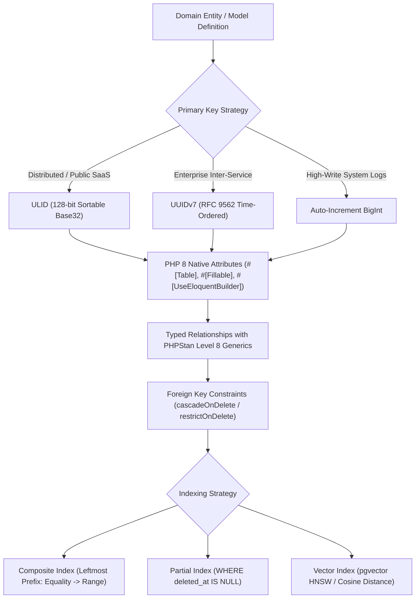
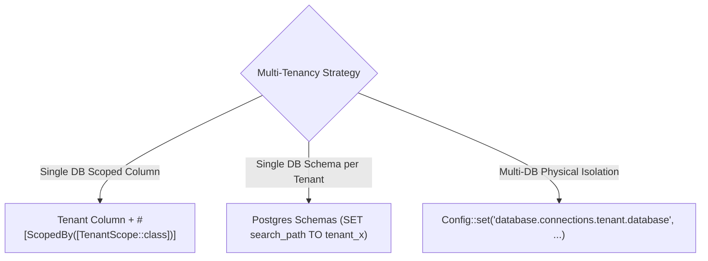

# Laravel 13 & Modern PHP 8.6+ Database Schema Design, Indexing & Concurrency Architecture

> **Document**: `docs/architecture/database-schema-design-and-indexing.md`  
> **Target Framework**: Laravel 13 (PHP 8.6+)  
> **Scope**: Primary & Foreign Key Strategies, Eloquent Attributes, Relationship Generics, Indexing Patterns (B-Tree, Composite, Partial, Vector), and Multi-Tenancy Architecture  

---

## 🧭 Executive Architectural Database Decision Framework

Database schema design establishes the permanent physical foundation of an application. Poor choices in primary key data types, missing composite indexes, or improper foreign key cascades cause severe locking bottlenecks, data corruption, and catastrophic migration refactoring at scale.



---

## 1. Primary Key (PK) Architecture & Decision Matrix

| Identifier Strategy | Column Generator | Storage Footprint | B-Tree Locality | Security / Anti-Scraping | Best Fit |
| :--- | :--- | :--- | :--- | :--- | :--- |
| **ULID (Universally Unique Lexicographically Sortable Identifier)** | `$table->ulid('id')->primary()` | 16 bytes (CHAR 26 Base32) | Excellent (time-clustered) | Immune to ID enumeration attacks | **Recommended Default**: All SaaS, multi-tenant, and customer-facing models. |
| **UUIDv7** | `$table->uuid('id')->primary()` | 16 bytes (CHAR 36) | Excellent (millisecond time-sorted) | Immune to ID enumeration | Inter-system events, Kafka messages, microservice boundaries. |
| **Auto-Increment BigInt** | `$table->id()` | 8 bytes (BIGINT UNSIGNED) | Optimal (strictly sequential) | Vulnerable (competitors can scrape order counts) | Internal tables, ledger lines, append-only sensor telemetry. |
| **Composite PK** | `$table->primary(['tenant_id', 'id'])` | Varies | Clustered by leftmost column | N/A | Range/hash-partitioned tables, strict pivot tables. |

---

## 2. Eloquent Model Attributes & Anatomy (PHP 8.6+)

In Laravel 13, model metadata is declared via **native PHP 8 attributes**, eliminating boilerplate protected properties:

```php
<?php

declare(strict_types=1);

namespace App\Models;

use App\Builders\InvoiceQueryBuilder;
use App\Enums\InvoiceStatus;
use App\Models\Scopes\TenantScope;
use Illuminate\Database\Eloquent\Attributes\Fillable;
use Illuminate\Database\Eloquent\Attributes\Hidden;
use Illuminate\Database\Eloquent\Attributes\ScopedBy;
use Illuminate\Database\Eloquent\Attributes\Table;
use Illuminate\Database\Eloquent\Attributes\UseEloquentBuilder;
use Illuminate\Database\Eloquent\Casts\AsFluent;
use Illuminate\Database\Eloquent\Concerns\HasUlids;
use Illuminate\Database\Eloquent\Factories\HasFactory;
use Illuminate\Database\Eloquent\Model;
use Illuminate\Database\Eloquent\Relations\BelongsTo;
use Illuminate\Database\Eloquent\Relations\HasMany;
use Illuminate\Database\Eloquent\SoftDeletes;

#[Table('invoices')]
#[Fillable([
    'tenant_id',
    'customer_id',
    'invoice_number',
    'status',
    'subtotal_cents',
    'tax_cents',
    'total_cents',
    'metadata',
    'due_date',
])]
#[Hidden(['audit_trail', 'gateway_raw'])]
#[UseEloquentBuilder(InvoiceQueryBuilder::class)]
#[ScopedBy([TenantScope::class])]
class Invoice extends Model
{
    use HasFactory;
    use HasUlids;
    use SoftDeletes;

    /**
     * Method-based attribute casts.
     *
     * @return array<string, string|class-string>
     */
    protected function casts(): array
    {
        return [
            'status' => InvoiceStatus::class,
            'subtotal_cents' => 'integer',
            'tax_cents' => 'integer',
            'total_cents' => 'integer',
            'metadata' => AsFluent::class,
            'due_date' => 'immutable_date',
            'created_at' => 'immutable_datetime',
            'updated_at' => 'immutable_datetime',
            'deleted_at' => 'immutable_datetime',
        ];
    }

    /**
     * @return BelongsTo<Customer, $this>
     */
    public function customer(): BelongsTo
    {
        return $this->belongsTo(Customer::class, 'customer_id');
    }

    /**
     * @return HasMany<InvoiceItem, $this>
     */
    public function items(): HasMany
    {
        return $this->hasMany(InvoiceItem::class, 'invoice_id');
    }
}
```

---

## 3. Relationships Architecture & PHPStan Level 8 Generics

All Eloquent relationship methods must declare native return types and **PHPStan generic docblocks**:

```php
/**
 * One-to-Many: Invoice has many InvoiceItems
 *
 * @return HasMany<InvoiceItem, $this>
 */
public function items(): HasMany
{
    return $this->hasMany(InvoiceItem::class, 'invoice_id');
}

/**
 * Many-to-One: Invoice belongs to Customer
 *
 * @return BelongsTo<Customer, $this>
 */
public function customer(): BelongsTo
{
    return $this->belongsTo(Customer::class, 'customer_id');
}

/**
 * Many-to-Many: User belongs to many Roles with pivot timestamps
 *
 * @return BelongsToMany<Role, $this>
 */
public function roles(): BelongsToMany
{
    return $this->belongsToMany(Role::class, 'role_user')
        ->withTimestamps();
}

/**
 * Has-Many-Through: Country has many Posts through Users
 *
 * @return HasManyThrough<Post, User, $this>
 */
public function posts(): HasManyThrough
{
    return $this->hasManyThrough(Post::class, User::class);
}

/**
 * Polymorphic: Order has many Comments
 *
 * @return MorphMany<Comment, $this>
 */
public function comments(): MorphMany
{
    return $this->morphMany(Comment::class, 'commentable');
}
```

---

## 4. Foreign Key (FK) Integrity & Cascades

Anonymous database migrations must specify explicit foreign key constraints and appropriate cascade actions:

| Cascade Rule | Migration Syntax | Appropriate Scenario |
| :--- | :--- | :--- |
| **`cascadeOnDelete()`** | `$table->foreignUlid('order_id')->constrained()->cascadeOnDelete();` | Dependent children whose existence has no meaning without the parent (e.g. `order_items`). |
| **`restrictOnDelete()`** | `$table->foreignUlid('product_id')->constrained()->restrictOnDelete();` | Parent entities that must not be deleted if referenced by financial or historical records. |
| **`nullOnDelete()`** | `$table->foreignUlid('assigned_to')->nullable()->constrained('users')->nullOnDelete();` | Optional associations where deleting the target should simply clear the assignment. |

---

## 5. Indexing Architecture & Strategy

### The Leftmost Prefix Rule (Equality-then-Range)
Database B-Tree indexes only match queries that supply conditions on the index's leading columns.

```text
Index: (tenant_id, status, created_at)

MATCHES:
WHERE tenant_id = '...'                                       [Uses 1 column]
WHERE tenant_id = '...' AND status = 'paid'                   [Uses 2 columns]
WHERE tenant_id = '...' AND status = 'paid' AND created_at >  [Uses all 3 columns]

FAILS TO USE INDEX:
WHERE status = 'paid'                                         [Missing leftmost prefix tenant_id]
WHERE created_at > '2026-01-01'                               [Missing leftmost prefix tenant_id]
```

### AI Vector Similarity Indexing (pgvector)
For semantic search and LLM retrieval in Laravel 13:

```php
// In migration:
DB::statement('CREATE EXTENSION IF NOT EXISTS vector');
Schema::create('knowledge_articles', function (Blueprint $table): void {
    $table->ulid('id')->primary();
    $table->string('title');
    $table->text('content');
    $table->timestamps();
});

// Add 1536-dimension embedding column (OpenAI / Gemini standard):
DB::statement('ALTER TABLE knowledge_articles ADD COLUMN embedding vector(1536)');

// Build HNSW (Hierarchical Navigable Small World) index for fast approximate nearest neighbor:
DB::statement('CREATE INDEX idx_articles_embedding ON knowledge_articles USING hnsw (embedding vector_cosine_ops) WITH (m = 16, ef_construction = 64)');
```

---

## 6. Multi-Tenancy Architecture Patterns



---

## 7. Concurrency, ACID Boundaries & Row Locking

Protect shared state against race conditions using pessimistic locks inside transactions:

```php
DB::transaction(attempts: 3, callback: function () use ($orderId): void {
    // Acquire exclusive row-level write lock
    $order = Order::where('id', $orderId)
        ->lockForUpdate()
        ->firstOrFail();

    // Verify invariants
    if ($order->status !== OrderStatus::Pending) {
        throw new InvalidStateException('Order is no longer pending.');
    }

    $order->update(['status' => OrderStatus::Paid]);
});
```
