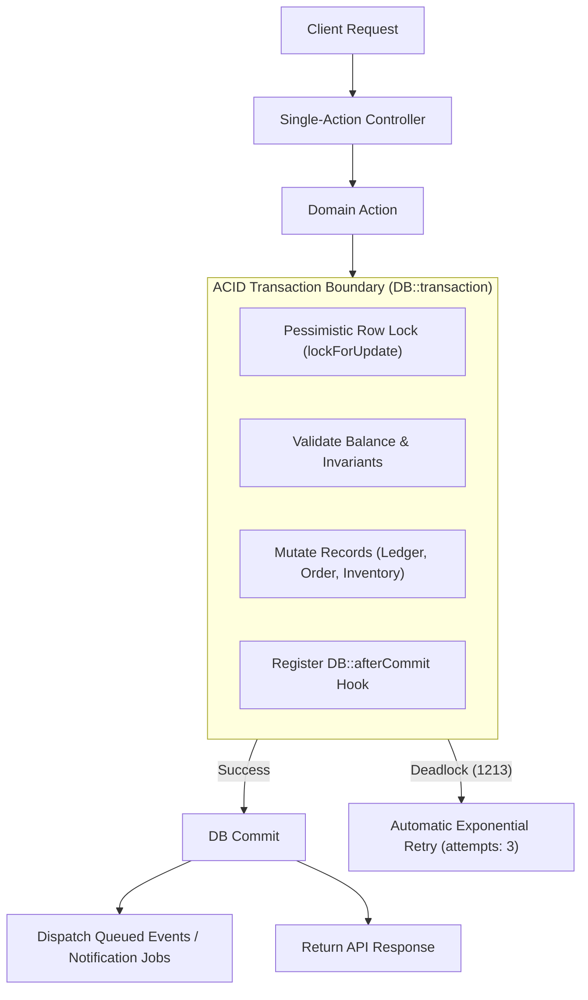

# Laravel 13 & Modern PHP 8.5+ Database Transactions, Concurrency & Deadlock Architecture

This document defines the production engineering standards for handling ACID database transactions, concurrency control, deadlock recovery, and post-commit event dispatching in Laravel 13 and PHP 8.5+.

---

## 1. Executive Principles of Database Concurrency

High-concurrency SaaS applications face race conditions (double spending, overselling limited inventory, negative balances) and database deadlocks when multiple workers mutate overlapping rows concurrently.



---

## 2. The 5 Mandatory Transaction Rules

1. **Deadlock Automatic Retry**:
   - Always specify retry attempts on transactions: `DB::transaction(fn () => ..., attempts: 3)`.
   - Never catch deadlock exceptions (`1213` in MySQL, `40P01` in Postgres) manually; let Laravel's transaction manager handle retries.
2. **Pessimistic Locking on High-Contention State**:
   - Always acquire an exclusive row lock (`lockForUpdate()`) when reading state that will be mutated based on its current value (e.g. inventory counters, wallet balances).
3. **NEVER Execute External HTTP Calls Inside Transactions**:
   - External API calls (Stripe, Twilio, Webhooks, AI SDK inference) can take hundreds of milliseconds or timeout.
   - Performing HTTP calls inside a database transaction holds database connection pool sockets, keeps locks active, and exhausts MySQL/PostgreSQL worker threads.
4. **Use `afterCommit` for Side Effects**:
   - Never dispatch background jobs, send emails, or broadcast WebSockets inside an active transaction.
   - Use `DB::afterCommit(fn () => ...)` or implement `ShouldHandleEventsAfterCommit` so that side effects only fire if the database transaction successfully commits.
5. **Keep Transactions as Short as Possible**:
   - Pre-compute all data, validate inputs in Form Requests, and prepare DTOs *before* opening the transaction.

---

## 3. Production Implementation: Financial Transfer Action

```php
declare(strict_types=1);

namespace App\Actions\Billing;

use App\Data\Billing\TransferFundsDto;
use App\Events\Billing\FundsTransferredEvent;
use App\Exceptions\Billing\InsufficientBalanceException;
use App\Models\LedgerEntry;
use App\Models\Wallet;
use Illuminate\Support\Facades\DB;
use Throwable;

final readonly class TransferFundsAction
{
    /**
     * @throws InsufficientBalanceException|Throwable
     */
    #[\NoDiscard]
    public function execute(TransferFundsDto $dto): LedgerEntry
    {
        // 1. Wrap in transaction with 3 deadlock retry attempts
        return DB::transaction(function () use ($dto): LedgerEntry {
            // 2. Lock sender and receiver rows deterministically to prevent cross-deadlocks
            $walletIds = [$dto->senderWalletId, $dto->receiverWalletId];
            sort($walletIds); // Canonical sorting prevents lock-order deadlocks

            /** @var array<string, Wallet> $wallets */
            $wallets = Wallet::query()
                ->whereIn('id', $walletIds)
                ->lockForUpdate()
                ->get()
                ->keyBy('id')
                ->all();

            $sender = $wallets[$dto->senderWalletId] ?? throw new InsufficientBalanceException('Sender wallet not found.');
            $receiver = $wallets[$dto->receiverWalletId] ?? throw new InsufficientBalanceException('Receiver wallet not found.');

            // 3. Verify invariants under row lock
            if ($sender->balance_cents < $dto->amountCents) {
                throw new InsufficientBalanceException(
                    sprintf('Insufficient balance: available %d cents, requested %d cents.', $sender->balance_cents, $dto->amountCents)
                );
            }

            // 4. Perform atomic balance mutations
            $sender->decrement('balance_cents', $dto->amountCents);
            $receiver->increment('balance_cents', $dto->amountCents);

            // 5. Create immutable audit ledger entry
            $ledger = LedgerEntry::query()->create([
                'sender_wallet_id' => $sender->id,
                'receiver_wallet_id' => $receiver->id,
                'amount_cents' => $dto->amountCents,
                'idempotency_key' => $dto->idempotencyKey,
                'transferred_at' => now(),
            ]);

            // 6. Safe Post-Commit Side Effect
            DB::afterCommit(function () use ($ledger): void {
                event(new FundsTransferredEvent($ledger->id));
            });

            return $ledger;
        }, attempts: 3);
    }
}
```

---

## 4. Concurrency Locking Models

### 4.1 Pessimistic Locking (`lockForUpdate`)

Use pessimistic locking when write conflict probability is high (e.g. flash sales, event ticketing, wallet transfers):

```php
// Acquires 'FOR UPDATE' row lock
$product = Product::query()->where('id', $productId)->lockForUpdate()->firstOrFail();

if ($product->stock_count < $requestedQuantity) {
    throw new OutOfStockException();
}

$product->decrement('stock_count', $requestedQuantity);
```

### 4.2 Shared Locking (`sharedLock`)

Use `sharedLock()` ('FOR SHARE' / 'LOCK IN SHARE MODE') when you need to read rows and guarantee that other transactions cannot mutate them, but multiple transactions can read simultaneously:

```php
// Prevent other transactions from updating while we generate an invoice snapshot
$order = Order::query()->where('id', $orderId)->sharedLock()->firstOrFail();
```

### 4.3 Optimistic Locking (Version Column)

Use optimistic locking when conflict probability is low, avoiding heavy database row locks by validating a `version` or `updated_at` column:

```php
$affected = Article::query()
    ->where('id', $articleId)
    ->where('version', $currentVersion)
    ->update([
        'title' => $newTitle,
        'version' => $currentVersion + 1,
    ]);

if ($affected === 0) {
    throw new ConcurrentModificationException('Record was modified by another user. Please reload.');
}
```

---

## 5. Event & Queue Safety: `ShouldHandleEventsAfterCommit`

When dispatching events from inside transactions, asynchronous queue workers might pick up the job before the database transaction has finished committing. The worker then attempts to query the database, fails to find the new row, and crashes with `ModelNotFoundException`.

### Solution: Post-Commit Queueing

Declare the listener with `ShouldHandleEventsAfterCommit`:

```php
declare(strict_types=1);

namespace App\Listeners\Billing;

use App\Events\Billing\FundsTransferredEvent;
use Illuminate\Contracts\Events\ShouldHandleEventsAfterCommit;
use Illuminate\Contracts\Queue\ShouldQueue;
use Illuminate\Queue\InteractsWithQueue;

final class SendTransferReceiptNotification implements ShouldQueue, ShouldHandleEventsAfterCommit
{
    use InteractsWithQueue;

    public function handle(FundsTransferredEvent $event): void
    {
        // Guaranteed to run ONLY AFTER the parent database transaction has fully committed
    }
}
```

---

## 6. Architectural Checklist for Transactions

| Pattern | Rule | Risk if Violated |
| :--- | :--- | :--- |
| **Deadlock Retries** | Always pass `attempts: 3` | Unhandled `1213 Deadlock` crashes user request |
| **Row Locking** | Use `lockForUpdate()` for balance checks | Race conditions leading to double spending |
| **Lock Ordering** | Sort IDs canonically (`sort($ids)`) | Symmetrical lock-order deadlocks ($A \rightarrow B$ vs $B \rightarrow A$) |
| **External HTTP** | NEVER call APIs inside transactions | Database connection pool exhaustion, 504 timeouts |
| **Side Effects** | Use `DB::afterCommit()` or `ShouldHandleEventsAfterCommit` | Queue worker runs before commit and encounters missing records |
| **Transaction Scope** | Keep execution under 50ms | Worker thread backlog and database table lock contention |
