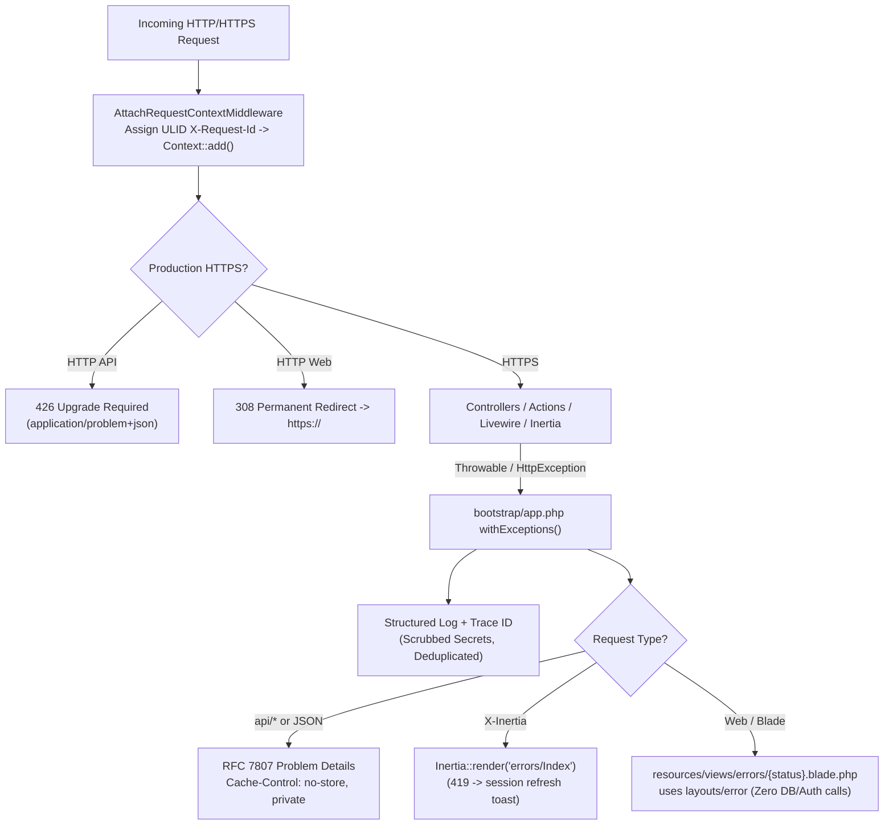

# Master Architectural Guide: Error Handling, Error Pages, Error Components & HTTP/HTTPS Transport Resilience

> **Document**: `docs/architecture/error-handling-pages-and-components.md`  
> **Framework**: Laravel 13 & PHP 8.6+ (Blade, Livewire v3/v4, Inertia.js v2: Vue 3, React 19, Svelte 5)  
> **Standards**: RFC 7807 Problem Details, WCAG 2.2 Accessibility (`role="alert"`, `aria-live`), OWASP Error Handling & Transport Security (TLS 1.2+/HSTS).

---

## 1. End-to-End Error Lifecycle Architecture



---

## 2. Domain Exception Hierarchy (`app/Exceptions/`)

Model predictable business failures as typed, final domain exceptions instead of throwing generic `\Exception` or returning raw arrays:

```php
<?php

declare(strict_types=1);

namespace App\Exceptions;

use Exception;
use Symfony\Component\HttpFoundation\Response;

abstract class DomainException extends Exception
{
    abstract public function statusCode(): int;

    abstract public function errorCode(): string;

    abstract public function title(): string;
}
```

```php
<?php

declare(strict_types=1);

namespace App\Exceptions\Billing;

use App\Exceptions\DomainException;
use Symfony\Component\HttpFoundation\Response;

final class UpstreamGatewayUnavailableException extends DomainException
{
    public function __construct(
        public readonly string $provider,
        string $message = 'The payment provider is temporarily unreachable over HTTPS.',
    ) {
        parent::__construct($message);
    }

    public function statusCode(): int
    {
        return Response::HTTP_SERVICE_UNAVAILABLE;
    }

    public function errorCode(): string
    {
        return 'UPSTREAM_GATEWAY_UNAVAILABLE';
    }

    public function title(): string
    {
        return 'Payment Provider Unavailable';
    }
}
```

---

## 3. Isolated Error Layout & Native Blade Error Pages

### A. Zero-Dependency Error Layout (`resources/views/components/layouts/error.blade.php`)

Place the anonymous Blade error layout under `resources/views/components/layouts/error.blade.php` so Laravel automatically discovers `<x-layouts.error>` (or explicitly register `Blade::anonymousComponentPath(resource_path('views/layouts'), 'layouts')` in `AppServiceProvider::boot()` if you keep layouts under `resources/views/layouts/`). Never call `auth()->user()`, database queries, or Redis sessions inside the error layout: when a `500` or `503` happens during an infrastructure outage, the error page must still render cleanly.

```blade
@props(['title' => 'Error', 'status' => 500])

<!DOCTYPE html>
<html lang="{{ str_replace('_', '-', app()->getLocale()) }}" class="h-full bg-zinc-950 text-zinc-100">
<head>
    <meta charset="utf-8">
    <meta name="viewport" content="width=device-width, initial-scale=1">
    <meta name="robots" content="noindex, nofollow">
    <title>{{ $status }} — {{ $title }} | {{ config('app.name') }}</title>
    @vite(['resources/css/app.css', 'resources/js/app.js'])
</head>
<body class="flex min-h-full flex-col items-center justify-center overflow-x-clip px-6 py-12 font-sans antialiased">
    <x-error.https-transport />

    <main class="w-full max-w-xl">
        {{ $slot }}
    </main>

    <footer class="mt-8 text-center text-xs text-zinc-500">
        {{ config('app.name') }} &middot; Secure HTTPS Service
    </footer>
</body>
</html>
```

### B. Complete Blade Status Pages (`resources/views/errors/*.blade.php`)

Delegate every status view (`400`, `401`, `402`, `403`, `404`, `419`, `422`, `429`, `500`, `502`, `503`, `504`) to `<x-error.http-status />` so typography, Trace IDs, and recovery CTAs stay 100% consistent:

```blade
{{-- resources/views/errors/404.blade.php --}}
<x-layouts.error status="404" title="Page Not Found">
    <x-error.http-status
        :status="404"
        :trace-id="request()->attributes->get('trace_id')"
    />
</x-layouts.error>
```

```blade
{{-- resources/views/errors/419.blade.php (CSRF / Session Expired) --}}
<x-layouts.error status="419" title="Session Expired">
    <x-error.http-status
        :status="419"
        :trace-id="request()->attributes->get('trace_id')"
    />
</x-layouts.error>
```

```blade
{{-- resources/views/errors/429.blade.php (Rate Limited with Retry-After) --}}
<x-layouts.error status="429" title="Too Many Requests">
    <x-error.http-status
        :status="429"
        :retry-after="$exception?->getHeaders()['Retry-After'] ?? 60"
        :trace-id="request()->attributes->get('trace_id')"
    />
</x-layouts.error>
```

```blade
{{-- resources/views/errors/500.blade.php (Zero Stack-Trace Exposure) --}}
<x-layouts.error status="500" title="Server Error">
    <x-error.http-status
        :status="500"
        :trace-id="request()->attributes->get('trace_id')"
    />
</x-layouts.error>
```

```blade
{{-- resources/views/errors/503.blade.php (Maintenance / Upstream Outage) --}}
<x-layouts.error status="503" title="Service Unavailable">
    <x-error.http-status
        :status="503"
        :retry-after="$exception?->getHeaders()['Retry-After'] ?? 30"
        :trace-id="request()->attributes->get('trace_id')"
    />
</x-layouts.error>
```

---

## 4. Inertia.js v2 Error Pages & Error Components (Vue 3, React 19, Svelte 5)

### A. Vue 3 (TypeScript) Error Page + ErrorBoundary

```vue
<!-- resources/js/pages/errors/Index.vue -->
<script setup lang="ts">
import { Head, Link } from '@inertiajs/vue3';
import { computed, onMounted, onUnmounted, ref } from 'vue';
import ErrorLayout from '@/layouts/ErrorLayout.vue';
import HttpsTransportAlert from '@/components/error/HttpsTransportAlert.vue';

interface Props {
  status: number;
  traceId?: string;
  retryAfter?: string | number | null;
  isSecure?: boolean;
}

const props = defineProps<Props>();

const copyMap: Record<number, { title: string; detail: string }> = {
  400: { title: 'Bad Request', detail: 'The request payload or parameters could not be parsed.' },
  401: { title: 'Authentication Required', detail: 'Sign in to access this page.' },
  403: { title: 'Access Denied', detail: 'You do not have permission to access this resource.' },
  404: { title: 'Page Not Found', detail: 'This page does not exist or has been relocated.' },
  419: { title: 'Session Expired', detail: 'Reload to obtain a new CSRF security token.' },
  429: { title: 'Too Many Requests', detail: 'Rate limit exceeded. Wait before trying again.' },
  500: { title: 'Server Error', detail: 'An unexpected error occurred on our servers.' },
  502: { title: 'Bad Gateway', detail: 'An upstream HTTPS service returned an invalid response.' },
  503: { title: 'Service Unavailable', detail: 'Scheduled maintenance or temporary overload.' },
  504: { title: 'Gateway Timeout', detail: 'The upstream server failed to respond in time.' },
};

const meta = computed(() => copyMap[props.status] ?? copyMap[500]);
const remaining = ref<number>(props.retryAfter ? Math.max(0, Number(props.retryAfter)) : 0);
const copied = ref(false);
let timer: ReturnType<typeof setInterval> | null = null;

onMounted(() => {
  if (remaining.value > 0) {
    timer = setInterval(() => {
      if (remaining.value > 0) remaining.value -= 1;
      else if (timer) clearInterval(timer);
    }, 1000);
  }
});

onUnmounted(() => {
  if (timer) clearInterval(timer);
});

async function copyTrace(): Promise<void> {
  if (!props.traceId) return;
  await navigator.clipboard?.writeText(props.traceId);
  copied.value = true;
  setTimeout(() => (copied.value = false), 2000);
}
</script>

<template>
  <ErrorLayout :status="status" :title="meta.title">
    <Head :title="`${status} — ${meta.title}`" />
    <HttpsTransportAlert :enforce-https="true" />

    <section role="alert" class="rounded-2xl border border-zinc-800 bg-zinc-900/70 p-8 shadow-xl">
      <div class="flex items-center justify-between gap-4">
        <span class="font-mono text-sm font-semibold" :class="status >= 500 ? 'text-rose-400' : 'text-amber-400'">
          HTTP {{ status }}
        </span>
        <button
          v-if="traceId"
          type="button"
          class="rounded-md border border-zinc-800 bg-zinc-950 px-2.5 py-1 font-mono text-xs text-zinc-400 hover:border-zinc-700 hover:text-zinc-200"
          @click="copyTrace"
        >
          {{ copied ? 'Copied Trace ID' : `Trace: ${traceId.slice(0, 12)}` }}
        </button>
      </div>

      <h1 class="mt-4 text-3xl font-semibold tracking-tight text-zinc-50">{{ meta.title }}</h1>
      <p class="mt-3 text-base leading-relaxed text-zinc-400">{{ meta.detail }}</p>

      <div v-if="remaining > 0" class="mt-5 rounded-lg border border-amber-500/30 bg-amber-500/10 px-4 py-3 font-mono text-sm text-amber-300">
        Retry available in {{ remaining }}s
      </div>

      <div class="mt-8 flex flex-wrap gap-3">
        <button
          v-if="status >= 500 || status === 419"
          type="button"
          class="rounded-lg bg-zinc-100 px-4 py-2 text-sm font-medium text-zinc-950 hover:bg-white active:scale-[0.98]"
          @click="window.location.reload()"
        >
          Reload Page
        </button>
        <Link
          href="/"
          class="rounded-lg border border-zinc-800 bg-zinc-950 px-4 py-2 text-sm font-medium text-zinc-300 hover:border-zinc-700 hover:text-zinc-100"
        >
          Return Home
        </Link>
      </div>
    </section>
  </ErrorLayout>
</template>
```

### B. React 19 (TypeScript) ErrorBoundary + HTTPS Transport Alert

```tsx
// resources/js/components/ui/error/ErrorBoundary.tsx
import React, { Component, type ErrorInfo, type ReactNode } from 'react';

interface Props {
  children: ReactNode;
  fallbackTitle?: string;
}

interface State {
  hasError: boolean;
  message: string;
}

export class ErrorBoundary extends Component<Props, State> {
  public state: State = { hasError: false, message: '' };

  public static getDerivedStateFromError(error: Error): State {
    return { hasError: true, message: error.message || 'Component failed to render.' };
  }

  public componentDidCatch(error: Error, info: ErrorInfo): void {
    console.error('[UI ErrorBoundary]', error, info.componentStack);
  }

  public render(): ReactNode {
    if (this.state.hasError) {
      return (
        <div role="alert" className="rounded-xl border border-rose-500/30 bg-rose-500/10 p-6 text-sm text-rose-100">
          <h2 className="font-semibold">{this.props.fallbackTitle ?? 'Section failed to load'}</h2>
          <p className="mt-1 text-xs text-rose-200/80">
            An unexpected rendering error occurred. Reload or retry this section.
          </p>
          <button
            type="button"
            onClick={() => this.setState({ hasError: false, message: '' })}
            className="mt-4 rounded-md border border-rose-400/40 px-3 py-1.5 text-xs font-medium text-rose-100 hover:bg-rose-500/20"
          >
            Try Again
          </button>
        </div>
      );
    }

    return this.props.children;
  }
}
```

### C. Svelte 5 (Runes) Inline Field Error & Boundary

```svelte
<!-- resources/js/components/ui/error/FieldError.svelte -->
<script lang="ts">
  interface Props {
    id?: string;
    message?: string | null;
  }

  let { id, message }: Props = $props();
</script>

{#if message}
  <p {id} role="alert" aria-live="polite" class="mt-1.5 text-xs font-medium text-rose-400">
    {message}
  </p>
{/if}
```

Wrap unstable widgets in Svelte 5 using native `<svelte:boundary>`:

```svelte
<svelte:boundary onerror={(err) => console.error('[Svelte Boundary]', err)}>
  <LiveMetricsPanel />
  {#snippet failed(_error, reset)}
    <div role="alert" class="rounded-xl border border-rose-500/30 bg-rose-500/10 p-5 text-sm text-rose-100">
      <p class="font-medium">Unable to render metrics panel.</p>
      <button type="button" onclick={reset} class="mt-3 rounded-md border border-rose-400/40 px-3 py-1.5 text-xs">
        Retry
      </button>
    </div>
  {/snippet}
</svelte:boundary>
```

---

## 5. HTTPS / TLS Transport Security Checklist

1. **Force HTTPS URLs in Production (`AppServiceProvider::boot()`)**:
   ```php
   if (app()->isProduction()) {
       URL::forceScheme('https');
   }
   ```
2. **HSTS & Upgrade Insecure Requests**:
   Emit `Strict-Transport-Security: max-age=31536000; includeSubDomains; preload` on HTTPS responses and `upgrade-insecure-requests` inside `Content-Security-Policy` to eliminate mixed-content errors.
3. **Prevent Proxy HTTPS Redirect Loops**:
   Configure `$middleware->trustProxies(at: ..., headers: Request::HEADER_X_FORWARDED_FOR | Request::HEADER_X_FORWARDED_HOST | Request::HEADER_X_FORWARDED_PORT | Request::HEADER_X_FORWARDED_PROTO)` in `bootstrap/app.php` with explicit proxy CIDRs so `$request->isSecure()` accurately reflects TLS termination at Cloudflare/ALB/Nginx.
4. **Zero TLS Downgrades on Outbound `Http::` Requests**:
   NEVER call `Http::withoutVerifying()` or set `CURLOPT_SSL_VERIFYPEER => false` in production code. Catch `ConnectionException` cleanly and render `502`/`503`/`504` with Trace ID.

---

## 6. Pest 3 Verification Suite (`tests/Feature/ErrorHandlingTest.php`)

```php
<?php

declare(strict_types=1);

use App\Exceptions\Billing\UpstreamGatewayUnavailableException;
use Illuminate\Support\Facades\Route;

it('renders RFC 7807 Problem Details with Trace ID and no-store on API 404', function (): void {
    config()->set('app.debug', false);

    $this->getJson('/api/v1/does-not-exist')
        ->assertNotFound()
        ->assertHeader('Content-Type', 'application/problem+json')
        ->assertHeader('Cache-Control', 'no-store, private')
        ->assertHeader('X-Request-Id')
        ->assertJsonPath('status', 404)
        ->assertJsonMissingPath('trace');
});

it('renders custom 404 Blade page without leaking exception details', function (): void {
    config()->set('app.debug', false);

    $this->get('/non-existent-page-xyz')
        ->assertNotFound()
        ->assertHeader('Cache-Control', 'no-store, private')
        ->assertSee('HTTP 404')
        ->assertSee('Page Not Found')
        ->assertDontSee('Stack trace');
});

it('translates custom DomainException into 503 RFC 7807 response', function (): void {
    Route::get('/api/v1/_test-upstream', function (): never {
        throw new UpstreamGatewayUnavailableException('stripe');
    });

    $this->getJson('/api/v1/_test-upstream')
        ->assertServiceUnavailable()
        ->assertJsonPath('code', 'UPSTREAM_GATEWAY_UNAVAILABLE')
        ->assertHeader('Cache-Control', 'no-store, private');
});
```
