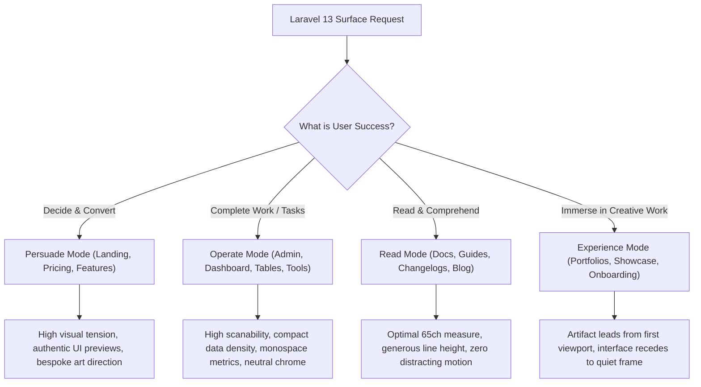

# Master Guide: Frontend Design Craft, Anti-AI-Slop & Aesthetic Taste in Laravel 13

This guide establishes the production-grade engineering and aesthetic standards for all frontend code generated, refactored, and architected in **Laravel 13 & PHP 8.6+**. It integrates the core methodologies of the three premier AI frontend design systems:

- **Paul Bakaus's Impeccable** (`pbakaus/impeccable`): Structured design vocabulary, `PRODUCT.md` / `DESIGN.md` governance, and deterministic anti-pattern detection (`npx impeccable detect`).
- **Leon Lin's Taste Skill** (`Leonxlnx/taste-skill`): Anti-slop frontend taste (the bar is figma.com, x.ai, linear.app), business kind driving visual treatment, one section per screen, and quiet micro-interactions.
- **Hassan El Mghari's Hallmark** (`nutlope/hallmark`): The Hard Floor against model defaults, the Hero Viewport Invariant (headline, 1 sentence, and CTA at 1280x800 without scrolling), thematic materials, and zero fake metrics or placeholder logos.

---

## 1. Executive Anti-AI-Slop Manifesto

Most AI-generated frontend code converges into predictable, formulaic templates colloquially known as **"AI slop"**:
- Purple-to-blue or indigo-to-pink gradient hero titles.
- Predictable 3-column grids of identical cards (icon in rounded circle + H3 + 2 lines of filler text).
- Overused pill tags and eyebrows floating above every single heading (`[✨ AI-POWERED PLATFORM]`).
- Generic typography with Inter font, arbitrary negative tracking, or mixed roman/italic display fonts.
- Unfocused motion with `transition: all` or animating layout properties (`width`, `height`, `top`).
- Fake metrics ("99.9% customer happiness", "10,000+ teams"), imaginary logos, or stock photos pretending to be users.
- Default un-themed browser chrome: blinding blue focus rings, default gray scrollbars, un-styled text selection.

In Laravel 13, frontend interfaces must look **human-crafted, intentional, and tailored to the client's domain**.

---

## 2. The 10 Invariant House Rules (The Hard Floor)

Every Blade view, Livewire component, and Inertia.js template must strictly satisfy these rules:

| # | Rule | Strict Requirement | Anti-Pattern to Reject |
| :-: | :--- | :--- | :--- |
| **1** | **No Cliché Gradients** | Monochromatic tones, warm analog neutrals, or brand contrast | `bg-gradient-to-r from-purple-600 to-blue-500` |
| **2** | **No Identical 3-Card Grids** | Asymmetric Bento layouts, live interactive previews, data tables | Repeated 3-column `[Icon + H3 + paragraph]` cards |
| **3** | **No Eyebrows / Pill Badges** | The headline carries its own weight; let typography speak | `[✨ AI-POWERED]` or `[NEW FEATURE]` above headings |
| **4** | **Hero Viewport Invariant** | Headline, 1 sentence, and CTA visible at 1280x800 without scroll | Gigantic `py-32` padding pushing CTA below fold |
| **5** | **Material Honesty** | Real product UI, authentic numbers, real customer quotes | Invented testimonials, fake metrics, unverified logos |
| **6** | **Restrained Motion** | Only animate `transform`, `opacity`, `filter`. Reduced-motion check | `transition: all`, animating `width`/`height`/`top`/`left` |
| **7** | **Themed Browser Surfaces** | Theme `::selection`, `caret-color`, custom scrollbars, `:focus-visible` | Default browser selection blue, unstyled gray scrollbars |
| **8** | **Real SVG Icons Only** | Clean single-weight SVG icons from Blade icons or Lucide | Emoji (`🚀`, `✨`, `🔥`, `💡`) used as UI glyphs |
| **9** | **Typography Discipline** | Body measure 65–75ch; display max 5rem; tracking floor `-0.03em` | Mixed roman/italic display fonts; negative body tracking |
| **10**| **One Section Per Screen** | At 1440x900, sections occupy intentional viewport heights | Orphaned section headings peeking in from bottom edge |

---

## 3. Surface Modes: Matching Ambition to Purpose

In accordance with Impeccable's mode taxonomy, every surface in a Laravel application belongs to one of four modes:



---

## 4. Business Kind Drives the Art Direction

In accordance with Taste Skill, the client's business category dictates the layout and media strategy:

### 1. Software, SaaS & Developer Tools (`site-kind: software`)
- **Primary Visual**: High-fidelity product UI, interactive code terminals, live pipeline diagrams.
- **Graphic Elements**: Directed DAG graphs with pulse dots, data density tables, keyboard shortcut badges (`kbd`).
- **Tone**: Modern minimal, technical, dark or crisp slate/zinc themes.

### 2. Physical Products & Hardware (`site-kind: product`)
- **Primary Visual**: High-resolution studio photography of the physical object (2+ photos per screen).
- **Graphic Elements**: Exploded diagrams, technical dimension callouts, material swatches.
- **Tone**: Tactile, material-focused, restrained editorial typography.

### 3. Local Places & Hospitality (`site-kind: place`)
- **Primary Visual**: Authentic environmental photography (12–20 photos across the full page).
- **Graphic Elements**: Large typographic moments (address, hours, signature dish), visit & booking block on screen 2.
- **Strict Prohibition**: Zero tech effects, zero WebGL shaders, zero animated particle loops.

---

## 5. Design Tokens & CSS Variables Architecture

All styles in Laravel 13 must link back to declared CSS tokens at `:root` (or in Tailwind v4 theme configuration):

```css
/* resources/css/tokens.css */
:root {
    /* Brand Palettes: High-contrast, analog neutrals */
    --color-background: #09090b;
    --color-foreground: #fafafa;
    --color-muted: #71717a;
    --color-border: #27272a;
    --color-card: #18181b;
    
    /* Semantic Accents */
    --color-accent: #3b82f6;
    --color-accent-subtle: rgba(59, 130, 246, 0.15);
    
    /* Typography Scales */
    --font-sans: 'Geist', -apple-system, BlinkMacSystemFont, 'Segoe UI', Roboto, sans-serif;
    --font-mono: 'Geist Mono', ui-monospace, SFMono-Regular, Menlo, Monaco, Consolas, monospace;
    --font-display: 'Instrument Serif', Georgia, serif;
    
    /* Layout Invariants */
    --max-measure: 68ch;
    --container-max-width: 1280px;
    
    /* Motion Easing Curves (Exponential Ease-Out) */
    --ease-out-expo: cubic-bezier(0.16, 1, 0.3, 1);
    --duration-micro: 150ms;
    --duration-standard: 250ms;
}

/* Themed Browser Native Surfaces */
::selection {
    background-color: var(--color-accent-subtle);
    color: var(--color-foreground);
}

input, textarea {
    caret-color: var(--color-accent);
}

/* Custom Themed Scrollbar */
* {
    scrollbar-width: thin;
    scrollbar-color: var(--color-border) transparent;
}

::-webkit-scrollbar {
    width: 6px;
    height: 6px;
}

::-webkit-scrollbar-thumb {
    background: var(--color-border);
    border-radius: 3px;
}

::-webkit-scrollbar-thumb:hover {
    background: var(--color-muted);
}
```

---

## 6. Micro-Interactions & Motion Choreography

All motion in Laravel 13 must be quiet, purposeful, and GPU-accelerated:

```css
/* resources/css/motion.css */

/* Micro-interaction: Card lift */
.card-hover {
    transition: transform var(--duration-micro) var(--ease-out-expo), 
                box-shadow var(--duration-micro) var(--ease-out-expo),
                border-color var(--duration-micro) ease;
}
.card-hover:hover {
    transform: translateY(-2px);
    box-shadow: 0 10px 25px -5px rgba(0, 0, 0, 0.3);
}

/* Micro-interaction: Button active press */
.btn-press {
    transition: transform 100ms ease, background-color var(--duration-micro) ease;
}
.btn-press:active {
    transform: scale(0.98);
}

/* Micro-interaction: Frame photo zoom */
.frame-photo {
    transition: transform 400ms var(--ease-out-expo);
}
.frame-container:hover .frame-photo {
    transform: scale(1.025);
}

/* Reduced Motion Safety */
@media (prefers-reduced-motion: reduce) {
    *, ::before, ::after {
        animation-duration: 0.01ms !important;
        animation-iteration-count: 1 !important;
        transition-duration: 0.01ms !important;
        scroll-behavior: auto !important;
    }
}
```

---

## 7. Multi-Stack Component Blueprints

### Blueprint 1: Blade UI Button Primitive (`components/ui/button.blade.php`)

```blade
@props([
    'variant' => 'primary',
    'size' => 'md',
    'as' => 'button',
])

@php
$baseClasses = 'inline-flex items-center justify-center font-medium rounded-lg transition-all duration-150 focus-visible:outline focus-visible:outline-2 focus-visible:outline-offset-2 active:scale-[0.98] disabled:opacity-50 disabled:pointer-events-none select-none';

$variants = [
    'primary' => 'bg-zinc-100 text-zinc-900 hover:bg-white hover:-translate-y-0.5 focus-visible:outline-white shadow-sm',
    'secondary' => 'border border-zinc-800 bg-zinc-900/60 text-zinc-200 hover:border-zinc-700 hover:text-white focus-visible:outline-zinc-500',
    'subtle' => 'text-zinc-400 hover:text-zinc-100 hover:bg-zinc-800/40 focus-visible:outline-zinc-600',
    'danger' => 'bg-rose-500/10 text-rose-400 border border-rose-500/30 hover:bg-rose-500/20 focus-visible:outline-rose-500',
];

$sizes = [
    'sm' => 'px-3 py-1.5 text-xs gap-1.5',
    'md' => 'px-4 py-2 text-sm gap-2',
    'lg' => 'px-6 py-3 text-base gap-2.5',
];

$classes = $baseClasses . ' ' . ($variants[$variant] ?? $variants['primary']) . ' ' . ($sizes[$size] ?? $sizes['md']);
@endphp

<{{ $as }} {{ $attributes->merge(['class' => $classes]) }}>
    {{ $slot }}
</{{ $as }}>
```

### Blueprint 2: Livewire v4 Feature Section (Bento Grid, Anti-Slop)

```blade
{{-- resources/views/pages/home/components/bento-features.blade.php --}}
<section class="mx-auto max-w-7xl px-6 py-20 lg:py-24">
    <!-- Clean, purposeful heading without eyebrow cliché -->
    <div class="max-w-3xl">
        <h2 class="text-3xl font-semibold tracking-tight text-zinc-100 sm:text-4xl text-balance">
            Architecture engineered for continuous throughput.
        </h2>
        <p class="mt-4 text-lg text-zinc-400 leading-relaxed text-pretty">
            Replace fragmented middleware with strict single-action invokables, async queue pools, and compile-time boundary enforcement.
        </p>
    </div>

    <!-- Asymmetric Bento Grid (Replaces 3 identical cards) -->
    <div class="mt-12 grid grid-cols-1 gap-6 md:grid-cols-3 lg:grid-cols-4">
        <!-- Tile 1: Large feature preview (2 cols) -->
        <div class="group relative rounded-2xl border border-zinc-800 bg-zinc-900/40 p-8 md:col-span-2 card-hover">
            <h3 class="text-xl font-semibold text-zinc-100">Deterministic Transaction Isolation</h3>
            <p class="mt-2 text-sm text-zinc-400 leading-relaxed max-w-md">
                Pessimistic row locking with 3 automatic deadlock retry attempts on critical ledger balances.
            </p>
            <div class="mt-6 rounded-xl border border-zinc-800/80 bg-zinc-950 p-4 font-mono text-xs text-zinc-300">
                <span class="text-emerald-400">DB::transaction</span>(fn () => <span class="text-accent">$account->lockForUpdate()</span>, attempts: 3);
            </div>
        </div>

        <!-- Tile 2: Metric visual (1 col) -->
        <div class="group relative rounded-2xl border border-zinc-800 bg-zinc-900/40 p-8 card-hover flex flex-col justify-between">
            <div>
                <h3 class="text-xl font-semibold text-zinc-100">Zero N+1</h3>
                <p class="mt-2 text-sm text-zinc-400 leading-relaxed">
                    Eager loading constraints strictly audited in non-production environments.
                </p>
            </div>
            <div class="mt-8 font-mono text-3xl font-bold tracking-tight text-zinc-100">
                O(1) <span class="text-xs font-normal text-zinc-500 font-sans">Cursor Streaming</span>
            </div>
        </div>

        <!-- Tile 3: Interactive code block (1 col) -->
        <div class="group relative rounded-2xl border border-zinc-800 bg-zinc-900/40 p-8 card-hover">
            <h3 class="text-xl font-semibold text-zinc-100">Level 8 Static Typing</h3>
            <p class="mt-2 text-sm text-zinc-400 leading-relaxed">
                Generic docblocks on all Eloquent relationships and query builders.
            </p>
            <div class="mt-6 inline-flex items-center gap-2 rounded-full border border-emerald-500/30 bg-emerald-500/10 px-3 py-1 text-xs font-medium text-emerald-400">
                <x-icon.check class="w-3.5 h-3.5" /> PHPStan Max Pass
            </div>
        </div>
    </div>
</section>
```

---

## 8. Design Governance CLI Workflow

Antigravity provides direct command integration to audit and refine your Laravel views and components:

```bash
# 1. Run Impeccable Anti-Pattern Detection across views
npx impeccable detect resources/views/

# 2. Audit a specific Blade or Inertia page
npx impeccable audit resources/views/pages/home/index.blade.php

# 3. Shape a new feature before writing templates
npx impeccable shape "Subscription checkout with invoice selector"

# 4. Polish typography, rhythm, and tone
npx impeccable polish resources/views/pages/admin/dashboard/index.blade.php

# 5. Check UI with Hallmark sloplint
node ~/.gemini/config/skills/hallmark/scripts/sloplint.mjs resources/views/pages/home/index.blade.php --render
```

---

## 9. Automated Pest 3 Architecture Tests

Codify these design rules in `tests/Arch/FrontendDesignTest.php`:

```php
<?php

declare(strict_types=1);

test('blade views do not contain forbidden anti-pattern classes')
    ->expect('resources/views')
    ->not->toUse([
        'bg-gradient-to-r from-purple',
        'from-purple-600 to-blue-500',
        'from-indigo-500 to-pink-500',
        'transition-all',
    ]);

test('blade templates avoid inline style attributes')
    ->expect('resources/views')
    ->not->toUse('style=');

test('all SVG icon components reside strictly under components/icon')
    ->expect('resources/views/components/icon')
    ->toHaveFiles();
```
