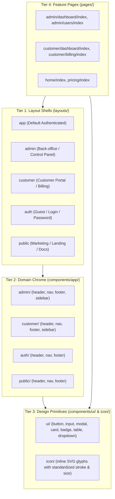

# Laravel 13 Frontend Layouts, Components & Pages Directory Architecture

This document defines the standardized directory structure, component categorization, layout boundaries, and page organization across all frontend stacks in Laravel 13: **Blade**, **Livewire (v3 & v4)**, and **Inertia.js v2** (**Vue 3**, **React 19/18**, and **Svelte 5**).

---

## 1. Executive Directory Philosophy: The 4-Tier Hierarchy

To prevent cluttered views, duplicated layouts, and leaky abstractions, all frontend assets in Laravel 13 must adhere strictly to a **4-Tier Hierarchy**:



---

## 2. Directory Tree Specifications

### A. Blade & Livewire v3/v4 (`resources/views/`)

```text
resources/views/
├── layouts/
│   ├── app.blade.php                  # Base application shell
│   ├── auth.blade.php                 # Guest login, register, password reset shell
│   ├── customer.blade.php             # Customer portal shell (topbar + account nav)
│   ├── admin.blade.php                # Admin back-office shell (collapsible sidebar + header)
│   └── public.blade.php               # Marketing & landing page shell
├── components/
│   ├── app/
│   │   ├── admin/
│   │   │   ├── header.blade.php       # Admin top navigation bar & search
│   │   │   ├── nav.blade.php          # Admin breadcrumbs & quick tabs
│   │   │   ├── footer.blade.php       # Admin copyright & environment indicator
│   │   │   └── sidebar.blade.php      # Admin persistent/collapsible menu
│   │   ├── customer/
│   │   │   ├── header.blade.php       # Customer header with tenant/team switcher
│   │   │   ├── nav.blade.php          # Customer secondary navigation tabs
│   │   │   ├── footer.blade.php       # Customer support links & status
│   │   │   └── sidebar.blade.php      # Customer self-service menu
│   │   ├── auth/
│   │   │   ├── header.blade.php       # Branding logo & title
│   │   │   ├── nav.blade.php          # Language/locale & help links
│   │   │   └── footer.blade.php       # Terms of service & privacy links
│   │   └── public/
│   │       ├── header.blade.php       # Public marketing header with mega-menu
│   │       ├── nav.blade.php          # Mobile off-canvas drawer
│   │       └── footer.blade.php       # Multi-column public footer
│   ├── ui/
│   │   ├── button.blade.php           # Primary, secondary, danger, ghost buttons
│   │   ├── input.blade.php            # Text, number, password input with error state
│   │   ├── modal.blade.php            # Alpine-powered modal dialog
│   │   ├── card.blade.php             # Content container with header/body/footer slots
│   │   ├── badge.blade.php            # Status indicators (success, warning, danger)
│   │   ├── table.blade.php            # Responsive data table wrapper
│   │   ├── dropdown.blade.php         # Dropdown menu with keyboard trap
│   │   └── alert.blade.php            # Flash notification banners
│   └── icon/
│       ├── search.blade.php           # Magnifying glass SVG
│       ├── user.blade.php             # User avatar SVG
│       ├── chevron-down.blade.php     # Directional chevron SVG
│       ├── check.blade.php            # Success checkmark SVG
│       └── alert-circle.blade.php     # Warning icon SVG
└── pages/
    ├── admin/
    │   └── dashboard/
    │       └── index.blade.php        # Admin metrics, charts, and activity log
    ├── customer/
    │   └── dashboard/
    │       └── index.blade.php        # Customer subscription status and usage
    └── home/
        └── index.blade.php            # Public homepage and marketing showcase
```

---

### B. Inertia.js v2 SPA (`resources/js/`) (Vue 3, React 19, Svelte 5)

```text
resources/js/
├── layouts/
│   ├── AppLayout.[vue|tsx|svelte]
│   ├── AuthLayout.[vue|tsx|svelte]
│   ├── CustomerLayout.[vue|tsx|svelte]
│   └── AdminLayout.[vue|tsx|svelte]
├── components/
│   ├── app/
│   │   ├── admin/
│   │   │   ├── AdminHeader.[vue|tsx|svelte]
│   │   │   ├── AdminNav.[vue|tsx|svelte]
│   │   │   ├── AdminFooter.[vue|tsx|svelte]
│   │   │   └── AdminSidebar.[vue|tsx|svelte]
│   │   ├── customer/
│   │   │   ├── CustomerHeader.[vue|tsx|svelte]
│   │   │   ├── CustomerNav.[vue|tsx|svelte]
│   │   │   ├── CustomerFooter.[vue|tsx|svelte]
│   │   │   └── CustomerSidebar.[vue|tsx|svelte]
│   │   ├── auth/
│   │   │   ├── AuthHeader.[vue|tsx|svelte]
│   │   │   ├── AuthNav.[vue|tsx|svelte]
│   │   │   └── AuthFooter.[vue|tsx|svelte]
│   │   └── public/
│   │       ├── PublicHeader.[vue|tsx|svelte]
│   │       ├── PublicNav.[vue|tsx|svelte]
│   │       └── PublicFooter.[vue|tsx|svelte]
│   ├── ui/
│   │   ├── Button.[vue|tsx|svelte]
│   │   ├── Input.[vue|tsx|svelte]
│   │   ├── Modal.[vue|tsx|svelte]
│   │   ├── Card.[vue|tsx|svelte]
│   │   ├── Badge.[vue|tsx|svelte]
│   │   ├── Table.[vue|tsx|svelte]
│   │   └── Dropdown.[vue|tsx|svelte]
│   └── icon/
│       ├── IconSearch.[vue|tsx|svelte]
│       ├── IconUser.[vue|tsx|svelte]
│       ├── IconChevronDown.[vue|tsx|svelte]
│       ├── IconCheck.[vue|tsx|svelte]
│       └── IconAlertCircle.[vue|tsx|svelte]
└── pages/
    ├── admin/
    │   └── dashboard/
    │       └── Index.[vue|tsx|svelte]
    ├── customer/
    │   └── dashboard/
    │       └── Index.[vue|tsx|svelte]
    └── home/
        └── Index.[vue|tsx|svelte]
```

---

## 3. Concrete Implementation: Blade & Livewire v3/v4

### 3.1 Admin Layout (`resources/views/layouts/admin.blade.php`)

```blade
@props([
    'title' => 'Admin Control Panel',
])

<!DOCTYPE html>
<html lang="{{ str_replace('_', '-', app()->getLocale()) }}" class="h-full bg-slate-900 text-slate-100">
<head>
    <meta charset="utf-8">
    <meta name="viewport" content="width=device-width, initial-scale=1">
    <title>{{ $title }} - {{ config('app.name') }}</title>
    @vite(['resources/css/app.css', 'resources/js/app.js'])
    @livewireStyles
</head>
<body class="h-full font-sans antialiased">
    <div class="flex min-h-screen">
        <!-- Persistent Admin Sidebar -->
        <x-app.admin.sidebar />

        <div class="flex flex-1 flex-col pl-64">
            <!-- Admin Top Header -->
            <x-app.admin.header :title="$title" />

            <!-- Sub Navigation / Breadcrumbs -->
            @isset($breadcrumbs)
                <x-app.admin.nav>
                    {{ $breadcrumbs }}
                </x-app.admin.nav>
            @endisset

            <!-- Page Content Injection -->
            <main class="flex-1 p-6 lg:p-8">
                {{ $slot }}
            </main>

            <!-- Admin Footer -->
            <x-app.admin.footer />
        </div>
    </div>

    @livewireScripts
</body>
</html>
```

### 3.2 Admin Sidebar (`resources/views/components/app/admin/sidebar.blade.php`)

```blade
<aside class="fixed inset-y-0 left-0 z-50 flex w-64 flex-col border-r border-slate-800 bg-slate-950 px-4 py-6">
    <div class="flex items-center gap-3 px-2">
        <x-icon.alert-circle class="h-8 w-8 text-indigo-500" />
        <span class="text-lg font-bold tracking-tight text-white">{{ config('app.name') }} <span class="text-xs uppercase text-indigo-400">Admin</span></span>
    </div>

    <nav class="mt-8 flex flex-1 flex-col gap-1">
        <a 
            href="{{ route('admin.dashboard') }}" 
            wire:navigate
            class="flex items-center gap-3 rounded-lg px-3 py-2 text-sm font-medium transition-colors {{ request()->routeIs('admin.dashboard') ? 'bg-indigo-600 text-white' : 'text-slate-400 hover:bg-slate-900 hover:text-white' }}"
        >
            <x-icon.search class="h-5 w-5" />
            <span>Dashboard</span>
        </a>
    </nav>
</aside>
```

### 3.3 UI Button Primitive (`resources/views/components/ui/button.blade.php`)

```blade
@props([
    'variant' => 'primary',
    'size' => 'md',
    'type' => 'button',
])

@php
    $baseClasses = 'inline-flex items-center justify-center font-medium rounded-md transition-colors focus:outline-none focus:ring-2 focus:ring-offset-2 disabled:opacity-50 disabled:cursor-not-allowed';
    
    $variants = [
        'primary' => 'bg-indigo-600 text-white hover:bg-indigo-700 focus:ring-indigo-500 shadow-sm',
        'secondary' => 'bg-slate-800 text-slate-100 hover:bg-slate-700 focus:ring-slate-500 border border-slate-700',
        'danger' => 'bg-rose-600 text-white hover:bg-rose-700 focus:ring-rose-500 shadow-sm',
        'ghost' => 'text-slate-400 hover:bg-slate-800 hover:text-white focus:ring-slate-600',
    ];

    $sizes = [
        'sm' => 'px-2.5 py-1.5 text-xs gap-1.5',
        'md' => 'px-3.5 py-2 text-sm gap-2',
        'lg' => 'px-4.5 py-2.5 text-base gap-2.5',
    ];
@endphp

<button
    type="{{ $type }}"
    {{ $attributes->class([$baseClasses, $variants[$variant] ?? $variants['primary'], $sizes[$size] ?? $sizes['md']]) }}
>
    {{ $slot }}
</button>
```

### 3.4 Admin Dashboard Page (`resources/views/pages/admin/dashboard/index.blade.php`)

```blade
<x-layouts.admin title="System Overview">
    <x-slot:breadcrumbs>
        <li class="text-sm font-medium text-slate-400">Admin</li>
        <li class="text-sm font-medium text-slate-600">/</li>
        <li class="text-sm font-medium text-slate-200">Dashboard</li>
    </x-slot:breadcrumbs>

    <div class="space-y-6">
        <div class="flex items-center justify-between">
            <div>
                <h1 class="text-2xl font-bold tracking-tight text-white">System Dashboard</h1>
                <p class="text-sm text-slate-400 mt-1">Real-time telemetry and user throughput metrics.</p>
            </div>
            <x-ui.button variant="primary">
                <x-icon.search class="h-4 w-4" />
                <span>Run Diagnostic</span>
            </x-ui.button>
        </div>

        <div class="grid grid-cols-1 gap-6 sm:grid-cols-3">
            <x-ui.card>
                <p class="text-sm font-medium text-slate-400">Total Revenue</p>
                <p class="mt-2 text-3xl font-semibold text-white">$482,900</p>
            </x-ui.card>
        </div>
    </div>
</x-layouts.admin>
```

---

## 4. Concrete Implementation: Vue 3 with TypeScript (`resources/js/`)

### 4.1 Admin Layout (`resources/js/layouts/AdminLayout.vue`)

```vue
<script setup lang="ts">
import { Head } from '@inertiajs/vue3';
import AdminSidebar from '@/components/app/admin/AdminSidebar.vue';
import AdminHeader from '@/components/app/admin/AdminHeader.vue';
import AdminFooter from '@/components/app/admin/AdminFooter.vue';

defineProps<{
  title: string;
}>();
</script>

<template>
  <Head :title="title" />

  <div class="flex min-h-screen bg-slate-900 text-slate-100">
    <AdminSidebar />

    <div class="flex flex-1 flex-col pl-64">
      <AdminHeader :title="title" />

      <main class="flex-1 p-6 lg:p-8">
        <slot />
      </main>

      <AdminFooter />
    </div>
  </div>
</template>
```

### 4.2 Admin Dashboard Page (`resources/js/pages/admin/dashboard/Index.vue`)

```vue
<script setup lang="ts">
import AdminLayout from '@/layouts/AdminLayout.vue';
import Card from '@/components/ui/Card.vue';
import Button from '@/components/ui/Button.vue';
import IconSearch from '@/components/icon/IconSearch.vue';

interface MetricItem {
  label: string;
  value: string;
}

defineProps<{
  metrics: MetricItem[];
}>();
</script>

<template>
  <AdminLayout title="Admin Overview">
    <div class="space-y-6">
      <header class="flex items-center justify-between">
        <div>
          <h1 class="text-2xl font-bold text-white">System Dashboard</h1>
          <p class="text-sm text-slate-400">Vue 3 + TypeScript Enterprise SPA</p>
        </div>
        <Button variant="primary">
          <IconSearch class="h-4 w-4" />
          <span>Export Metrics</span>
        </Button>
      </header>

      <div class="grid grid-cols-1 gap-6 sm:grid-cols-3">
        <Card v-for="(metric, i) in metrics" :key="i">
          <p class="text-sm text-slate-400">{{ metric.label }}</p>
          <p class="mt-2 text-3xl font-semibold text-white">{{ metric.value }}</p>
        </Card>
      </div>
    </div>
  </AdminLayout>
</template>
```

---

## 5. Concrete Implementation: React 19/18 (`resources/js/`)

### 5.1 Admin Layout (`resources/js/layouts/AdminLayout.tsx`)

```tsx
import React, { ReactNode } from 'react';
import { Head } from '@inertiajs/react';
import AdminSidebar from '@/components/app/admin/AdminSidebar';
import AdminHeader from '@/components/app/admin/AdminHeader';
import AdminFooter from '@/components/app/admin/AdminFooter';

interface AdminLayoutProps {
  title: string;
  children: ReactNode;
}

export default function AdminLayout({ title, children }: AdminLayoutProps): React.JSX.Element {
  return (
    <div className="flex min-h-screen bg-slate-900 text-slate-100">
      <Head title={title} />
      <AdminSidebar />

      <div className="flex flex-1 flex-col pl-64">
        <AdminHeader title={title} />
        <main className="flex-1 p-6 lg:p-8">{children}</main>
        <AdminFooter />
      </div>
    </div>
  );
}
```

---

## 6. Concrete Implementation: Svelte 5 with Runes (`resources/js/`)

### 6.1 Admin Layout (`resources/js/layouts/AdminLayout.svelte`)

```svelte
<script lang="ts">
  import type { Snippet } from 'svelte';
  import AdminSidebar from '@/components/app/admin/AdminSidebar.svelte';
  import AdminHeader from '@/components/app/admin/AdminHeader.svelte';
  import AdminFooter from '@/components/app/admin/AdminFooter.svelte';

  interface Props {
    title: string;
    children: Snippet;
  }

  let { title, children }: Props = $props();
</script>

<svelte:head>
  <title>{title}</title>
</svelte:head>

<div class="flex min-h-screen bg-slate-900 text-slate-100">
  <AdminSidebar />

  <div class="flex flex-1 flex-col pl-64">
    <AdminHeader {title} />
    <main class="flex-1 p-6 lg:p-8">
      {@render children()}
    </main>
    <AdminFooter />
  </div>
</div>
```

---

## 7. Controller Route-to-Page Resolution Matrix

All Laravel 13 controllers must resolve pages directly into this folder structure:

| HTTP Verb & Route | Controller Type | Blade / Livewire Return | Inertia.js (Vue/React/Svelte) Return |
| :--- | :--- | :--- | :--- |
| `GET /admin/dashboard` | Invokable | `view('pages.admin.dashboard.index', $data)` | `Inertia::render('admin/dashboard/Index', $data)` |
| `GET /customer/dashboard` | Invokable | `view('pages.customer.dashboard.index', $data)` | `Inertia::render('customer/dashboard/Index', $data)` |
| `GET /` | Invokable | `view('pages.home.index', $data)` | `Inertia::render('home/Index', $data)` |
| `GET /login` | Invokable | `view('pages.auth.login.index')` | `Inertia::render('auth/login/Index')` |

---

## 8. Pest 3 Testing for Layouts & Pages

```php
declare(strict_types=1);

use App\Models\User;
use Inertia\Testing\AssertableInertia as Assert;

test('admin dashboard renders with admin layout components', function (): void {
    $admin = User::factory()->create(['is_admin' => true]);

    $this->actingAs($admin)
        ->get('/admin/dashboard')
        ->assertOk()
        ->assertSee('System Dashboard')
        ->assertSeeText('Admin');
});

test('inertia admin dashboard resolves to correct page component', function (): void {
    $admin = User::factory()->create(['is_admin' => true]);

    $this->actingAs($admin)
        ->get('/admin/dashboard')
        ->assertInertia(fn (Assert $page) => $page
            ->component('admin/dashboard/Index')
            ->has('metrics')
        );
});
```
