# Laravel 13 & Inertia.js v3 Multi-Frontend Architecture (Vue 3, React 19+, Svelte 5+ & TypeScript)

> **Document**: `docs/architecture/inertia-and-frontend-stacks.md`  
> **Target Stack**: Laravel 13, PHP 8.5+ / 8.6+, **Inertia.js v3** (`@inertiajs/{core,vue3,react,svelte,vite}` **v3.11.0** & `inertiajs/inertia-laravel` **v3.8.0**), Vue 3, React 19+, Svelte 5+ (Runes), Vite 7/8, Node.js 22+ SSR.

This document defines the enterprise engineering standards for building Single-Page Applications (SPAs) with **Inertia.js v3** in Laravel 13.

---

## 1. Executive Architecture: Inertia.js v3 Modern Monolith SPA

```mermaid
flowchart TD
    Client["Client Browser (ESM / ES2022 SPA)"]

    subgraph InertiaV3["Inertia.js v3 Engine (v3.11.0)"]
        XHR["Built-in XHR Client & http Interceptors"]
        Router["Router (Instant Visits, Optimistic Rollback, Prefetch, QUERY)"]
        DataLayer["Deferred (#rescue), Optional, Once, InfiniteScroll, Live Props"]
        Standalone["useHttp() & <Form> with Built-in Precognition"]
    end

    Client --> InertiaV3

    subgraph Frameworks["Frontend Drivers (TypeScript)"]
        Vue["Vue 3 (<script setup lang='ts'>)"]
        React["React 19+ (Strict TSX — React 18 dropped)"]
        Svelte["Svelte 5+ (Runes: $props, $state, $derived)"]
    end

    InertiaV3 --> Frameworks

    subgraph ViteSSR["@inertiajs/vite (Vite 7/8)"]
        DevSSR["Built-in Dev SSR (No Node Daemon in Dev)"]
        ProdSSR["Production SSR Bundle (Node 22+)"]
    end

    Frameworks --> ViteSSR

    subgraph LaravelBackend["Laravel 13 + inertia-laravel v3.8.0"]
        Controller["Single-Action Invokable Controller"]
        Props["Inertia::render / defer / optional / once / live / flash"]
        ErrHandler["Inertia::handleExceptionsUsing()"]
        Blade["<x-inertia::head> & <x-inertia::app />"]
    end

    InertiaV3 <--> LaravelBackend
    Controller --> Props
```

Inertia.js v3 removes Axios, `qs`, and `lodash-es` in favor of a lightweight **built-in XHR client** with global interceptors, introduces **`@inertiajs/vite`** with zero-config setup and out-of-the-box Dev SSR, and adds **Optimistic Updates**, **Instant Visits**, **`useHttp()`**, **Layout Props**, **`<Form>` with built-in Precognition**, and **Live Props** (`v3.11.0` / `v3.7.0`).



---

## 2. Package Matrix & Minimum Requirements

| Package / Runtime | Minimum / Verified Version | Key Notes |
| :--- | :--- | :--- |
| `inertiajs/inertia-laravel` | `^3.8.0` (`v3.8.0`, Nov 2026) | Supports Laravel `^11.35 \| ^12 \| ^13` and PHP `^8.2` through **PHP 8.6**; conflicts `laravel/boost < 2.5.0` |
| `@inertiajs/vue3` / `react` / `svelte` / `vite` | `^3.11.0` (`v3.11.0`, Nov 2026) | ES2022 & **ESM-only** (`"type": "module"`; CommonJS `require()` removed) |
| **Vue / React / Svelte** | Vue `^3.0` / **React `^19.0`** / **Svelte `^5.0`** | React 18 & below dropped; Svelte 4 & SvelteKit dropped |
| **Vite & Node.js SSR** | Vite `^7.0 \|\| ^8.0`, **Node.js 22+** | Dev SSR runs inside Vite dev server; Node 22+ required for prod SSR (`inertia:start-ssr`) |

```bash
composer require inertiajs/inertia-laravel:^3.8
npm install @inertiajs/vue3@^3.11 @inertiajs/vite@^3.11   # or @inertiajs/react / @inertiajs/svelte
```

---

## 3. Zero-Config `@inertiajs/vite`, Built-in XHR & Blade Root Components

### 3.1 `vite.config.ts` (Automatic Page Resolution & Out-of-the-Box Dev SSR)

```typescript
import inertia from '@inertiajs/vite';
import laravel from 'laravel-vite-plugin';
import vue from '@vitejs/plugin-vue';
// or import react from '@vitejs/plugin-react';
// or import { svelte } from '@sveltejs/vite-plugin-svelte';
import { defineConfig } from 'vite';

export default defineConfig({
  plugins: [
    laravel({
      input: ['resources/css/app.css', 'resources/js/app.ts'],
      refresh: true,
    }),
    // Zero-config SSR in development (`npm run dev`) — no separate `inertia:start-ssr` process needed!
    // Pass `inertia({ ssr: false })` to disable SSR or `inertia({ ssr: { entry: 'resources/js/ssr.ts', port: 13714 } })`.
    inertia(),
    vue({
      template: {
        transformAssetUrls: { base: null, includeAbsolute: false },
      },
    }),
  ],
  resolve: {
    alias: { '@': '/resources/js' },
  },
});
```

### 3.2 `resources/js/app.ts` (Zero-Config Bootstrap, `http` Interceptors & Live Props)

```typescript
import { createInertiaApp, http, router } from '@inertiajs/vue3';
import { echo } from '@inertiajs/vue3/echo';
import { configureEcho } from '@laravel/echo-vue';
import AppLayout from '@/layouts/AppLayout.vue';

// 1. Configure Echo before enabling `live: echo()` (or pass `echo({ resolve: () => window.Echo })`)
configureEcho({
  broadcaster: 'reverb',
});

// 2. Global Built-in XHR Interceptors (Axios is removed from core; applies to router, useForm, <Form>, useHttp)
http.onRequest((requestConfig) => {
  requestConfig.headers['X-Timezone'] = Intl.DateTimeFormat().resolvedOptions().timeZone;
  return requestConfig;
});

http.onError((error) => {
  console.error('[Inertia HTTP]', error);
});

// Optional: Only if migrating legacy Axios interceptors
// import { axiosAdapter } from '@inertiajs/core';
// createInertiaApp({ http: axiosAdapter() });

// 3. v3 Error Events (renamed from v2 `invalid` -> `httpException` and `exception` -> `networkError`)
router.on('httpException', (event) => {
  if (event.detail.response.status === 419) {
    event.preventDefault();
    window.location.reload();
  }
});

router.on('networkError', (event) => {
  event.preventDefault();
  window.dispatchEvent(new CustomEvent('http-transport-error', { detail: { title: 'Network Error' } }));
});

// 4. Zero-Config App Initialization (guard `document` for `@inertiajs/vite` SSR execution)
createInertiaApp({
  id: 'app',
  nonce:
    typeof document !== 'undefined'
      ? document.querySelector<HTMLMetaElement>('meta[name="csp-nonce"]')?.content
      : undefined,
  defaults: {
    prefetch: { cacheFor: '1m' },
  },
  live: echo(), // Connect Inertia::live() props via configured Laravel Echo (or pusher() / actionCable())
  layout: (name) => (name.startsWith('auth/') || name.startsWith('errors/') ? null : AppLayout),
  withApp(app, { ssr, page }) {
    // Vue: register plugins on `app`
    // React 19: use `@inertiajs/react` (supports `strictMode: true`) and return `<ThemeProvider>{app}</ThemeProvider>`
    // Svelte 5: `app.set('locale', page.props.locale)` (Map context readable via `getContext()`)
    void ssr;
    void page;
  },
});
```

### 3.3 Root Blade Template (`resources/views/app.blade.php`)

Use Inertia v3's recommended Blade components `<x-inertia::head>` (supports a fallback slot rendered only when SSR is inactive, preventing duplicate `<title>` tags) and `<x-inertia::app />`:

```blade
<!DOCTYPE html>
<html lang="{{ str_replace('_', '-', app()->getLocale()) }}">
<head>
    <meta charset="utf-8">
    <meta name="viewport" content="width=device-width, initial-scale=1">
    <meta name="csp-nonce" content="{{ Vite::cspNonce() }}">
    <x-inertia::head>
        <title>{{ config('app.name') }}</title>
    </x-inertia::head>
    @vite(['resources/css/app.css', 'resources/js/app.ts'])
</head>
<body class="antialiased">
    <x-inertia::app id="app" />
</body>
</html>
```

---

## 4. Server-Side Controller & Prop Patterns (`inertia-laravel v3.8.0`)

### 4.1 Complete Invokable Controller (`BackedEnum`, `defer(rescue: true)`, `optional`, `once`, `scroll`, `live`, `flash`, `preserveBigIntegers`)

```php
<?php

declare(strict_types=1);

namespace App\Http\Controllers\Admin;

use App\Enums\AdminPage;
use App\Events\OrderStatusUpdated;
use App\Http\Resources\Metrics\RevenueMetricResource;
use App\Http\Resources\Orders\OrderSummaryResource;
use App\Models\Order;
use App\Models\RevenueMetric;
use App\Models\User;
use Illuminate\Broadcasting\PrivateChannel;
use Illuminate\Http\Request;
use Inertia\Inertia;
use Inertia\Response;

final class ShowDashboardController
{
    public function __invoke(Request $request): Response
    {
        /** @var User $user */
        $user = $request->userOrFail();
        $teamId = $user->current_team_id;

        // Backed Enum component names are supported natively in Inertia v3
        return Inertia::render(AdminPage::Dashboard, [
            'user' => [
                'id' => $user->id,
                'name' => $user->name,
                'role' => $user->role,
            ],

            // Deferred prop with rescue: true (renders client #rescue slot instead of failing page on error)
            'analytics' => Inertia::defer(
                fn (): array => RevenueMetricResource::make(
                    RevenueMetric::query()->where('team_id', $teamId)->latest()->firstOrFail(),
                )->resolve(),
                group: 'analytics',
                rescue: true,
            ),

            // Optional prop (replaces removed v2 Inertia::lazy())
            'auditExport' => Inertia::optional(
                fn (): array => OrderSummaryResource::collection(
                    Order::query()->where('team_id', $teamId)->latest()->limit(25)->get(),
                )->resolve(),
            ),

            // Infinite scroll paginated prop paired with <InfiniteScroll data="orders">
            'orders' => Inertia::scroll(
                fn () => OrderSummaryResource::collection(
                    Order::query()->where('team_id', $teamId)->latest()->cursorPaginate(20),
                ),
            ),

            // Live Prop (v3.7+ / client v3.11+): MUST pass PrivateChannel (strings are classified as public channels!)
            // Authorize `team.{teamId}` in routes/channels.php
            'openOrdersCount' => Inertia::live(
                fn (): int => Order::query()->where('team_id', $teamId)->where('status', 'open')->count(),
                on: OrderStatusUpdated::class,
                channel: new PrivateChannel("team.{$teamId}"),
                throttle: 500,
            ),

            // Once prop: cached client-side across visits until TTL expires
            'supportedCurrencies' => Inertia::once(fn (): array => ['USD', 'EUR', 'GBP', 'BDT'])->until(now()->addHours(6)),
        ])->preserveBigIntegers(); // Safely transfers >2^53-1 integer IDs as native JS BigInt (v3.5+ / client v3.8+)
    }
}
```

### 4.2 Pushing Live Prop Payloads Directly from Broadcast Events

```php
<?php

declare(strict_types=1);

namespace App\Events;

use Illuminate\Broadcasting\InteractsWithSockets;
use Illuminate\Broadcasting\PrivateChannel;
use Illuminate\Contracts\Broadcasting\ShouldBroadcast;
use Inertia\Inertia;

final class OrderStatusUpdated implements ShouldBroadcast
{
    use InteractsWithSockets;

    public function __construct(
        public readonly string $teamId,
        public readonly int $openOrdersCount,
    ) {}

    /** @return list<PrivateChannel> */
    public function broadcastOn(): array
    {
        return [new PrivateChannel("team.{$this->teamId}")];
    }

    /** @return array<string, mixed> */
    public function broadcastWith(): array
    {
        // Avoids an extra HTTP reload by pushing updated prop values straight through the WebSocket payload
        return Inertia::broadcastProps([
            'openOrdersCount' => $this->openOrdersCount,
        ]);
    }
}
```

### 4.3 Flash Data & Location Redirects (`v3.8.0`)

```php
// Flash data exposed as `page.flash`, `onFlash`, and `router.on('flash', ...)`
// Preserved across asset version changes, empty responses, and `Inertia::location()` in v3.8.0
Inertia::flash('toast', [
    'type' => 'success',
    'message' => 'Invoice archived.',
]);

return to_route('admin.invoices.index')->preserveFragment();
```

### 4.4 First-Class Exception Handling (`Inertia::handleExceptionsUsing`)

```php
<?php

declare(strict_types=1);

namespace App\Providers;

use Illuminate\Support\ServiceProvider;
use Inertia\ExceptionResponse;
use Inertia\Inertia;

final class AppServiceProvider extends ServiceProvider
{
    public function boot(): void
    {
        Inertia::handleExceptionsUsing(static function (ExceptionResponse $response) {
            if (in_array($response->statusCode(), [403, 404, 500, 503], true)) {
                return $response
                    ->render('errors/Index', [
                        'status' => $response->statusCode(),
                        'traceId' => (string) $response->request->attributes->get('trace_id', ''),
                    ])
                    ->withSharedData();
            }

            return null; // Fall through to Laravel's default exception response
        });
    }
}
```

---

## 5. Multi-Frontend Implementations (Vue 3, React 19+, Svelte 5+)

### 5.1 Vue 3 + TypeScript (`resources/js/pages/admin/dashboard/Index.vue`)

Demonstrates Persistent Layout Tuple Props, Dynamic `setLayoutProps`, `<Deferred>` with `#rescue`, `<InfiniteScroll>`, `<WhenMounted>`, `usePoll()`, `useProp()`, `useHttp()`, Instant Visits, and Optimistic Updates:

```vue
<script setup lang="ts">
import {
  Deferred,
  Head,
  InfiniteScroll,
  Link,
  WhenMounted,
  router,
  setLayoutProps,
  useHttp,
  usePoll,
  useProp,
} from '@inertiajs/vue3';
import AppLayout from '@/layouts/AppLayout.vue';

interface OrderDto {
  id: string;
  reference_code: string;
  total_formatted: string;
  status: 'open' | 'completed' | 'cancelled';
}

interface AnalyticsDto {
  monthly_recurring_revenue: string;
  active_subscribers: number;
}

defineOptions({
  layout: [AppLayout, { title: 'Executive Dashboard' }],
});

const props = defineProps<{
  user: { id: string; name: string; role: string };
  analytics?: AnalyticsDto;
  orders: { data: OrderDto[] };
  openOrdersCount: number;
}>();

// Reactive Live Prop wrapper (`value`, `loading`, `loaded`)
const liveOpenCount = useProp<number>('openOrdersCount');

// Polling with v3.2+ `mode` and v3.9+ `background` (replaces deprecated `keepAlive`)
const { polling, start, stop } = usePoll(
  15_000,
  { only: ['analytics'] },
  { autoStart: true, mode: 'rest', background: 'pause' },
);

// Standalone HTTP search without triggering a page visit
const lookup = useHttp<{ q: string }, { matches: number }>({ q: '' });

function quickApprove(orderId: string): void {
  // Optimistic Update: immediately decrements count & rolls back automatically on 422/network error
  router
    .optimistic((current) => ({
      openOrdersCount: Math.max(0, (current.openOrdersCount as number) - 1),
    }))
    .patch(`/admin/orders/${orderId}/approve`, {}, { preserveScroll: true });
}

function toggleCompactChrome(compact: boolean): void {
  setLayoutProps({ compact });
}
</script>

<template>
  <Head title="Executive Dashboard" />

  <div class="space-y-6">
    <header class="flex flex-wrap items-center justify-between gap-4">
      <div>
        <h1 class="text-2xl font-bold text-zinc-900 dark:text-zinc-100">Welcome back, {{ props.user.name }}</h1>
        <p class="text-sm text-zinc-500">
          Open orders (live): <strong class="tabular-nums">{{ liveOpenCount.value }}</strong>
          · Poll: {{ polling ? 'active' : 'paused' }}
        </p>
      </div>

      <div class="flex items-center gap-2">
        <button type="button" @click="polling ? stop() : start()">
          {{ polling ? 'Pause Poll' : 'Resume Poll' }}
        </button>
        <button type="button" @click="toggleCompactChrome(true)">Compact Header</button>
        <!-- Instant Visit + Prefetch + QUERY HTTP method supported in v3.10+ -->
        <Link href="/admin/orders/create" component="admin/orders/Create" prefetch>
          + Create Order
        </Link>
      </div>
    </header>

    <Deferred data="analytics">
      <template #fallback>
        <div class="grid grid-cols-1 gap-4 sm:grid-cols-2 animate-pulse">
          <div class="h-24 rounded-xl bg-zinc-200 dark:bg-zinc-800" />
          <div class="h-24 rounded-xl bg-zinc-200 dark:bg-zinc-800" />
        </div>
      </template>

      <template #rescue>
        <p role="alert" class="rounded-xl border border-rose-300 p-4 text-sm text-rose-700">
          Analytics temporarily unavailable.
        </p>
      </template>

      <template #default="{ reloading }">
        <div v-if="props.analytics" :class="{ 'opacity-60': reloading }" class="grid grid-cols-1 gap-4 sm:grid-cols-2">
          <div class="rounded-xl border border-zinc-200 p-5 dark:border-zinc-800">
            <p class="text-xs uppercase text-zinc-500">MRR</p>
            <p class="mt-1 text-3xl font-bold tabular-nums">{{ props.analytics.monthly_recurring_revenue }}</p>
          </div>
          <div class="rounded-xl border border-zinc-200 p-5 dark:border-zinc-800">
            <p class="text-xs uppercase text-zinc-500">Active Subscribers</p>
            <p class="mt-1 text-3xl font-bold tabular-nums">{{ props.analytics.active_subscribers }}</p>
          </div>
        </div>
      </template>
    </Deferred>

    <!-- Client-only widget wrapper during SSR hydration (v3.8+) -->
    <WhenMounted>
      <template #fallback>
        <div class="h-10 animate-pulse rounded-lg bg-zinc-100 dark:bg-zinc-900" />
      </template>
      <form class="flex gap-2" @submit.prevent="lookup.query('/api/v1/orders/count')">
        <input v-model="lookup.q" type="search" placeholder="Instant count lookup (QUERY)..." />
        <button type="submit" :disabled="lookup.processing">Count</button>
      </form>
    </WhenMounted>

    <InfiniteScroll data="orders" :buffer="400" preserve-url>
      <ul class="divide-y divide-zinc-200 rounded-xl border border-zinc-200 dark:divide-zinc-800 dark:border-zinc-800">
        <li v-for="order in props.orders.data" :key="order.id" class="flex items-center justify-between px-5 py-3">
          <span class="font-mono text-sm">{{ order.reference_code }}</span>
          <div class="flex items-center gap-3">
            <span class="font-semibold tabular-nums">{{ order.total_formatted }}</span>
            <button v-if="order.status === 'open'" type="button" @click="quickApprove(order.id)">Approve</button>
          </div>
        </li>
      </ul>
    </InfiniteScroll>
  </div>
</template>
```

### 5.2 React 19+ + TypeScript (`resources/js/pages/admin/dashboard/Index.tsx`)

> **React 18 Dropped**: Inertia v3 requires **React 19+**. Arrow-function layout components must be wrapped in an array (`Page.layout = [AppLayout]`) so Inertia does not invoke them as render callbacks. Also note `<Deferred>` in React no longer flashes `#fallback` on partial reloads.

```tsx
import type { JSX } from 'react';
import { Deferred, Form, Head, Link, router, setLayoutProps, useHttp } from '@inertiajs/react';
import AppLayout from '@/layouts/AppLayout';

interface DashboardProps {
  user: { id: string; name: string; role: string };
  analytics?: { monthly_recurring_revenue: string; active_subscribers: number };
  openOrdersCount: number;
}

interface FilterForm {
  search: string;
}

function Dashboard({ user, analytics, openOrdersCount }: DashboardProps): JSX.Element {
  const ping = useHttp<Record<string, never>, { ok: boolean }>({});

  return (
    <>
      <Head title="Executive Dashboard" />
      <main className="space-y-6">
        <header className="flex items-center justify-between">
          <div>
            <h1 className="text-2xl font-bold">Welcome, {user.name}</h1>
            <p className="text-sm text-zinc-500">Open orders: {openOrdersCount}</p>
          </div>
          <div className="flex items-center gap-3">
            <button type="button" onClick={() => setLayoutProps({ compact: true })}>Compact</button>
            <button type="button" disabled={ping.processing} onClick={() => void ping.get('/up')}>Ping</button>
            <Link href="/admin/orders/create" component="admin/orders/Create" prefetch>
              + Create Order
            </Link>
          </div>
        </header>

        <Deferred
          data="analytics"
          fallback={<div className="h-24 animate-pulse rounded-xl bg-zinc-200 dark:bg-zinc-800" />}
          rescue={<p role="alert">Analytics temporarily unavailable.</p>}
        >
          {analytics && (
            <div className="grid grid-cols-1 gap-4 sm:grid-cols-2">
              <div className="rounded-xl border border-zinc-200 p-5 dark:border-zinc-800">
                <span className="text-xs uppercase text-zinc-500">Monthly Revenue</span>
                <p className="mt-1 text-3xl font-bold tabular-nums">{analytics.monthly_recurring_revenue}</p>
              </div>
              <div className="rounded-xl border border-zinc-200 p-5 dark:border-zinc-800">
                <span className="text-xs uppercase text-zinc-500">Active Subscribers</span>
                <p className="mt-1 text-3xl font-bold tabular-nums">{analytics.active_subscribers}</p>
              </div>
            </div>
          )}
        </Deferred>

        {/* Typed <Form> using HTTP QUERY method (v3.10+) */}
        <Form<FilterForm> action="/admin/orders" method="query" disableWhileProcessing>
          {({ processing }) => (
            <div className="flex gap-2">
              <input name="search" type="search" placeholder="Filter orders..." />
              <button type="submit" disabled={processing}>Search</button>
              <button
                type="button"
                onClick={() =>
                  router
                    .optimistic((p) => ({ openOrdersCount: Math.max(0, (p.openOrdersCount as number) - 1) }))
                    .post('/admin/orders/archive-oldest')
                }
              >
                Archive Oldest
              </button>
            </div>
          )}
        </Form>
      </main>
    </>
  );
}

Dashboard.layout = [[AppLayout, { title: 'Executive Dashboard' }]];

export default Dashboard;
```

### 5.3 Svelte 5+ Runes + TypeScript (`resources/js/pages/admin/dashboard/Index.svelte`)

```svelte
<script module lang="ts">
  import AppLayout from '@/layouts/AppLayout.svelte';
  export const layout = [AppLayout, { title: 'Executive Dashboard' }];
</script>

<script lang="ts">
  import { Deferred, Head, Link, useProp } from '@inertiajs/svelte';

  interface Props {
    user: { id: string; name: string; role: string };
    analytics?: { monthly_recurring_revenue: string; active_subscribers: number };
    openOrdersCount: number;
  }

  let { user, analytics, openOrdersCount }: Props = $props();
  const liveCount = useProp<number>('openOrdersCount');
</script>

<Head title="Executive Dashboard" />

<section class="space-y-6">
  <header class="flex items-center justify-between">
    <div>
      <h1 class="text-2xl font-bold">Welcome back, {user.name}</h1>
      <p class="text-sm text-zinc-500">Open orders: {liveCount.value ?? openOrdersCount}</p>
    </div>
    <Link href="/admin/orders/create" component="admin/orders/Create" prefetch>
      + Create Order
    </Link>
  </header>

  <Deferred data="analytics">
    {#snippet fallback()}
      <div class="h-24 animate-pulse rounded-xl bg-zinc-200 dark:bg-zinc-800"></div>
    {/snippet}

    {#snippet rescue()}
      <p role="alert">Analytics temporarily unavailable.</p>
    {/snippet}

    {#if analytics}
      <div class="rounded-xl border border-zinc-200 p-5 dark:border-zinc-800">
        <p class="text-xs uppercase text-zinc-500">Monthly Revenue</p>
        <p class="mt-1 text-3xl font-bold tabular-nums">{analytics.monthly_recurring_revenue}</p>
      </div>
    {/if}
  </Deferred>
</section>
```

---

## 6. `config/inertia.php` v3.8.0 Configuration Reference

Key structural updates in `inertiajs/inertia-laravel` v3:
- `pages.paths` (default `[resource_path('js/pages')]`) & `pages.extensions` moved **out of `testing`** into top-level `pages`.
- `expose_shared_prop_keys => true`: powers Instant Visits shared prop carry-over.
- `ssr.hot_url`, `ssr.runtime` (`'node'`), `ssr.ensure_runtime_exists`, `ssr.throw_on_error` (`INERTIA_SSR_THROW_ON_ERROR`).
- `preserve_big_integers => false` (or enable per-response via `->preserveBigIntegers()`).
- `devtools` (`enabled`, `except`, `storage`, `middleware`, `gate`, `redact` keys/headers).
- `history.encrypt => false` (or `Inertia::encryptHistory()` / `'inertia.encrypt'` middleware; unique IV per encrypted entry in v3.9.1+).

---

## 7. Testing Inertia v3 with Pest 3

```php
<?php

declare(strict_types=1);

use App\Models\RevenueMetric;
use App\Models\Team;
use App\Models\User;
use Inertia\Testing\AssertableInertia as Assert;

it('renders dashboard with deferred analytics and flash notifications', function (): void {
    $team = Team::factory()->create();
    $user = User::factory()->create([
        'role' => 'admin',
        'current_team_id' => $team->id,
    ]);
    RevenueMetric::factory()->create(['team_id' => $team->id]);

    $this->actingAs($user)
        ->get('/admin/dashboard')
        ->assertOk()
        ->assertInertia(fn (Assert $page) => $page
            ->component('admin/dashboard/Index')
            ->has('user', fn (Assert $userProp) => $userProp
                ->where('id', $user->id)
                ->where('name', $user->name)
                ->where('role', 'admin'),
            )
            ->loadDeferredProps('analytics', fn (Assert $reload) => $reload
                ->has('analytics.monthly_recurring_revenue')
                ->has('analytics.active_subscribers'),
            ),
        );
});

it('flashes confirmation across inertia location redirects', function (): void {
    $user = User::factory()->create(['role' => 'admin']);

    $this->actingAs($user)
        ->post('/admin/invoices/archive')
        ->assertRedirect()
        ->assertInertiaFlash('toast.type', 'success');
});
```

---

## 8. Inertia v2 → v3 Upgrade & Migration Runbook

### 8.1 Pre-Upgrade Audit Commands
```bash
# 1. Hunt for removed/renamed PHP server symbols
grep -rnE 'Inertia::lazy\(|LazyProp|DeferProp::\$group|Inertia\\Testing\\Concerns\\(Has|Matching|Debugging)' app/ tests/ config/

# 2. Hunt for removed/renamed JS client symbols and events
grep -rnE "router\.on\(['\"](invalid|exception)['\"]|router\.cancel\(|hideProgress\(|revealProgress\(|use_data_attribute_for_initial_page|keepAlive" resources/js/ config/
```

### 8.2 Complete v2 → v3 Breaking Changes Checklist
1. **Ecosystem Minimums**: PHP `>= 8.2`, Laravel `>= 11.35`, React `>= 19.0` (18 dropped), Svelte `>= 5.0` (4 & SvelteKit dropped), Vite `7|8`, Node `>= 22` for SSR, ES2022 + ESM-only (`"type": "module"`).
2. **Axios / `qs` / `lodash-es` Removed**: Built-in XHR client handles all requests; migrate interceptors to `http.onRequest/onResponse/onError` (or opt into `axiosAdapter()` from `@inertiajs/core`).
3. **Events Renamed**: `invalid` → `httpException` (`inertia:httpException`); `exception` → `networkError` (`inertia:networkError`).
4. **Router & Progress Removals**: `router.cancel()` → `router.cancelAll()`; `hideProgress()` / `revealProgress()` → `progress.hide()` / `progress.reveal()`.
5. **Server Removals**: `Inertia::lazy()` & `LazyProp` → `Inertia::optional()`; `DeferProp::$group` removed; deprecated `Inertia\Testing\Concerns\{Has,Matching,Debugging}` traits removed.
6. **`config/inertia.php` Restructured**: Move `testing.page_paths` & `testing.page_extensions` into `pages.paths` & `pages.extensions` (lowercase `js/pages` default); remove `pages.use_data_attribute_for_initial_page`.
7. **`future` Config Namespace Removed**: `<script type="application/json">`, `<title data-inertia>`, `<dialog>` error modal, and `preserveEqualProps` are permanently enabled.
8. **React Specific**: `<Deferred>` no longer flashes fallback during partial reloads; arrow-function persistent layouts must be wrapped in `[ArrowLayout]`.
9. **`useForm` Reset Timing**: `processing` and `progress` reset only inside `onFinish`.
10. **Anti-Hallucination Guard**: Never emit `useLayoutProps()` or `<Prefetch>` (neither exists in Inertia v3) — use `setLayoutProps()` / `resetLayoutProps()` and `<Link prefetch>` / `router.prefetch()` / `usePrefetch()`.
