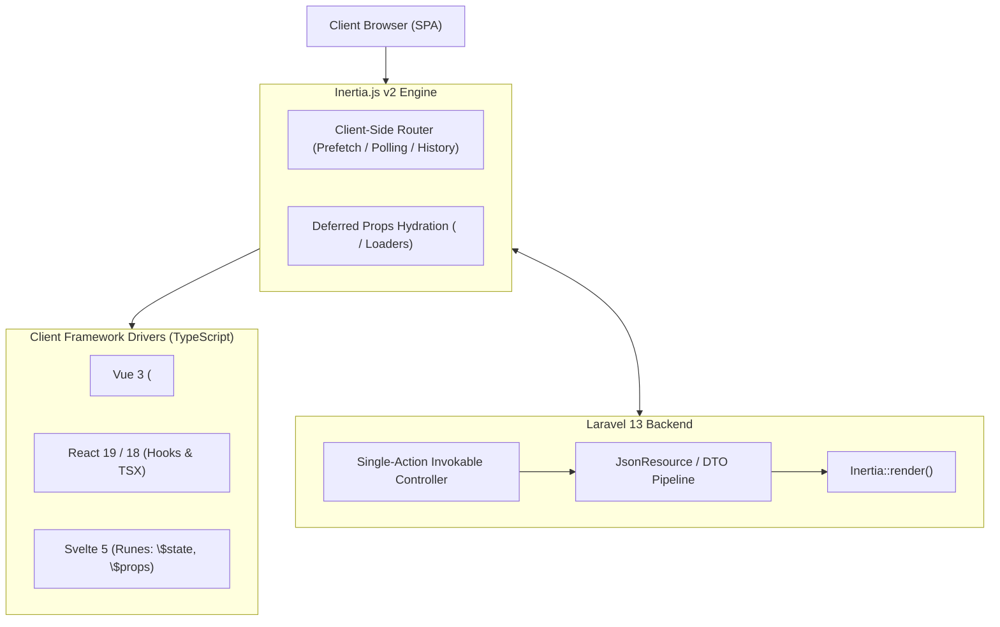

# Laravel 13 & Inertia.js v2 Multi-Frontend Architecture (Vue 3, React, Svelte 5 & TypeScript)

This document defines the production engineering standards for building Single-Page Applications (SPAs) with **Inertia.js v2** in Laravel 13 using **Vue 3 (TypeScript)**, **React (TypeScript)**, and **Svelte 5**.

---

## 1. Executive Paradigm: The Modern Monolith SPA

Inertia.js eliminates the overhead of GraphQL or REST API layers for internal SPAs. Laravel controllers return Inertia page responses with type-safe props, while the client renders them using modern reactive frontend frameworks.



---

## 2. Controller Architecture with Inertia v2 Features

Controllers pass data to frontend pages using `Inertia::render()`. With Inertia.js v2, heavy data is optimized using **Deferred Props** and **Lazy Props**:

### Invokable Inertia Controller (`app/Http/Controllers/Dashboard/ShowDashboardController.php`)

```php
declare(strict_types=1);

namespace App\Http\Controllers\Dashboard;

use App\Http\Resources\Metrics\RevenueMetricResource;
use App\Http\Resources\Orders\OrderSummaryResource;
use App\Models\Order;
use App\Models\RevenueMetric;
use App\Models\User;
use Illuminate\Http\Request;
use Inertia\Inertia;
use Inertia\Response;

final class ShowDashboardController
{
    public function __invoke(Request $request): Response
    {
        /** @var User $user */
        $user = $request->userOrFail();

        return Inertia::render('Dashboard/Index', [
            // Instant core props (sent on initial page load)
            'user' => [
                'id' => $user->id,
                'name' => $user->name,
                'email' => $user->email,
                'role' => $user->role,
            ],
            'recentOrders' => fn (): array => OrderSummaryResource::collection(
                Order::query()->where('team_id', $user->current_team_id)->latest()->limit(5)->get()
            )->resolve(),

            // Inertia v2 Deferred Prop: Page loads instantly; metrics stream in asynchronously in background
            'analytics' => Inertia::defer(fn (): array => RevenueMetricResource::make(
                RevenueMetric::query()->where('team_id', $user->current_team_id)->firstOrFail()
            )->resolve()),
        ]);
    }
}
```

---

## 3. Frontend Stacks: Production Implementations

### 3.1 Vue 3 + TypeScript (`resources/js/Pages/Dashboard/Index.vue`)

Using `<script setup lang="ts">`, typed props, and Inertia components:

```vue
<script setup lang="ts">
import { Head, Link, Deferred } from '@inertiajs/vue3';

interface UserDto {
  id: string;
  name: string;
  email: string;
  role: string;
}

interface OrderSummaryDto {
  id: string;
  reference_code: string;
  total_formatted: string;
  status: 'pending' | 'completed' | 'cancelled';
}

interface AnalyticsDto {
  monthly_recurring_revenue: string;
  churn_rate: number;
  active_subscribers: number;
}

const props = defineProps<{
  user: UserDto;
  recentOrders: OrderSummaryDto[];
  analytics?: AnalyticsDto;
}>();
</script>

<template>
  <Head title="Executive Dashboard" />

  <div class="min-h-screen bg-slate-50 dark:bg-slate-950 p-8 space-y-8">
    <!-- Header -->
    <header class="flex justify-between items-center">
      <div>
        <h1 class="text-2xl font-bold text-slate-900 dark:text-white">Welcome back, {{ props.user.name }}</h1>
        <p class="text-sm text-slate-500">Team role: {{ props.user.role }}</p>
      </div>

      <!-- Inertia v2 Prefetching on Hover -->
      <Link
        href="/orders/create"
        prefetch
        class="rounded-lg bg-indigo-600 px-4 py-2 text-sm font-semibold text-white shadow-xs hover:bg-indigo-500 transition"
      >
        + Create Order
      </Link>
    </header>

    <!-- Deferred Analytics Metrics (Inertia v2 Deferred Props) -->
    <Deferred data="analytics">
      <template #fallback>
        <div class="grid grid-cols-1 md:grid-cols-3 gap-6 animate-pulse">
          <div v-for="i in 3" :key="i" class="h-28 bg-slate-200 dark:bg-slate-800 rounded-xl" />
        </div>
      </template>

      <div v-if="props.analytics" class="grid grid-cols-1 md:grid-cols-3 gap-6">
        <div class="p-6 bg-white dark:bg-slate-900 rounded-xl border border-slate-200 dark:border-slate-800 shadow-xs">
          <p class="text-xs font-semibold text-slate-500 uppercase">MRR</p>
          <p class="text-3xl font-extrabold text-slate-900 dark:text-white mt-1">{{ props.analytics.monthly_recurring_revenue }}</p>
        </div>
        <div class="p-6 bg-white dark:bg-slate-900 rounded-xl border border-slate-200 dark:border-slate-800 shadow-xs">
          <p class="text-xs font-semibold text-slate-500 uppercase">Active Subscribers</p>
          <p class="text-3xl font-extrabold text-slate-900 dark:text-white mt-1">{{ props.analytics.active_subscribers }}</p>
        </div>
        <div class="p-6 bg-white dark:bg-slate-900 rounded-xl border border-slate-200 dark:border-slate-800 shadow-xs">
          <p class="text-xs font-semibold text-slate-500 uppercase">Churn Rate</p>
          <p class="text-3xl font-extrabold text-emerald-600 mt-1">{{ props.analytics.churn_rate }}%</p>
        </div>
      </div>
    </Deferred>

    <!-- Recent Orders Table -->
    <div class="bg-white dark:bg-slate-900 rounded-xl border border-slate-200 dark:border-slate-800 overflow-hidden shadow-xs">
      <div class="px-6 py-4 border-b border-slate-200 dark:border-slate-800 font-semibold text-slate-900 dark:text-white">
        Recent Orders
      </div>
      <ul class="divide-y divide-slate-100 dark:divide-slate-800">
        <li v-for="order in props.recentOrders" :key="order.id" class="px-6 py-4 flex justify-between items-center">
          <span class="font-mono text-sm text-slate-700 dark:text-slate-300">{{ order.reference_code }}</span>
          <span class="text-sm font-semibold text-slate-900 dark:text-white">{{ order.total_formatted }}</span>
        </li>
      </ul>
    </div>
  </div>
</template>
```

---

### 3.2 React 19 / 18 + TypeScript (`resources/js/Pages/Dashboard/Index.tsx`)

Using functional components, typed props, and React Suspense with Inertia:

```tsx
import React, { Suspense } from 'react';
import { Head, Link, Deferred } from '@inertiajs/react';

interface UserDto {
  id: string;
  name: string;
  email: string;
  role: string;
}

interface OrderSummaryDto {
  id: string;
  reference_code: string;
  total_formatted: string;
}

interface AnalyticsDto {
  monthly_recurring_revenue: string;
  active_subscribers: number;
}

interface DashboardProps {
  user: UserDto;
  recentOrders: OrderSummaryDto[];
  analytics?: AnalyticsDto;
}

export default function Dashboard({ user, recentOrders, analytics }: DashboardProps): React.JSX.Element {
  return (
    <>
      <Head title="Executive Dashboard" />

      <main className="min-h-screen bg-slate-50 dark:bg-slate-950 p-8 space-y-8">
        <header className="flex justify-between items-center">
          <div>
            <h1 className="text-2xl font-bold text-slate-900 dark:text-white">Welcome, {user.name}</h1>
            <p className="text-sm text-slate-500">Role: {user.role}</p>
          </div>

          <Link
            href="/orders/create"
            prefetch
            className="rounded-lg bg-indigo-600 px-4 py-2 text-sm font-semibold text-white shadow-xs hover:bg-indigo-500 transition"
          >
            + Create Order
          </Link>
        </header>

        {/* Deferred Analytics Loading */}
        <Deferred
          data="analytics"
          fallback={
            <div className="grid grid-cols-1 md:grid-cols-2 gap-6 animate-pulse">
              <div className="h-28 bg-slate-200 dark:bg-slate-800 rounded-xl" />
              <div className="h-28 bg-slate-200 dark:bg-slate-800 rounded-xl" />
            </div>
          }
        >
          {analytics && (
            <div className="grid grid-cols-1 md:grid-cols-2 gap-6">
              <div className="p-6 bg-white dark:bg-slate-900 rounded-xl border border-slate-200 dark:border-slate-800">
                <span className="text-xs font-semibold text-slate-500 uppercase">Monthly Revenue</span>
                <p className="text-3xl font-extrabold text-slate-900 dark:text-white mt-1">
                  {analytics.monthly_recurring_revenue}
                </p>
              </div>
              <div className="p-6 bg-white dark:bg-slate-900 rounded-xl border border-slate-200 dark:border-slate-800">
                <span className="text-xs font-semibold text-slate-500 uppercase">Active Subscribers</span>
                <p className="text-3xl font-extrabold text-slate-900 dark:text-white mt-1">
                  {analytics.active_subscribers}
                </p>
              </div>
            </div>
          )}
        </Deferred>
      </main>
    </>
  );
}
```

---

### 3.3 Svelte 5 (Runes) + TypeScript (`resources/js/Pages/Dashboard/Index.svelte`)

Using Svelte 5 runes (`$props()`, `$state()`, `$derived()`):

```svelte
<script lang="ts">
  import { Head, Link } from '@inertiajs/svelte';

  interface Props {
    user: { id: string; name: string; role: string };
    recentOrders: Array<{ id: string; reference_code: string; total_formatted: string }>;
  }

  // Svelte 5 Runes
  let { user, recentOrders }: Props = $props();
</script>

<Head title="Executive Dashboard" />

<div class="min-h-screen bg-slate-50 dark:bg-slate-950 p-8 space-y-8">
  <header class="flex justify-between items-center">
    <div>
      <h1 class="text-2xl font-bold text-slate-900 dark:text-white">Welcome back, {user.name}</h1>
      <p class="text-sm text-slate-500">{user.role}</p>
    </div>

    <Link
      href="/orders/create"
      prefetch
      class="rounded-lg bg-indigo-600 px-4 py-2 text-sm font-semibold text-white shadow-xs hover:bg-indigo-500 transition"
    >
      + Create Order
    </Link>
  </header>

  <div class="bg-white dark:bg-slate-900 rounded-xl border border-slate-200 dark:border-slate-800 overflow-hidden shadow-xs">
    <div class="px-6 py-4 border-b border-slate-200 dark:border-slate-800 font-semibold text-slate-900 dark:text-white">
      Recent Orders
    </div>
    <ul class="divide-y divide-slate-100 dark:divide-slate-800">
      {#each recentOrders as order (order.id)}
        <li class="px-6 py-4 flex justify-between items-center">
          <span class="font-mono text-sm text-slate-700 dark:text-slate-300">{order.reference_code}</span>
          <span class="text-sm font-semibold text-slate-900 dark:text-white">{order.total_formatted}</span>
        </li>
      {/each}
    </ul>
  </div>
</div>
```

---

## 4. Vite Configuration & Multi-Stack Bundling (`vite.config.ts`)

```typescript
import { defineConfig } from 'vite';
import laravel from 'laravel-vite-plugin';
import vue from '@vitejs/plugin-vue';
// or import react from '@vitejs/plugin-react';
// or import { svelte } from '@sveltejs/vite-plugin-svelte';

export default defineConfig({
  plugins: [
    laravel({
      input: 'resources/js/app.ts',
      ssr: 'resources/js/ssr.ts',
      refresh: true,
    }),
    vue({
      template: {
        transformAssetUrls: {
          base: null,
          includeAbsolute: false,
        },
      },
    }),
  ],
  resolve: {
    alias: {
      '@': '/resources/js',
    },
  },
});
```

---

## 5. Testing Inertia Pages with Pest 3

```php
declare(strict_types=1);

use App\Models\User;
use Inertia\Testing\AssertableInertia as Assert;

it('renders dashboard with proper user and deferred metrics props', function (): void {
    $user = User::factory()->create(['role' => 'admin']);

    $this->actingAs($user)
        ->get('/dashboard')
        ->assertOk()
        ->assertInertia(fn (Assert $page) => $page
            ->component('Dashboard/Index')
            ->has('user', fn (Assert $userProp) => $userProp
                ->where('id', $user->id)
                ->where('name', $user->name)
                ->where('role', 'admin')
            )
            ->has('recentOrders')
        );
});
```
