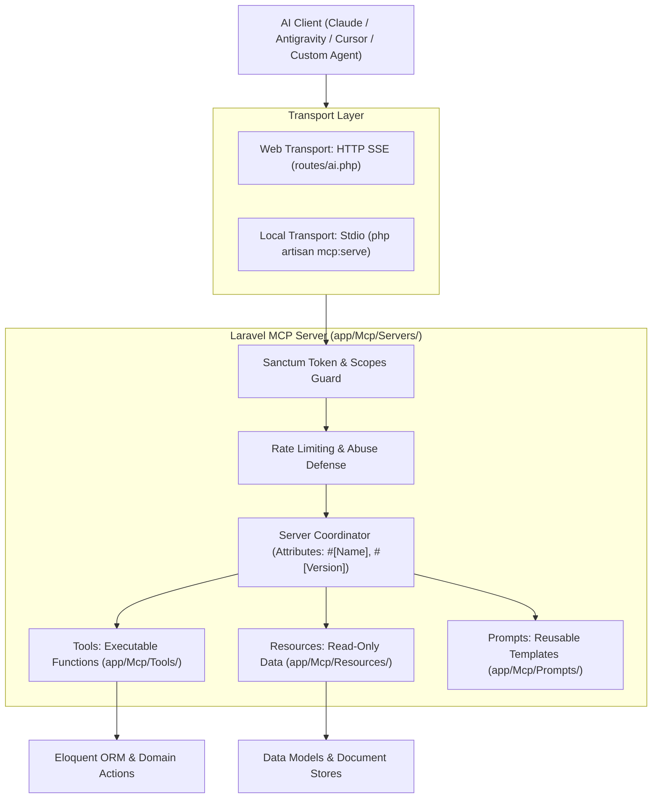

# Laravel 13 & Modern PHP 8.5+ Model Context Protocol (MCP) Architecture

This document defines the enterprise architectural blueprint for developing, hosting, securing, and consuming **Model Context Protocol (MCP)** servers and clients using Laravel's official first-party package (**`laravel/mcp`**) in tandem with the Laravel AI SDK (**`laravel/ai`**) targeting Laravel 13 and PHP 8.5+.

---

## 1. Executive Overview & Protocol Mechanics

The **Model Context Protocol (MCP)** is an open JSON-RPC 2.0 standard created by Anthropic that standardizes how AI applications (Claude Desktop, Antigravity, Cursor, ChatGPT, and custom LLM agents) connect to external tools, live databases, and contextual resources.



### The Three MCP Primitives

1. **Tools**: Executable functions that allow AI models to perform mutations or queries (e.g. running an Artisan command, querying sales, issuing an invoice).
2. **Resources**: Read-only contextual documents exposed via URIs (e.g. `user://{id}/profile`, `docs://api-schema`) that models inspect passively without side effects.
3. **Prompts**: Standardized, reusable conversation templates with typed parameters that ensure reproducible model behaviors.

---

## 2. Installation & Directory Architecture

Install the official package and publish the AI routing infrastructure:

```bash
composer require laravel/mcp
php artisan vendor:publish --tag=ai-routes
```

### Canonical Directory Structure

```text
app/
├── Mcp/
│   ├── Servers/              # Hub servers grouping capabilities
│   │   ├── PlatformServer.php
│   │   └── AnalyticsServer.php
│   ├── Tools/                # Executable tools with JsonSchema
│   │   ├── CreateOrderTool.php
│   │   └── QueryMetricsTool.php
│   ├── Resources/            # Read-only URI data providers
│   │   ├── UserProfileResource.php
│   │   └── SystemHealthResource.php
│   └── Prompts/              # Reusable conversation templates
│       ├── CodeReviewPrompt.php
│       └── IncidentTriagePrompt.php
routes/
└── ai.php                    # Dedicated MCP web routes
```

---

## 3. Server Architecture (`app/Mcp/Servers/`)

Scaffold a server using Artisan:

```bash
php artisan make:mcp-server PlatformServer
```

The Server class uses PHP 8 native attributes (`#[Name]`, `#[Version]`, `#[Instructions]`) to declare metadata for client capability negotiation:

```php
declare(strict_types=1);

namespace App\Mcp\Servers;

use App\Mcp\Prompts\IncidentTriagePrompt;
use App\Mcp\Resources\SystemHealthResource;
use App\Mcp\Resources\UserProfileResource;
use App\Mcp\Tools\CreateOrderTool;
use App\Mcp\Tools\QueryMetricsTool;
use Laravel\Mcp\Server;
use Laravel\Mcp\Server\Attributes\Instructions;
use Laravel\Mcp\Server\Attributes\Name;
use Laravel\Mcp\Server\Attributes\Version;

#[Name('Enterprise Platform MCP Server')]
#[Version('1.0.0')]
#[Instructions('This server provides secure access to enterprise customer records, system telemetry, and transactional tools.')]
final class PlatformServer extends Server
{
    /**
     * @var array<int, class-string<\Laravel\Mcp\Server\Tool>>
     */
    protected array $tools = [
        CreateOrderTool::class,
        QueryMetricsTool::class,
    ];

    /**
     * @var array<int, class-string<\Laravel\Mcp\Server\Resource>>
     */
    protected array $resources = [
        UserProfileResource::class,
        SystemHealthResource::class,
    ];

    /**
     * @var array<int, class-string<\Laravel\Mcp\Server\Prompt>>
     */
    protected array $prompts = [
        IncidentTriagePrompt::class,
    ];
}
```

---

## 4. MCP Tools: Executable Actions with Schemas

Scaffold a tool:

```bash
php artisan make:mcp-tool CreateOrderTool
```

A Tool must implement `schema(JsonSchema $schema)` for argument validation and `handle(Request $request): Response` for execution:

```php
declare(strict_types=1);

namespace App\Mcp\Tools;

use App\Actions\Orders\CreateOrderAction;
use App\Data\Orders\CreateOrderDto;
use App\Models\User;
use Exception;
use Illuminate\Contracts\JsonSchema\JsonSchema;
use Illuminate\Support\Facades\Log;
use Laravel\Mcp\Request;
use Laravel\Mcp\Response;
use Laravel\Mcp\Server\Tool;

final class CreateOrderTool extends Tool
{
    protected string $description = 'Create a new customer order. Validates inventory, charges customer, and returns order confirmation.';

    public function schema(JsonSchema $schema): array
    {
        return [
            'customer_id' => $schema->string()
                ->description('ULID of the customer')
                ->required(),
            'sku' => $schema->string()
                ->description('Item SKU code to purchase')
                ->required(),
            'quantity' => $schema->integer()
                ->description('Units to purchase (1-100)')
                ->default(1),
            'idempotency_key' => $schema->string()
                ->description('Unique idempotency key to prevent duplicate charges')
                ->required(),
        ];
    }

    public function handle(Request $request): Response
    {
        $customerId = (string) $request->input('customer_id');
        $sku = (string) $request->input('sku');
        $quantity = (int) ($request->input('quantity') ?? 1);
        $idempotencyKey = (string) $request->input('idempotency_key');

        $user = User::query()->find($customerId);
        if ($user === null) {
            return Response::error("Customer [{$customerId}] not found.");
        }

        try {
            $action = app(CreateOrderAction::class);
            $dto = new CreateOrderDto(
                user: $user,
                sku: $sku,
                quantity: $quantity,
                idempotencyKey: $idempotencyKey
            );

            $order = $action->execute($dto);

            return Response::json([
                'success' => true,
                'order_id' => $order->id,
                'status' => $order->status,
                'total_cents' => $order->total_cents,
            ]);
        } catch (Exception $e) {
            Log::error('MCP CreateOrderTool execution failed', ['error' => $e->getMessage()]);

            return Response::error('Order creation failed: ' . $e->getMessage());
        }
    }
}
```

---

## 5. MCP Resources: Read-Only URIs & Dynamic Templates

Scaffold a resource:

```bash
php artisan make:mcp-resource UserProfileResource
```

Resources provide direct context. Static resources use fixed URIs; dynamic resources implement `HasUriTemplate` with parameter placeholders:

```php
declare(strict_types=1);

namespace App\Mcp\Resources;

use App\Models\User;
use Laravel\Mcp\Contracts\HasUriTemplate;
use Laravel\Mcp\Response;
use Laravel\Mcp\Server\Resource;
use Laravel\Mcp\Server\UriTemplate;

final class UserProfileResource extends Resource implements HasUriTemplate
{
    protected string $description = 'Customer account profile and subscription metadata by user ID.';

    public function uriTemplate(): UriTemplate
    {
        return new UriTemplate('user://{id}/profile');
    }

    /**
     * @param array<string, string> $parameters
     */
    public function read(array $parameters): Response
    {
        $id = $parameters['id'] ?? '';
        $user = User::query()->find($id);

        if ($user === null) {
            return Response::error("User [{$id}] not found.");
        }

        return Response::json([
            'id' => $user->id,
            'name' => $user->name,
            'email' => $user->email,
            'tier' => $user->subscription_tier ?? 'free',
            'created_at' => $user->created_at?->toIso8601String(),
        ]);
    }
}
```

---

## 6. MCP Prompts: Reusable Conversation Templates

Scaffold a prompt:

```bash
php artisan make:mcp-prompt IncidentTriagePrompt
```

Prompts guarantee that AI clients invoke repeatable workflows with pre-engineered system guardrails:

```php
declare(strict_types=1);

namespace App\Mcp\Prompts;

use Illuminate\Contracts\JsonSchema\JsonSchema;
use Laravel\Mcp\Server\Prompt;

final class IncidentTriagePrompt extends Prompt
{
    protected string $description = 'Structured incident triage protocol for production outages.';

    public function schema(JsonSchema $schema): array
    {
        return [
            'service_name' => $schema->string()->description('Affected microservice name')->required(),
            'error_rate' => $schema->number()->description('Observed 5xx error percentage')->required(),
            'log_snippet' => $schema->string()->description('Sample stack trace or log excerpt')->required(),
        ];
    }

    /**
     * @param array<string, mixed> $arguments
     */
    public function template(array $arguments): string
    {
        $service = (string) ($arguments['service_name'] ?? 'Unknown');
        $errorRate = (float) ($arguments['error_rate'] ?? 0.0);
        $logs = (string) ($arguments['log_snippet'] ?? '');

        return <<<PROMPT
You are the Incident Commander managing a production disruption for service [{$service}].
Current observed 5xx error rate: {$errorRate}%.

Review the following log excerpt:
```
{$logs}
```

Formulate an immediate mitigation plan:
1. Root cause hypothesis
2. Recommended circuit-breaker or rollback command
3. Customer status communication draft
PROMPT;
    }
}
```

---

## 7. Transport Layer & Routing (`routes/ai.php`)

Laravel MCP supports two official transports:

### 7.1 Web Transport (HTTP & Server-Sent Events / SSE)

Register servers inside `routes/ai.php` using the `Mcp` facade. Apply Sanctum authentication and rate limiting:

```php
declare(strict_types=1);

use App\Mcp\Servers\PlatformServer;
use Illuminate\Support\Facades\Route;
use Laravel\Mcp\Facades\Mcp;

Route::middleware(['auth:sanctum', 'throttle:60,1'])->group(function (): void {
    // Exposes SSE stream and JSON-RPC message endpoint for external AI clients
    Mcp::web('/mcp/platform', PlatformServer::class);
});
```

### 7.2 Stdio Transport (Local IDE & CLI Integration)

For local desktop clients (Claude Desktop, Cursor IDE, Antigravity Hub):

```bash
php artisan mcp:serve PlatformServer
```

Configure your AI client config (e.g. `claude_desktop_config.json`):

```json
{
  "mcpServers": {
    "laravel-app": {
      "command": "php",
      "args": ["artisan", "mcp:serve", "PlatformServer"],
      "cwd": "/path/to/laravel-app"
    }
  }
}
```

---

## 8. Bridging MCP with the Laravel AI SDK (`laravel/ai`)

Your own internal Laravel AI agents can consume external MCP servers as tools, giving your agents instant access to third-party MCP ecosystems (GitHub, Postgres, Slack, Browserbase):

```php
declare(strict_types=1);

namespace App\Ai\Agents;

use Laravel\Ai\Concerns\HasTools;
use Laravel\Ai\Contracts\Agent;
use Laravel\Ai\Promptable;
use Laravel\Mcp\Facades\Mcp;

final class DevopsCopilotAgent implements Agent
{
    use Promptable, HasTools;

    public function instructions(): string
    {
        return 'You are an autonomous DevOps assistant. Use registered MCP tools to inspect repositories and deployments.';
    }

    public function tools(): iterable
    {
        // Connect to external or internal MCP server tools dynamically
        return [
            ...Mcp::client('github')->tools(),
            ...Mcp::client('kubernetes')->tools(),
        ];
    }
}
```

---

## 9. Security Hardening & Zero-Trust Verification

1. **Authentication Enforcement**: NEVER expose MCP web endpoints without `auth:sanctum` or `auth:api`. Every request must be authenticated with verifiable token scopes (e.g. `ability:mcp:execute`).
2. **IDOR Defense & Tenant Scoping**: Never execute queries based solely on IDs provided in MCP tool arguments. Verify that the authenticated user has explicit policy rights (`$user->can('view', $order)`) to access or mutate the record.
3. **Strict Parameter Validation**: Define typed schemas for every parameter in `schema()`. Reject payloads violating the schema before invoking domain actions.
4. **Read-Only vs Mutation Boundaries**: Use **Resources** for read-only telemetry and data lookups. Keep mutations strictly inside **Tools** with idempotency keys.
5. **Audit Logging**: Log every MCP tool execution with client identity, tool name, arguments, and execution duration.

---

## 10. Deterministic Testing with Pest 3

Test your MCP servers without network calls or external clients:

```php
declare(strict_types=1);

use App\Mcp\Servers\PlatformServer;
use App\Models\User;
use Laravel\Mcp\Facades\Mcp;

it('executes create order tool through MCP server successfully', function (): void {
    $user = User::factory()->create();

    $response = Mcp::server(PlatformServer::class)->callTool('create_order', [
        'customer_id' => $user->id,
        'sku' => 'PRO-SUBSCRIPTION',
        'quantity' => 1,
        'idempotency_key' => 'test-idempotency-key-123',
    ]);

    expect($response->isSuccess())->toBeTrue()
        ->and($response->json('success'))->toBeTrue()
        ->and($response->json('order_id'))->not->toBeNull();
});

it('reads user profile resource from MCP URI', function (): void {
    $user = User::factory()->create(['name' => 'Alice Dev']);

    $response = Mcp::server(PlatformServer::class)->readResource("user://{$user->id}/profile");

    expect($response->isSuccess())->toBeTrue()
        ->and($response->json('name'))->toBe('Alice Dev')
        ->and($response->json('email'))->toBe($user->email);
});
```
