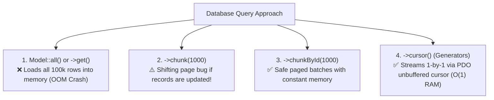

# Modern PHP 8.5+ & Laravel 13 Memory Safety, Leak Prevention & Resource Architecture

> **Document**: `docs/architecture/memory-safety-and-performance.md`  
> **Framework**: Laravel 13 & PHP 8.5+  
> **Target Environments**: Laravel Octane (FrankenPHP / Swoole / RoadRunner), Horizon, Queue Workers, High-Throughput APIs.

---

## 🏛️ Executive Summary

In traditional PHP-FPM, memory safety was rarely scrutinized because the PHP process terminates after each HTTP request—wiping all memory automatically. 

In modern Laravel 13, applications frequently run as **long-lived daemon processes**:
- **Laravel Octane** (FrankenPHP / Swoole / RoadRunner) keeping application memory hot for thousands of concurrent requests.
- **Queue Workers & Horizon** running continuously for days.
- **Batch Processing & CLI Daemons** handling millions of database rows and gigabytes of file streaming.

In these environments, memory leaks cause Out-Of-Memory (`Fatal error: Allowed memory size of X bytes exhausted`) crashes, degraded server throughput, and cross-request state pollution.

This guide establishes the production engineering rules to guarantee **constant $O(1)$ memory usage** across all application layers.

---

## 1. Database Query Memory Safety: The $O(1)$ Rule



---

### A. The "Page Shifting Bug" in `chunk()` vs. `chunkById()`

> [!CAUTION]
> **Never use `chunk()` when modifying records**: If you query rows with `where('status', 'pending')->chunk(100)` and update `status = 'processed'`, the offset increases while rows vanish from the matching set. **Half of your records will be skipped!** Always use `chunkById()`.

```php
// ❌ Dangerous: Shifting page bug skips records during mutation
Order::query()
    ->where('status', OrderStatus::Pending)
    ->chunk(100, function ($orders) {
        foreach ($orders as $order) {
            $order->update(['status' => OrderStatus::Processing]); // Skips page 2!
        }
    });

// ✅ Correct: Safe, index-driven pagination by primary key
Order::query()
    ->where('status', OrderStatus::Pending)
    ->chunkById(500, function ($orders) {
        foreach ($orders as $order) {
            $order->update(['status' => OrderStatus::Processing]);
        }
    });
```

---

### B. Streaming Millions of Records with `cursor()` and Generators

For exports, reporting, and processing where records are read sequentially, use `cursor()`. It utilizes PHP Generators (`yield`) and unbuffered database queries to keep memory consumption virtually flat:

```php
use App\Models\Order;
use Illuminate\Support\LazyCollection;

#[\NoDiscard]
public function streamPendingOrders(): LazyCollection
{
    // Memory usage remains flat (~15MB) whether reading 10 or 1,000,000 orders
    return Order::query()
        ->where('status', OrderStatus::Pending)
        ->cursor();
}
```

---

### C. The Query Log Memory Trap

Laravel records every executed SQL query in memory if the query log is enabled (common during debugging, migrations, or seeders). In long-running workers, this causes a fatal leak:

```php
use Illuminate\Support\Facades\DB;

final class ProcessMassiveBatchJob implements ShouldQueue
{
    public function handle(): void
    {
        // 1. Strictly disable query logging in long-running jobs
        DB::disableQueryLog();

        // 2. Process records safely
        Order::query()->chunkById(1000, function ($orders) {
            foreach ($orders as $order) {
                // ...
            }
        });
    }
}
```

---

## 2. Laravel Octane & FrankenPHP Concurrency Safety

In Laravel Octane, the application is booted **once** in memory and kept alive across requests. Storing state in static properties or singletons causes memory leaks and security breaches.

### The Cardinal Rules of Octane:

#### 1. Never Store Request State in Static Properties
```php
// ❌ FATAL Octane Bug: User A's data leaks to User B and memory grows infinitely!
final class UserContext
{
    private static ?User $currentUser = null;

    public static function setUser(User $user): void
    {
        self::$currentUser = $user;
    }
}

// ✅ Correct: Bind to the container per-request, or use Octane::bind()
```

#### 2. Avoid Unbounded In-Memory Caches
```php
// ❌ Memory Leak: Array grows on every request without eviction
final class PriceCalculator
{
    private static array $cachedRates = [];

    public function getRate(string $currency): float
    {
        return self::$cachedRates[$currency] ??= $this->fetch($currency);
    }
}

// ✅ Correct: Use Laravel Cache with explicit TTL or WeakMap
```

#### 3. Use `WeakMap` for Object-Associated Caches
PHP 8.0+ `WeakMap` automatically garbage-collects cache keys as soon as the referenced object is destroyed, preventing unbounded memory retention:

```php
<?php

declare(strict_types=1);

namespace App\Support;

use App\Models\User;
use WeakMap;

final class UserPermissionCache
{
    /** @var WeakMap<User, array<string, bool>> */
    private WeakMap $cache;

    public function __construct()
    {
        $this->cache = new WeakMap();
    }

    public function has(User $user, string $permission): bool
    {
        return $this->cache[$user][$permission] ?? false;
    }

    public function set(User $user, string $permission, bool $value): void
    {
        $permissions = $this->cache[$user] ?? [];
        $permissions[$permission] = $value;
        $this->cache[$user] = $permissions;
        // As soon as $user is unset, this memory is automatically freed!
    }
}
```

---

## 3. Large File Streaming & Zero-Memory Exports

Reading multi-megabyte or gigabyte files with `file_get_contents()` loads the entire file into RAM. Always stream files using resource pointers.

### A. Zero-Memory CSV Export with `streamDownload()`

Exporting 1,000,000 rows without storing the file on disk or buffering it in memory:

```php
<?php

declare(strict_types=1);

namespace App\Http\Controllers\Api\V1\Orders;

use App\Models\Order;
use Illuminate\Http\Request;
use Symfony\Component\HttpFoundation\StreamedResponse;

final class ExportOrdersCsvController
{
    public function __invoke(Request $request): StreamedResponse
    {
        $headers = [
            'Content-Type' => 'text/csv',
            'Content-Disposition' => 'attachment; filename="orders.csv"',
        ];

        return response()->streamDownload(function (): void {
            // Open direct output buffer stream
            $handle = fopen('php://output', 'w');
            if ($handle === false) {
                return;
            }

            // Write CSV headers
            fputcsv($handle, ['ID', 'Order Number', 'Total Cents', 'Status', 'Created At']);

            // Stream records from database directly to HTTP response
            Order::query()
                ->select(['id', 'order_number', 'total_cents', 'status', 'created_at'])
                ->cursor()
                ->each(function (Order $order) use ($handle): void {
                    fputcsv($handle, [
                        $order->id,
                        $order->order_number,
                        $order->total_cents,
                        $order->status->value,
                        $order->created_at->toISOString(),
                    ]);
                });

            fclose($handle);
        }, 'orders.csv', $headers);
    }
}
```

---

### B. Safe Chunked File Upload Processing
```php
public function processImport(string $absolutePath): void
{
    $handle = fopen($absolutePath, 'r');
    if ($handle === false) {
        throw new RuntimeException("Cannot open file: {$absolutePath}");
    }

    try {
        // Read line-by-line: memory footprint stays under 2MB
        while (($row = fgetcsv($handle, 4096)) !== false) {
            $this->processRow($row);
        }
    } finally {
        fclose($handle);
    }
}
```

---

## 4. Garbage Collection & Long-Running Batch Jobs

PHP's cyclic garbage collector detects circular references (e.g. `$parent->child` and `$child->parent`). In heavy CLI loops, manually invoking the collector prevents memory accumulation:

```php
public function processMassiveQueue(): void
{
    $count = 0;

    Order::query()->chunkById(1000, function ($orders) use (&$count): void {
        foreach ($orders as $order) {
            $this->process($order);
            $count++;
        }

        // 1. Explicitly clear local variables and trigger cycle collection every 5,000 items
        if ($count % 5000 === 0) {
            gc_collect_cycles();
            gc_mem_caches();
        }
    });
}
```

---

## 5. Queue Worker Defense-in-Depth

Even with pristine code, external third-party SDKs (Stripe, AWS, Algolia) can leak memory. Protect workers by setting strict recycling boundaries in production:

```bash
# Restart worker after 1,000 jobs, 1 hour, or if memory exceeds 512MB
php artisan queue:work redis \
    --max-jobs=1000 \
    --max-time=3600 \
    --memory=512 \
    --tries=3 \
    --timeout=60
```

---

## 6. Pest 3 Architecture Boundary Tests for Memory Safety

Automate memory safety compliance in CI using Pest 3 architectural tests:

```php
// tests/Feature/MemorySafetyArchTest.php

arch('disallow unbounded Model::all() in jobs and commands')
    ->expect('Illuminate\Database\Eloquent\Model')
    ->not->toReceive('all')
    ->in(['App\Jobs', 'App\Console\Commands']);

arch('disallow file_get_contents in file processing actions')
    ->expect('App\Actions\Imports')
    ->not->toUse('file_get_contents');

arch('disallow query logging calls in production controllers')
    ->expect(['DB::enableQueryLog', 'DB::getQueryLog'])
    ->not->toBeUsed();
```

---

## 📌 Memory Safety Rules & Checklist

| Checkpoint | Dangerous Practice | Production-Safe Standard |
| :--- | :--- | :--- |
| **Large DB Reads** | `Model::all()` or `->get()` | `chunkById(1000)` or `cursor()` |
| **Record Mutations** | `->chunk(100)` | `->chunkById(100)` (Prevents page shifting bug) |
| **Query Log** | Active in queues/seeders | `DB::disableQueryLog()` |
| **Octane State** | `static $state = []` | Container bindings, `WeakMap`, or Cache with TTL |
| **File Exports** | Buffering in memory | `response()->streamDownload()` via `php://output` |
| **File Reads** | `file_get_contents($path)` | `fopen()` and `fgetcsv()` / `fgets()` |
| **Queue Workers** | Infinite unbounded loop | `--max-jobs=1000 --max-time=3600 --memory=512` |
| **Circular References** | Unhandled object cycles | `gc_collect_cycles()` & `unset()` in batch loops |
