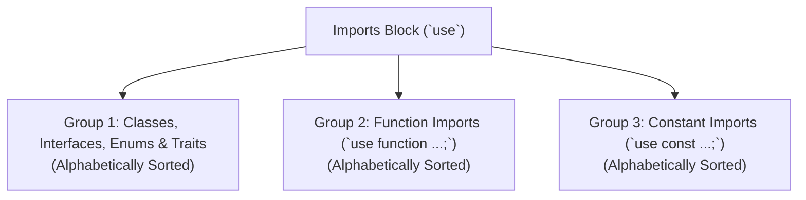

# Modern PHP 8.5+ & Laravel 13 Namespace, Import & Class Standards

> **Document**: `docs/architecture/namespace-import-class-standards.md`  
> **Framework**: Laravel 13 & PHP 8.5+  
> **Standards Compliance**: PSR-4, PSR-12, PER Coding Style 2.0, PHPStan Level 8 / max, Laravel Pint.

---

## 🏛️ Executive Summary

Writing clean, maintainable, and type-safe PHP requires strict adherence to uniform structural standards. This document outlines the official conventions for:
1. **File Prologue & Namespaces**: Strict typing and PSR-4 directory mapping.
2. **Import Statements (`use`)**: Canonical ordering, alphabetical sorting, explicit root imports, and aliasing rules.
3. **Class Anatomy & Organization**: `final` by default, `readonly` DTOs, canonical member ordering, and modern PHP 8.5+ property hooks.

---

## 1. File Prologue & Namespace Standards

Every PHP file in the application must strictly follow this opening sequence:

```php
<?php

declare(strict_types=1);

namespace App\Actions\Orders;
```

### Mandatory Rules:
1. **`<?php` on Line 1**: Never use opening tags with closing `?>` in pure PHP files.
2. **`declare(strict_types=1);`**: Must be the very first statement following `<?php`, separated by a single blank line.
3. **One Namespace per File**: Matches the file's directory path relative to `app/` (PSR-4).
4. **No Curly-Brace Namespaces**: Never use `namespace App { ... }`.
5. **Exact Casing**: Namespace casing must match directory names exactly (`App\Http\Controllers\Api\V1`).

---

## 2. Import (`use`) Statement Best Practices

Import declarations must be organized cleanly, consistently, and deterministically.



### A. Canonical Import Order
Separate import groups with a single blank line:
1. **Classes, Interfaces, Enums, and Traits**
2. **Functions (`use function ...;`)**
3. **Constants (`use const ...;`)**

```php
namespace App\Services;

// 1. Classes, Interfaces, Enums & Traits (A-Z)
use App\Contracts\PaymentGatewayInterface;
use App\Data\OrderSummaryDto;
use App\Enums\OrderStatus;
use App\Models\Order;
use DateTimeImmutable;
use Illuminate\Support\Facades\DB;
use InvalidArgumentException;

// 2. Functions (A-Z)
use function array_first;
use function count;
use function sprintf;

// 3. Constants (A-Z)
use const PHP_EOL;
use const PHP_INT_MAX;
```

---

### B. Explicit Root Imports (No Inline Backslashes)

> [!IMPORTANT]
> **Zero Inline Backslashes**: Never use root backslashes (`\DateTimeImmutable`, `\Exception`, `\Throwable`) inside the class body or signatures. Always import standard PHP classes at the top of the file.

| ❌ Anti-Pattern (Inline Backslash) | ✅ Modern Clean Practice (Import at Top) |
| :--- | :--- |
| `public ?\DateTimeImmutable $timestamp;` | `use DateTimeImmutable;`<br>`public ?DateTimeImmutable $timestamp;` |
| `catch (\Throwable $e) { ... }` | `use Throwable;`<br>`catch (Throwable $e) { ... }` |
| `$date = new \DateTime('now');` | `use DateTimeImmutable;`<br>`$date = new DateTimeImmutable('now');` |
| `throw new \InvalidArgumentException(...);` | `use InvalidArgumentException;`<br>`throw new InvalidArgumentException(...);` |

**Why?**
- Eliminates visual noise inside methods and properties.
- Conforms to PSR-12 and PER-CS formatting specifications.
- Enables instant opcode symbol resolution and unambiguous PHPStan type resolution.

---

### C. Single-Line Imports vs. Grouped Imports

Always use **single-line imports**. Avoid multi-line grouped curly imports (`use Foo\{Bar, Baz};`):

```php
// ❌ Grouped Imports (Poor git diffs, prone to merge conflicts)
use App\Models\{Order, User, Product, Category};
use App\Actions\Orders\{CreateOrderAction, CancelOrderAction, RefundOrderAction};

// ✅ Single-Line Imports (Clean git diffs, trivial sorting, fast grep)
use App\Actions\Orders\CancelOrderAction;
use App\Actions\Orders\CreateOrderAction;
use App\Actions\Orders\RefundOrderAction;
use App\Models\Category;
use App\Models\Order;
use App\Models\Product;
use App\Models\User;
```

---

### D. Aliasing Standards (`as`)

Use the `as` alias keyword **only when resolving name collisions** between classes from different namespaces sharing the same short name:

```php
// ✅ Justified: Resolving collision between Eloquent Model and Third-Party SDK
use App\Models\Customer;
use Stripe\Customer as StripeCustomer;

// ✅ Justified: Resolving collision between Custom Contract and Framework Contract
use App\Contracts\EventDispatcher as CustomEventDispatcher;
use Illuminate\Contracts\Events\Dispatcher as FrameworkDispatcher;

// ❌ Anti-Pattern: Unnecessary arbitrary aliases that obscure real class names
use App\Models\User as U;
use App\Actions\Orders\CreateOrderAction as Action;
```

---

### E. Zero Unused Imports
Never leave orphaned or dead imports in files. Enforce automated cleanup via Pint (`"no_unused_imports": true`) and PHPStan.

---

## 3. Class Architecture & Member Ordering

To ensure instant readability across the entire engineering team, class members must always appear in strict canonical order:

```text
Class Anatomy Order:
1. Class Attributes (#[Table], #[NoDiscard], #[UseEloquentBuilder])
2. Class Declaration (final [readonly] class ...)
3. Trait Usages (use HasFactory, HasUlids;)
4. Class Constants (public const -> protected const -> private const)
5. Properties:
   a. Static Properties
   b. Public & Asymmetric Instance Properties (public private(set))
   c. Protected Instance Properties
   d. Private Instance Properties
6. Constructor (__construct with promoted properties)
7. Framework Hooks / Lifecycle Methods (booted, casts, authorize, rules)
8. Magic Methods (__invoke, __toString, __clone)
9. Public API Methods (execute, handle, calculate)
10. Protected Helper Methods
11. Private Implementation Methods
```

---

### Canonical Code Example: Complete Class Anatomy

```php
<?php

declare(strict_types=1);

namespace App\Services\Orders;

// 1. Imports
use App\Contracts\PaymentGatewayInterface;
use App\Data\OrderResultDto;
use App\Enums\OrderStatus;
use App\Models\Concerns\TracksActivity;
use App\Models\Order;
use App\Models\User;
use DateTimeImmutable;
use Illuminate\Support\Facades\DB;
use InvalidArgumentException;

// 2. Attributes & Class Declaration
final class OrderProcessingService
{
    // 3. Trait Usages
    use TracksActivity;

    // 4. Constants
    public const int MAX_RETRIES = 3;
    private const string CACHE_PREFIX = 'order_proc:';

    // 5. Properties (Static, then Instance)
    private static int $totalProcessedCount = 0;

    // 5b. Public read, private write (PHP 8.4 Asymmetric Visibility + Property Hook)
    public private(set) int $attemptsCount = 0 {
        get => $this->attemptsCount;
        set {
            if ($value < 0) {
                throw new InvalidArgumentException('Attempts cannot be negative.');
            }
            $this->attemptsCount = $value;
        }
    }

    public private(set) ?DateTimeImmutable $lastProcessedAt = null;

    // 6. Constructor (Property Promotion with strict types)
    public function __construct(
        private readonly PaymentGatewayInterface $gateway,
        private readonly int $timeoutSeconds = 30,
    ) {}

    // 7. Magic Methods
    public function __invoke(Order $order, string $paymentToken): OrderResultDto
    {
        return $this->process($order, $paymentToken);
    }

    // 8. Public API Methods
    #[\NoDiscard]
    public function process(Order $order, string $paymentToken): OrderResultDto
    {
        $this->attemptsCount++;

        return DB::transaction(function () use ($order, $paymentToken): OrderResultDto {
            $charge = $this->gateway->charge($order, $paymentToken);

            if (! $charge->isSuccessful) {
                $this->handleFailure($order, $charge->errorMessage);
                return OrderResultDto::failed($charge->errorMessage);
            }

            $this->finalizeOrder($order, $charge->transactionId);
            $this->lastProcessedAt = new DateTimeImmutable();
            self::$totalProcessedCount++;

            return OrderResultDto::success($order->id, $charge->transactionId);
        });
    }

    // 9. Protected Helper Methods (if class is designed for extension; otherwise private)
    // 10. Private Implementation Methods
    private function finalizeOrder(Order $order, string $transactionId): void
    {
        $order->status = OrderStatus::Paid;
        $order->transaction_id = $transactionId;
        $order->save();

        $this->logActivity('order_paid', ['order_id' => $order->id]);
    }

    private function handleFailure(Order $order, string $reason): void
    {
        $order->status = OrderStatus::Failed;
        $order->failure_reason = $reason;
        $order->save();
    }
}
```

---

## 4. Class Design Guidelines

### A. `final` by Default
Always declare service, action, controller, and job classes as `final`:
- Eliminates brittle inheritance hierarchies.
- Protects encapsulation and invariants from unintended method overrides.
- Allows PHP opcache to optimize method dispatching.
- **Exceptions**: Abstract base classes and framework models requiring extension (`abstract class BaseReport`, `class Order extends Model`).

### B. `final readonly` for DTOs and Value Objects
Immutable data transfer objects should use `final readonly class`:
```php
namespace App\Data;

final readonly class CreateOrderDto
{
    /**
     * @param list<array{product_id: string, quantity: int}> $items
     */
    public function __construct(
        public string $userId,
        public array $items,
        public string $paymentToken,
        public ?string $promoCode = null,
    ) {}
}
```

### C. Modern Attributes Usage
Leverage PHP 8.4 & PHP 8.5+ native attributes:
- `#[\NoDiscard]`: Ensures callers cannot ignore critical return values (e.g. calculation results, builder instances, transaction status).
- `#[Override]`: Explicitly marks methods intended to override parent or trait behavior (ensures compile-time validation if parent method signature changes).
- Eloquent Attributes: `#[Table('orders')]`, `#[Fillable([...])]`, `#[Hidden([...])]`, `#[UseEloquentBuilder(OrderQueryBuilder::class)]`.

---

## 5. Automated Tooling Configuration

### Laravel Pint (`pint.json`)
Ensure these rules are active in your root `pint.json`:

```json
{
    "preset": "laravel",
    "rules": {
        "declare_strict_types": true,
        "ordered_imports": {
            "sort_algorithm": "alpha",
            "imports_order": ["class", "function", "const"]
        },
        "no_unused_imports": true,
        "single_import_per_statement": true,
        "fully_qualified_strict_types": true,
        "global_namespace_import": {
            "import_classes": true,
            "import_constants": true,
            "import_functions": true
        },
        "trailing_comma_in_multiline": true,
        "single_line_empty_body": true
    }
}
```

### Automated Commands:
```bash
# Test formatting without changes
./vendor/bin/pint --test

# Fix formatting across all files
./vendor/bin/pint
```

---

## 📌 Summary Checklist

| Component | Standard |
| :--- | :--- |
| **Strict Types** | `declare(strict_types=1);` on line 3 of every file. |
| **Namespace** | Exactly matches directory path under `app/` (PSR-4). |
| **Root Imports** | `use DateTimeImmutable;`, `use Exception;` imported at top; **zero** inline `\` backslashes. |
| **Import Ordering** | 1. Classes $\rightarrow$ 2. Functions $\rightarrow$ 3. Constants; alphabetically sorted within each group. |
| **Import Style** | One import per line (no curly-brace grouped imports). |
| **Aliasing** | `as` keyword used **strictly** to resolve class name collisions. |
| **Class Mutability** | `final` by default; `final readonly` for DTOs and Value Objects. |
| **Member Order** | Traits $\rightarrow$ Constants $\rightarrow$ Properties $\rightarrow$ Constructor $\rightarrow$ Hooks $\rightarrow$ Magic $\rightarrow$ Public $\rightarrow$ Private. |
| **Property Hooks** | Use `get => ...; set => ...;` instead of manual boilerplate getters and setters. |
| **Visibility** | Use `public private(set)` for public-read, private-write attributes. |
