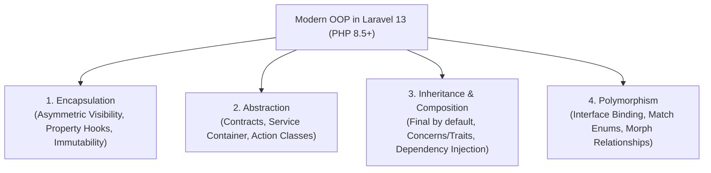

# Modern OOP: The 4 Pillars & Architectural Organization in Laravel 13 (PHP 8.5+)

> **Document**: `docs/architecture/oop-pillars-and-organization.md`  
> **Framework**: Laravel 13 & PHP 8.5+  
> **Scope**: The 4 Pillars of Object-Oriented Programming (Encapsulation, Abstraction, Inheritance, Polymorphism) and Best-Practice Directory Organization.

---

## 🏛️ The 4 Pillars in Modern Laravel & PHP 8.5+

Traditional Object-Oriented Programming (OOP) has evolved significantly in modern PHP. With features like **asymmetric visibility**, **property hooks**, **readonly classes**, and **backed enums**, Laravel 13 codebases achieve strict encapsulation and clean abstractions with zero boilerplate.



---

## 1. Pillar 1: Encapsulation

Encapsulation ensures an object protects its internal state and invariants from invalid external modifications.

### Modern PHP 8.4 & 8.5+ Features:
- **Asymmetric Visibility (`public private(set)`)**: The outside world can read values directly, but only the class itself can mutate them.
- **Property Hooks (`get => ...; set => ...;`)**: Validation and formatting logic reside directly at the property boundary.
- **`readonly` & `clone with`**: Protects immutable DTOs and Value Objects.

### Code Example: Encapsulated Value Object
```php
<?php

declare(strict_types=1);

namespace App\Data;

use DateTimeImmutable;
use InvalidArgumentException;

final class BankAccount
{
    // Public read, strictly private write (PHP 8.4)
    public private(set) int $balanceInCents {
        get => $this->balanceInCents;
        set {
            if ($value < 0) {
                throw new InvalidArgumentException('Balance cannot be negative (no overdraft allowed).');
            }
            $this->balanceInCents = $value;
        }
    }

    // Clean imported type with asymmetric visibility and nullable modifier
    public private(set) ?DateTimeImmutable $lastTransactionAt = null;

    public function __construct(int $initialDeposit)
    {
        $this->balanceInCents = $initialDeposit;
    }

    public function deposit(int $cents): void
    {
        if ($cents <= 0) {
            throw new InvalidArgumentException('Deposit amount must be positive.');
        }

        $this->balanceInCents += $cents;
        $this->lastTransactionAt = new DateTimeImmutable();
    }
}
```

---

## 2. Pillar 2: Abstraction

Abstraction exposes essential functionality while hiding complex implementation details. Consumers interact with clean contracts rather than low-level infrastructure.

### Modern Laravel Implementations:
- **Contracts (Interfaces)**: Declaring public API contracts decoupled from third-party vendors.
- **Form Requests**: Abstracting input extraction, type conversion, and gate authorization away from HTTP controllers.
- **Action Classes**: Encapsulating multi-step database transactions into clean, runnable single-method units.

### Code Example: Decoupled Payment Contract & Action
```php
// app/Contracts/PaymentGatewayInterface.php
namespace App\Contracts;

use App\Data\ChargeResultDto;
use App\Models\Order;
use NoDiscard;

interface PaymentGatewayInterface
{
    #[NoDiscard]
    public function charge(Order $order, string $paymentToken): ChargeResultDto;
}
```

```php
// app/Actions/Orders/ProcessOrderPaymentAction.php
namespace App\Actions\Orders;

use App\Contracts\PaymentGatewayInterface;
use App\Models\Order;

final readonly class ProcessOrderPaymentAction
{
    public function __construct(
        private PaymentGatewayInterface $gateway, // Abstract dependency injected
    ) {}

    public function execute(Order $order, string $token): void
    {
        $result = $this->gateway->charge($order, $token);

        if (! $result->isSuccessful) {
            $order->markAsFailed($result->errorMessage);
            return;
        }

        $order->markAsPaid($result->transactionId);
    }
}
```

---

## 3. Pillar 3: Inheritance & Composition (Composition Over Inheritance)

While classical OOP favored deep class inheritance hierarchies (`BaseController` $\rightarrow$ `CrudController` $\rightarrow$ `UserController`), modern software engineering strongly prefers **Composition over Inheritance**.

### Core Guidelines:
1. **Mark classes `final` by default**: Prevents brittle subclassing and unintended method overrides.
2. **Use inheritance strictly for framework contracts**: E.g., extending `Illuminate\Database\Eloquent\Model` or `Illuminate\Foundation\Http\FormRequest`.
3. **Use Concerns (Traits) for horizontal reuse**: Encapsulating shared model behavior (`HasUlids`, `HasSlug`) inside `app/Models/Concerns/`.
4. **Use Dependency Injection for business behavior**: Inject collaborator classes instead of inheriting from base classes.

### Code Example: Composition via Constructor Injection & Traits
```php
<?php

declare(strict_types=1);

namespace App\Services;

use App\Contracts\PaymentGatewayInterface;
use App\Contracts\TaxCalculatorInterface;
use App\Models\Concerns\TracksActivity;

final readonly class CheckoutService
{
    // Horizontal composition for shared logging
    use TracksActivity;

    // Behavioral composition via dependency injection
    public function __construct(
        private PaymentGatewayInterface $payments,
        private TaxCalculatorInterface $taxes,
    ) {}
}
```

---

## 4. Pillar 4: Polymorphism

Polymorphism allows different underlying implementations to satisfy the same interface or contract, allowing dynamic runtime swapping.

### Modern Laravel & PHP Implementations:
1. **Service Container Binding**: Swapping production and testing drivers in `AppServiceProvider`.
2. **Backed Enums with Pattern Matching**: Clean, type-safe polymorphic branching without creating dozens of empty subclasses.
3. **Eloquent Polymorphic Relations (`morphTo`, `morphMany`)**: Associating comments, images, or activities across disparate parent models.

### A. Service Container Contextual Polymorphism
```php
// app/Providers/AppServiceProvider.php
public function register(): void
{
    // Bind contract to Stripe implementation in production, or Fake in testing
    $this->app->bind(
        PaymentGatewayInterface::class,
        fn() => app()->isProduction()
            ? new StripePaymentGateway(config('services.stripe.secret'))
            : new FakePaymentGateway()
    );
}
```

### B. Polymorphic Behavioral Enums (Replacing Strategy Subclasses)
```php
namespace App\Enums;

use App\Services\Senders\EmailSender;
use App\Services\Senders\PushSender;
use App\Services\Senders\SmsSender;

enum NotificationChannel: string
{
    case Email = 'email';
    case Sms = 'sms';
    case Push = 'push';

    public function senderClass(): string
    {
        return match ($this) {
            self::Email => EmailSender::class,
            self::Sms => SmsSender::class,
            self::Push => PushSender::class,
        };
    }

    public function maxRetries(): int
    {
        return match ($this) {
            self::Email => 5,
            self::Sms, self::Push => 2,
        };
    }
}
```

### C. Eloquent Polymorphic Relations
```php
namespace App\Models;

use Illuminate\Database\Eloquent\Model;
use Illuminate\Database\Eloquent\Relations\MorphTo;

class Comment extends Model
{
    /**
     * Polymorphic relation: Can belong to an Article, Video, or Product.
     *
     * @return MorphTo<Model, $this>
     */
    public function commentable(): MorphTo
    {
        return $this->morphTo();
    }
}
```

---

## 5. Best-Practice OOP Directory Organization

Here is the recommended enterprise organization for an OOP codebase in Laravel 13:

```text
app/
├── Actions/                        # [Abstraction] Single-responsibility domain operations
│   └── Orders/
│       ├── CreateOrderAction.php
│       └── CancelOrderAction.php
├── Contracts/                      # [Abstraction & Polymorphism] Interfaces & boundaries
│   ├── PaymentGatewayInterface.php
│   └── TaxCalculatorInterface.php
├── Concerns/                       # [Composition] Cross-cutting horizontal traits
│   ├── TracksActivity.php
│   └── InteractsWithTenant.php
├── Data/                           # [Encapsulation] Immutable DTOs & Value Objects
│   ├── CreateOrderDto.php
│   └── AddressValueObject.php
├── Enums/                          # [Polymorphism] Backed Enums with domain rules
│   ├── OrderStatus.php
│   └── PaymentMethod.php
├── Http/
│   ├── Controllers/                # Thin HTTP coordinators
│   │   └── Orders/
│   │       ├── StoreOrderController.php (__invoke)
│   │       └── ShowOrderController.php
│   ├── Requests/                   # Validation & Gate authorization
│   │   └── Orders/StoreOrderRequest.php
│   └── Resources/                  # API data transformation
│       └── Orders/OrderResource.php
├── Models/
│   ├── Concerns/                   # Model-specific capabilities (HasSlug, HasUlid)
│   └── Order.php                   # Encapsulated Eloquent models
└── Providers/
    └── AppServiceProvider.php     # Service container polymorphic bindings
```

---

## 6. Anti-Patterns to Avoid

| Anti-Pattern | Description | Modern Solution |
| :--- | :--- | :--- |
| **Anemic Domain Models** | Models that are purely passive data bags with zero helper logic. | Encapsulate domain calculations in Value Objects, Actions, or Model methods. |
| **Fat Base Controllers** | Putting helper methods in `Controller.php` so all child controllers inherit them. | Use dedicated Action classes or Injected Services instead. |
| **Primitive Obsession** | Passing unstructured strings and integers instead of typed objects (`$status = 'paid'`, `$phone = '123'`). | Use backed Enums (`OrderStatus::Paid`) and Value Objects (`PhoneNumber`). |
| **God Classes / Services** | A single `OrderService` with 35 methods doing checkout, invoice, email, and refund. | Split into individual Actions: `CreateOrderAction`, `RefundOrderAction`. |
| **Public Mutable Properties**| Leaving public properties open to uncontrolled external mutation. | Use `public private(set)` or property hooks. |
