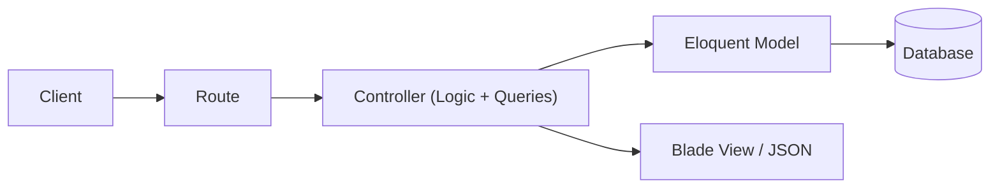
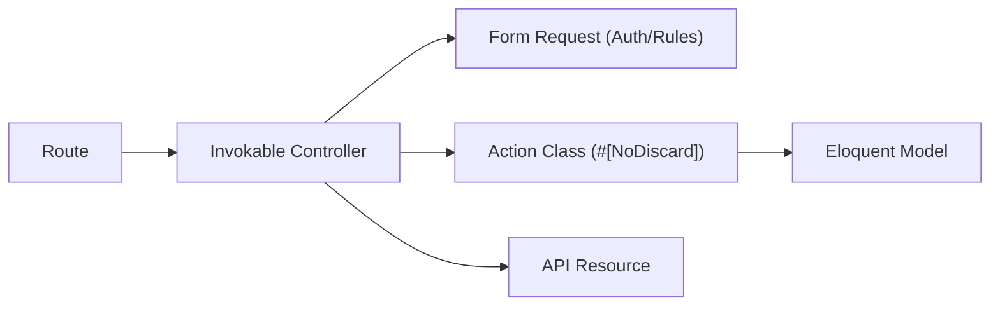
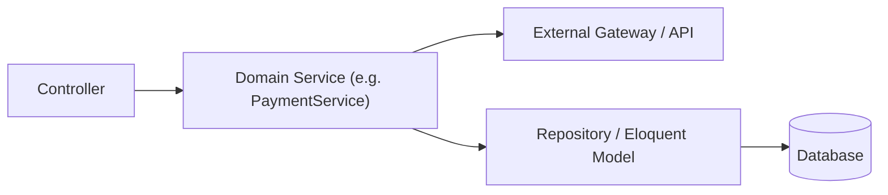
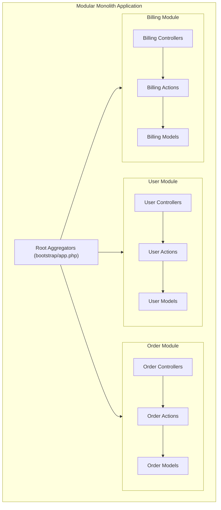
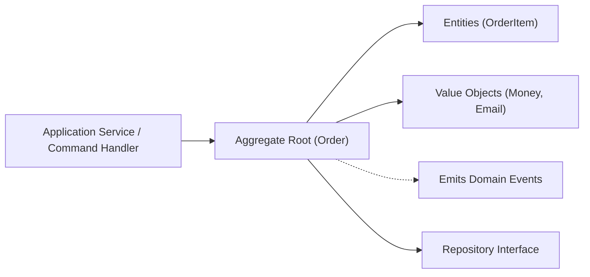
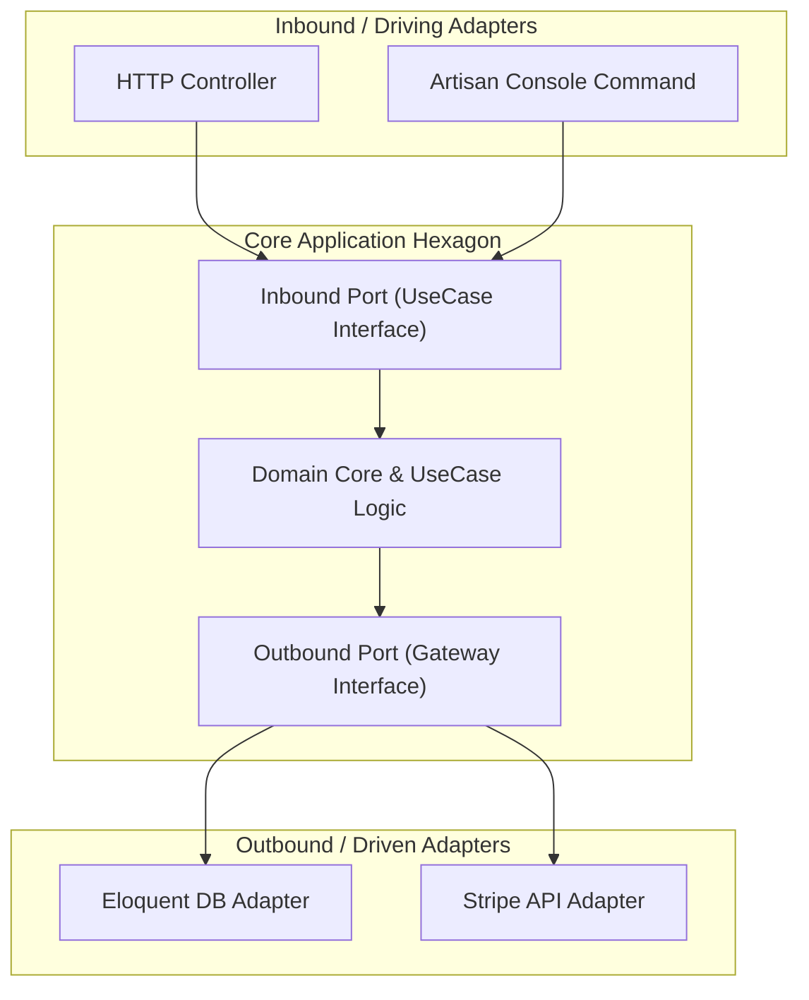
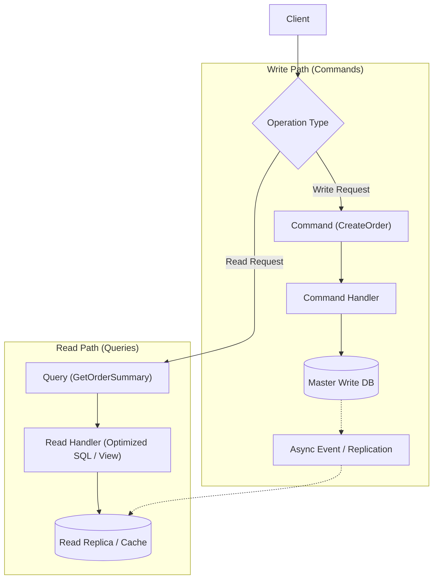
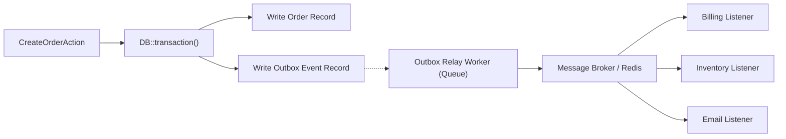

# Laravel 13 Architectural Decision Guide: Top 10 Software Architecture Patterns

> **Document**: `docs/architecture/patterns.md`  
> **Target Framework**: Laravel 13 (PHP 8.5+)  
> **Scope**: Enterprise Software Architecture, Design Patterns, and Tradeoff Analysis  

This document serves as the authoritative guide for evaluating and selecting software architecture patterns in Laravel applications, ranging from simple monolithic designs to advanced Domain-Driven Design (DDD), Hexagonal, and CQRS architectures.

---

## 🧭 Architecture Decision Matrix at a Glance

| # | Architecture Pattern | Complexity | Scalability | Testability | Ideal Team Size | Best Use Case |
| :- | :--- | :--- | :--- | :--- | :--- | :--- |
| **1** | **Classic MVC Monolith** | Low | Low – Med | Medium | 1 – 3 devs | MVPs, internal tooling, simple CRUD apps. |
| **2** | **Action-Driven Monolith** | Low – Med | High | Very High | 2 – 8 devs | Modern SaaS, standard production Laravel apps. |
| **3** | **Service-Oriented Monolith** | Medium | Medium | High | 3 – 10 devs | Multi-step workflows, 3rd party integration-heavy apps. |
| **4** | **Modular Monolith** | Medium | Very High | Very High | 5 – 25 devs | Large SaaS platforms, multiple domain teams. |
| **5** | **Domain-Driven Design (DDD)** | High | Very High | Maximum | 8 – 30+ devs | Complex business rules, fintech, healthcare, core banking. |
| **6** | **Hexagonal (Ports & Adapters)**| High | High | Maximum | 5 – 20 devs | Framework-agnostic engines, multi-driver infrastructure. |
| **7** | **CQRS Architecture** | High | Maximum | High | 5 – 20 devs | High read/write asymmetry, real-time analytics, high throughput. |
| **8** | **Event-Driven Architecture (EDA)**| Med – High | Maximum | High | 5 – 25 devs | Async workflows, notification pipelines, outbox patterns. |
| **9** | **Clean / Onion Architecture** | High | High | Maximum | 5 – 20 devs | Strict regulatory boundaries, multi-delivery channels (API, CLI, RPC). |
| **10**| **Local Package Architecture** | High | High | Very High | 10 – 50+ devs | Mono-repos, reusable corporate libraries across multiple apps. |

---

## 1. Classic MVC Monolith (Standard Laravel)

### Overview
The default Laravel pattern where Controllers manage the HTTP lifecycle and interact directly with Eloquent models.



### Directory Layout
```text
app/
├── Http/
│   └── Controllers/
│       ├── UserController.php
│       └── OrderController.php
└── Models/
    ├── User.php
    └── Order.php
```

### Code Example
```php
final class OrderController extends Controller
{
    public function store(Request $request): JsonResponse
    {
        $validated = $request->validate([
            'items' => 'required|array',
            'total' => 'required|numeric',
        ]);

        $order = Order::create($validated);

        return response()->json($order, 201);
    }
}
```

- **Pros**: Fastest time-to-market; zero boilerplate; every Laravel developer understands it.
- **Cons**: Controllers become "fat" (>500 lines); business logic is tightly coupled to HTTP requests; hard to test without HTTP mocks.
- **Verdict**: Use for MVPs and small tools. Transition to Action-Driven as complexity grows.

---

## 2. Action-Driven / Class-Based Monolith (Single-Action Pattern)

### Overview
Decouples business logic into single-responsibility Action classes, paired with Invokable (`__invoke`) controllers and Form Requests.



### Directory Layout
```text
app/
├── Actions/
│   └── Orders/
│       ├── CreateOrderAction.php
│       └── CancelOrderAction.php
├── Http/
│   ├── Controllers/
│   │   └── Orders/
│   │       ├── StoreOrderController.php
│   │       └── CancelOrderController.php
│   ├── Requests/Orders/StoreOrderRequest.php
│   └── Resources/Orders/OrderResource.php
└── Models/Order.php
```

### Code Example (Laravel 13 & PHP 8.5+)
```php
// app/Actions/Orders/CreateOrderAction.php
namespace App\Actions\Orders;

use App\Data\Orders\CreateOrderDto;
use App\Enums\OrderStatus;
use App\Events\OrderCreated;
use App\Models\Order;
use App\Models\User;
use Illuminate\Support\Facades\DB;
use NoDiscard;

final readonly class CreateOrderAction
{
    #[NoDiscard]
    public function execute(User $user, CreateOrderDto $dto): Order
    {
        return DB::transaction(function () use ($user, $dto): Order {
            $order = Order::query()->create([
                'user_id' => $user->id,
                'total_amount' => $dto->total,
                'status' => OrderStatus::Pending,
            ]);

            OrderCreated::dispatch($order);

            return $order;
        });
    }
}
```

- **Pros**: Reusable across CLI, Web, and Queue jobs; easy unit testing with Pest; skinny controllers.
- **Cons**: More files created per feature.
- **Verdict**: **Recommended Default** for 90% of modern Laravel 13 applications.

---

## 3. Service-Oriented Monolith (Service Layer)

### Overview
Groups business operations of a domain into cohesive Service classes, optionally abstracting database access through Repositories.



### Directory Layout
```text
app/
├── Services/
│   ├── PaymentService.php
│   └── SubscriptionService.php
├── Repositories/
│   ├── OrderRepositoryInterface.php
│   └── EloquentOrderRepository.php
└── Http/Controllers/SubscriptionController.php
```

### Code Example
```php
final readonly class SubscriptionService
{
    public function __construct(
        private StripeGateway $gateway,
        private OrderRepositoryInterface $orders,
    ) {}

    public function subscribe(User $user, Plan $plan, string $paymentMethod): Subscription
    {
        $stripeCustomer = $this->gateway->createCustomer($user, $paymentMethod);
        $subscription = $this->gateway->chargeSubscription($stripeCustomer, $plan);

        return $this->orders->createSubscriptionRecord($user, $plan, $subscription->id);
    }
}
```

- **Pros**: Centralizes complex external integrations and multi-entity orchestrations.
- **Cons**: Services can degenerate into "God Classes" if responsibilities are not strictly partitioned.
- **Verdict**: Ideal when workflows involve third-party integrations (Stripe, CRM, AWS) across multiple models.

---

## 4. Modular Monolith (Domain-Oriented Modules)

### Overview
Partitions a monolith into isolated business modules within `app/Modules/`, each containing its own HTTP layer, domain rules, models, and routes.



### Directory Layout
```text
app/
├── Modules/
│   ├── Identity/
│   │   ├── Http/
│   │   ├── Domain/
│   │   └── routes/ (web.php, api.php)
│   ├── Order/
│   │   ├── Http/
│   │   ├── Actions/
│   │   ├── Models/
│   │   └── routes/
│   └── Billing/
│       ├── Http/
│       ├── Services/
│       └── routes/
```

- **Pros**: Clear architectural boundaries without microservice operational complexity (no network latency, distributed transactions, or Kubernetes clusters).
- **Cons**: Requires discipline to prevent cross-module direct database queries.
- **Verdict**: **Recommended Enterprise Architecture** for large Laravel SaaS platforms.

---

## 5. Domain-Driven Design (Tactical DDD)

### Overview
Places business rules and domain logic at the center of the universe. Uses Aggregates, Entities, Value Objects, and Domain Events.



### Directory Layout
```text
src/
├── Domain/
│   └── Orders/
│       ├── Models/Order.php (Aggregate Root)
│       ├── ValueObjects/Money.php
│       ├── ValueObjects/OrderStatus.php
│       ├── Events/OrderPlaced.php
│       └── Repositories/OrderRepositoryInterface.php
├── Application/
│   └── Orders/
│       ├── Commands/PlaceOrderCommand.php
│       └── Handlers/PlaceOrderHandler.php
└── Infrastructure/
    └── Persistence/
        └── EloquentOrderRepository.php
```

### Code Example (PHP 8.5+ Value Object & Aggregate)
```php
// src/Domain/Orders/ValueObjects/Money.php
namespace Domain\Orders\ValueObjects;

use DomainException;
use NoDiscard;

final readonly class Money
{
    public function __construct(
        public int $amountInCents,
        public string $currency = 'USD',
    ) {
        if ($amountInCents < 0) {
            throw new DomainException('Money amount cannot be negative.');
        }
    }

    #[NoDiscard]
    public function add(self $other): self
    {
        if ($this->currency !== $other->currency) {
            throw new DomainException('Currency mismatch.');
        }
        return new self($this->amountInCents + $other->amountInCents, $this->currency);
    }
}
```

- **Pros**: Business invariants cannot be violated; zero framework contamination in core rules; ultimate long-term maintainability.
- **Cons**: High cognitive load and boilerplate; slower feature iteration for simple CRUD.
- **Verdict**: Use for high-risk, mission-critical business cores (banking, payment processing, healthcare).

---

## 6. Hexagonal Architecture (Ports and Adapters)

### Overview
Isolates core business logic from frameworks, UI, and storage mechanisms using Inbound and Outbound Ports (Interfaces) and Adapters (Implementations).



- **Pros**: Infrastructure can be completely swapped without modifying business rules (e.g. switching database or mock testing).
- **Cons**: Substantial interface and adapter mapping boilerplate.
- **Verdict**: Excellent when building business engines designed to support multiple frontends, CLIs, and interchangeable third-party backends.

---

## 7. CQRS (Command Query Responsibility Segregation)

### Overview
Separates write operations (Commands that mutate state and emit events) from read operations (Queries that fetch data directly).



### Code Example
```php
// Write Path: Command
final readonly class ChargeCardCommand
{
    public function __construct(
        public string $orderId,
        public int $amountInCents,
    ) {}
}

// Read Path: Query (Bypasses Eloquent overhead, direct projection)
final readonly class GetUserOrderSummaryQuery
{
    public function execute(string $userId): array
    {
        return DB::table('orders')
            ->where('user_id', $userId)
            ->selectRaw('count(*) as count, sum(total_amount) as total')
            ->first();
    }
}
```

- **Pros**: Read models can be independently scaled and cached; zero ORM overhead on high-throughput read endpoints.
- **Cons**: Eventual consistency challenges; increased architectural overhead.
- **Verdict**: Crucial for high-traffic applications with heavy read-to-write ratios (dashboards, e-commerce product catalogs).

---

## 8. Event-Driven Architecture (EDA & Transactional Outbox)

### Overview
Decouples services via asynchronous Domain Events, frequently leveraging the Transactional Outbox Pattern to guarantee message delivery without distributed two-phase commits.



- **Pros**: Extreme decoupling; failure in downstream consumers (e.g. email provider down) does not fail user transactions.
- **Cons**: Async debugging is harder; requires idempotency handling on listeners.
- **Verdict**: Essential for payment, notification, and third-party webhook processing pipelines.

---

## 9. Clean / Onion Architecture

### Overview
Strict inward dependency rule: inner layers never reference outer layers.
- **Inner Circle**: Entities (Enterprise Rules).
- **Second Circle**: Use Cases (Application Rules).
- **Third Circle**: Interface Adapters (Controllers, Gateways, Presenters).
- **Outer Circle**: Frameworks & Drivers (Laravel Router, Blade, PostgreSQL).

- **Pros**: Complete framework independence; long architectural longevity.
- **Cons**: High mapping ceremony; often fights against Laravel's native ActiveRecord philosophy.
- **Verdict**: Best for enterprise software mandated to survive framework migrations or strict architectural compliance standards.

---

## 10. Local Package Architecture (Mono-Repo with Composer)

### Overview
Deconstructs large applications into private local Composer packages stored in `packages/*` and referenced via Composer's `path` repository.

```text
project/
├── composer.json (root)
├── app/
└── packages/
    ├── customer-portal/
    │   ├── composer.json
    │   └── src/CustomerPortalServiceProvider.php
    ├── billing-engine/
    │   ├── composer.json
    │   └── src/BillingServiceProvider.php
    └── reporting-core/
        ├── composer.json
        └── src/ReportingServiceProvider.php
```

### Root `composer.json` Configuration
```json
{
    "repositories": [
        {
            "type": "path",
            "url": "packages/*",
            "options": {
                "symlink": true
            }
        }
    ],
    "require": {
        "corporate/customer-portal": "@dev",
        "corporate/billing-engine": "@dev"
    }
}
```

- **Pros**: Enforces physical code boundaries; allows independent testing and potential extraction to private Git repositories.
- **Cons**: Composer dependency management overhead; slower dev iteration during cross-package changes.
- **Verdict**: Ideal for multi-product organizations sharing core business packages across multiple distinct Laravel applications.

---

## 🎯 Summary Recommendation for Laravel 13

1. **For Startups & Most SaaS Products**: Use **Pattern 2 (Action-Driven Monolith)**. It maximizes speed, maintains high testability with Pest, and keeps controllers thin without unnecessary ceremony.
2. **For Growing Scale-Ups & Multi-Team Systems**: Transition to **Pattern 4 (Modular Monolith)**. It groups domain logic cleanly into `app/Modules/` while retaining Laravel's native developer ergonomics.
3. **For High-Risk Financial & Regulated Cores**: Isolate the core calculation engine using **Pattern 5 (DDD)** or **Pattern 6 (Hexagonal)**, wrapped inside an Action-Driven or Modular Monolith envelope.
