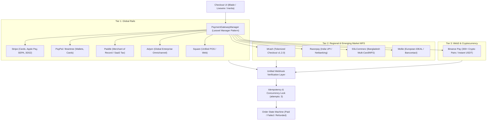
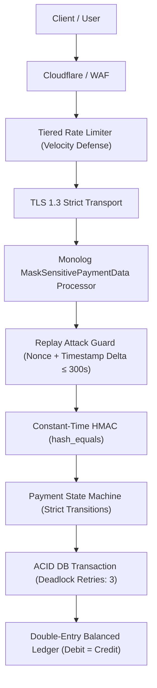
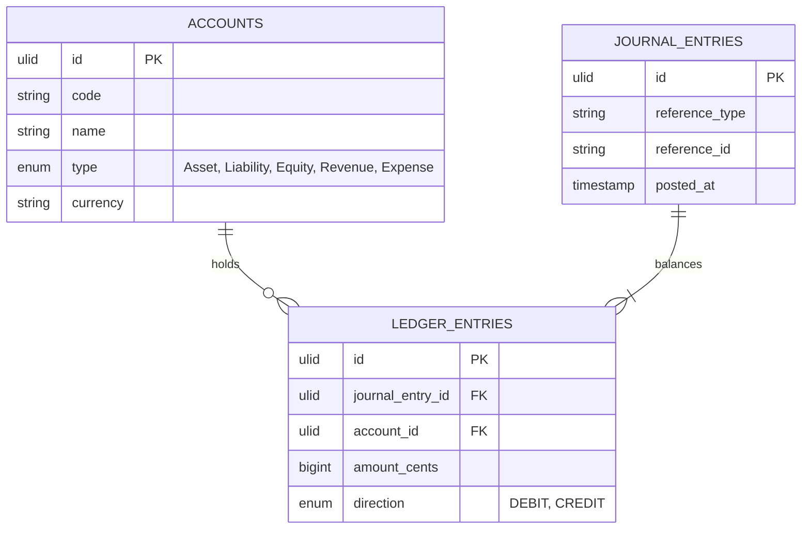

# Laravel 13 & Modern PHP 8.6+ Payment Gateway Architecture & Fintech Integrations

> **Document**: `docs/architecture/payment-gateways-and-fintech-integrations.md`  
> **Target Framework**: Laravel 13 (PHP 8.6+)  
> **Scope**: Multi-Driver Payment Gateway Architecture, Crypto (Binance Pay), MFS (bKash), Global Rails (Stripe, PayPal, Razorpay), Webhook Security, and PCI-DSS Compliance  

---

## 🧭 Executive Overview & The Top 10 Payment Gateways

Processing financial transactions requires zero tolerance for race conditions, credential leakage, or unverified webhooks. This guide details a production-grade, multi-driver fintech architecture in Laravel 13 supporting both traditional credit rails, mobile financial services (MFS), and cryptocurrency:



---

## 1. The Top 10 Payment Gateways Breakdown

| Gateway | Best Use Case | Primary Geographic Focus | Supported Rails | Security & Webhook Validation |
| :--- | :--- | :--- | :--- | :--- |
| **1. Stripe** | Global SaaS & E-commerce | Worldwide (47+ countries) | Cards, Apple/Google Pay, SEPA, ACH, Klarna | 3DS2, SAQ-A, `Stripe-Signature` HMAC-SHA256 |
| **2. bKash** | Mobile Financial Services (MFS) | Bangladesh / South Asia (70M+ users) | Direct bKash Wallet Balance | Tokenized Checkout, Bearer Grant Token + Query API |
| **3. Binance Pay** | Borderless Web3 & Crypto | Global (200+ countries) | USDT, BTC, ETH, BNB (300+ Cryptocurrencies) | SHA512-HMAC Non-repudiation (Nonce + Timestamp) |
| **4. PayPal / Braintree**| Consumer Wallets | Global | PayPal Balance, Venmo, Credit Cards | OAuth 2.0 Bearer, Asymmetric Webhook Signature |
| **5. Razorpay** | High-growth Asian Markets | India / APAC | UPI, Netbanking, Cards, Wallets | PCI-DSS L1, `X-Razorpay-Signature` HMAC-SHA256 |
| **6. Paddle** | B2B / B2C Software & SaaS | Global | Cards, PayPal, Wire, Auto Sales Tax / VAT | Merchant of Record (MoR), Ed25519 Webhook Signatures |
| **7. Mollie** | European Local Payment Rails | European Union / UK | iDEAL, Bancontact, Cartes Bancaires, SEPA | PSD2 SCA, Idempotent Webhook Ping verification |
| **8. Adyen** | Unified Commerce & Retail | Global Enterprise | 250+ Local Payment Methods, Global Acquiring | Custom HMAC-SHA256 calculation per notification |
| **9. Square** | Integrated In-person & Online | US, CA, UK, AU, JP, ES | Terminal Hardware, Cards, Cash App Pay | OAuth 2.0, Webhook HMAC-SHA256 Signature |
| **10. SSLCommerz** | Aggregated South Asian Banking| Bangladesh / South Asia | Visa, Mastercard, Amex, Nagad, Rocket | IPN (Instant Payment Notification) Dual Validation |

---

## 2. Unified Driver Architecture (`config/payments.php`)

Configure all payment drivers centrally:

```php
<?php

declare(strict_types=1);

return [
    'default' => env('PAYMENT_DEFAULT_DRIVER', 'stripe'),

    'drivers' => [
        'stripe' => [
            'key' => env('STRIPE_KEY'),
            'secret' => env('STRIPE_SECRET'),
            'webhook_secret' => env('STRIPE_WEBHOOK_SECRET'),
        ],

        'bkash' => [
            'app_key' => env('BKASH_APP_KEY'),
            'app_secret' => env('BKASH_APP_SECRET'),
            'username' => env('BKASH_USERNAME'),
            'password' => env('BKASH_PASSWORD'),
            'sandbox' => env('BKASH_SANDBOX', true),
        ],

        'binance' => [
            'api_key' => env('BINANCE_PAY_API_KEY'),
            'secret_key' => env('BINANCE_PAY_SECRET_KEY'),
            'sandbox' => env('BINANCE_PAY_SANDBOX', false),
        ],

        'razorpay' => [
            'key_id' => env('RAZORPAY_KEY_ID'),
            'key_secret' => env('RAZORPAY_KEY_SECRET'),
            'webhook_secret' => env('RAZORPAY_WEBHOOK_SECRET'),
        ],

        'paddle' => [
            'vendor_id' => env('PADDLE_VENDOR_ID'),
            'api_key' => env('PADDLE_API_KEY'),
            'public_key' => env('PADDLE_PUBLIC_KEY'),
        ],
    ],
];
```

---

## 3. bKash Tokenized Checkout Deep-Dive

bKash Tokenized Checkout replaces legacy checkout by eliminating direct customer credential handling and providing a continuous tokenized agreement lifecycle.

### Complete Lifecycle Flow

1. **Grant Token**:
   ```text
   POST /tokenized/checkout/token/grant
   Headers: { username, password }
   Body: { app_key, app_secret }
   Response: { id_token, refresh_token, token_type: "Bearer", expiresIn: 3600 }
   ```
2. **Create Payment**:
   ```text
   POST /tokenized/checkout/create
   Headers: { Authorization: id_token, X-APP-Key }
   Body: { mode: "0011", payerReference, callbackURL, amount, currency: "BDT", intent: "sale", merchantInvoiceNumber }
   Response: { paymentID, bkashURL, transactionStatus: "Initiated" }
   ```
3. **Execute Payment**:
   ```text
   POST /tokenized/checkout/execute
   Headers: { Authorization: id_token, X-APP-Key }
   Body: { paymentID }
   Response: { trxID, paymentID, amount, transactionStatus: "Completed", statusCode: "0000" }
   ```
4. **Query Payment Status**:
   ```text
   POST /tokenized/checkout/payment/status
   Headers: { Authorization: id_token, X-APP-Key }
   Body: { paymentID }
   Response: { trxID, transactionStatus: "Completed" }
   ```

---

## 4. Binance Pay (Crypto Web3) Deep-Dive

Binance Pay uses cryptographic non-repudiation for all communications:

### Signature Generation Algorithm
Every request sent to Binance Pay must compute a SHA512-HMAC signature:
$$\text{payloadToSign} = \text{Timestamp} + \text{"\textbackslash n"} + \text{Nonce} + \text{"\textbackslash n"} + \text{JsonPayload} + \text{"\textbackslash n"}$$
$$\text{Signature} = \text{strtoupper}(\text{hash\_hmac}('sha512', \text{payloadToSign}, \text{SecretKey}))$$

### Required HTTP Headers
- `BinancePay-Timestamp`: Current UTC millisecond timestamp (`(string)(int)(microtime(true) * 1000)`).
- `BinancePay-Nonce`: Cryptographically secure random 32-character string (`Str::random(32)`).
- `BinancePay-Certificate-SN`: Merchant API Key.
- `BinancePay-Signature`: The computed uppercase hex signature.

---

## 5. PCI-DSS Compliance & Advanced Fintech Security

Fintech architectures require defense-in-depth across the entire request-response lifecycle:



### 1. Zero Raw Card Data Storage (PCI-DSS SAQ A)
- **Tokenization**: Never accept raw 16-digit Primary Account Numbers (PAN), CVVs, or card expiration dates onto your application server. Use gateway hosted tokens (Stripe Elements, bKash Hosted Checkout, Binance Pay QR, PayPal Buttons).
- **Log Redaction**: Register a Monolog processor (`App\Logging\MaskSensitivePaymentData`) in `config/logging.php` to scrub potential PANs, CVVs, and Authorization Bearer headers before they hit disk or centralized log collectors (Datadog, CloudWatch).

### 2. Replay Attack Defense Protocol
- **Timestamp Window**: Calculate $|\text{now}() - \text{timestamp}| \le 300\text{s}$. If older than 5 minutes or in the future, abort with `401 Unauthorized`.
- **Atomic Nonce Cache**: Cache each unique nonce with a 10-minute TTL (`Cache::add("nonce:{$nonce}", true, 600)`). If key already exists, reject as a replay attack.

### 3. Monetary Decimal Safety: The Zero-Float Rule
- **Prohibition**: Never store or calculate money using floating-point types (`float`, `double`).
- **Standard**: Always store monetary values as **integer cents** (e.g., `1050` = $10.50 USD) or use BCMath strings (`bcmul`, `bcadd`) with explicit scales for cryptocurrency or fractional shares.

---

## 6. Payment Finite State Machine (FSM)

Enforce strict, unidirectional state transitions to eliminate race conditions and double-settlement bugs:

| Current Status | Allowed Target Statuses | Disallowed (Illegal) Transitions |
| :--- | :--- | :--- |
| `Draft` | `Pending`, `Failed` | `Paid`, `Refunded`, `Authorized` |
| `Pending` | `Authorized`, `Paid`, `Failed` | `Refunded`, `PartiallyRefunded` |
| `Authorized` | `Paid` (Capture), `Voided` (Cancel) | `Refunded`, `Pending` |
| `Paid` | `PartiallyRefunded`, `Refunded`, `Disputed` | `Pending`, `Draft`, `Authorized` |
| `PartiallyRefunded` | `PartiallyRefunded`, `Refunded`, `Disputed` | `Paid`, `Pending`, `Draft` |
| `Disputed` | `Paid` (Won), `Refunded` / `Lost` (Chargeback) | `Draft`, `Pending` |
| `Failed` *(Terminal)* | *None* | Any transition |
| `Refunded` *(Terminal)* | *None* | Any transition |
| `Voided` *(Terminal)* | *None* | Any transition |

---

## 7. Double-Entry Bookkeeping Ledger Architecture

Financial auditability requires an immutable double-entry ledger where every credit corresponds to an equal debit:



---

## 8. Asynchronous Webhook Queue Pipeline & Dead-Letter Queue (DLQ)

To handle massive webhook spikes without timing out external gateways:
1. **Synchronous Controller**: Validates HMAC signature with `hash_equals()`, stores raw payload in `webhook_events`, and returns `HTTP 200 OK` in $< 50\text{ms}$.
2. **Queued Worker (`ProcessPaymentWebhookJob`)**: Dispatches asynchronous processing on Redis queue `fintech-webhooks` with exponential backoff (`backoff: [10, 30, 90, 300]`).
3. **Dead-Letter Queue (DLQ)**: Failed events after 5 attempts are routed to `failed_jobs` and trigger an automated PagerDuty / Slack alert for manual reconciliation.

