# Modern PHP 8.6.0 GA Syntax, Standard Library & Migration Architecture

> **Document**: `docs/architecture/php-8-6-modern-syntax-and-migration.md`  
> **Framework**: Laravel 13 & PHP 8.6.0 GA (released November 19, 2026)  
> **Focus**: Authoritative PHP 8.6 syntax, exact standard library APIs, engine optimizations, Laravel 13 integration blueprints, PHPStan Level 8+, and PHP 8.5 → 8.6 upgrade runbook.

---

## 1. Executive Summary

PHP **8.6.0 GA** (November 19, 2026) builds on PHP 8.4 (property hooks, asymmetric visibility) and PHP 8.5 (pipe operator `|>`, `clone($obj, [...])`, `#[NoDiscard]`, native `Uri\*`) with functional ergonomics, high-precision time & I/O primitives, structured stream error handling, stronger security defaults, and engine-level optimizations:

```mermaid
flowchart TD
    PHP86["PHP 8.6.0 GA (Nov 19, 2026)"]

    PHP86 --> Lang["Language & Syntax"]
    PHP86 --> Stdlib["Standard Library & Core"]
    PHP86 --> Sec["Security, Crypto & Runtime"]
    PHP86 --> Migr["Deprecations & BC Hygiene"]

    Lang --> PFA["Partial Function Application (? and ...)"]
    Lang --> ROD["Readonly Property Defaults"]
    Lang --> OVR["#[Override] on Constants & Enum Cases"]
    Lang --> COP["Object Property Writes on Constants"]
    Lang --> DBG["Debugable Enums & Parameter DocComments"]

    Stdlib --> CLAMP["clamp() for Numbers & Comparable Objects"]
    Stdlib --> DUR["Time\\Duration & Time\\TimeException"]
    Stdlib --> SORT["Global SortDirection Enum"]
    Stdlib --> POLL["Io\\Poll\\* & StreamPollHandle"]
    Stdlib --> STRM["StreamErrorMode / StreamException"]

    Sec --> SESS["Session Security Defaults (strict/httponly/Lax)"]
    Sec --> SOD["Sodium IPcrypt, XOF & Post-Quantum KEM"]
    Sec --> OPT["Compiler & VM Optimizations"]

    Migr --> ID["Reserved Identifiers (let, is, _, namespace)"]
    Migr --> MB["Mbregex Oniguruma EOL -> PCRE /u"]
    Migr --> BC["trim() \\f, Stream Flush False, Strict ValueError"]
```



---

## 2. Complete Language & Syntax Reference

### 2.1 Partial Function Application (PFA)

RFCs: `partial_function_application_v2`, `partial_function_application_optional_placeholder`.

PFA evaluates a call expression containing `?` (single required placeholder) or trailing `...` (variadic leftover placeholder) into a `Closure` instead of invoking the target immediately.

#### Rules & Guarantees
1. **Strict Parameter Ordering**:
   - Segment 1: Zero or more positional arguments or `?` placeholders.
   - Segment 2: Zero or more named arguments with fixed values or `?` placeholders (`attempt: ?`).
   - Segment 3: Zero or one trailing `...` variadic placeholder.
   - Placing any positional argument or `?` after a named argument is a **compile-time error**.
2. **Optionality Semantics**:
   - Every `?` placeholder generates a **required** parameter on the resulting `Closure` even if the underlying function parameter has a default value.
   - Only the trailing `...` placeholder inherits optionality and default values from remaining parameters.
3. **Full Metadata Inheritance**:
   - Resulting `Closure` inherits parameter names, native types, pass-by-reference / return-by-reference semantics, return type, `#[NoDiscard]`, and `#[SensitiveParameter]`.
4. **Compiler Optimization**:
   - `array_map()` invoked with a first-class callable (`foo(...)`) or PFA (`str_replace(' ', '-', ?)`) is compiled into an optimized internal `foreach` loop.

#### Production Laravel 13 Example (Pipe + PFA)
```php
<?php

declare(strict_types=1);

namespace App\Actions\Content;

use Illuminate\Support\Str;
use NoDiscard;

final readonly class SanitizeTagsAction
{
    /**
     * @param list<string> $rawTags
     * @return list<string>
     */
    #[NoDiscard]
    public function execute(array $rawTags): array
    {
        $cleanOne = static fn (string $tag): string => $tag
            |> trim(...)
            |> str_replace(['_', ' '], '-', ?)
            |> strtolower(...)
            |> Str::limit(?, 40, '');

        return $rawTags
            |> array_map($cleanOne, ?)
            |> array_filter(?, static fn (string $t): bool => $t !== '')
            |> array_unique(...)
            |> array_values(...);
    }
}
```

---

### 2.2 Readonly Property Defaults

RFC: `readonly_property_defaults`.

Readonly instance properties (and properties on `readonly class` declarations) may now define a default value inline:

```php
<?php

declare(strict_types=1);

namespace App\Contracts;

interface WebhookVerifierContract
{
    public string $algorithm { get; }
    public int $toleranceSeconds { get; }
}
```

```php
<?php

declare(strict_types=1);

namespace App\Payments\Webhooks;

use App\Contracts\WebhookVerifierContract;

final readonly class StripeWebhookConfig implements WebhookVerifierContract
{
    // Default counts as the single initializing write — cannot be overwritten in __construct()
    public string $algorithm = 'sha256';
    public int $toleranceSeconds = 300;

    public function __construct(
        // Runtime-configurable immutable values still use promoted constructor parameters:
        public string $signingSecret,
        public bool $strictReplayCheck = true,
    ) {}
}
```

> [!WARNING]
> Do **not** assign to a `readonly` property with an inline default inside `__construct()` — PHP 8.6 treats the default value as the property's one-and-only initialization and throws an `Error` on reassignment.

---

### 2.3 `#[Override]` on Class, Interface, Trait Constants & Enum Cases

RFC: `override_constants`.

`#[Override]` (previously methods in PHP 8.3 and properties in PHP 8.5) now validates class constants, interface constants, trait constants (checked against the composing class's parents/interfaces), enum constants, and enum cases at compile time.

- Requires a matching `public` or `protected` constant in a parent class or implemented interface.
- A `private` parent constant does **not** satisfy `#[Override]`.
- Always import `use Override;` explicitly at the top of the file.

```php
<?php

declare(strict_types=1);

namespace App\Gateways;

use Override;

interface GatewayContract
{
    public const int MAX_ATTEMPTS = 3;
    public const string MODE_LIVE = 'live';
}

final class BkashGateway implements GatewayContract
{
    #[Override]
    public const int MAX_ATTEMPTS = 5;

    #[Override]
    public const string MODE_LIVE = 'live';
}
```

---

### 2.4 Object Property Writes on Constants

RFC: `const_object_property_write`.

Objects stored in global constants or class constants now support `->` property mutations, `isset()`, `unset()`, compound assignments (`+=`, `.=`), increment/decrement (`++`, `--`), and passing object properties by reference. Rebinding the constant identifier itself remains illegal, and array dimension write semantics (`[]`) on constants remain unchanged.

```php
<?php

declare(strict_types=1);

use stdClass;

// Class constants cannot directly use `new` expressions — initialize via a global constant first
const GLOBAL_RUNTIME_STATS = new stdClass();

final class RuntimeCounters
{
    public const stdClass STATS = GLOBAL_RUNTIME_STATS;
}

RuntimeCounters::STATS->dispatched = 0;
RuntimeCounters::STATS->dispatched++;
```

> [!CAUTION]
> **Laravel Octane / Swoole / FrankenPHP Safety**: Never mutate objects stored in constants to hold per-request or per-tenant user data under long-running workers — constant objects persist across requests for the entire worker lifetime.

---

### 2.5 Debugable Enums & Parameter DocComments

#### Debugable Enums (`debugable-enums`)
Enums can now implement `public function __debugInfo(): array` (strictly non-nullable `array`; returning `?array` / `array|null` is deprecated in PHP 8.6) to redact sensitive backing values in debug dumps (`var_dump()`, Symfony VarDumper / `dd()`). Note that Monolog's `NormalizerFormatter` uses JSON normalization rather than `__debugInfo()`, so keep separate log redaction/scrubbing configured for application logs:

```php
<?php

declare(strict_types=1);

namespace App\Enums\Integrations;

enum ProviderTokenScope: string
{
    case BillingAdmin = 'sk_live_billing_admin';
    case ReadOnly = 'pk_live_readonly';

    /**
     * @return array{case: string, prefix: string}
     */
    public function __debugInfo(): array
    {
        return [
            'case' => $this->name,
            'prefix' => substr($this->value, 0, 7) . '***',
        ];
    }
}
```

#### Parameter DocComments (`parameter-doccomments`)
DocComments attached directly to function/method parameters are now preserved in AST and accessible via `ReflectionParameter::getDocComment(): string|false` — useful for auto-generating tool descriptions in `laravel/mcp` and `laravel/ai`:

```php
<?php

declare(strict_types=1);

namespace App\Mcp\Tools;

use ReflectionMethod;

final class InvoiceLookupTool
{
    /**
     * @return array{invoice_id: string, include_lines: bool}
     */
    public function handle(
        /** ULID of the invoice to retrieve */
        string $invoiceId,
        /** Whether to hydrate individual line items */
        bool $includeLines = false,
    ): array {
        return [
            'invoice_id' => $invoiceId,
            'include_lines' => $includeLines,
        ];
    }

    /**
     * @return array<string, string>
     */
    public static function parameterDescriptions(): array
    {
        $descriptions = [];
        foreach (new ReflectionMethod(self::class, 'handle')->getParameters() as $param) {
            $doc = $param->getDocComment();
            if ($doc !== false) {
                $descriptions[$param->getName()] = trim($doc, "/* \t\n\r");
            }
        }

        return $descriptions;
    }
}
```

---

### 2.6 `WeakMap` Reference Assignment

PHP 8.6 enables reference assignment on `WeakMap` keys without requiring the key to exist beforehand:

```php
<?php

declare(strict_types=1);

use WeakMap;

/** @var WeakMap<object, int> $counters */
$counters = new WeakMap();
$initial = 1;
$counters[$model] =& $initial;
```

---

## 3. Standard Library & Core API Synopses

### 3.1 `clamp()`

```php
function clamp(mixed $value, mixed $min, mixed $max): mixed;
```

- Works with `int`, `float`, `string`, `DateTimeImmutable`, `Time\Duration`, and any object supporting PHP comparison semantics.
- Throws `ValueError` when `$min > $max` or when `$min` / `$max` is `NAN`.
- Returns `NAN` when `$value` is `NAN`.

### 3.2 `Time\Duration` & `Time\TimeException`

```php
namespace Time;

use Exception;

class TimeException extends Exception {}

final readonly class Duration
{
    public int $seconds;
    public int $nanoseconds;
    public bool $negative;

    public static function fromNanoseconds(int $nanoseconds): self;
    public static function fromMicroseconds(int $microseconds): self;
    public static function fromMilliseconds(int $milliseconds): self;
    public static function fromSeconds(int $seconds, int $nanoseconds = 0): self;
    public static function fromMinutes(int $minutes): self;
    public static function fromHours(int $hours): self;
    public static function fromIso8601DurationString(string $specification): self;

    public function negate(): self;
    public function absolute(): self;
    public function add(Duration $duration): self;
    public function sub(Duration $duration): self;
    public function multiplyBy(int $factor): self;
    public function divideBy(int $divisor): self;

    public static function compare(self $a, self $b): int;
}
```

- Maximum magnitude: `9223372035999999999` nanoseconds (~292 years).
- Supports standard operators (`<`, `<=`, `==`, `!=`, `>=`, `>`, `<=>`) and `clamp()`.
- **Does NOT define** `__toString()`, `toIsoString()`, or `toSeconds()`.
- `fromIso8601DurationString()` accepts time-only ISO 8601 durations (up to `H` hours, e.g. `PT2H15M30S`); calendar designators (`Y`, `M` months, `W`, `D`) throw `Time\TimeException`.

#### Laravel 13 Circuit Breaker / Retry Backoff Example with `Time\Duration`
```php
<?php

declare(strict_types=1);

namespace App\Support\Http;

use NoDiscard;
use Time\Duration;

final readonly class RetryPolicy
{
    public function __construct(
        public Duration $baseDelay,
        public Duration $maxDelay,
    ) {}

    #[NoDiscard]
    public function delayForAttempt(int $attempt): Duration
    {
        $multiplier = 1 << clamp($attempt - 1, 0, 10);

        return clamp(
            $this->baseDelay->multiplyBy($multiplier),
            $this->baseDelay,
            $this->maxDelay,
        );
    }
}
```

---

### 3.3 Global `SortDirection` Enum

```php
enum SortDirection
{
    case Ascending;
    case Descending;
}
```

Use native `SortDirection` across repositories, Eloquent custom query builders, and DTOs instead of defining custom `App\Enums\Common\SortDirection` enums or raw `'asc'`/`'desc'` strings.

---

### 3.4 Native I/O Polling API (`Io\Poll\*` & `StreamPollHandle`)

```php
// Stub synopsis (PHP 8.6 internal namespaces):
namespace Io;

use Exception;

class IoException extends Exception {}
```

```php
namespace Io\Poll;

use Time\Duration;

enum Backend
{
    case Auto;
    case Poll;
    case Epoll;
    case Kqueue;
    case EventPorts;
    case WSAPoll;

    /** @return list<self> */
    public static function getAvailableBackends(): array;
    public function isAvailable(): bool;
    public function supportsEdgeTriggering(): bool;
}

enum Event
{
    case Read;
    case Write;
    case Error;
    case HangUp;
    case ReadHangUp;
    case OneShot;
    case EdgeTriggered;
}

interface Handle {} // Internal-only marker interface

final class Context
{
    public function __construct(Backend $backend = Backend::Auto);
    /** @param list<Event> $events */
    public function add(Handle $handle, array $events, mixed $data = null): Watcher;
    /** @return list<Watcher> */
    public function wait(?Duration $timeout = null, ?int $maxEvents = null): array;
    public function getBackend(): Backend;
}

final class Watcher
{
    public function getHandle(): Handle;
    /** @return list<Event> */
    public function getWatchedEvents(): array;
    /** @return list<Event> */
    public function getTriggeredEvents(): array;
    public function getData(): mixed;
    public function hasTriggered(Event $event): bool;
    public function isActive(): bool;
    /** @param list<Event> $events */
    public function modify(array $events, mixed $data = null): void;
    /** @param list<Event> $events */
    public function modifyEvents(array $events): void;
    public function modifyData(mixed $data): void;
    public function remove(): void;
}
```

```php
// Global namespace:
use Io\Poll\Handle;

final class StreamPollHandle implements Handle
{
    /** @param resource $stream */
    public function __construct(mixed $stream);
    /** @return resource */
    public function getStream(): mixed;
    public function isValid(): bool;
}
```

Exception hierarchy under `Io\Poll`: `PollException` (extends `Io\IoException`), `FailedPollOperationException`, `FailedContextInitializationException`, `FailedHandleAddException`, `FailedWatcherModificationException`, `FailedPollWaitException`, `BackendUnavailableException`, `InactiveWatcherException`, `HandleAlreadyWatchedException`, `InvalidHandleException`.

---

### 3.5 Structured Stream Error Handling

| Symbol | Purpose |
| :--- | :--- |
| `StreamErrorMode` | `Error` (legacy warnings), `Exception` (throws `StreamException` on terminating errors), `Silent` |
| `StreamErrorStore` | `Auto`, `None`, `NonTerminating`, `Terminating`, `All` |
| `StreamErrorCode` | Typed enum of stream failure codes |
| `final readonly class StreamError` | `$code`, `$message`, `$wrapperName`, `$severity`, `$terminating`, `$param` |
| `class StreamException extends Exception` | `getErrors(): array` (`list<StreamError>`) |
| `stream_last_errors(): array` / `stream_clear_errors(): void` | Inspect and reset stored `StreamError` history |
| `stream_socket_get_crypto_status()` | Inspect non-blocking TLS handshake state (`STREAM_CRYPTO_STATUS_*`) |

---

### 3.6 Reflection, URI, Cryptography & Extension Highlights

1. **Reflection**:
   - `ReflectionProperty::isReadable(?string $scope, ?object $object = null): bool`
   - `ReflectionProperty::isWritable(?string $scope, ?object $object = null): bool`
   - `ReflectionParameter::getDocComment(): string|false`
   - `ReflectionConstant::inNamespace(): bool`
   - `ReflectionAttribute::{inNamespace,getNamespaceName,getShortName}()`
2. **URI Builders & Helpers**:
   - `Uri\Rfc3986\UriBuilder`, `Uri\WhatWg\UrlBuilder`, `Uri\WhatWg\url_percent_encode()`, `Uri\WhatWg\UrlPercentEncodingMode`
   - `Uri\Rfc3986\Uri::{getUriType,getHostType}()`, `Uri\WhatWg\Url::{isSpecialScheme,getHostType}()`
3. **Security & Cryptography**:
   - **Session Security Defaults**: `session.use_strict_mode = 1`, `session.cookie_httponly = 1`, `session.cookie_samesite = "Lax"` now default-enabled.
   - **Sodium**:
     - IPcrypt: `sodium_crypto_ipcrypt_{keygen,encrypt,decrypt}()`, `_nd_*()`, `_ndx_*()`, `_pfx_*()`, `sodium_bin2ip()`, `sodium_ip2bin()` — ideal for privacy-preserving IP anonymization in analytics/logs.
     - XOF: `sodium_crypto_xof_{shake128,shake256,turboshake128,turboshake256}()` (+ `_init`, `_update`, `_squeeze`, and `SodiumCryptoXof*State`).
     - Post-Quantum KEM (libsodium ≥ 1.0.22): `sodium_crypto_kem_*()` (X-Wing) & `sodium_crypto_kem_mlkem768_*()` (ML-KEM-768).
   - **OpenSSL**: `Openssl\OpensslException`, `Openssl\Session`, `Openssl\Psk`, `OPENSSL_RSA_PSS_SALTLEN_*`.
4. **Stdlib, DB, Intl & Zip**:
   - `ARRAY_FILTER_USE_VALUE`
   - `grapheme_strrev()`, `Locale::getDisplayKeyword()`, `Locale::getDisplayKeywordValue()`, `IntlDatePatternGenerator::{getSkeleton,getBaseSkeleton}()`, `IntlNumberRangeFormatter` (ICU ≥ 63), `SpoofChecker::{areBidiConfusable,getBidiSkeleton,getSkeleton}()` (Bidi: ICU ≥ 74)
   - `ZipArchive::openString()` & `ZipArchive::closeString()` (in-memory ZIP handling without temp files)
   - `mysqli::quote_string()` / `mysqli_quote_string()`, `MYSQLI_OPT_COMPRESS`
   - `Pdo\Pgsql::ATTR_CHUNK_SIZE` (libpq ≥ 17)
   - `pack()` / `unpack()` `<` and `>` endianness modifiers on signed/unsigned integers and floats/doubles
   - `error_include_args` INI (off by default)
   - Unicode 18.0 tables; `finfo` upgraded to `file 5.48` (TTF detected as `font/ttf`); `PHP_OS_FAMILY` adds `'AIX'`.

---

## 4. Engine & Compiler Optimizations

PHP 8.6 introduces zero-code-change runtime wins that align cleanly with our architectural rules:

- **Direction-Aware Property Resolution**: Moves `private(set)` / `protected(set)` asymmetric visibility checks to opline runtime cache population.
- **Stateless Closure Caching**: Eliminates repeated closure allocations in hot loops.
- **`array_map()` FCC / PFA Loop Compilation**: `array_map(trim(...), $items)` and `array_map(str_replace(' ', '-', ?), $items)` compile into tight internal `foreach` loops.
- **`printf()` Optimization**: `printf()` calls using only `%s` and `%d` compile directly into string interpolation.
- **Faster `new self()` Dispatch**: Streamlines argument passing for statically known constructors.
- **TAILCALL VM & ZTS**: Expanded TAILCALL support (including Windows Clang ≥ 19 x86_64) and ZTS throughput improvements.

---

## 5. Complete PHP 8.5 → 8.6 Migration & Upgrade Runbook

### 5.1 Pre-Upgrade Codebase Audit Commands

```bash
# 1. Hunt for deprecated identifiers & functions before upgrading runtime
grep -rnE '\b(mb_ereg|mb_split|is_double|is_long|is_integer|doubleval|strcoll|SORT_LOCALE_STRING|metaphone|spl_classes|spl_object_hash)\b' app/ config/ routes/

# 2. Check for nullable __debugInfo return types or return inside finally
grep -rnE 'function __debugInfo\s*\(\s*\)\s*:\s*(\?array|array\|null|null\|array)' app/

# 3. Verify PHPStan Level 8+ and Rector PHP 8.6 rules
./vendor/bin/phpstan analyse --level=8
./vendor/bin/rector process --dry-run
./vendor/bin/pest
```

### 5.2 Complete Deprecation Matrix (`PHP-8.6/UPGRADING`)

- **Core**:
  - `return` inside `finally` blocks.
  - Returning values from `__construct()` / `__destruct()` or declaring them as generators.
  - Nullable return type (`?array` / `array|null`) on `__debugInfo()`.
  - Naming a function `readonly`; naming a class constant `namespace`.
  - Using `let` or `is` as class, interface, trait, enum, function, constant, or `use`/`class_alias()` alias names.
  - Using `_` as a constant name (`const` / `define()`) or `use const` alias.
  - Passing 3rd argument (`$case_insensitive`) to `define()`.
  - Calling `is_a()` / `is_subclass_of()` with string first argument when `$allow_string` is `false`.
- **Mbstring**: `mb_ereg*`, `mb_split` (Oniguruma EOL → migrate to PCRE `/u`); passing objects to `mb_convert_variables()`.
- **Standard**: `is_double()`, `is_long()`, `is_integer()`, `doubleval()`, `strcoll()`, `SORT_LOCALE_STRING`, `metaphone()`, `>16` filters in `php://filter` URL without `filter.max_filter_count`, objects passed to `array_walk()`, `array_walk_recursive()`, `http_build_query()`.
- **SPL**: `spl_classes()`, `spl_object_hash()`, `ArrayIterator` methods inherited from `ArrayObject` (`getFlags`, `setFlags`, `asort`, `ksort`, `uasort`, `uksort`, `natsort`, `natcasesort`, `serialize`, `unserialize`), `SplFileObject` CSV methods (`fgetcsv`, `fputcsv`, `setCsvControl`, `getCsvControl`).
- **Session / Reflection / MySQLi / Compression / GMP**:
  - Custom session handlers lacking `create_sid()` or `validateId()`.
  - `ReflectionProperty::setValue()` / `setRawValue()` with non-declaring-class objects; `ReflectionMethod::invoke*()` with an object for static methods.
  - `mysqli::get_charset()`, `mysqli::stmt_init()`, `mysqli_stmt::__construct()` without `$query`.
  - Objects passed to bzip2/zlib stream filters or `deflate_init()` / `inflate_init()`; GMP `<<`, `>>`, `**` with lossy float right operands.

### 5.3 Critical Backward-Incompatible Changes to Test

1. **`trim()` / `ltrim()` / `rtrim()` / `chop()`**: Now strip form feed (`\f`) by default. Pass an explicit character mask if `\f` must be preserved.
2. **Stream Flush / Close Failures**: `fclose()`, `file_put_contents()`, and `copy()` now return `false` if flushing/closing the underlying stream fails (e.g., full disk / broken pipe). Always check return values!
3. **`json_last_error_msg()` & `JsonException` Messages**: Now append `near location {line}:{column}`. Update brittle tests asserting exact strings like `"Syntax error"` to assert `json_last_error() === JSON_ERROR_SYNTAX` or substring matches.
4. **Stricter `ValueError` / `TypeError`**: Invalid `$mode`/`$case`/`$flags` on `array_filter()`, `array_change_key_case()`, `pathinfo()`, `scandir()`, out-of-range `number_format()` decimals, and NUL bytes in filesystem/env/path calls (`stat()`, `file_exists()`, `getenv()`, `putenv()`, `parse_str()`, `proc_open()`, etc.) now throw instead of silently coercing or warning.
5. **`unpack()` Endianness Format Strings**: `"s<value"` now treats `<` as little-endian modifier yielding key `"value"` instead of `"<value"`.
6. **DOM Properties**: `@readonly` DOM properties (`DOMNode::$nodeType`, `DOMDocument::$xmlEncoding`, etc.) now enforce `public private(set)` asymmetric visibility.
7. **Hard Out-Of-Memory**: Calls `abort()` (exit code `134`) instead of `exit(1)` — check supervisor/container health alerts accordingly.
8. **CLI Built-In Dev Server**: Accepts HTTP `QUERY` method and no longer reflects the `Host` header.
9. **Session Cookie Defaults**: `session.use_strict_mode=1`, `session.cookie_httponly=1`, `session.cookie_samesite="Lax"` are active by default (matches Laravel's hardened defaults, but verify legacy non-Laravel scripts sharing sessions).
10. **Minimum Database Versions**: MySQL ≥ 5.7.3 or MariaDB ≥ 10.2.4 required for persistent connection reset (`COM_RESET_CONNECTION`).

---

## 6. PHP 8.5 & PHP 8.6 Anti-Hallucination Reference

| Syntax / Symbol | Real Status | Correct Alternative |
| :--- | :--- | :--- |
| `clone $obj with (a: 1)` | Does **not** exist | `clone($obj, ['a' => 1])` (PHP 8.5) |
| `Duration::ofSeconds()` / `toIsoString()` / `toSeconds()` | Do **not** exist | `Duration::fromSeconds()`, `$d->seconds`, `$d->nanoseconds` |
| `new Io\Poll()` / `Poll::READ` / `wait(timeoutMs: ...)` / `wait(timeoutSeconds: ...)` | Do **not** exist | `new Io\Poll\Context()`, `new StreamPollHandle($s)`, `[Event::Read]`, `wait(timeout: Duration::fromSeconds(1))` |
| `JsonException::getOffset()` | Does **not** exist | `$e->getMessage()` (`... near location L:C`) |
| `BackedEnum::values()` | Under discussion (not in 8.6) | `array_column(self::cases(), 'value')` |
| `$x is int` (Pattern Matching) | Under discussion (not in 8.6) | `match` expressions / `is_int()` |
| `let $x = 1` / `class Box<T>` / `$x \|>= fn(...)` | Declined | Standard variables / PHPStan `@template` / `$x = $x \|> fn(...)` |
| `Time\Instant` / `Time\Clock` | Under discussion (not in 8.6) | `DateTimeImmutable` / PSR-20 `ClockInterface` |
