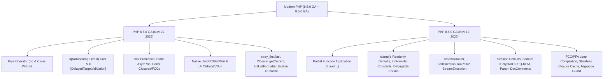

# Modern PHP 8.5+ & PHP 8.6.0 GA Syntax, Standard Library & Migration Architecture

> **Document**: `docs/architecture/php-8-6-modern-syntax-and-migration.md`  
> **Framework**: Laravel 13, PHP 8.5.0 GA (released November 20, 2025) & PHP 8.6.0 GA (released November 19, 2026)  
> **Focus**: Authoritative PHP 8.5 & PHP 8.6 syntax, exact standard library APIs, engine optimizations, Laravel 13 integration blueprints, PHPStan Level 8+, and cumulative PHP 8.4 → 8.5 → 8.6 upgrade runbook.

---

## 1. Executive Summary

Modern Laravel 13 codebases run on **PHP 8.5.0 GA** and **PHP 8.6.0 GA**, building on PHP 8.4 (property hooks, instance asymmetric visibility, `Pdo\*` subclasses, `Dom\HTMLDocument`, `array_find*`). Together, PHP 8.5 and PHP 8.6 deliver first-class functional pipelines, immutable cloning, RFC 3986 / WHATWG URI handling, nanosecond durations, native OS I/O polling, structured stream exceptions, hardened session defaults, and engine-level compiler wins:



---

## 2. Complete PHP 8.5.0 GA Language & Standard Library Reference

### 2.1 Native Pipe Operator (`|>`, `T_PIPE`)

Evaluates left-to-right, passing the LHS value as the single by-value argument to the RHS callable.

#### Precedence & Grammar Rules
1. **Left-associative**: `$a |> f(...) |> g(...)` parses as `($a |> f(...)) |> g(...)`.
2. **Precedence**: Directly below `.` (string concatenation) and **above** all comparisons (`==`, `===`, `<`, `<=`, `>`, `>=`, `<=>`), bitwise/logical operators (`&`, `^`, `|`, `&&`, `||`), `??`, `?:`, `=`, and `yield`.
   - `5 + 2 |> f(...)` evaluates `(5 + 2) |> f(...)`.
   - `'beep' |> strlen(...) === 4` compares the piped length against `4`.
   - `$id |> findUsername(...) ?? 'guest'` coalesces the entire pipe chain.
3. **Parentheses Required on RHS**: Arrow functions (`fn(...) => ...`), `??`, and `?:` MUST be wrapped in parentheses when used on the RHS (`$x |> (static fn (string $v): string => ...)`). Omitting parentheses around arrow functions is a syntax error.
4. **Callable Constraints**: RHS must accept one value argument (pass-by-reference parameters throw an `Error`, except internal "prefer-ref" functions). Compiled directly when the RHS is a function, `$obj->method(...)`, or `Class::method(...)` first-class callable.

```php
<?php

declare(strict_types=1);

namespace App\Support;

final class InputNormalizer
{
    public static function sanitizeHandle(string $raw): string
    {
        // Strictly PHP 8.5-compatible (parenthesized static arrow function on RHS)
        return $raw
            |> trim(...)
            |> (static fn (string $value): string => ltrim($value, '@'))
            |> strtolower(...)
            |> (static fn (string $value): string => preg_replace('/[^a-z0-9_]/', '', $value) ?? '');
    }
}
```

---

### 2.2 Clone With v2 (`clone(object $object, array $withProperties = []): object`)

`clone` is promoted to a language construct/function supporting both immutable property updates (`clone($obj, ['prop' => $val])`) and first-class callable usage (`clone(...)`). It cannot be shadowed by a namespaced `clone()` function or disabled via `disable_functions`.

#### Execution Order & Invariants
1. Shallow copy of `$object`.
2. `__clone()` executes **before** `$withProperties` assignments.
3. `$withProperties` writes execute in array iteration order; the first error or exception aborts subsequent writes.
4. `readonly` state is unlocked for the cloned copy during assignment (enabling `with*()` methods on `readonly` classes).
5. Visibility rules (`public readonly` has implicit `protected(set)` unless `public(set)` is declared), property `set` hooks, `__set()`, and dynamic property rules (`#[AllowDynamicProperties]`) are enforced normally.
6. **Value-Object Invariants**: Because `clone($object, [...])` bypasses `__construct()` and runs `__clone()` before applying overrides, classes with invariants must validate inside a property `set` hook or reconstruct through their validating constructor (`new self(...)`).

```php
<?php

declare(strict_types=1);

namespace App\Data;

use App\Enums\OrderStatus;
use NoDiscard;

final readonly class OrderSnapshot
{
    public function __construct(
        public string $orderId,
        public int $totalCents,
        public OrderStatus $status,
    ) {}

    #[NoDiscard('Capture the cloned OrderSnapshot returned by withStatus().')]
    public function withStatus(OrderStatus $status): self
    {
        return clone($this, [
            'status' => $status,
        ]);
    }

    /**
     * @param list<self> $snapshots
     * @return list<self>
     */
    public static function duplicateAll(array $snapshots): array
    {
        // PHP 8.5 first-class callable clone(...)
        return array_map(clone(...), $snapshots);
    }
}
```

---

### 2.3 `#[NoDiscard]` & `(void)` Cast (`T_VOID_CAST`)

```php
#[Attribute(Attribute::TARGET_METHOD | Attribute::TARGET_FUNCTION)]
final class NoDiscard
{
    public readonly ?string $message;

    public function __construct(?string $message = null) {}
}
```

- **Fail-Closed Check**: When a `#[NoDiscard]` function/method is called in a void context, PHP emits `E_USER_WARNING` (userland) or `E_WARNING` (native) **after** argument evaluation and **before** executing the function body — so error-to-exception handlers abort before side effects run.
- **No Inheritance**: Applies strictly to the called declaration (NOT inherited from interfaces, abstract methods, or parent methods, EXCEPT methods copied from traits keep `#[NoDiscard]`).
- **Compile-Time Restrictions**: Forbidden on `: void`, `: never`, void/untyped magic methods (`__construct`, `__clone`), and property hooks.
- **Intentional Discard with `(void)`**: `(void) $action->execute($dto);` explicitly suppresses the warning and is preserved from OPcache dead-code elimination. `(void)` is a **statement-only** construct (NOT an expression: `if ((void) $fn())` is a `ParseError`).
- **Applied natively in PHP 8.5** to `flock()` and `DateTimeImmutable::set*()`.

---

### 2.4 Attributes, `final` Property Promotion, Static Asymmetric Visibility & Constant Expressions

1. **`#[Override]` on Properties (`Attribute::TARGET_PROPERTY`)**: Compile-time verification that a regular or promoted property overrides a parent/interface property.
2. **`#[DelayedTargetValidation]` (`Attribute::TARGET_ALL`)**: Suppresses compile-time target validation for internal/extension attributes on the same declaration and defers validation to `ReflectionAttribute::newInstance()` (useful for cross-version PHP 8.5/8.6 libraries and with PHP 8.5's new compile-time error for `#[Attribute]` on abstract classes, interfaces, traits, and enums).
3. **`#[Deprecated]` Expansion**: Extended from PHP 8.4 (functions/methods/class constants) to **traits** and **compile-time non-class constants** (`const FOO = ...`, via `Attribute::TARGET_CONSTANT`).
4. **Attributes on Compile-Time Non-Class Constants**: Supported on `const` (not `define()`); inspect via `ReflectionConstant::getAttributes(?string $name = null, int $flags = 0): array` (`ReflectionConstant` is also no longer `final` and adds `getFileName()`, `getExtension()`, `getExtensionName()`).
5. **`final` Constructor Property Promotion**: `public function __construct(final string $id)` (defaults to `public` if visibility omitted; combinable with asymmetric visibility and property hooks).
6. **Asymmetric Visibility for Static Properties**: `public private(set) static int $count = 0;` / `public protected(set) static string $mode = 'live';`.
7. **Static Closures, First-Class Callables & Type Casts in Constant Expressions**:
   - Permitted in attributes, property/parameter defaults, and constants.
   - Closures MUST be `static` with NO `use (...)` clause; arrow functions (`fn(...) => ...`) are disallowed.
   - FCCs limited to `function_name(...)` and `ClassName::methodName(...)` (no dynamic expressions or `__callStatic()`).
   - Type casts are valid in constant expressions (`const MAX_ITEMS = (int) 50.0;`).

---

### 2.5 Native URI Extension (`Uri\Rfc3986\Uri` & `Uri\WhatWg\Url`)

Always-enabled built-in extension backed by `uriparser` (RFC 3986) and `Lexbor` (WHATWG URL). Replaces error-prone `parse_url()` calls in SSRF guards, OAuth redirect validators, and webhook routers.

```php
// Stub synopsis (PHP 8.5 internal Uri namespaces):
namespace Uri;

use Error;
use Exception;

enum UriComparisonMode
{
    case IncludeFragment;
    case ExcludeFragment;
}

class UriException extends Exception {}
class UriError extends Error {}
class InvalidUriException extends UriException {}
```

```php
namespace Uri\Rfc3986;

use SensitiveParameter;
use Uri\UriComparisonMode;

final readonly class Uri
{
    public function __construct(string $uri, ?self $baseUrl = null);
    public static function parse(string $uri, ?self $baseUrl = null): ?static;

    public function resolve(string $uri): static;
    public function equals(self $uri, UriComparisonMode $comparisonMode = UriComparisonMode::ExcludeFragment): bool;

    public function toString(): string;
    public function toRawString(): string;

    public function getScheme(): ?string;
    public function getRawScheme(): ?string;
    public function getUserInfo(): ?string;
    public function getRawUserInfo(): ?string;
    public function getUsername(): ?string;
    public function getRawUsername(): ?string;
    public function getPassword(): ?string;
    public function getRawPassword(): ?string;
    public function getHost(): ?string;
    public function getRawHost(): ?string;
    public function getPort(): ?int;
    public function getPath(): string;
    public function getRawPath(): string;
    public function getQuery(): ?string;
    public function getRawQuery(): ?string;
    public function getFragment(): ?string;
    public function getRawFragment(): ?string;

    public function withScheme(?string $scheme): static;
    public function withUserInfo(#[SensitiveParameter] ?string $userinfo): static;
    public function withHost(?string $host): static;
    public function withPort(?int $port): static;
    public function withPath(string $path): static;
    public function withQuery(?string $query): static;
    public function withFragment(?string $fragment): static;
}
```

```php
namespace Uri\WhatWg;

use SensitiveParameter;
use Throwable;
use Uri\InvalidUriException;
use Uri\UriComparisonMode;

final readonly class UrlValidationError
{
    public string $context;
    public UrlValidationErrorType $type;
    public bool $failure;
}

class InvalidUrlException extends InvalidUriException
{
    /** @var list<UrlValidationError> */
    public readonly array $errors;

    /** @param list<UrlValidationError> $errors */
    public function __construct(string $message = '', array $errors = [], int $code = 0, ?Throwable $previous = null);
}

final readonly class Url
{
    /** @param list<UrlValidationError>|null $softErrors */
    public function __construct(string $uri, ?self $baseUrl = null, ?array &$softErrors = null);
    /** @param list<UrlValidationError>|null $errors */
    public static function parse(string $uri, ?self $baseUrl = null, ?array &$errors = null): ?static;

    /** @param list<UrlValidationError>|null $softErrors */
    public function resolve(string $uri, ?array &$softErrors = null): static;
    public function equals(self $url, UriComparisonMode $comparisonMode = UriComparisonMode::ExcludeFragment): bool;

    public function toAsciiString(): string;
    public function toUnicodeString(): string;

    public function getScheme(): string;
    public function getUsername(): ?string;
    public function getPassword(): ?string;
    public function getAsciiHost(): ?string;
    public function getUnicodeHost(): ?string;
    public function getPort(): ?int;
    public function getPath(): string;
    public function getQuery(): ?string;
    public function getFragment(): ?string;

    public function withScheme(string $scheme): static;
    public function withUsername(?string $username): static;
    public function withPassword(#[SensitiveParameter] ?string $password): static;
    public function withHost(?string $host): static;
    public function withPort(?int $port): static;
    public function withPath(string $path): static;
    public function withQuery(?string $query): static;
    public function withFragment(?string $fragment): static;
}
```

---

### 2.6 PHP 8.5 Standard Library, Intl, Curl, Filter, PDO, OPcache & Runtime Additions

| Area | New PHP 8.5 APIs / Settings | Practical Laravel 13 Usage |
| :--- | :--- | :--- |
| **Core & Arrays** | `array_first()`, `array_last()`, `get_error_handler()`, `get_exception_handler()`, `Closure::getCurrent()`, `Closure` subtype of `callable` | Safe first/last array access without pointer mutation; clean recursive closures without `&$fn` |
| **Filter** | `FILTER_THROW_ON_FAILURE`, `Filter\FilterException`, `Filter\FilterFailedException` | Fail-loud validation in DTOs/Support utilities (do not combine with `FILTER_NULL_ON_FAILURE`) |
| **Intl** | `IntlListFormatter` (`TYPE_AND`/`OR`/`UNITS`, `WIDTH_WIDE`/`SHORT`/`NARROW`), `Locale::isRightToLeft()` / `locale_is_right_to_left()`, `Locale::{addLikelySubtags,minimizeSubtags}()`, `grapheme_levenshtein()`, `$locale` on `grapheme_*()` | Locale-accurate list formatting & RTL layout direction detection for Blade/Inertia views |
| **Curl** | `curl_multi_get_handles()`, `curl_share_init_persistent()` + `CurlSharePersistentHandle` | Persistent cross-request DNS/TLS connection sharing in PHP-FPM workers |
| **DOM** | `Dom\Element::getElementsByClassName()`, `insertAdjacentHTML()`, `$outerHTML`, `$children` | HTML5 manipulation in mailers, sanitizers, and SSR tests |
| **PDO / PgSQL / SQLite** | `Pdo\Sqlite::setAuthorizer(?callable)`, `ATTR_TRANSACTION_MODE`, `ATTR_EXPLAIN_STATEMENT`, `ATTR_BUSY_STATEMENT`; `Pdo\Pgsql::copyFromArray(iterable)` & `PDO::ATTR_PREFETCH = 0`; `pg_close_stmt()` | Sandboxed SQLite queries & streaming PostgreSQL bulk COPY from generators |
| **Cookies (CHIPS)** | `'partitioned' => true` in `setcookie()`, `setrawcookie()`, `session_set_cookie_params()` | Partitioned third-party cookies for embedded checkout/OAuth iframes |
| **OPcache & Runtime** | OPcache **always built-in** (`opcache_is_script_cached_in_file_cache()`, `opcache.file_cache_read_only`), `fatal_error_backtraces=1`, `max_memory_limit` (`INI_SYSTEM`), `PHP_BUILD_DATE`, `PHP_BUILD_PROVIDER`, `php --ini=diff` | Remove `zend_extension=opcache.so` from Dockerfiles; set `max_memory_limit` ceiling in production containers; debug OOM/timeout fatals with native backtraces |

---

## 3. Complete PHP 8.6.0 GA Language & Syntax Reference

### 3.1 Partial Function Application (PFA)

RFCs: `partial_function_application_v2`, `partial_function_application_optional_placeholder`.

PFA evaluates a call expression containing `?` (single required placeholder) or trailing `...` (variadic leftover placeholder) into a `Closure` instead of invoking the target immediately.

#### Rules & Guarantees
1. **Strict Parameter Ordering**:
   - Segment 1: Zero or more positional arguments or `?` placeholders.
   - Segment 2: Zero or more named arguments with fixed values or `?` placeholders (`attempt: ?`).
   - Segment 3: Zero or one trailing `...` variadic placeholder.
   - Placing any positional argument or `?` after a named argument is a **compile-time error**.
2. **Optionality Semantics**:
   - Every `?` placeholder generates a **required** parameter on the resulting `Closure` even if the underlying function parameter has a default value.
   - Only the trailing `...` placeholder inherits optionality and default values from remaining parameters.
3. **Full Metadata Inheritance**:
   - Resulting `Closure` inherits parameter names, native types, pass-by-reference / return-by-reference semantics, return type, `#[NoDiscard]`, and `#[SensitiveParameter]`.
4. **Compiler Optimization**:
   - `array_map()` invoked with a first-class callable (`foo(...)`) or PFA (`str_replace(' ', '-', ?)`) is compiled into an optimized internal `foreach` loop.

#### Production Laravel 13 Example (Pipe + PFA)
```php
<?php

declare(strict_types=1);

namespace App\Actions\Content;

use Illuminate\Support\Str;
use NoDiscard;

final readonly class SanitizeTagsAction
{
    /**
     * @param list<string> $rawTags
     * @return list<string>
     */
    #[NoDiscard]
    public function execute(array $rawTags): array
    {
        $cleanOne = static fn (string $tag): string => $tag
            |> trim(...)
            |> str_replace(['_', ' '], '-', ?)
            |> strtolower(...)
            |> Str::limit(?, 40, '');

        return $rawTags
            |> array_map($cleanOne, ?)
            |> array_filter(?, static fn (string $t): bool => $t !== '')
            |> array_unique(...)
            |> array_values(...);
    }
}
```

---

### 3.2 Readonly Property Defaults

RFC: `readonly_property_defaults`.

Readonly instance properties (and properties on `readonly class` declarations) may now define a default value inline:

```php
<?php

declare(strict_types=1);

namespace App\Contracts;

interface WebhookVerifierContract
{
    public string $algorithm { get; }
    public int $toleranceSeconds { get; }
}
```

```php
<?php

declare(strict_types=1);

namespace App\Payments\Webhooks;

use App\Contracts\WebhookVerifierContract;

final readonly class StripeWebhookConfig implements WebhookVerifierContract
{
    // Default counts as the single initializing write — cannot be overwritten in __construct()
    public string $algorithm = 'sha256';
    public int $toleranceSeconds = 300;

    public function __construct(
        // Runtime-configurable immutable values still use promoted constructor parameters:
        public string $signingSecret,
        public bool $strictReplayCheck = true,
    ) {}
}
```

> [!WARNING]
> Do **not** assign to a `readonly` property with an inline default inside `__construct()` — PHP 8.6 treats the default value as the property's one-and-only initialization and throws an `Error` on reassignment.

---

### 3.3 `#[Override]` on Class, Interface, Trait Constants & Enum Cases

RFC: `override_constants`.

`#[Override]` (methods in PHP 8.3, properties in PHP 8.5) now validates class constants, interface constants, trait constants (checked against the composing class's parents/interfaces), enum constants, and enum cases at compile time.

- Requires a matching `public` or `protected` constant in a parent class or implemented interface.
- A `private` parent constant does **not** satisfy `#[Override]`.
- Always import `use Override;` explicitly at the top of the file.

```php
<?php

declare(strict_types=1);

namespace App\Gateways;

use Override;

interface GatewayContract
{
    public const int MAX_ATTEMPTS = 3;
    public const string MODE_LIVE = 'live';
}

final class BkashGateway implements GatewayContract
{
    #[Override]
    public const int MAX_ATTEMPTS = 5;

    #[Override]
    public const string MODE_LIVE = 'live';
}
```

---

### 3.4 Object Property Writes on Constants

RFC: `const_object_property_write`.

Objects stored in global constants or class constants now support `->` property mutations, `isset()`, `unset()`, compound assignments (`+=`, `.=`), increment/decrement (`++`, `--`), and passing object properties by reference. Rebinding the constant identifier itself remains illegal, and array dimension write semantics (`[]`) on constants remain unchanged.

```php
<?php

declare(strict_types=1);

use stdClass;

// Class constants cannot directly use `new` expressions — initialize via a global constant first
const GLOBAL_RUNTIME_STATS = new stdClass();

final class RuntimeCounters
{
    public const stdClass STATS = GLOBAL_RUNTIME_STATS;
}

RuntimeCounters::STATS->dispatched = 0;
RuntimeCounters::STATS->dispatched++;
```

> [!CAUTION]
> **Laravel Octane / Swoole / FrankenPHP Safety**: Never mutate objects stored in constants to hold per-request or per-tenant user data under long-running workers — constant objects persist across requests for the entire worker lifetime.

---

### 3.5 Debugable Enums & Parameter DocComments

#### Debugable Enums (`debugable-enums`)
Enums can now implement `public function __debugInfo(): array` (strictly non-nullable `array`; returning `null` was deprecated in PHP 8.5 and declaring `?array` / `array|null` is deprecated in PHP 8.6) to redact sensitive backing values in debug dumps (`var_dump()`, Symfony VarDumper / `dd()`). Note that Monolog's `NormalizerFormatter` uses JSON normalization rather than `__debugInfo()`, so keep separate log redaction/scrubbing configured for application logs:

```php
<?php

declare(strict_types=1);

namespace App\Enums\Integrations;

enum ProviderTokenScope: string
{
    case BillingAdmin = 'sk_live_billing_admin';
    case ReadOnly = 'pk_live_readonly';

    /**
     * @return array{case: string, prefix: string}
     */
    public function __debugInfo(): array
    {
        return [
            'case' => $this->name,
            'prefix' => substr($this->value, 0, 7) . '***',
        ];
    }
}
```

#### Parameter DocComments (`parameter-doccomments`)
DocComments attached directly to function/method parameters are now preserved in AST and accessible via `ReflectionParameter::getDocComment(): string|false` — useful for auto-generating tool descriptions in `laravel/mcp` and `laravel/ai`:

```php
<?php

declare(strict_types=1);

namespace App\Mcp\Tools;

use ReflectionMethod;

final class InvoiceLookupTool
{
    /**
     * @return array{invoice_id: string, include_lines: bool}
     */
    public function handle(
        /** ULID of the invoice to retrieve */
        string $invoiceId,
        /** Whether to hydrate individual line items */
        bool $includeLines = false,
    ): array {
        return [
            'invoice_id' => $invoiceId,
            'include_lines' => $includeLines,
        ];
    }

    /**
     * @return array<string, string>
     */
    public static function parameterDescriptions(): array
    {
        $descriptions = [];
        foreach (new ReflectionMethod(self::class, 'handle')->getParameters() as $param) {
            $doc = $param->getDocComment();
            if ($doc !== false) {
                $descriptions[$param->getName()] = trim($doc, "/* \t\n\r");
            }
        }

        return $descriptions;
    }
}
```

---

### 3.6 `WeakMap` Reference Assignment

PHP 8.6 enables reference assignment on `WeakMap` keys without requiring the key to exist beforehand:

```php
<?php

declare(strict_types=1);

use WeakMap;

/** @var WeakMap<object, int> $counters */
$counters = new WeakMap();
$initial = 1;
$counters[$model] =& $initial;
```

---

## 4. PHP 8.6.0 GA Standard Library & Core API Synopses

### 4.1 `clamp()`

```php
function clamp(mixed $value, mixed $min, mixed $max): mixed;
```

- Works with `int`, `float`, `string`, `DateTimeImmutable`, `Time\Duration`, and any object supporting PHP comparison semantics.
- Throws `ValueError` when `$min > $max` or when `$min` / `$max` is `NAN`.
- Returns `NAN` when `$value` is `NAN`.

### 4.2 `Time\Duration` & `Time\TimeException`

```php
namespace Time;

use Exception;

class TimeException extends Exception {}

final readonly class Duration
{
    public int $seconds;
    public int $nanoseconds;
    public bool $negative;

    public static function fromNanoseconds(int $nanoseconds): self;
    public static function fromMicroseconds(int $microseconds): self;
    public static function fromMilliseconds(int $milliseconds): self;
    public static function fromSeconds(int $seconds, int $nanoseconds = 0): self;
    public static function fromMinutes(int $minutes): self;
    public static function fromHours(int $hours): self;
    public static function fromIso8601DurationString(string $specification): self;

    public function negate(): self;
    public function absolute(): self;
    public function add(Duration $duration): self;
    public function sub(Duration $duration): self;
    public function multiplyBy(int $factor): self;
    public function divideBy(int $divisor): self;

    public static function compare(self $a, self $b): int;
}
```

- Maximum magnitude: `9223372035999999999` nanoseconds (~292 years).
- Supports standard operators (`<`, `<=`, `==`, `!=`, `>=`, `>`, `<=>`) and `clamp()`.
- **Does NOT define** `__toString()`, `toIsoString()`, or `toSeconds()`.
- `fromIso8601DurationString()` accepts time-only ISO 8601 durations (up to `H` hours, e.g. `PT2H15M30S`); calendar designators (`Y`, `M` months, `W`, `D`) throw `Time\TimeException`.

#### Laravel 13 Circuit Breaker / Retry Backoff Example with `Time\Duration`
```php
<?php

declare(strict_types=1);

namespace App\Support\Http;

use NoDiscard;
use Time\Duration;

final readonly class RetryPolicy
{
    public function __construct(
        public Duration $baseDelay,
        public Duration $maxDelay,
    ) {}

    #[NoDiscard]
    public function delayForAttempt(int $attempt): Duration
    {
        $multiplier = 1 << clamp($attempt - 1, 0, 10);

        return clamp(
            $this->baseDelay->multiplyBy($multiplier),
            $this->baseDelay,
            $this->maxDelay,
        );
    }
}
```

---

### 4.3 Global `SortDirection` Enum

```php
enum SortDirection
{
    case Ascending;
    case Descending;
}
```

Use native `SortDirection` across repositories, Eloquent custom query builders, and DTOs instead of defining custom `App\Enums\Common\SortDirection` enums or raw `'asc'`/`'desc'` strings.

---

### 4.4 Native I/O Polling API (`Io\Poll\*` & `StreamPollHandle`)

```php
// Stub synopsis (PHP 8.6 internal namespaces):
namespace Io;

use Exception;

class IoException extends Exception {}
```

```php
namespace Io\Poll;

use Time\Duration;

enum Backend
{
    case Auto;
    case Poll;
    case Epoll;
    case Kqueue;
    case EventPorts;
    case WSAPoll;

    /** @return list<self> */
    public static function getAvailableBackends(): array;
    public function isAvailable(): bool;
    public function supportsEdgeTriggering(): bool;
}

enum Event
{
    case Read;
    case Write;
    case Error;
    case HangUp;
    case ReadHangUp;
    case OneShot;
    case EdgeTriggered;
}

interface Handle {} // Internal-only marker interface

final class Context
{
    public function __construct(Backend $backend = Backend::Auto);
    /** @param list<Event> $events */
    public function add(Handle $handle, array $events, mixed $data = null): Watcher;
    /** @return list<Watcher> */
    public function wait(?Duration $timeout = null, ?int $maxEvents = null): array;
    public function getBackend(): Backend;
}

final class Watcher
{
    public function getHandle(): Handle;
    /** @return list<Event> */
    public function getWatchedEvents(): array;
    /** @return list<Event> */
    public function getTriggeredEvents(): array;
    public function getData(): mixed;
    public function hasTriggered(Event $event): bool;
    public function isActive(): bool;
    /** @param list<Event> $events */
    public function modify(array $events, mixed $data = null): void;
    /** @param list<Event> $events */
    public function modifyEvents(array $events): void;
    public function modifyData(mixed $data): void;
    public function remove(): void;
}
```

```php
// Global namespace:
use Io\Poll\Handle;

final class StreamPollHandle implements Handle
{
    /** @param resource $stream */
    public function __construct(mixed $stream);
    /** @return resource */
    public function getStream(): mixed;
    public function isValid(): bool;
}
```

Exception hierarchy under `Io\Poll`: `PollException` (extends `Io\IoException`), `FailedPollOperationException`, `FailedContextInitializationException`, `FailedHandleAddException`, `FailedWatcherModificationException`, `FailedPollWaitException`, `BackendUnavailableException`, `InactiveWatcherException`, `HandleAlreadyWatchedException`, `InvalidHandleException`.

---

### 4.5 Structured Stream Error Handling

| Symbol | Purpose |
| :--- | :--- |
| `StreamErrorMode` | `Error` (legacy warnings), `Exception` (throws `StreamException` on terminating errors), `Silent` |
| `StreamErrorStore` | `Auto`, `None`, `NonTerminating`, `Terminating`, `All` |
| `StreamErrorCode` | Typed enum of stream failure codes |
| `final readonly class StreamError` | `$code`, `$message`, `$wrapperName`, `$severity`, `$terminating`, `$param` |
| `class StreamException extends Exception` | `getErrors(): array` (`list<StreamError>`) |
| `stream_last_errors(): array` / `stream_clear_errors(): void` | Inspect and reset stored `StreamError` history |
| `stream_socket_get_crypto_status()` | Inspect non-blocking TLS handshake state (`STREAM_CRYPTO_STATUS_*`) |

---

### 4.6 Reflection, URI Builders, Cryptography & Extension Highlights (PHP 8.6)

1. **Reflection**:
   - `ReflectionProperty::isReadable(?string $scope, ?object $object = null): bool`
   - `ReflectionProperty::isWritable(?string $scope, ?object $object = null): bool`
   - `ReflectionParameter::getDocComment(): string|false`
   - `ReflectionConstant::inNamespace(): bool`
   - `ReflectionAttribute::{inNamespace,getNamespaceName,getShortName}()`
2. **URI Builders & Helpers**:
   - `Uri\Rfc3986\UriBuilder`, `Uri\WhatWg\UrlBuilder`, `Uri\WhatWg\url_percent_encode()`, `Uri\WhatWg\UrlPercentEncodingMode`
   - `Uri\Rfc3986\Uri::{getUriType,getHostType}()`, `Uri\WhatWg\Url::{isSpecialScheme,getHostType}()`
3. **Security & Cryptography**:
   - **Session Security Defaults**: `session.use_strict_mode = 1`, `session.cookie_httponly = 1`, `session.cookie_samesite = "Lax"` now default-enabled.
   - **Sodium**:
     - IPcrypt: `sodium_crypto_ipcrypt_{keygen,encrypt,decrypt}()`, `_nd_*()`, `_ndx_*()`, `_pfx_*()`, `sodium_bin2ip()`, `sodium_ip2bin()` — ideal for privacy-preserving IP anonymization in analytics/logs.
     - XOF: `sodium_crypto_xof_{shake128,shake256,turboshake128,turboshake256}()` (+ `_init`, `_update`, `_squeeze`, and `SodiumCryptoXof*State`).
     - Post-Quantum KEM (libsodium ≥ 1.0.22): `sodium_crypto_kem_*()` (X-Wing) & `sodium_crypto_kem_mlkem768_*()` (ML-KEM-768).
   - **OpenSSL**: `Openssl\OpensslException`, `Openssl\Session`, `Openssl\Psk`, `OPENSSL_RSA_PSS_SALTLEN_*`.
4. **Stdlib, DB, Intl & Zip**:
   - `ARRAY_FILTER_USE_VALUE`
   - `grapheme_strrev()`, `Locale::getDisplayKeyword()`, `Locale::getDisplayKeywordValue()`, `IntlDatePatternGenerator::{getSkeleton,getBaseSkeleton}()`, `IntlNumberRangeFormatter` (ICU ≥ 63), `SpoofChecker::{areBidiConfusable,getBidiSkeleton,getSkeleton}()` (Bidi: ICU ≥ 74)
   - `ZipArchive::openString()` & `ZipArchive::closeString()` (in-memory ZIP handling without temp files)
   - `mysqli::quote_string()` / `mysqli_quote_string()`, `MYSQLI_OPT_COMPRESS`
   - `Pdo\Pgsql::ATTR_CHUNK_SIZE` (libpq ≥ 17)
   - `pack()` / `unpack()` `<` and `>` endianness modifiers on signed/unsigned integers and floats/doubles
   - `error_include_args` INI (off by default)
   - Unicode 18.0 tables; `finfo` upgraded to `file 5.48` (TTF detected as `font/ttf`); `PHP_OS_FAMILY` adds `'AIX'`.

---

## 5. Engine & Compiler Optimizations (PHP 8.6)

PHP 8.6 introduces zero-code-change runtime wins that align cleanly with our architectural rules:

- **Direction-Aware Property Resolution**: Moves `private(set)` / `protected(set)` asymmetric visibility checks to opline runtime cache population.
- **Stateless Closure Caching**: Eliminates repeated closure allocations in hot loops.
- **`array_map()` FCC / PFA Loop Compilation**: `array_map(trim(...), $items)` and `array_map(str_replace(' ', '-', ?), $items)` compile into tight internal `foreach` loops.
- **`printf()` Optimization**: `printf()` calls using only `%s` and `%d` compile directly into string interpolation.
- **Faster `new self()` Dispatch**: Streamlines argument passing for statically known constructors.
- **TAILCALL VM & ZTS**: Expanded TAILCALL support (including Windows Clang ≥ 19 x86_64) and ZTS throughput improvements.

---

## 6. Cumulative PHP 8.4 → 8.5 → 8.6 Migration & Upgrade Runbook

### 6.1 Pre-Upgrade Codebase Audit Commands

```bash
# 1. Hunt for PHP 8.5 deprecated casts, resource-close calls, driver PDO constants & legacy symbols
grep -rnE '\((integer|boolean|double|binary)\)|\b(curl_close|curl_share_close|finfo_close|imagedestroy|xml_parser_free|mysqli_execute|socket_set_timeout|DATE_RFC7231|__sleep|__wakeup)\b|\b(MHASH_|PDO::MYSQL_ATTR_|PDO::PGSQL_|PDO::SQLITE_|PDO::DBLIB_ATTR_|PDO::FB_ATTR_|PDO::ODBC_)[A-Z0-9_]*\b|\$http_response_header|->setAccessible\(' app/ config/ routes/

# 2. Hunt for PHP 8.6 deprecated identifiers, Mbregex & SPL functions
grep -rnE '\b(mb_ereg[a-z_]*|mb_split|is_double|is_long|is_integer|doubleval|strcoll|SORT_LOCALE_STRING|metaphone|spl_classes|spl_object_hash)\b' app/ config/ routes/

# 3. Check for nullable __debugInfo return types or zend_extension=opcache in Docker/INI files
grep -rnE 'function __debugInfo\s*\(\s*\)\s*:\s*(\?array|array\|null|null\|array)' app/
grep -rnE 'zend_extension\s*=\s*.*opcache|disable_classes' docker/ .docker/ php*.ini 2>/dev/null || true

# 4. Inspect effective INI overrides on PHP 8.5+ and run static analysis + test suite
php --ini=diff
./vendor/bin/phpstan analyse --level=8
./vendor/bin/rector process --dry-run
./vendor/bin/pest
```

### 6.2 PHP 8.5.0 GA Deprecation & BC Matrix (`PHP-8.5/UPGRADING`)

- **Core Deprecations**:
  - Non-canonical scalar casts `(boolean)`, `(integer)`, `(double)`, `(binary)` → `(bool)`, `(int)`, `(float)`, `(string)`.
  - Backtick shell execution operator `` `cmd` `` → use `Illuminate\Support\Facades\Process` with array arguments.
  - Terminating `case` statements with `;` instead of `:`.
  - Using `null` as array offset or in `array_key_exists()` → use `""`.
  - Incrementing non-numeric strings (`$str++`) → `str_increment()`.
  - `__sleep()` & `__wakeup()` magic methods (soft-deprecated → migrate to `__serialize()` & `__unserialize()`).
  - Returning `null` from `__debugInfo()` → return `[]`.
  - Constant redeclaration; producing output inside a user output handler; invalid closure rebinding; `$exclude_disabled` on `get_defined_functions()`; `report_memleaks` INI; `register_argc_argv` deriving `argc`/`argv` from query strings on non-CLI SAPIs.
- **Extension Deprecations**:
  - **PDO**: Driver-specific constants on `PDO` (`PDO::MYSQL_ATTR_*`, `PDO::PGSQL_*`, `PDO::SQLITE_*`, `PDO::DBLIB_ATTR_*`, `PDO::FB_ATTR_*`, `PDO::ODBC_*`) and driver-specific methods (`PDO::pgsql*()`, `PDO::sqlite*()`) → migrate to PHP 8.4+ `Pdo\Mysql`, `Pdo\Pgsql`, `Pdo\Sqlite` subclasses; `"uri:"` DSN scheme.
  - **No-Op Close Calls**: `curl_close()`, `curl_share_close()`, `finfo_close()`, `imagedestroy()`, `xml_parser_free()`.
  - **Standard / Hash / Date / MySQLi / Intl / Reflection / SPL**: `$http_response_header` → `http_get_last_response_headers()`; `socket_set_timeout()` → `stream_set_timeout()`; `chr()` outside `0..255`; `ord()` non-1-byte string; `null` passed to `readdir()`/`rewinddir()`/`closedir()`; `MHASH_*` constants; `DATE_RFC7231` / `DateTimeInterface::RFC7231` (convert to UTC via `setTimezone(new DateTimeZone('UTC'))` before formatting `'D, d M Y H:i:s \G\M\T'`); `mysqli_execute()` → `mysqli_stmt_execute()`; `intl.error_level` INI; `Reflection*::setAccessible()`, `ReflectionClass::getConstant()` for missing constants, `ReflectionProperty::getDefaultValue()` without defaults; `SplObjectStorage::{contains,attach,detach}()` → `offsetExists()`/`offsetSet()`/`offsetUnset()`; `ArrayObject`/`ArrayIterator` with objects; `finfo_buffer()` `$context`; `openssl_pkey_derive()` `$key_length`.
- **Critical PHP 8.5 BC Changes**:
  1. **OPcache Always Compiled In**: `zend_extension=opcache.so` emits a startup warning; `--enable-opcache`/`--disable-opcache` and `-z`/`--zend-extension` CLI flags removed.
  2. **`disable_classes` INI Removed**: Remove from `php.ini` / PHP-FPM pools.
  3. **Strict `#[Attribute]` Declarations**: Applying `#[Attribute]` to abstract classes, interfaces, traits, or enums is a compile-time error unless paired with `#[DelayedTargetValidation]`.
  4. **Traits Bound Before Parent Class**: Audit trait/parent method/property precedence if relying on legacy order.
  5. **PDO `FETCH_CLASS` Constructor Args**: Now follow `call_user_func_array` semantics (string keys treated as named args); `PDOStatement::setFetchMode()` during active fetch throws `Error`; `FETCH_PROPS_LATE` without `FETCH_CLASS` throws `ValueError`.
  6. **Strict Warnings & ValueErrors**: Destructuring non-arrays (other than `null`), out-of-range float-to-int casts, `NAN` casts, `$_SESSION` keys containing `|`, and NUL bytes in `finfo_file()`/`Locale::*`/`pcntl_exec()` now warn or throw `ValueError`; `ArrayObject` rejects enums.

### 6.3 PHP 8.6.0 GA Deprecation Matrix (`PHP-8.6/UPGRADING`)

- **Core**:
  - `return` inside `finally` blocks.
  - Returning values from `__construct()` / `__destruct()` or declaring them as generators.
  - Nullable return type (`?array` / `array|null`) on `__debugInfo()`.
  - Naming a function `readonly`; naming a class constant `namespace`.
  - Using `let` or `is` as class, interface, trait, enum, function, constant, or `use`/`class_alias()` alias names.
  - Using `_` as a constant name (`const` / `define()`) or `use const` alias.
  - Passing 3rd argument (`$case_insensitive`) to `define()`.
  - Calling `is_a()` / `is_subclass_of()` with string first argument when `$allow_string` is `false`.
- **Mbstring**: `mb_ereg*`, `mb_split` (Oniguruma EOL → migrate to PCRE `/u`); passing objects to `mb_convert_variables()`.
- **Standard**: `is_double()`, `is_long()`, `is_integer()`, `doubleval()`, `strcoll()`, `SORT_LOCALE_STRING`, `metaphone()`, `>16` filters in `php://filter` URL without `filter.max_filter_count`, objects passed to `array_walk()`, `array_walk_recursive()`, `http_build_query()`.
- **SPL**: `spl_classes()`, `spl_object_hash()`, `ArrayIterator` methods inherited from `ArrayObject` (`getFlags`, `setFlags`, `asort`, `ksort`, `uasort`, `uksort`, `natsort`, `natcasesort`, `serialize`, `unserialize`), `SplFileObject` CSV methods (`fgetcsv`, `fputcsv`, `setCsvControl`, `getCsvControl`).
- **Session / Reflection / MySQLi / Compression / GMP**:
  - Custom session handlers lacking `create_sid()` or `validateId()`.
  - `ReflectionProperty::setValue()` / `setRawValue()` with non-declaring-class objects; `ReflectionMethod::invoke*()` with an object for static methods.
  - `mysqli::get_charset()`, `mysqli::stmt_init()`, `mysqli_stmt::__construct()` without `$query`.
  - Objects passed to bzip2/zlib stream filters or `deflate_init()` / `inflate_init()`; GMP `<<`, `>>`, `**` with lossy float right operands.

### 6.4 Critical PHP 8.6 Backward-Incompatible Changes to Test

1. **`trim()` / `ltrim()` / `rtrim()` / `chop()`**: Now strip form feed (`\f`) by default. Pass an explicit character mask if `\f` must be preserved.
2. **Stream Flush / Close Failures**: `fclose()`, `file_put_contents()`, and `copy()` now return `false` if flushing/closing the underlying stream fails (e.g., full disk / broken pipe). Always check return values!
3. **`json_last_error_msg()` & `JsonException` Messages**: Now append `near location {line}:{column}`. Update brittle tests asserting exact strings like `"Syntax error"` to assert `json_last_error() === JSON_ERROR_SYNTAX` or substring matches.
4. **Stricter `ValueError` / `TypeError`**: Invalid `$mode`/`$case`/`$flags` on `array_filter()`, `array_change_key_case()`, `pathinfo()`, `scandir()`, out-of-range `number_format()` decimals, and NUL bytes in filesystem/env/path calls (`stat()`, `file_exists()`, `getenv()`, `putenv()`, `parse_str()`, `proc_open()`, etc.) now throw instead of silently coercing or warning.
5. **`unpack()` Endianness Format Strings**: `"s<value"` now treats `<` as little-endian modifier yielding key `"value"` instead of `"<value"`.
6. **DOM Properties**: `@readonly` DOM properties (`DOMNode::$nodeType`, `DOMDocument::$xmlEncoding`, etc.) now enforce `public private(set)` asymmetric visibility.
7. **Hard Out-Of-Memory**: Calls `abort()` (exit code `134`) instead of `exit(1)` — check supervisor/container health alerts accordingly.
8. **CLI Built-In Dev Server**: Accepts HTTP `QUERY` method and no longer reflects the `Host` header.
9. **Session Cookie Defaults**: `session.use_strict_mode=1`, `session.cookie_httponly=1`, `session.cookie_samesite="Lax"` are active by default (matches Laravel's hardened defaults, but verify legacy non-Laravel scripts sharing sessions).
10. **Minimum Database Versions**: MySQL ≥ 5.7.3 or MariaDB ≥ 10.2.4 required for persistent connection reset (`COM_RESET_CONNECTION`).

---

## 7. Version Boundary & Anti-Hallucination Reference (PHP 8.4 vs 8.5 vs 8.6)

| Syntax / Symbol | Real Status / Version | Correct Alternative |
| :--- | :--- | :--- |
| `Pdo\Mysql`, `Pdo\Pgsql`, `Pdo\Sqlite`, `#[Deprecated]` (funcs/methods/class consts), `array_find*` | **PHP 8.4** (not new in 8.5) | Use on PHP 8.4+; migrate off legacy `PDO::MYSQL_ATTR_*` / `PDO::pgsql*()` before 8.5 |
| `|>`, `clone($obj, [...])`, `#[NoDiscard]` + `(void)`, `#[Override]` on props, `final` promotion, static asym vis, `Uri\Rfc3986\Uri`, `Uri\WhatWg\Url`, `array_first`/`last` | **PHP 8.5.0 GA** | Available on PHP 8.5+ and PHP 8.6+ |
| `?` / `...` PFA, `clamp()`, Readonly defaults, `#[Override]` on consts/enum cases, `Time\Duration`, `SortDirection`, `Io\Poll\*`, `StreamException`, `UriBuilder`/`UrlBuilder` | **PHP 8.6.0 GA** (not in 8.5) | Requires PHP 8.6+; use closures/explicit helpers on PHP 8.5 |
| `clone $obj with (a: 1)` | Does **not** exist | `clone($obj, ['a' => 1])` (PHP 8.5) |
| `if ((void) $fn())` | **ParseError** | `(void) $fn();` is statement-only (PHP 8.5) |
| `Duration::ofSeconds()` / `toIsoString()` / `toSeconds()` | Do **not** exist | `Duration::fromSeconds()`, `$d->seconds`, `$d->nanoseconds` |
| `new Io\Poll()` / `Poll::READ` / `wait(timeoutMs: ...)` / `wait(timeoutSeconds: ...)` | Do **not** exist | `new Io\Poll\Context()`, `new StreamPollHandle($s)`, `[Event::Read]`, `wait(timeout: Duration::fromSeconds(1))` |
| `JsonException::getOffset()` | Does **not** exist | `$e->getMessage()` (`... near location L:C`) |
| `BackedEnum::values()` | Under discussion (not in 8.6) | `array_column(self::cases(), 'value')` |
| `$x is int` (Pattern Matching) | Under discussion (not in 8.6) | `match` expressions / `is_int()` |
| `let $x = 1` / `class Box<T>` / `$x \|>= trim(...)` | Declined | Standard variables / PHPStan `@template` / `$x = $x \|> trim(...)` |
| `Time\Instant` / `Time\Clock` | Under discussion (not in 8.6) | `DateTimeImmutable` / PSR-20 `ClockInterface` |
