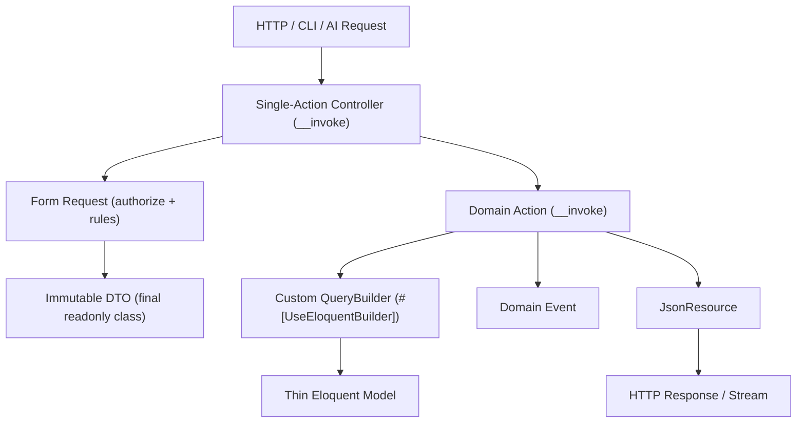
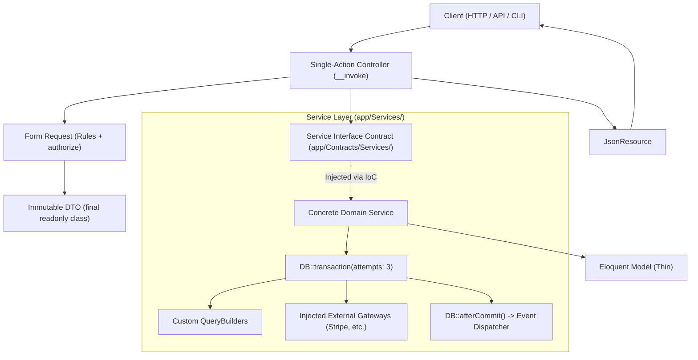

# Laravel 13 & Modern PHP 8.6+ Architectural Base Project Directory Tree Patterns

> **Document**: `docs/architecture/project-directory-tree-patterns.md`  
> **Target Framework**: Laravel 13 (PHP 8.6+)  
> **Scope**: Standardized Codebase Directory Blueprints, Namespace Mappings, and Structural Guardrails  

---

## 🧭 Executive Architectural Blueprint Matrix

Choosing the right directory architecture is the single most decisive factor governing codebase velocity, maintainability, and team scalability. Laravel 13's lean skeleton (`bootstrap/app.php` and `routes/console.php`) pairs naturally with modern architectural paradigms:

| Architectural Pattern | Primary Suitability | Directory Root | Business Logic Isolation | Invariant Protection |
| :--- | :--- | :--- | :--- | :--- |
| **Action-Driven Monolith** *(Recommended Default)* | 85% of SaaS & API platforms (1–12 engineers) | `app/` | `app/Actions/<Domain>/` | Action pre-conditions + DTOs |
| **Service-Class Oriented Monolith** | Multi-step workflows, transactions, ERP/SaaS (3–15 engineers) | `app/` | `app/Services/<Domain>/` | Service Interface Contracts + DTOs |
| **Modular Monolith** | Multi-team platforms, cross-domain SaaS (10–30+ engineers) | `modules/<Domain>/` | `modules/<Domain>/src/Actions/` | Module public contracts + Events |
| **Domain-Driven Design (DDD)** | Core banking, fintech, complex regulatory domains | `src/Domain/` | `src/Domain/<Domain>/` | Aggregate Roots + Entities |
| **Hexagonal (Ports & Adapters)** | Engine apps, multi-storage swappable infrastructure | `src/Core/` | `src/Core/UseCases/` | Driving & Driven Ports |
| **CQRS / Event-Sourced** | High read/write asymmetry, audit-heavy systems | `app/` or `src/` | `app/Commands/` & `app/Queries/` | Command handlers & Projections |

---

## 1. Pattern A: Modern Action-Driven Monolith

The **Action-Driven Monolith** is the modern standard for Laravel 13. It cleanly decomposes traditional controller and model bloat into focused, single-responsibility PHP classes while maintaining standard Laravel conventions.



### Complete Codebase Directory Blueprint

```text
my-action-app/
├── app/
│   ├── Actions/                        # Granular business operations (1 class = 1 job)
│   │   ├── Auth/
│   │   │   ├── AuthenticateUserAction.php
│   │   │   ├── RegisterCustomerAction.php
│   │   │   └── SendPasswordResetEmailAction.php
│   │   ├── Billing/
│   │   │   ├── ChargeCustomerAction.php
│   │   │   ├── CreateSubscriptionAction.php
│   │   │   └── HandleWebhookAction.php
│   │   └── Orders/
│   │       ├── CalculateOrderTotalsAction.php
│   │       ├── CancelOrderAction.php
│   │       ├── CreateOrderAction.php
│   │       └── TransitionOrderStatusAction.php
│   ├── Ai/                             # First-party laravel/ai SDK
│   │   ├── Agents/
│   │   │   ├── CustomerSupportAgent.php
│   │   │   └── OrderAuditorAgent.php
│   │   └── Tools/
│   │       ├── CheckInventoryTool.php
│   │       └── IssueRefundTool.php
│   ├── Builders/                       # Eloquent Custom Query Builders with PHPStan generics
│   │   ├── OrderQueryBuilder.php
│   │   ├── ProductQueryBuilder.php
│   │   └── UserQueryBuilder.php
│   ├── Concerns/                       # Reusable PHP traits isolated by behavioral capability
│   │   ├── HasUlids.php
│   │   ├── InteractsWithStripe.php
│   │   └── TracksAuditHistory.php
│   ├── Contracts/                      # Public domain & infrastructural interfaces
│   │   ├── PaymentGatewayInterface.php
│   │   └── ShippingCalculatorInterface.php
│   ├── Data/                           # Strongly-typed immutable Data Transfer Objects (DTOs)
│   │   ├── Auth/
│   │   │   └── UserRegistrationData.php
│   │   ├── Billing/
│   │   │   ├── ChargePayloadData.php
│   │   │   └── InvoiceSummaryData.php
│   │   └── Orders/
│   │       ├── CreateOrderData.php
│   │       ├── OrderItemData.php
│   │       └── ShippingAddressData.php
│   ├── Enums/                          # Native PHP backed enums with state & translation methods
│   │   ├── Currency.php
│   │   ├── OrderStatus.php
│   │   ├── PaymentGatewayType.php
│   │   └── UserRole.php
│   ├── Events/                         # Domain event payloads (immutable)
│   │   └── Orders/
│   │       ├── OrderCreated.php
│   │       ├── OrderFulfillmentFailed.php
│   │       └── OrderPaid.php
│   ├── Exceptions/                     # Domain-specific typed exceptions
│   │   ├── Billing/
│   │   │   ├── CardDeclinedException.php
│   │   │   └── FraudCheckFailedException.php
│   │   └── Orders/
│   │       ├── InvalidOrderTransitionException.php
│   │       └── OutOfStockException.php
│   ├── Http/
│   │   ├── Controllers/                # Strict Single-Action Invokables (__invoke)
│   │   │   ├── Api/
│   │   │   │   └── V1/
│   │   │   │       ├── Auth/
│   │   │   │       │   └── LoginController.php
│   │   │   │       └── Orders/
│   │   │   │           ├── CancelOrderController.php
│   │   │   │           ├── IndexOrderController.php
│   │   │   │           ├── ShowOrderController.php
│   │   │   │           └── StoreOrderController.php
│   │   │   └── Web/
│   │   │       ├── CheckoutController.php
│   │   │       └── OrderConfirmationController.php
│   │   ├── Middleware/                 # Lean, fluent middleware
│   │   │   ├── EnsureAccountActive.php
│   │   │   ├── EnforceIdempotencyKey.php
│   │   │   └── SetTenantContext.php
│   │   ├── Requests/                   # Dedicated Form Requests with authorize() and rules()
│   │   │   ├── Api/
│   │   │   │   └── V1/
│   │   │   │       └── Orders/
│   │   │   │           ├── CancelOrderRequest.php
│   │   │   │           └── StoreOrderRequest.php
│   │   │   └── Web/
│   │   │       └── CheckoutRequest.php
│   │   └── Resources/                  # JsonResource & ResourceCollection serializers
│   │       └── V1/
│   │           ├── Billing/
│   │           │   └── InvoiceResource.php
│   │           └── Orders/
│   │               ├── OrderCollection.php
│   │               ├── OrderItemResource.php
│   │               └── OrderResource.php
│   ├── Jobs/                           # Asynchronous queued jobs (#[WithQueue], #[RetryFor])
│   │   └── Orders/
│   │       ├── GenerateInvoicePdfJob.php
│   │       ├── NotifyWarehouseJob.php
│   │       └── SendOrderDispatchJob.php
│   ├── Listeners/                      # Asynchronous domain event listeners
│   │   └── Orders/
│   │       ├── DispatchWarehouseShipmentListener.php
│   │       └── SendCustomerReceiptListener.php
│   ├── Mail/                           # Mailable classes
│   │   └── Orders/
│   │       ├── OrderReceiptMailable.php
│   │       └── RefundProcessedMailable.php
│   ├── Mcp/                            # Model Context Protocol servers, tools, and prompts
│   │   ├── Prompts/
│   │   │   └── OrderMetricsPrompt.php
│   │   ├── Resources/
│   │   │   └── OrderSchemaResource.php
│   │   ├── Servers/
│   │   │   └── StoreMcpServer.php
│   │   └── Tools/
│   │       ├── GetRecentOrdersTool.php
│   │       └── ProcessManualRefundTool.php
│   ├── Models/                         # Thin Eloquent models using PHP 8 attributes
│   │   ├── Customer.php
│   │   ├── Order.php
│   │   ├── OrderItem.php
│   │   └── Product.php
│   ├── Notifications/                  # User notifications across multiple delivery channels
│   │   └── OrderShippedNotification.php
│   ├── Policies/                       # Granular authorization policies
│   │   └── OrderPolicy.php
│   ├── Rules/                          # Reusable custom validation rules
│   │   ├── ValidTaxIdentificationNumber.php
│   │   └── WithinGeographicalFence.php
│   ├── Services/                       # 3rd-party integration adapters ONLY (No internal logic)
│   │   ├── Stripe/
│   │   │   ├── StripeGateway.php
│   │   │   └── StripeWebhookVerifier.php
│   │   └── TaxJar/
│   │       └── TaxJarCalculator.php
│   └── Support/                        # Pure static algorithmic and mathematical utilities
│       ├── CurrencyFormatter.php
│       └── GeoDistance.php
├── bootstrap/
│   ├── app.php                         # Fluent application builder
│   └── providers.php                   # Registered service providers
├── config/                             # Configuration files
├── database/
│   ├── factories/                      # Test factories with explicit states
│   ├── migrations/                     # Anonymous migrations with cascades and indexes
│   └── seeders/                        # Idempotent database seeders
├── resources/
│   ├── js/                             # Inertia.js frontend tree (4-Tier)
│   └── views/                          # Blade & Livewire frontend tree (4-Tier)
├── routes/
│   ├── ai.php                          # MCP Web SSE routes
│   ├── api.php                         # Versioned stateless REST API routes
│   ├── console.php                     # Artisan commands & crons
│   └── web.php                         # Stateful web routes
└── tests/
    ├── Arch/                           # Architectural boundary tests (Pest 3)
    ├── Feature/                        # HTTP integration & end-to-end tests
    └── Unit/                           # Isolated Action & DTO tests
```

---

## 2. Pattern B: Modular Monolith Directory Architecture

The **Modular Monolith** partitions the codebase into autonomous, self-contained business modules inside `modules/`. Each module possesses its own routes, models, migrations, actions, and tests.

```text
my-modular-app/
├── app/                                # Global Core Kernel
│   ├── Concerns/
│   ├── Contracts/
│   ├── Support/
│   └── Providers/
│       └── AppServiceProvider.php
├── modules/
│   ├── Billing/                        # Module 1: Billing Context
│   │   ├── config/
│   │   │   └── billing.php
│   │   ├── database/
│   │   │   ├── factories/
│   │   │   └── migrations/
│   │   ├── resources/
│   │   │   └── views/
│   │   ├── routes/
│   │   │   ├── api.php
│   │   │   └── web.php
│   │   ├── src/
│   │   │   ├── Actions/
│   │   │   │   ├── ChargeCustomerAction.php
│   │   │   │   └── CreateInvoiceAction.php
│   │   │   ├── Contracts/              # PUBLIC API exposed to other modules
│   │   │   │   └── BillingServiceInterface.php
│   │   │   ├── Data/
│   │   │   │   └── InvoiceSummaryData.php
│   │   │   ├── Events/
│   │   │   │   └── PaymentSucceeded.php
│   │   │   ├── Http/
│   │   │   │   ├── Controllers/
│   │   │   │   ├── Requests/
│   │   │   │   └── Resources/
│   │   │   ├── Models/
│   │   │   │   ├── Invoice.php
│   │   │   │   └── PaymentMethod.php
│   │   │   └── Providers/
│   │   │       └── BillingServiceProvider.php
│   │   └── tests/
│   │       ├── Feature/
│   │       └── Unit/
│   ├── Customers/                      # Module 2: Customer Identity & Auth
│   │   └── ...
│   ├── Inventory/                      # Module 3: Warehouse & Catalog
│   │   └── ...
│   └── Orders/                         # Module 4: Order Processing & Checkout
│       └── ...
├── bootstrap/
│   ├── app.php
│   └── providers.php
└── tests/
    └── Arch/
        └── ModuleIsolationTest.php     # Prohibits direct access to another module's models
```

### Module Boundary Invariants
1. **Model Isolation**: `Modules\Orders` must **never** instantiate or query `Modules\Billing\Models\Invoice` directly.
2. **Interface Contracts**: Inter-module communication must traverse public contracts (e.g., `Modules\Billing\Contracts\BillingServiceInterface`) registered in the IoC container.
3. **Decoupled Events**: State changes are broadcast asynchronously using native Laravel domain events.

---

## 3. Pattern C: Domain-Driven Design (DDD) Directory Architecture

For mission-critical domains with rich business rules, DDD separates pure business invariants from delivery mechanisms and infrastructure persistence.

```text
my-ddd-app/
├── app/                                # Delivery Mechanisms
│   ├── Console/
│   │   └── Commands/
│   │       └── ReindexOrdersCommand.php
│   └── Http/                           # Controllers purely adapt HTTP to Application Use Cases
│       ├── Controllers/
│       │   └── Order/
│       │       └── PlaceOrderController.php
│       ├── Requests/
│       │   └── Order/
│       │       └── PlaceOrderRequest.php
│       └── Resources/
│           └── Order/
│               └── OrderResource.php
├── src/
│   ├── Application/                    # Use Cases & Application Orchestration
│   │   └── Order/
│   │       ├── Commands/
│   │       │   ├── PlaceOrderCommand.php
│   │       │   └── PlaceOrderHandler.php
│   │       ├── DTO/
│   │       │   └── OrderPlacementData.php
│   │       └── Queries/
│   │           ├── GetOrderHistoryQuery.php
│   │           └── GetOrderHistoryHandler.php
│   ├── Domain/                         # Pure Framework-Agnostic Core
│   │   └── Order/
│   │       ├── Aggregates/
│   │       │   └── Order.php           # Enforces business invariants
│   │       ├── Entities/
│   │       │   └── OrderItem.php
│   │       ├── Events/
│   │       │   └── OrderPlaced.php
│   │       ├── Exceptions/
│   │       │   └── CreditLimitExceededException.php
│   │       ├── Repositories/           # Repository Interfaces (Contracts)
│   │       │   └── OrderRepositoryInterface.php
│   │       └── ValueObjects/
│   │           ├── Money.php
│   │           ├── OrderId.php
│   │           └── OrderStatus.php
│   └── Infrastructure/                 # Persistence, Gateways, External Drivers
│       └── Order/
│           ├── Persistence/
│           │   ├── EloquentOrderModel.php
│           │   └── SqlOrderRepository.php
│           └── Gateways/
│               └── StripeGatewayAdapter.php
```

---

## 4. Pattern D: Hexagonal (Ports & Adapters) Directory Architecture

Decouples business use cases entirely from frameworks, databases, and network transports.

```text
src/
├── Core/
│   ├── Domain/                         # Pure domain logic
│   │   ├── Model/
│   │   │   └── Account.php
│   │   └── ValueObject/
│   │       └── Balance.php
│   └── Ports/
│       ├── Inbound/                    # Driving Ports (What users/systems can do)
│       │   ├── TransferFundsUseCase.php
│       │   └── TransferFundsCommand.php
│       └── Outbound/                   # Driven Ports (What the domain needs from outside)
│           ├── AccountRepositoryPort.php
│           └── PaymentNotificationPort.php
└── Adapters/
    ├── Primary/                        # Driving Adapters (Receive inputs from outside)
    │   ├── Http/
    │   │   ├── Controllers/
    │   │   │   └── TransferFundsController.php
    │   │   └── Requests/
    │   │       └── TransferFundsRequest.php
    │   └── Console/
    │       └── TransferFundsCliCommand.php
    └── Secondary/                      # Driven Adapters (Communicate with infrastructure)
        ├── Database/
        │   └── EloquentAccountRepositoryAdapter.php
        └── Notifications/
            └── TwilioSmsAdapter.php
```

---

## 5. Pattern E: Service-Class Oriented Monolith (Service-Layer Architecture)

The **Service-Class Oriented Monolith** encapsulates business operations within dedicated, cohesive domain Service classes implementing explicit interfaces. It is especially suited for enterprise systems with complex multi-step workflows, cross-model transactions, external API interactions, and asynchronous event triggers.



### Complete Codebase Directory Blueprint

```text
my-service-app/
├── app/
│   ├── Contracts/
│   │   └── Services/                   # Public Interface Contracts for IoC Container
│   │       ├── Billing/
│   │       │   ├── PaymentGatewayServiceInterface.php
│   │       │   ├── SubscriptionServiceInterface.php
│   │       │   └── TaxCalculationServiceInterface.php
│   │       ├── Customers/
│   │       │   └── CustomerRegistrationServiceInterface.php
│   │       └── Orders/
│   │           ├── OrderCreationServiceInterface.php
│   │           ├── OrderFulfillmentServiceInterface.php
│   │           └── OrderPricingServiceInterface.php
│   ├── Services/                       # Domain-Scoped Cohesive Service Implementations
│   │   ├── Billing/
│   │   │   ├── StripePaymentService.php
│   │   │   ├── SubscriptionService.php
│   │   │   └── AvalaraTaxService.php
│   │   ├── Customers/
│   │   │   └── CustomerRegistrationService.php
│   │   └── Orders/
│   │       ├── OrderCreationService.php
│   │       ├── OrderFulfillmentService.php
│   │       └── OrderPricingService.php
│   ├── Data/                           # Strongly-typed immutable DTOs passed into Services
│   │   ├── Billing/
│   │   │   ├── ChargeCustomerData.php
│   │   │   └── SubscriptionPlanData.php
│   │   └── Orders/
│   │       ├── CreateOrderData.php
│   │       ├── OrderFulfillmentData.php
│   │       └── OrderPricingData.php
│   ├── Builders/                       # Eloquent Custom Query Builders
│   │   ├── CustomerQueryBuilder.php
│   │   ├── OrderQueryBuilder.php
│   │   └── ProductQueryBuilder.php
│   ├── Enums/                          # Backed enums
│   │   ├── OrderStatus.php
│   │   └── PaymentStatus.php
│   ├── Events/                         # Domain event payloads
│   │   └── Orders/
│   │       ├── OrderCreated.php
│   │       └── OrderFulfillmentCompleted.php
│   ├── Exceptions/                     # Domain & application-specific exceptions
│   │   └── Orders/
│   │       ├── InsufficientInventoryException.php
│   │       └── OrderStateTransitionException.php
│   ├── Http/
│   │   ├── Controllers/                # Thin Invokable Controllers injecting Service Interfaces
│   │   │   └── Api/
│   │   │       └── V1/
│   │   │           └── Orders/
│   │   │               ├── CancelOrderController.php
│   │   │               ├── CreateOrderController.php
│   │   │               └── FulfillOrderController.php
│   │   ├── Requests/                   # Dedicated Form Requests with toDto() method
│   │   │   └── Api/
│   │   │       └── V1/
│   │   │           └── Orders/
│   │   │               ├── CreateOrderRequest.php
│   │   │               └── FulfillOrderRequest.php
│   │   └── Resources/                  # JsonResource transformations
│   │       └── V1/
│   │           └── Orders/
│   │               ├── OrderCollection.php
│   │               └── OrderResource.php
│   ├── Jobs/                           # Queued asynchronous background jobs
│   │   └── Orders/
│   │       └── ProcessWarehouseDispatchJob.php
│   ├── Listeners/                      # Event listeners
│   │   └── Orders/
│   │       └── SendOrderConfirmationEmailListener.php
│   ├── Models/                         # Thin Eloquent Models
│   │   ├── Customer.php
│   │   ├── Order.php
│   │   └── OrderItem.php
│   ├── Policies/                       # Authorization policies
│   │   └── OrderPolicy.php
│   └── Providers/
│       └── AppServiceProvider.php       # Binds Service Interfaces to Concrete Implementations
├── bootstrap/
│   ├── app.php
│   └── providers.php
└── tests/
    ├── Arch/
    │   └── ServiceBoundaryTest.php     # Enforces service interfaces & single-responsibility
    ├── Feature/
    │   └── Orders/
    │       └── OrderCreationTest.php
    └── Unit/
        └── Services/
            └── OrderCreationServiceTest.php
```

### Modern Service Implementation Standard (PHP 8.6+)

```php
<?php

declare(strict_types=1);

namespace App\Services\Orders;

use App\Contracts\Services\Billing\PaymentGatewayServiceInterface;
use App\Contracts\Services\Orders\OrderCreationServiceInterface;
use App\Data\Orders\CreateOrderData;
use App\Enums\OrderStatus;
use App\Events\Orders\OrderCreated;
use App\Exceptions\Orders\InsufficientInventoryException;
use App\Models\Order;
use App\Models\Product;
use Illuminate\Contracts\Events\Dispatcher;
use Illuminate\Support\Facades\DB;
use Override;

final readonly class OrderCreationService implements OrderCreationServiceInterface
{
    public function __construct(
        private PaymentGatewayServiceInterface $paymentGateway,
        private Dispatcher $events,
    ) {}

    #[Override]
    public function create(CreateOrderData $data): Order
    {
        return DB::transaction(attempts: 3, callback: function () use ($data): Order {
            // 1. Pessimistic row locking on stock
            $productIds = array_map(fn($item) => $item->productId, $data->items);
            $products = Product::whereIn('id', $productIds)
                ->lockForUpdate()
                ->get()
                ->keyBy('id');

            foreach ($data->items as $item) {
                $product = $products->get($item->productId);
                if (! $product || $product->stock < $item->quantity) {
                    throw new InsufficientInventoryException(
                        "Product {$item->productId} has insufficient stock."
                    );
                }
                $product->decrement('stock', $item->quantity);
            }

            // 2. Persist order & items
            $order = Order::create([
                'user_id' => $data->userId,
                'status' => OrderStatus::Pending,
                'total_amount' => $data->totalAmount,
            ]);

            foreach ($data->items as $item) {
                $order->items()->create([
                    'product_id' => $item->productId,
                    'quantity' => $item->quantity,
                    'unit_price' => $item->unitPrice,
                ]);
            }

            // 3. Coordinate external payment side-effect
            $this->paymentGateway->chargeCustomer($order, $data->paymentDetails);

            // 4. Dispatch post-commit domain event
            DB::afterCommit(fn() => $this->events->dispatch(new OrderCreated($order)));

            return $order;
        });
    }
}
```

---

## 6. Pattern F: Canonical 4-Tier Frontend Directory Integration

Whether building server-rendered Blade/Livewire components or Inertia.js SPAs (Vue 3, React 19, Svelte 5), both trees strictly mirror the canonical 4-tier directory hierarchy:

```text
Blade & Livewire Tree                   Inertia.js SPA Tree (Vue/React/Svelte)
resources/views/                        resources/js/
├── layouts/                            ├── layouts/
│   ├── admin.blade.php                 │   ├── AdminLayout.vue
│   ├── app.blade.php                   │   ├── AppLayout.vue
│   ├── auth.blade.php                  │   ├── AuthLayout.vue
│   └── customer.blade.php              │   └── CustomerLayout.vue
├── components/                         ├── components/
│   ├── app/                            │   ├── app/
│   │   ├── admin/                      │   │   ├── admin/
│   │   │   ├── header.blade.php        │   │   │   ├── AdminHeader.vue
│   │   │   ├── nav.blade.php           │   │   │   ├── AdminNav.vue
│   │   │   ├── footer.blade.php        │   │   │   ├── AdminFooter.vue
│   │   │   └── sidebar.blade.php       │   │   │   └── AdminSidebar.vue
│   │   ├── customer/                   │   │   ├── customer/
│   │   │   ├── header.blade.php        │   │   │   └── CustomerHeader.vue
│   │   │   ├── nav.blade.php           │   │   └── ...
│   │   │   └── footer.blade.php        │   ├── icon/
│   │   ├── auth/                       │   │   ├── SearchIcon.vue
│   │   └── public/                     │   │   └── UserIcon.vue
│   ├── icon/                           │   └── ui/
│   │   ├── search.blade.php            │       ├── Button.vue
│   │   └── chevron-down.blade.php      │       ├── Modal.vue
│   └── ui/                             │       └── Badge.vue
│       ├── button.blade.php            └── pages/
│       ├── modal.blade.php                 ├── admin/
│       └── card.blade.php                  │   └── dashboard/
└── pages/                                  │       └── Index.vue
    ├── admin/                              ├── customer/
    │   └── dashboard/                      │   └── orders/
    │       └── index.blade.php             │       ├── Index.vue
    ├── customer/                           │       └── Show.vue
    │   └── orders/                         └── home/
    │       ├── index.blade.php                 └── Index.vue
    │       └── show.blade.php
    └── home/
        └── index.blade.php
```

---

## 7. Pest 3 Architecture Boundary Enforcement

Place the following comprehensive boundary assertions in `tests/Arch/DirectoryPatternTest.php`:

```php
declare(strict_types=1);

namespace Tests\Arch;

// 1. Controller Boundary: Single-action invokables in Http/Controllers
arch('controllers are invokable and reside in Http/Controllers')
    ->expect('App\Http\Controllers')
    ->toHaveSuffix('Controller')
    ->toBeInvokable();

// 2. Action Boundary: Encapsulated business actions in Actions/
arch('actions are final and invokable')
    ->expect('App\Actions')
    ->toHaveSuffix('Action')
    ->toBeFinal()
    ->toBeInvokable();

// 3. Service Boundary: Domain services must implement contracts
arch('services implement contracts and reside in Services/')
    ->expect('App\Services')
    ->toHaveSuffix('Service')
    ->toBeFinal()
    ->toImplement('App\Contracts\Services');

// 4. DTO Boundary: Immutable data transfer objects in Data/
arch('data transfer objects are final readonly')
    ->expect('App\Data')
    ->toHaveSuffix('Data')
    ->toBeFinal()
    ->toBeReadonly();

// 5. Model Boundary: Eloquent models must not leak into Controllers
arch('controllers do not access query builders directly')
    ->expect('App\Http\Controllers')
    ->not->toUse('Illuminate\Database\Eloquent\Builder');

// 6. Query Builder Boundary: Builders must reside in Builders/
arch('query builders extend eloquent builder and reside in Builders/')
    ->expect('App\Builders')
    ->toHaveSuffix('QueryBuilder')
    ->toExtend('Illuminate\Database\Eloquent\Builder');

// 7. Zero Miscellaneous Dumping Grounds
arch('no generic helpers or utility dumping grounds exist')
    ->expect(['App\Helpers', 'App\Utils'])
    ->not->toBeClasses();
```

---

## 8. Anti-Patterns & Prohibitions

1. **NO "God" Services**: Never build `app/Services/OrderService.php` with 40 unrelated methods. Break down into discrete `app/Actions/Orders/<Verb><Noun>Action.php` or focused domain services (`OrderCreationService`, `OrderFulfillmentService`).
2. **NO Procedural `helpers.php`**: Eliminate global functions. Encapsulate pure mathematical and algorithmic helpers as pure static classes under `app/Support/`.
3. **NO Database Queries in Views**: Views must only receive pre-computed, pre-eager-loaded DTOs or ViewModels.
4. **NO Direct Model Coupling Across Modules**: In a modular monolith, modules must never query models belonging to another bounded context.
