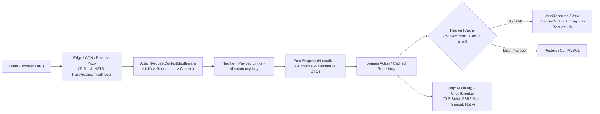

# Master Architectural Guide: Resilient Request Handling & Cache Handling in Laravel 13

> **Document**: `docs/architecture/request-and-cache-resilience.md`  
> **Framework**: Laravel 13 & PHP 8.6+  
> **Scope**: Inbound Request Pipeline (Correlation ID, Content Negotiation, Form Requests + DTOs, Idempotency Keys, Rate Limiting, HTTPS/Proxy Hardening), Outbound `Http::` Resilience (Timeouts, Jittered Retries, TLS Enforcement, SSRF Defense, Circuit Breakers), and Resilient Cache Handling (Laravel 13 `failover` Store, `LockTimeoutException` Recovery, `Cache::flexible()` SWR, Multi-Tenant Key Versioning, HTTP Cache Headers).

---

## 1. Unified Request & Cache Resilience Architecture



---

## 2. Inbound Request Hardening & Lifecycle Standards

### A. Middleware Ordering in `bootstrap/app.php`

Always declare explicit `trustProxies`, `trustHosts`, HTTPS enforcement, correlation context, and tiered throttling in `bootstrap/app.php`:

```php
<?php

declare(strict_types=1);

use App\Http\Middleware\AttachRequestContextMiddleware;
use App\Http\Middleware\EnforceIdempotencyKeyMiddleware;
use App\Http\Middleware\EnsureHttpsRequest;
use App\Http\Middleware\EnsureJsonRequest;
use App\Http\Middleware\SecurityHeaders;
use Illuminate\Foundation\Application;
use Illuminate\Foundation\Configuration\Middleware;
use Illuminate\Http\Request;

return Application::configure(basePath: dirname(__DIR__))
    ->withMiddleware(function (Middleware $middleware): void {
        // 1. Explicit proxy CIDRs (prevents Host / X-Forwarded-Proto spoofing & HTTPS loops)
        $middleware->trustProxies(
            at: array_values(array_filter(explode(',', (string) env('TRUSTED_PROXIES', '')))),
            headers: Request::HEADER_X_FORWARDED_FOR
                | Request::HEADER_X_FORWARDED_HOST
                | Request::HEADER_X_FORWARDED_PORT
                | Request::HEADER_X_FORWARDED_PROTO,
        );

        // 2. Host header allowlist (blocks cache poisoning & Host injection)
        $middleware->trustHosts(at: static fn (): array => [
            '^' . preg_quote((string) parse_url((string) config('app.url'), PHP_URL_HOST), '/') . '$',
        ]);

        // 3. Global pipeline: append runs AFTER Laravel's built-in TrustProxies & TrustHosts,
        // preserving order: TrustProxies -> TrustHosts -> AttachRequestContext -> EnsureHttpsRequest -> SecurityHeaders
        $middleware->append([
            AttachRequestContextMiddleware::class,
            EnsureHttpsRequest::class,
            SecurityHeaders::class,
        ]);

        // 4. Named route middleware aliases
        $middleware->alias([
            'idempotent' => EnforceIdempotencyKeyMiddleware::class,
            'force.json' => EnsureJsonRequest::class,
        ]);

        // 5. Tiered API throttling
        $middleware->throttleApi('api');
    })
    ->create();
```

### B. Tiered Rate Limiting (`AppServiceProvider::boot()`)

Configure burst + sustained limits returning structured RFC 7807 `429` responses with `Retry-After`:

```php
use Illuminate\Cache\RateLimiting\Limit;
use Illuminate\Http\Request;
use Illuminate\Support\Facades\RateLimiter;
use Symfony\Component\HttpFoundation\Response;

RateLimiter::for('api', static function (Request $request): array {
    $key = (string) ($request->user()?->id ?? $request->ip());

    $tooManyResponse = static fn (Request $req, array $headers) => response()->json([
        'type' => 'https://api.example.com/errors/rate-limit-exceeded',
        'title' => 'Too Many Requests',
        'status' => Response::HTTP_TOO_MANY_REQUESTS,
        'code' => 'RATE_LIMIT_EXCEEDED',
        'detail' => 'Rate limit exceeded. Inspect the Retry-After header before retrying.',
        'trace_id' => $req->attributes->get('trace_id'),
    ], Response::HTTP_TOO_MANY_REQUESTS, array_merge($headers, [
        'Content-Type' => 'application/problem+json',
        'Cache-Control' => 'no-store, private',
    ]));

    return [
        Limit::perSecond(10)->by("burst:{$key}")->response($tooManyResponse),
        Limit::perMinute(120)->by("minute:{$key}")->response($tooManyResponse),
    ];
});
```

---

## 3. Outbound HTTP / HTTPS Circuit Breaker (`app/Support/Http/CircuitBreaker.php`)

Prevent cascading timeouts when a third-party HTTPS API degrades by wrapping outbound `Http::resilient()` calls in a Cache-backed Circuit Breaker:

```php
<?php

declare(strict_types=1);

namespace App\Support\Http;

use App\Exceptions\Billing\UpstreamGatewayUnavailableException;
use Closure;
use Illuminate\Http\Client\ConnectionException;
use Illuminate\Http\Client\RequestException;
use Illuminate\Support\Facades\Cache;
use Illuminate\Support\Facades\Log;
use NoDiscard;

final readonly class CircuitBreaker
{
    /** @var list<int> */
    private const array DEPENDENCY_FAILURE_STATUSES = [429, 500, 502, 503, 504];

    public function __construct(
        private string $service,
        private int $failureThreshold = 5,
        private int $openSeconds = 30,
    ) {}

    /**
     * @template TResult
     * @param Closure(): TResult $operation
     * @return TResult
     */
    #[NoDiscard]
    public function call(Closure $operation): mixed
    {
        $openKey = "circuit:{$this->service}:open";
        $failKey = "circuit:{$this->service}:failures";

        if (Cache::has($openKey)) {
            throw new UpstreamGatewayUnavailableException(
                provider: $this->service,
                message: "Service [{$this->service}] circuit is open; fast-failing request.",
            );
        }

        try {
            $result = $operation();
            Cache::forget($failKey);

            return $result;
        } catch (ConnectionException|RequestException $e) {
            // Preserve non-transient client errors (e.g., 400, 404, 422) for the caller — never trip the circuit on them
            if (
                $e instanceof RequestException
                && ! in_array($e->response->status(), self::DEPENDENCY_FAILURE_STATUSES, true)
            ) {
                throw $e;
            }

            // Atomically initialize counter with TTL before incrementing (required on database/empty cache stores)
            Cache::add($failKey, 0, $this->openSeconds * 2);
            $failures = (int) Cache::increment($failKey);
            Cache::touch($failKey, $this->openSeconds * 2);

            if ($failures >= $this->failureThreshold) {
                Cache::put($openKey, true, $this->openSeconds);
                Log::error('Outbound HTTPS circuit opened.', [
                    'service' => $this->service,
                    'failures' => $failures,
                    'open_seconds' => $this->openSeconds,
                ]);
            }

            throw new UpstreamGatewayUnavailableException(
                provider: $this->service,
                message: "Upstream HTTPS call to [{$this->service}] failed.",
            );
        }
    }
}
```

---

## 4. Resilient Multi-Tenant Cache Architecture

### A. Versioned Multi-Tenant Key Strategy (Zero Tag-Memory Leaks & Eviction-Safe)

Redis cache tags can accumulate orphaned set entries under high churn. Prefer deterministic **versioned namespace keys** scoped strictly by `tenant_id` so invalidation is $O(1)$ and cross-tenant cache leaks are impossible.

> [!IMPORTANT]
> **Eviction & Race Safety**: Keep generation metadata (`__version`) in a **non-evicting authoritative store** (e.g., `Cache::store('database')` or a dedicated `noeviction` Redis DB) and serialize initialization/advancement with an atomic lock or ULID token so LRU eviction or concurrent writes can NEVER revert a version back to `1` and resurrect stale entries.

```php
<?php

declare(strict_types=1);

namespace App\Support;

use Illuminate\Support\Facades\Cache;
use Illuminate\Support\Facades\DB;
use Illuminate\Support\Str;
use NoDiscard;

final class TenantCacheKey
{
    private const string VERSION_STORE = 'database';

    private function __construct() {}

    #[NoDiscard]
    public static function for(string $tenantId, string $domain, string $suffix): string
    {
        $store = Cache::store(self::VERSION_STORE);
        $vKey = self::versionKey($tenantId, $domain);

        // Atomically initialize with a unique ULID generation token (never reuses "1" after eviction/reset)
        $version = $store->get($vKey);
        if (! is_string($version) || $version === '') {
            $initial = (string) Str::ulid();
            $store->add($vKey, $initial);
            $version = (string) $store->get($vKey, $initial);
        }

        return sprintf('t:%s:%s:g:%s:%s', $tenantId, $domain, $version, $suffix);
    }

    /**
     * Advance namespace generation atomically strictly AFTER the DB transaction commits.
     */
    public static function invalidateDomainAfterCommit(string $tenantId, string $domain): void
    {
        DB::afterCommit(static function () use ($tenantId, $domain): void {
            $store = Cache::store(self::VERSION_STORE);
            $vKey = self::versionKey($tenantId, $domain);

            $store->lock("lock:{$vKey}", 5)->block(3, static function () use ($store, $vKey): void {
                // Always write a strictly newer ULID generation token under the lock
                $store->forever($vKey, (string) Str::ulid());
            });
        });
    }

    private static function versionKey(string $tenantId, string $domain): string
    {
        return sprintf('t:%s:%s:__version', $tenantId, $domain);
    }
}
```

### B. Conditional HTTP Caching (`ETag` + `304 Not Modified` + `stale-if-error`)

Use Laravel's native `cache.headers` middleware on public read-heavy routes while ensuring error responses override `Cache-Control` to `no-store, private`:

```php
Route::middleware('cache.headers:public;max_age=300;stale_while_revalidate=60;stale_if_error=3600;etag')
    ->get('/api/v1/catalog/products', ListPublicProductsController::class)
    ->name('api.v1.catalog.products.index');
```

---

## 5. Pest 3 Resilience Verification Suite (`tests/Feature/RequestAndCacheResilienceTest.php`)

```php
<?php

declare(strict_types=1);

use App\Exceptions\Billing\UpstreamGatewayUnavailableException;
use App\Support\Http\CircuitBreaker;
use App\Support\ResilientCache;
use Illuminate\Http\Client\ConnectionException;
use Illuminate\Support\Facades\Cache;
use Illuminate\Support\Facades\Http;

it('attaches ULID X-Request-Id header on every response', function (): void {
    $response = $this->get('/up');

    $response->assertOk()->assertHeader('X-Request-Id');
    expect((string) $response->headers->get('X-Request-Id'))->not->toBeEmpty();
});

it('falls back to origin callback when cache backend throws', function (): void {
    Cache::shouldReceive('flexible')->once()->andThrow(new RuntimeException('Redis connection refused'));

    $value = ResilientCache::flexible('catalog:featured', 60, 300, static fn (): array => ['status' => 'origin']);

    expect($value)->toBe(['status' => 'origin']);
});

it('opens circuit breaker after repeated HTTPS connection failures', function (): void {
    Http::fake(static fn () => throw new ConnectionException('cURL error 28: Operation timed out'));

    $breaker = new CircuitBreaker(service: 'payments', failureThreshold: 2, openSeconds: 60);

    for ($i = 0; $i < 2; $i++) {
        expect(fn () => $breaker->call(static fn () => Http::get('https://api.stripe.com/v1/charges')))
            ->toThrow(UpstreamGatewayUnavailableException::class);
    }

    expect(Cache::has('circuit:payments:open'))->toBeTrue();
});
```
