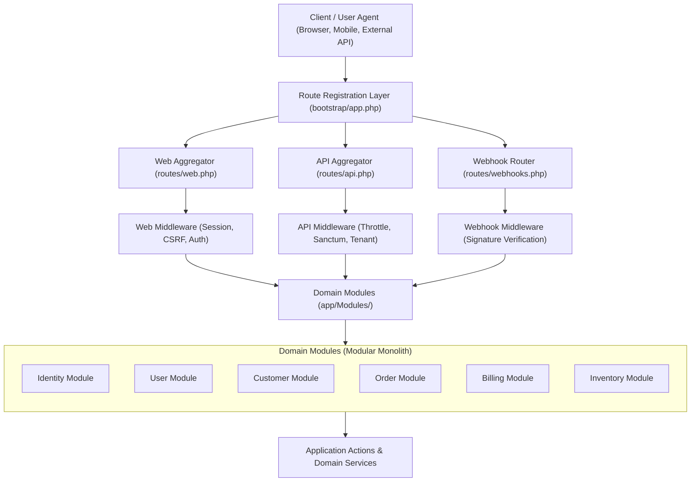
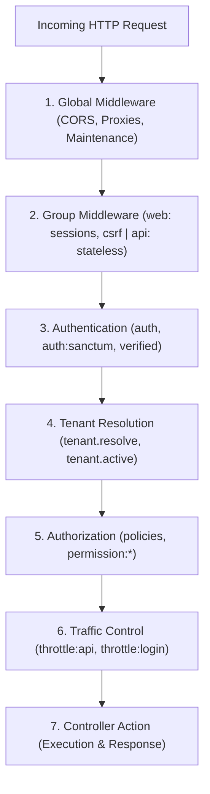
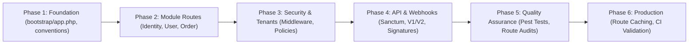

# Laravel 13 — Enterprise Modular Routing Architecture

> **Architecture Document**: `docs/architecture/routing.md`  
> **Application Pattern**: Modular Monolith  
> **Target Framework**: Laravel 13 (PHP 8.5+)  
> **Status**: Recommended Architecture Specification  

---

## Executive Summary

The recommended approach for enterprise systems is a **Domain-Oriented Modular Routing Architecture** featuring centralized route registration, isolated module route files, strict naming conventions, multi-layered middleware boundaries, and independent API versioning.

The primary objective is to maintain clean architectural boundaries as the application scales from a single Laravel project into an enterprise-grade SaaS platform.

---

## 1. Architectural Principles

1. **Domain Separation**: Each business module exclusively owns and defines its internal routes.
2. **Centralized Registration**: Unified route registration through `bootstrap/app.php` and root aggregators without scattered overrides.
3. **Explicit Routing**: Single-action or resourceful controllers handle all business-facing HTTP requests (no closures in production routes).
4. **Consistent Naming**: Predictable hierarchical naming convention across all routes (`{application}.{module}.{resource}.{action}`).
5. **Middleware Boundaries**: Authentication, authorization, tenant isolation, and rate-limiting are strictly enforced at outer boundaries.
6. **API Versioning**: Public and mobile APIs are versioned independently (`v1`, `v2`) to preserve backwards compatibility.
7. **Route Discoverability**: Developers can immediately locate route definitions by inspecting domain directories.
8. **Backward Compatibility**: New API revisions and route reorganizations never break legacy external consumers.



---

## 2. Recommended Directory Structure

This structure maintains Laravel's core conventions while isolating business domains inside `app/Modules/`:

```text
project/
├── app/
│   ├── Http/
│   │   ├── Controllers/
│   │   ├── Middleware/
│   │   └── Requests/
│   ├── Providers/
│   │   └── AppServiceProvider.php
│   └── Modules/
│       ├── Identity/
│       │   ├── Http/
│       │   │   ├── Controllers/
│       │   │   ├── Requests/
│       │   │   └── Resources/
│       │   ├── Domain/
│       │   │   ├── Actions/
│       │   │   └── Policies/
│       │   └── routes/
│       │       ├── web.php
│       │       └── api.php
│       ├── User/
│       │   ├── Http/
│       │   ├── Domain/
│       │   └── routes/
│       │       ├── web.php
│       │       ├── admin.php
│       │       └── api.php
│       ├── Customer/
│       │   └── routes/
│       │       ├── web.php
│       │       └── api.php
│       ├── Order/
│       │   └── routes/
│       │       ├── web.php
│       │       └── api.php
│       ├── Billing/
│       │   └── routes/
│       │       ├── web.php
│       │       └── api.php
│       └── Inventory/
│           └── routes/
│               ├── web.php
│               └── api.php
├── bootstrap/
│   └── app.php
├── routes/
│   ├── web.php          # Web module aggregator
│   ├── api.php          # API module aggregator
│   ├── webhooks.php     # Webhook router
│   └── console.php      # CLI commands
└── tests/
    └── Feature/
        └── Routing/
            ├── PublicRoutesTest.php
            ├── AdminRoutesTest.php
            ├── ApiRoutesTest.php
            └── TenantIsolationTest.php
```

> [!NOTE]
> `app/Modules/` is an application-level architectural convention that preserves complete compatibility with native Laravel tooling while grouping code by business domain.

---

## 3. Central Route Registration

Laravel 13 eliminates `RouteServiceProvider` in favor of unified bootstrapping in `bootstrap/app.php`. Root route files act as **Module Aggregators**.

### `bootstrap/app.php`
```php
<?php

declare(strict_types=1);

use App\Http\Middleware\CheckPermission;
use App\Http\Middleware\EnsureTenantIsActive;
use App\Http\Middleware\ResolveTenant;
use Illuminate\Foundation\Application;
use Illuminate\Foundation\Configuration\Exceptions;
use Illuminate\Foundation\Configuration\Middleware;
use Illuminate\Support\Facades\Route;

return Application::configure(basePath: dirname(__DIR__))
    ->withRouting(
        web: __DIR__.'/../routes/web.php',
        api: __DIR__.'/../routes/api.php',
        commands: __DIR__.'/../routes/console.php',
        health: '/up',
        then: function (): void {
            // Dedicated Webhook Router
            Route::middleware('api')
                ->prefix('webhooks')
                ->name('webhooks.')
                ->group(base_path('routes/webhooks.php'));
        },
    )
    ->withMiddleware(function (Middleware $middleware): void {
        $middleware->alias([
            'tenant.resolve' => ResolveTenant::class,
            'tenant.active' => EnsureTenantIsActive::class,
            'permission' => CheckPermission::class,
        ]);
    })
    ->withExceptions(function (Exceptions $exceptions): void {
        // Exception reporting & rendering
    })->create();
```

### Web Aggregator (`routes/web.php`)
```php
<?php

declare(strict_types=1);

use Illuminate\Support\Facades\Route;

// Public guest routes
require app_path('Modules/Identity/routes/web.php');

// Authenticated user application routes
Route::middleware(['auth', 'verified'])->group(function (): void {
    require app_path('Modules/User/routes/web.php');
    require app_path('Modules/Customer/routes/web.php');
    require app_path('Modules/Order/routes/web.php');
});

// Platform Administration routes
Route::prefix('admin')
    ->name('admin.')
    ->middleware(['auth', 'verified', 'permission:admin.access'])
    ->group(function (): void {
        require app_path('Modules/User/routes/admin.php');
        require app_path('Modules/Order/routes/admin.php');
        require app_path('Modules/Billing/routes/admin.php');
    });
```

### API Aggregator (`routes/api.php`)
```php
<?php

declare(strict_types=1);

use Illuminate\Support\Facades\Route;

Route::prefix('v1')->name('v1.')->group(function (): void {
    // Public authentication & registration
    require app_path('Modules/Identity/routes/api.php');

    // Protected API routes
    Route::middleware('auth:sanctum')->group(function (): void {
        require app_path('Modules/User/routes/api.php');
        require app_path('Modules/Customer/routes/api.php');
        require app_path('Modules/Order/routes/api.php');
        require app_path('Modules/Billing/routes/api.php');
    });
});
```

---

## 4. Module Route Implementation

Each module owns its route definitions. The root aggregator controls application-wide middleware stacks.

### User Web Routes (`app/Modules/User/routes/web.php`)
```php
<?php

declare(strict_types=1);

use App\Modules\User\Http\Controllers\UserController;
use App\Modules\User\Http\Controllers\UserProfileController;
use Illuminate\Support\Facades\Route;

Route::prefix('users')->name('users.')->group(function (): void {
    // Static routes MUST precede parameterized routes to avoid conflicts
    Route::get('/profile', UserProfileController::class)->name('profile');
    Route::get('/', [UserController::class, 'index'])->name('index');
    Route::get('/{user}', [UserController::class, 'show'])
        ->name('show')
        ->whereNumber('user');
});
```

### User Admin Routes (`app/Modules/User/routes/admin.php`)
```php
<?php

declare(strict_types=1);

use App\Modules\User\Http\Controllers\Admin\UserController;
use Illuminate\Support\Facades\Route;

Route::prefix('users')->name('users.')->controller(UserController::class)->group(function (): void {
    Route::get('/', 'index')->name('index');
    Route::get('/create', 'create')->name('create');
    Route::post('/', 'store')->name('store');
    Route::get('/{user}', 'show')->name('show')->whereNumber('user');
    Route::get('/{user}/edit', 'edit')->name('edit')->whereNumber('user');
    Route::put('/{user}', 'update')->name('update')->whereNumber('user');
    Route::delete('/{user}', 'destroy')->name('destroy')->whereNumber('user');
});
```

### User API Routes (`app/Modules/User/routes/api.php`)
```php
<?php

declare(strict_types=1);

use App\Modules\User\Http\Controllers\Api\V1\UserController;
use Illuminate\Support\Facades\Route;

Route::get('profile', [UserController::class, 'profile'])->name('profile');
Route::apiResource('users', UserController::class);
```

#### Generated API Endpoints:
| HTTP Verb | Endpoint | Route Name |
| :--- | :--- | :--- |
| `GET` | `/api/v1/profile` | `v1.profile` |
| `GET` | `/api/v1/users` | `v1.users.index` |
| `POST` | `/api/v1/users` | `v1.users.store` |
| `GET` | `/api/v1/users/{user}` | `v1.users.show` |
| `PUT/PATCH` | `/api/v1/users/{user}` | `v1.users.update` |
| `DELETE` | `/api/v1/users/{user}` | `v1.users.destroy` |

---

## 5. Enterprise Route Naming Conventions

All route names must be globally unique and follow a predictable hierarchy:
`{application}.{module}.{resource}.{action}`

| Application Scope | Route Name Example | Description |
| :--- | :--- | :--- |
| **Public Website** | `public.home` | Public-facing marketing pages |
| **Customer App** | `app.dashboard` | Authenticated client panel |
| **User Module** | `app.users.index` | Customer-accessible user list |
| **Admin Panel** | `admin.users.index` | Internal administrative panel |
| **Admin Orders** | `admin.orders.show` | Admin order inspection |
| **API v1** | `v1.users.index` | Public API Version 1 |
| **API v2** | `v2.users.index` | Public API Version 2 |
| **Webhooks** | `webhooks.payment.stripe` | Asynchronous provider webhooks |

### Standard Formats Matrix:
| Element | Convention | Example |
| :--- | :--- | :--- |
| **URI** | `kebab-case` | `/user-profiles` |
| **Resource** | `plural noun` | `/orders` |
| **Route name** | `lowercase dot notation` | `admin.orders.index` |
| **Controller** | `PascalCase` | `OrderController` |
| **Action** | `camelCase` | `showInvoice()`, `__invoke` |
| **Parameter** | `singular noun` | `{order}` |
| **Middleware alias** | `dot notation` | `tenant.resolve` |
| **API version** | `v1, v2` | `/api/v1/orders` |

---

## 6. Middleware Architecture & Execution Matrix

Middleware must be organized into logical execution tiers:



### Responsibility Matrix:
| Middleware | Responsibility | Scope |
| :--- | :--- | :--- |
| `auth` | Session-based stateful authentication | Web applications |
| `auth:sanctum` | Token-based stateless authentication | REST APIs |
| `verified` | Email verification validation | Protected customer portals |
| `tenant.resolve` | Identify & load tenant context from header or subdomain | Multi-tenant applications |
| `tenant.active` | Verify tenant account standing (active/suspended) | Tenant endpoints |
| `can` | Resource-level policy authorization | Granular operations |
| `permission` | Role-based or permission-based gate check | Admin & management areas |
| `throttle` | Request rate limiting & abuse prevention | Login, webhooks, API endpoints |

### Mandatory Security Guidelines:
1. **Never trust client-supplied tenant IDs**: Always validate user membership against the target tenant.
2. **Resolve tenant context prior to database queries**: Prevent data leakage across organizational boundaries.
3. **Use Policies for resource-level authorization**: Do not rely solely on route-level middleware.
4. **Isolate webhooks from session state**: Verify cryptographic signatures independently.

---

## 7. Resource Routing Standards

### Standard CRUD
```php
Route::resource('orders', OrderController::class);
Route::apiResource('orders', Api\OrderController::class);
```

### Custom Business Operations
Model state transitions as explicit action endpoints rather than generic updates:
```php
Route::prefix('orders')->name('orders.')->controller(OrderController::class)->group(function (): void {
    Route::post('/{order}/cancel', 'cancel')->name('cancel');
    Route::post('/{order}/approve', 'approve')->name('approve');
    Route::post('/{order}/complete', 'complete')->name('complete');
    Route::get('/{order}/invoice', 'invoice')->name('invoice');
});
```

### Shallow Nesting
Avoid deeply nested URI hierarchies. Use shallow nesting for parent-child relations:
```php
// GET /customers/{customer}/orders
// POST /customers/{customer}/orders
// GET /orders/{order}
Route::resource('customers.orders', CustomerOrderController::class)->shallow();
```

---

## 8. Route Model Binding & Constraints

### Custom Slugs
```php
// Resolves using model's unique slug
Route::get('/articles/{article:slug}', [ArticleController::class, 'show'])->name('articles.show');
```

### Explicit Parameter Constraints
```php
Route::get('/users/{user}', [UserController::class, 'show'])->whereNumber('user');
Route::get('/products/{slug}', [ProductController::class, 'show'])->where('slug', '[a-z0-9-]+');
Route::get('/invoices/{invoice}', [InvoiceController::class, 'show'])->whereUuid('invoice');
Route::get('/orders/{order}', [OrderController::class, 'show'])->whereUlid('order');
```

### Automatic Scoped Binding
Ensure nested models strictly belong to the parent resource in the URI:
```php
Route::scopeBindings()->group(function (): void {
    Route::get('/customers/{customer}/orders/{order}', [CustomerOrderController::class, 'show']);
});
```

---

## 9. Multi-Tenant Routing Architecture

For SaaS deployments requiring tenant subdomain isolation:

```php
use Illuminate\Support\Facades\Route;

Route::domain('{tenant}.example.com')
    ->middleware(['web', 'auth', 'tenant.resolve', 'tenant.active'])
    ->name('tenant.')
    ->group(function (): void {
        Route::get('/dashboard', DashboardController::class)->name('dashboard');
        Route::resource('orders', TenantOrderController::class);
    });
```

> [!IMPORTANT]
> The subdomain identifier alone is **never** sufficient authentication. Always verify that the authenticated user holds valid membership in the active tenant context.

---

## 10. Webhook Routing Architecture

Webhooks bypass CSRF verification and authenticate exclusively via cryptographic payload signatures.

### Webhook Router (`routes/webhooks.php`)
```php
<?php

declare(strict_types=1);

use App\Modules\Billing\Http\Controllers\WebhookController;
use Illuminate\Support\Facades\Route;

Route::prefix('payments')->name('payment.')->controller(WebhookController::class)->group(function (): void {
    Route::post('/stripe', 'stripe')->name('stripe');
    Route::post('/paypal', 'paypal')->name('paypal');
});
```

Registered in `bootstrap/app.php`:
```php
->withRouting(
    // ...
    then: function (): void {
        Route::middleware(['api', 'webhook.signature'])
            ->prefix('webhooks')
            ->name('webhooks.')
            ->group(base_path('routes/webhooks.php'));
    },
)
```

Endpoints produced:
- `POST /webhooks/payments/stripe`
- `POST /webhooks/payments/paypal`

---

## 11. API Versioning Strategy

Keep public API contracts decoupled from internal module versions:

```text
app/Modules/User/
├── Http/Controllers/Api/
│   ├── V1/UserController.php
│   └── V2/UserController.php
└── routes/
    ├── api-v1.php
    └── api-v2.php
```

### Registration:
```php
Route::prefix('v1')->name('v1.')->group(function (): void {
    require app_path('Modules/User/routes/api-v1.php');
});

Route::prefix('v2')->name('v2.')->group(function (): void {
    require app_path('Modules/User/routes/api-v2.php');
});
```

Never duplicate domain logic between API revisions. Revisions share underlying Domain Actions and Eloquent Models, varying only in Request validation rules and API Resource representations.

---

## 12. Testing Strategy with Pest 3

Routing must be verified as an independent architectural contract.

```php
<?php

declare(strict_types=1);

use App\Models\User;

test('guest cannot access admin dashboard', function () {
    $this->get('/admin/dashboard')
        ->assertRedirect('/login');
});

test('authenticated user can access user listing', function () {
    $user = User::factory()->create();

    $this->actingAs($user)
        ->get('/users')
        ->assertOk();
});

test('API rejects unauthenticated requests with 401', function () {
    $this->getJson('/api/v1/users')
        ->assertUnauthorized();
});

test('scoped binding prevents accessing foreign tenant orders', function () {
    $userA = User::factory()->create();
    $userB = User::factory()->create();
    $orderB = Order::factory()->for($userB)->create();

    $this->actingAs($userA)
        ->getJson("/api/v1/users/{$userA->id}/orders/{$orderB->id}")
        ->assertNotFound();
});
```

---

## 13. Performance & Deployment Standards

In production, eliminate dynamic route registration overhead using route caching:

```bash
# Production Deployment Sequence
composer install --no-dev --optimize-autoloader
php artisan migrate --force
php artisan optimize:clear
php artisan config:cache
php artisan route:cache
php artisan view:cache
```

### Verification & Inspection Commands:
```bash
# View all routes
php artisan route:list

# Filter by API routes
php artisan route:list --path=api

# Filter out vendor routes
php artisan route:list --except-vendor
```

> [!CAUTION]
> Never use route closures in a production codebase. Closures cannot be serialized by `php artisan route:cache`.

---

## 14. Enterprise Routing Governance

### Rules Enforced in CI & Code Review:
1. **Route Ownership**: Every route must reside in its corresponding domain module route file.
2. **Unique Naming**: Route names must be globally unique across all modules.
3. **No Closures**: Controllers handle all business requests.
4. **Thin Controllers**: Controllers orchestrate HTTP requests; business algorithms belong in Actions.
5. **No Destructive GET Requests**: State mutations must use POST, PUT, PATCH, or DELETE.

---

## 15. Implementation Roadmap


