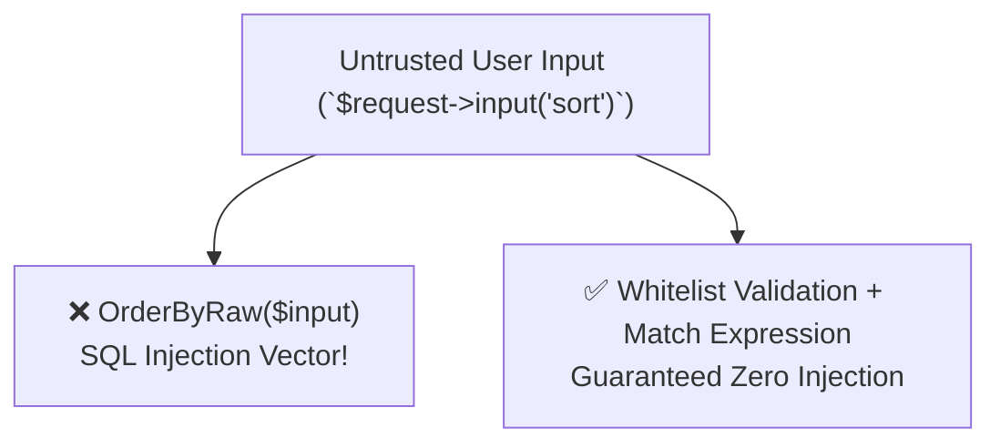

# Modern PHP 8.5+ & Laravel 13 Security, Hardening & Hacker Protection

> **Document**: `docs/architecture/security-and-hacker-protection.md`  
> **Framework**: Laravel 13 & PHP 8.5+  
> **Standards Compliance**: OWASP Top 10 (2025/2026), NIST SP 800-63B, RFC 7807, ISO 27001.

---

## 🏛️ Executive Summary

Security is not a plugin or an afterthought—it is an architectural discipline. A hardened Laravel 13 application assumes zero trust and enforces defense-in-depth at every layer:
- **Injection Defense**: Parameterized queries, raw SQL whitelisting, and ReDoS prevention.
- **Broken Access Control & IDOR**: Scoped route model bindings, mandatory policy gates, and ULID/UUID identifiers.
- **SSRF (Server-Side Request Forgery) Defense**: Private IP range blacklisting for webhooks and avatar downloads.
- **Timing Attack Immunity**: Constant-time verification (`hash_equals`) for signatures and tokens.
- **Upload Hardening & Anti-RCE**: Magic byte binary inspection, private disk storage, and SVG sanitization.
- **Cryptographic Rigor**: AES-256-GCM encryption, Argon2id password hashing, and session rotation.

---

## 1. SQL Injection & Dynamic Query Hardening

Laravel Eloquent protects against SQL injection by default when using standard methods (`where('email', $email)`). Vulnerabilities arise when developers bypass the query builder using raw expressions.



### A. Raw Query Hardening: Never Concatenate
```php
// ❌ CRITICAL VULNERABILITY: SQL Injection via concatenation
$users = DB::select("SELECT * FROM users WHERE status = '{$status}'");

// ✅ SECURE: Strict PDO Parameter Binding
$users = DB::select('SELECT * FROM users WHERE status = :status', [
    'status' => $status,
]);
```

### B. Dynamic Column Sorting: Whitelist Enforcement
Never pass user input directly to `orderBy()` or `orderByRaw()`:

```php
use Illuminate\Database\Eloquent\Builder;

final class FilterArticlesAction
{
    private const array ALLOWED_SORT_COLUMNS = [
        'created_at' => 'created_at',
        'title' => 'title',
        'views_count' => 'views_count',
    ];

    public function execute(Builder $query, ?string $sortBy, string $direction = 'desc'): Builder
    {
        // 1. Validate against strict whitelist
        $column = self::ALLOWED_SORT_COLUMNS[$sortBy] ?? 'created_at';
        $dir = strtolower($direction) === 'asc' ? 'asc' : 'desc';

        return $query->orderBy($column, $dir);
    }
}
```

---

## 2. Insecure Direct Object References (IDOR) & Scoped Bindings

Attackers exploit IDOR by altering sequential IDs (`/api/v1/invoices/1042` $\rightarrow$ `/api/v1/invoices/1043`) to access another tenant's records.

### A. Scoped Route Model Binding
Enforce parent-child ownership automatically in routes:

```php
// routes/api.php
Route::prefix('v1')->group(function () {
    // Laravel automatically verifies that {invoice} belongs to {organization}
    Route::get('/organizations/{organization}/invoices/{invoice}', ShowInvoiceController::class)
        ->scopeBindings();
});
```

### B. Mandatory Policy Gate Enforcement
Never rely solely on route parameters. Always authorize against the authenticated user:

```php
// app/Http/Requests/Invoices/ShowInvoiceRequest.php
public function authorize(): bool
{
    /** @var Invoice $invoice */
    $invoice = $this->route('invoice');
    
    return $this->user()?->can('view', $invoice) ?? false;
}
```

### C. Modern ULIDs/UUIDs over Auto-Increment Integers
Using ULIDs prevents sequential enumeration attacks:
```php
$table->ulid('id')->primary(); // 01j8m2a8p9q8b8n3v8b2c4d5e6 (Un-guessable & chronologically sortable)
```

---

## 3. Server-Side Request Forgery (SSRF) Defense

When an application downloads remote URLs (e.g. webhook URLs, avatar images, PDF generators), attackers supply internal addresses (`http://169.254.169.254` or `http://192.168.1.1`) to access internal infrastructure or cloud metadata.

### The SSRF Shield: Rejecting Private & Reserved IP Addresses
```php
<?php

declare(strict_types=1);

namespace App\Support;

use InvalidArgumentException;

final class SafeHttpClient
{
    /**
     * Validates that a user-provided URL does NOT resolve to internal/private subnets.
     */
    public static function assertPublicUrl(string $url): void
    {
        $host = parse_url($url, PHP_URL_HOST);
        if (! is_string($host)) {
            throw new InvalidArgumentException("Invalid URL format: {$url}");
        }

        $ip = gethostbyname($host);

        // Filter out private, reserved, and loopback IP ranges (RFC 1918, RFC 3927)
        if (! filter_var(
            $ip,
            FILTER_VALIDATE_IP,
            FILTER_FLAG_IPV4 | FILTER_FLAG_NO_PRIV_RANGE | FILTER_FLAG_NO_RES_RANGE
        )) {
            throw new InvalidArgumentException("Forbidden: Target URL resolves to an internal or private address ({$ip}).");
        }
    }
}
```

---

## 4. Timing Attack Immunity: Constant-Time Verification

Standard string comparisons (`===` or `strcmp()`) return `false` on the first non-matching byte, leaking execution time and enabling byte-by-byte signature forgery.

### Constant-Time Verification with `hash_equals()`
Always verify HMACs, API keys, and webhook signatures using `hash_equals()`:

```php
<?php

declare(strict_types=1);

namespace App\Support;

final class SignatureVerifier
{
    public static function verify(string $payload, string $providedSignature, string $secret): bool
    {
        $expectedSignature = hash_hmac('sha256', $payload, $secret);

        // Constant-time execution prevents timing side-channel attacks
        return hash_equals($expectedSignature, $providedSignature);
    }
}
```

---

## 5. File Upload Hardening & Remote Code Execution (RCE) Defense

Attackers upload malicious `.php` files masked as `.jpg` or embed JavaScript inside SVG images.

### Hardened File Upload Rules:
1. **Never trust client-reported MIME types or extensions**.
2. **Inspect binary Magic Bytes** via `finfo_file()`.
3. **Store uploads outside the public web root** (`storage/app/private/` or private cloud buckets).
4. **Generate cryptographically random filenames**.
5. **Serve via temporary signed URLs** or streaming controllers.

```php
<?php

declare(strict_types=1);

namespace App\Actions\Uploads;

use Illuminate\Http\UploadedFile;
use Illuminate\Support\Facades\Storage;
use Illuminate\Support\Str;
use InvalidArgumentException;
use NoDiscard;

final class StoreUserAvatarAction
{
    private const array ALLOWED_MIME_TYPES = [
        'image/jpeg' => 'jpg',
        'image/png'  => 'png',
        'image/webp' => 'webp',
    ];

    #[NoDiscard]
    public function execute(UploadedFile $file, string $userId): string
    {
        // 1. Inspect real binary magic bytes on disk
        $realMime = $file->getMimeType();
        $extension = self::ALLOWED_MIME_TYPES[$realMime] ?? null;

        if ($extension === null) {
            throw new InvalidArgumentException('Invalid image format. Only JPEG, PNG, and WebP are allowed.');
        }

        // 2. Cryptographically secure randomized filename
        $safeFilename = sprintf('%s_%s.%s', $userId, Str::random(32), $extension);

        // 3. Store on private disk outside web document root
        Storage::disk('private')->putFileAs('avatars', $file, $safeFilename);

        return $safeFilename;
    }
}
```

---

## 6. Mass Assignment & Model Invariant Protection

Enforce strict model safety in `AppServiceProvider::boot()`:

```php
// app/Providers/AppServiceProvider.php
use Illuminate\Database\Eloquent\Model;

public function boot(): void
{
    // 1. Crash immediately in dev/testing if unfillable fields are passed
    Model::preventSilentlyDiscardingAttributes(! app()->isProduction());

    // 2. Prevent lazy loading (N+1 query defense)
    Model::preventLazyLoading(! app()->isProduction());
}
```

---

## 7. HTTP Security Headers Middleware

Ensure all HTTP responses declare modern security defense headers:

```php
<?php

declare(strict_types=1);

namespace App\Http\Middleware;

use Closure;
use Illuminate\Http\Request;
use Symfony\Component\HttpFoundation\Response;

final class SecurityHeadersMiddleware
{
    public function handle(Request $request, Closure $next): Response
    {
        /** @var Response $response */
        $response = $next($request);

        $response->headers->set('X-Frame-Options', 'DENY');
        $response->headers->set('X-Content-Type-Options', 'nosniff');
        $response->headers->set('Referrer-Policy', 'strict-origin-when-cross-origin');
        $response->headers->set('Permissions-Policy', 'geolocation=(), camera=(), microphone=()');
        
        if (app()->isProduction()) {
            $response->headers->set('Strict-Transport-Security', 'max-age=31536000; includeSubDomains; preload');
        }

        return $response;
    }
}
```

---

## 8. Pest 3 Security Architecture Tests

Automate security regression testing in CI:

```php
// tests/Feature/SecurityArchTest.php

arch('disallow insecure raw execution functions')
    ->expect(['eval', 'exec', 'shell_exec', 'passthru', 'system', 'unserialize'])
    ->not->toBeUsed();

arch('disallow md5 and sha1 for hashing sensitive data')
    ->expect(['md5', 'sha1'])
    ->not->toBeUsed();

arch('controllers must not access superglobals directly')
    ->expect(['_GET', '_POST', '_REQUEST', '_COOKIE', '_SERVER'])
    ->not->toBeUsed();

arch('routes must declare auth or rate limiting middleware')
    ->expect('routes/api.php')
    ->toUse('throttle');
```

---

## 📌 Senior Security & Hacker Defense Checklist

| Threat Vector | Attack Scenario | Production Defense |
| :--- | :--- | :--- |
| **SQL Injection** | `$request->input('sort')` in raw SQL | Strict array whitelist + parameter binding |
| **IDOR** | Guessing `/orders/105` | ULIDs (`$table->ulid()`) + `Route::scopeBindings()` |
| **SSRF** | Downloading `http://169.254.169.254` | `SafeHttpClient::assertPublicUrl()` (RFC 1918 blocks) |
| **Timing Attacks** | Forging webhook HMAC signature | `hash_equals($expected, $provided)` |
| **File Upload RCE** | Renaming `exploit.php` to `image.png` | Binary Magic Byte validation + private storage |
| **Mass Assignment**| Overwriting `is_admin = true` | FormRequest `toDto()` + `preventSilentlyDiscardingAttributes` |
| **Brute Force** | Dictionary attack on login | `RateLimiter::for('login')` composite key (IP + email) |
| **Clickjacking** | Embedding site in malicious iframe | `X-Frame-Options: DENY` |
| **Deserialization**| Remote object injection | Never call `unserialize()`; use `json_decode()` |
