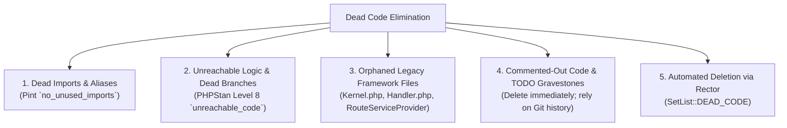

# The Senior Architect's Guide: Dead Code Elimination, Refactoring & Codebase Hygiene

> **Document**: `docs/architecture/senior-developer-code-review-and-refactoring.md`  
> **Framework**: Laravel 13 & PHP 8.5+  
> **Audience**: Principal Engineers, Staff Architects & Senior Developers.

---

## 🏛️ The Senior Developer Mindset

A 20+ year veteran engineer looks at software differently than a junior or intermediate developer:

| Intermediate Developer Mindset | 20+ Year Senior Architect Mindset |
| :--- | :--- |
| *"Look how many lines of code I wrote today!"* | *"Code is liability, not an asset. Look how many lines I safely deleted."* |
| Clever one-liners and complex inheritance hierarchies. | Boring, predictable, highly readable code with low cognitive load. |
| Premature abstraction after seeing 2 similar lines. | Tolerates duplication until 3 concrete business use cases prove the abstraction. |
| Deeply nested `if/else` logic ("Arrow Anti-Pattern"). | Guard clauses and early returns. Flattened cyclomatic complexity. |
| Swallowed errors and unhandled edge cases. | Fail-fast, strict types, and explicit domain exceptions. |
| Commented-out dead code *"just in case we need it"*. | Ruthless deletion. Git history preserves past experiments. |

---

## 1. Dead Code Elimination (Zombie Code Hunting)

Dead code increases mental overhead, slows down static analysis, confuses newcomers, and rots over time.



---

### A. Dead Legacy Files in Laravel 13
If an application was upgraded from Laravel 9/10 to Laravel 11/12/13, eliminate these dead legacy skeleton files immediately:

| Legacy File to Delete | Modern Laravel 13 Replacement |
| :--- | :--- |
| ❌ `app/Http/Kernel.php` | Configured fluently in `bootstrap/app.php` (`withMiddleware`) |
| ❌ `app/Console/Kernel.php` | Scheduled commands in `routes/console.php` |
| ❌ `app/Exceptions/Handler.php` | Handled fluently in `bootstrap/app.php` (`withExceptions`) |
| ❌ `app/Providers/RouteServiceProvider.php` | Declared in `bootstrap/app.php` (`withRouting`) |
| ❌ `app/Providers/EventServiceProvider.php` | Auto-discovered by Laravel or registered in `AppServiceProvider` |

---

### B. Commented-Out Code: Zero Tolerance Policy
> [!CAUTION]
> **Delete Commented-Out Code**: Never commit commented-out code blocks. Version control (Git) retains full history. Commented-out code creates doubt, clutters search results, and rots as types change.

```php
// ❌ Anti-Pattern: Commented-out graveyard
// public function oldDiscountCalculation($price) {
//     return $price * 0.9;
// }

// ✅ Clean: Only active, production code remains.
```

---

### C. Automated Dead Code Purging with Rector

Configure Rector in `rector.php` to continuously detect and delete dead code in CI:

```php
<?php

declare(strict_types=1);

use Rector\Config\RectorConfig;
use Rector\Set\ValueObject\SetList;

return RectorConfig::configure()
    ->withPaths([
        __DIR__ . '/app',
        __DIR__ . '/bootstrap/app.php',
        __DIR__ . '/config',
        __DIR__ . '/routes',
        __DIR__ . '/tests',
    ])
    ->withPreparedSets(
        deadCode: true,      // Automatically strips unused private methods, dead params, unused constants
        codeQuality: true,   // Modernizes syntax, simplifies boolean expressions
        typeDeclarations: true // Adds native parameter and return types
    )
    ->withSets([
        SetList::DEAD_CODE,
        SetList::PHP_84,
        SetList::PHP_85,
    ]);
```

**Run Rector in CI**:
```bash
# Dry run to inspect dead code
vendor/bin/rector process --dry-run

# Automatically purge dead code
vendor/bin/rector process
```

---

## 2. Guard Clauses & Flattening the "Pyramid of Doom"

Nested conditional blocks increase cyclomatic complexity exponentially. Senior developers use **Guard Clauses** and **Early Returns** to keep the happy path left-aligned.

### ❌ The Junior / Anti-Pattern: Deep Nested Pyramid
```php
public function processOrder(Order $order, User $user, ?Coupon $coupon): OrderResult
{
    if ($user->isActive()) {
        if (! $order->isPaid()) {
            if ($order->hasStock()) {
                if ($coupon !== null) {
                    if ($coupon->isValid()) {
                        $order->applyCoupon($coupon);
                    } else {
                        throw new InvalidCouponException();
                    }
                }
                $order->markAsPaid();
                return OrderResult::success($order);
            } else {
                throw new OutOfStockException();
            }
        } else {
            throw new OrderAlreadyPaidException();
        }
    } else {
        throw new InactiveUserException();
    }
}
```

### ✅ The 20+ Year Senior Standard: Guard Clauses & Early Returns
```php
#[\NoDiscard]
public function processOrder(Order $order, User $user, ?Coupon $coupon): OrderResult
{
    // 1. Guard clauses eliminate invalid preconditions immediately
    if (! $user->isActive()) {
        throw new InactiveUserException();
    }

    if ($order->isPaid()) {
        throw new OrderAlreadyPaidException();
    }

    if (! $order->hasStock()) {
        throw new OutOfStockException();
    }

    // 2. Specific domain validation
    if ($coupon !== null && ! $coupon->isValid()) {
        throw new InvalidCouponException();
    }

    // 3. Clean, unindented Happy Path
    if ($coupon !== null) {
        $order->applyCoupon($coupon);
    }

    $order->markAsPaid();

    return OrderResult::success($order);
}
```

---

## 3. Sandi Metz's Rule: Duplication is Cheaper than the Wrong Abstraction

Junior developers rush to abstract as soon as they see two lines of duplicated code. Senior architects follow **AHA (Avoid Hasty Abstractions)**:

```text
The Senior Abstraction Heuristic:
1. Occurrence 1: Write inline, expressive code.
2. Occurrence 2: Tolerate the duplication. The problem space is not yet fully understood.
3. Occurrence 3: Re-evaluate. Only abstract if the business concept and rate of change are identical.
```

> **The Litmus Test**: Ask: *"Will these two pieces of code ever need to change independently for different business reasons?"*  
> If yes $\rightarrow$ **Leave them duplicated**. Coupling them to a single shared helper creates a fragile, tangled abstraction.

---

## 4. Senior Architect Code Smell Hit List

| Code Smell | What It Looks Like | Senior Refactoring Fix |
| :--- | :--- | :--- |
| **Primitive Obsession** | `$status = 'paid'`, `$currency = 'USD'`, `$phone = '+12345678'` | Use backed Enums (`OrderStatus::Paid`) and Value Objects (`PhoneNumber`, `Currency`). |
| **Feature Envy** | A controller or service reaching into an object: `$order->user->company->address->country` | Tell, Don't Ask. Call `$order->shippingCountry()`. |
| **Temporal Coupling** | `$service->setClient($c); $service->setToken($t); $service->send();` | Pass all required dependencies in constructor or single method call: `$service->send($client, $token)`. |
| **God Action/Service** | An `OrderService` with 35 methods doing checkout, invoice, email, and refund. | Split into individual Single-Action classes: `CreateOrderAction`, `RefundOrderAction`. |
| **Swallowed Errors** | `catch (Exception $e) { /* silent */ }` | Log, rethrow, or translate to a domain exception with context. |

---

## 5. Architectural Boundary Enforcement with Pest 3

A codebase stays clean only if architectural rules are continuously verified in CI:

```php
// tests/ArchTest.php

arch('dead debugging functions must never exist')
    ->expect(['dd', 'dump', 'ray', 'var_dump', 'print_r'])
    ->not->toBeUsed();

arch('controllers must be thin and invokable')
    ->expect('App\Http\Controllers')
    ->classes()
    ->toBeFinal()
    ->toHaveSuffix('Controller')
    ->toBeInvokable();

arch('models do not query other models directly')
    ->expect('App\Models')
    ->not->toUse('Illuminate\Support\Facades\Http');

arch('actions are final and provide an execute method')
    ->expect('App\Actions')
    ->classes()
    ->toBeFinal()
    ->toHaveMethod('execute');

arch('strict types are enforced across the entire application')
    ->expect('App')
    ->toUseStrictTypes();
```

---

## 6. The Production CI Maintenance Command Suite

Run this 4-step pipeline before every pull request:

```bash
# 1. Automated code formatting & dead import removal (Pint)
./vendor/bin/pint

# 2. Automated dead code removal & PHP 8.5 syntax modernization (Rector)
./vendor/bin/rector process --dry-run

# 3. Static analysis & unreachable code detection (PHPStan Level 8 / max)
./vendor/bin/phpstan analyse --memory-limit=2G

# 4. Feature, Unit, and Architectural Boundary verification (Pest 3)
./vendor/bin/pest --bail
```

---

## 📌 Senior Architect's Refactoring Checklist

1. ✅ **Purge Legacy Files**: Delete `Kernel.php`, `Handler.php`, and unused Service Providers.
2. ✅ **Flatten Arrow Code**: Replace deep nested conditionals with guard clauses and early returns.
3. ✅ **Eliminate Dead Imports**: Ensure `"no_unused_imports": true` in `pint.json`.
4. ✅ **Value Objects over Primitives**: Wrap unstructured primitives in immutable, type-safe objects.
5. ✅ **Single Responsibility**: Ensure every controller and action has one and only one reason to change.
6. ✅ **Enforce Architecture in CI**: Let `tests/ArchTest.php` catch regressions before code review.
