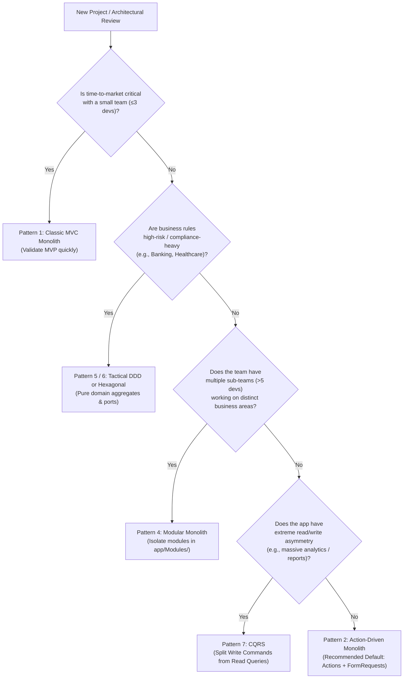
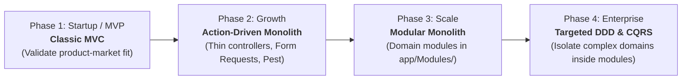

# Laravel 13 Architectural Decision Matrix Skill

This skill provides a systematic framework for evaluating, selecting, and auditing software architecture patterns for Laravel 13 (PHP 8.5+) applications.

---

## 1. Executive Architectural Decision Matrix

Evaluate the **Top 10 Architectural Patterns** across 9 critical software engineering dimensions:

| # | Architecture Pattern | Complexity | Velocity (TTM) | Maintainability | Testability | Blast Radius | Team Size | Scalability | Primary Use Case |
| :- | :--- | :--- | :--- | :--- | :--- | :--- | :--- | :--- | :--- |
| **1** | **Classic MVC Monolith** | ⭐ (1/5) | ⭐⭐⭐⭐⭐ (5/5) | ⭐⭐ (2/5) | ⭐⭐ (2/5) | High (Entire App) | 1 – 3 devs | Low | MVPs, proof-of-concepts, simple CRUD. |
| **2** | **Action-Driven Monolith** | ⭐⭐ (2/5) | ⭐⭐⭐⭐⭐ (5/5) | ⭐⭐⭐⭐⭐ (5/5) | ⭐⭐⭐⭐⭐ (5/5) | Medium | 2 – 8 devs | High | **Recommended Standard** for modern SaaS. |
| **3** | **Service-Layer Monolith** | ⭐⭐⭐ (3/5) | ⭐⭐⭐⭐ (4/5) | ⭐⭐⭐ (3/5) | ⭐⭐⭐⭐ (4/5) | Medium | 3 – 10 devs | Medium | Multi-step 3rd-party integrations (Stripe, CRM). |
| **4** | **Modular Monolith** | ⭐⭐⭐ (3/5) | ⭐⭐⭐⭐ (4/5) | ⭐⭐⭐⭐⭐ (5/5) | ⭐⭐⭐⭐⭐ (5/5) | Low (Per Module) | 5 – 25 devs | Very High | **Recommended Enterprise** for scaling platforms. |
| **5** | **Tactical DDD** | ⭐⭐⭐⭐⭐ (5/5) | ⭐⭐ (2/5) | ⭐⭐⭐⭐⭐ (5/5) | ⭐⭐⭐⭐⭐ (5/5) | Isolated | 8 – 30+ devs | Maximum | High-risk financial, healthcare, core banking. |
| **6** | **Hexagonal (Ports/Adapters)**| ⭐⭐⭐⭐ (4/5) | ⭐⭐⭐ (3/5) | ⭐⭐⭐⭐⭐ (5/5) | ⭐⭐⭐⭐⭐ (5/5) | Isolated | 5 – 20 devs | High | Framework-agnostic engines, multi-driver tools. |
| **7** | **CQRS Architecture** | ⭐⭐⭐⭐ (4/5) | ⭐⭐⭐ (3/5) | ⭐⭐⭐⭐ (4/5) | ⭐⭐⭐⭐ (4/5) | Medium | 5 – 20 devs | Maximum | Asymmetric read/write workloads (20:1 reads). |
| **8** | **Event-Driven (EDA)** | ⭐⭐⭐⭐ (4/5) | ⭐⭐⭐ (3/5) | ⭐⭐⭐⭐ (4/5) | ⭐⭐⭐⭐ (4/5) | Very Low | 5 – 25 devs | Maximum | Asynchronous pipelines, webhooks, audit trails. |
| **9** | **Clean / Onion Architecture** | ⭐⭐⭐⭐⭐ (5/5) | ⭐⭐ (2/5) | ⭐⭐⭐⭐⭐ (5/5) | ⭐⭐⭐⭐⭐ (5/5) | Isolated | 5 – 20 devs | High | Strict compliance, multi-delivery channels (API/CLI). |
| **10**| **Local Package (Mono-repo)** | ⭐⭐⭐⭐ (4/5) | ⭐⭐⭐ (3/5) | ⭐⭐⭐⭐ (4/5) | ⭐⭐⭐⭐⭐ (5/5) | Low (Per Package)| 10 – 50+ devs| Very High | Shared corporate libraries across multiple apps. |

---

## 2. Interactive Decision Tree



---

## 3. Top Architectural Blueprints

### Pattern 2: Action-Driven Monolith (Recommended Standard)
```php
<?php

declare(strict_types=1);

namespace App\Actions\Orders;

use App\Data\CreateOrderDto;
use App\Enums\OrderStatus;
use App\Events\OrderCreated;
use App\Models\Order;
use App\Models\User;
use Illuminate\Support\Facades\DB;
use NoDiscard;

final readonly class CreateOrderAction
{
    #[NoDiscard]
    public function execute(User $user, CreateOrderDto $dto): Order
    {
        return DB::transaction(function () use ($user, $dto): Order {
            $order = Order::query()->create([
                'user_id' => $user->id,
                'status' => OrderStatus::Pending,
                'total_amount' => $dto->total,
            ]);

            OrderCreated::dispatch($order);

            return $order;
        });
    }
}
```

### Pattern 4: Modular Monolith (Enterprise Scaling)
```text
app/Modules/
├── Identity/ (Http/, Domain/, routes/web.php, routes/api.php)
├── User/     (Http/, Domain/, routes/web.php, routes/admin.php, routes/api.php)
├── Order/    (Http/, Actions/, Models/, routes/)
└── Billing/  (Http/, Services/, Models/, routes/)
```

### Pattern 7: CQRS (Command Query Responsibility Segregation)
```php
// Write Path: Command Handler with Transaction
final readonly class CreateOrderCommandHandler
{
    public function handle(CreateOrderCommand $command): string
    {
        return DB::transaction(function () use ($command): string {
            $order = Order::create([...]);
            OrderPlaced::dispatch($order);
            return $order->id;
        });
    }
}

// Read Path: Direct Query Projection (Bypasses heavy ORM)
final readonly class GetOrderSummaryQuery
{
    public function get(string $userId): array
    {
        return DB::table('orders')
            ->where('user_id', $userId)
            ->selectRaw('count(*) as total_orders, sum(total_amount) as total_spent')
            ->first();
    }
}
```

---

## 4. Conway's Law & Team Topology Mapping

| Team Topology | Organization Structure | Optimal Architecture Pattern |
| :--- | :--- | :--- |
| **Solo Founder / Duo** | 1–2 Fullstack Developers | **Action-Driven Monolith** (Speed + Maintainability) |
| **Single Agile Squad** | 3–6 Developers, 1 PM | **Action-Driven Monolith** with Form Requests & DTOs |
| **Multiple Feature Squads** | 2–5 Squads (10–25 Devs) by domain | **Modular Monolith** (`app/Modules/{Domain}`) |
| **Cross-Functional Units** | Separate functional teams | **Modular Monolith** or **Local Composer Packages** |
| **Core Engineering + Apps** | Dedicated Core Team + Consumer Apps | **DDD / Hexagonal Core** via **Local Packages** |

---

## 5. Pragmatic Evolution Pathway



---

## Complete Documentation References

- 🏛️ **Executive Decision Matrix**: 👉 **[docs/architecture/Architectural.md](file:///C:/Users/SHAMIM.IT/.gemini/config/plugins/laravel/docs/architecture/Architectural.md)**
- 📁 **Architectural Base Directory Tree Patterns**: 👉 **[docs/architecture/project-directory-tree-patterns.md](file:///C:/Users/SHAMIM.IT/.gemini/config/plugins/laravel/docs/architecture/project-directory-tree-patterns.md)**
- 🧩 **Project Structure Skill**: 👉 **[skills/laravel-project-structure/SKILL.md](file:///C:/Users/SHAMIM.IT/.gemini/config/plugins/laravel/skills/laravel-project-structure/SKILL.md)**
- 📚 **Top 10 Patterns Deep Dive**: 👉 **[docs/architecture/patterns.md](file:///C:/Users/SHAMIM.IT/.gemini/config/plugins/laravel/docs/architecture/patterns.md)**
- 🌐 **Enterprise Modular Routing**: 👉 **[docs/architecture/routing.md](file:///C:/Users/SHAMIM.IT/.gemini/config/plugins/laravel/docs/architecture/routing.md)**
- 📄 **Route Implementation Guide**: 👉 **[docs/Route.md](file:///C:/Users/SHAMIM.IT/.gemini/config/plugins/laravel/docs/Route.md)**
