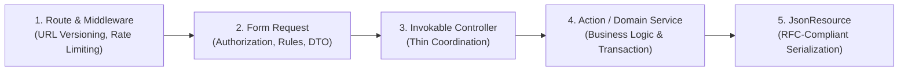

# Laravel 13 & PHP 8.5+ API Design Skill

This skill guides the design, implementation, and auditing of robust, high-performance RESTful APIs in Laravel 13 adhering to PHP 8.5+ strict typing standards.

> 📖 **Master Specification**: For complete design details, RFC 7807 error envelopes, and idempotency patterns, see **[docs/api/design.md](file:///C:/Users/SHAMIM.IT/.gemini/config/plugins/laravel/docs/api/design.md)**.

---

## 🚀 Quick Scaffolding Blueprint

When building any new API endpoint, scaffold through the canonical 5-layer API stack:



---

## 1. Routing & URL Conventions

### Standard Versioned Route Group
Declare API endpoints in `routes/api.php` using version prefixes and kebab-case URIs:

```php
use App\Http\Controllers\Api\V1\Orders\CancelOrderController;
use App\Http\Controllers\Api\V1\Orders\IndexOrderController;
use App\Http\Controllers\Api\V1\Orders\ShowOrderController;
use App\Http\Controllers\Api\V1\Orders\StoreOrderController;
use Illuminate\Support\Facades\Route;

Route::prefix('v1')
    ->name('api.v1.')
    ->middleware(['throttle:api', 'auth:sanctum'])
    ->group(function () {
        // Standard Resource endpoints (Single Action Invokables)
        Route::get('/orders', IndexOrderController::class)->name('orders.index');
        Route::post('/orders', StoreOrderController::class)->name('orders.store');
        Route::get('/orders/{order}', ShowOrderController::class)->name('orders.show');
        
        // Custom State Transitions (Kebab-case verbs)
        Route::post('/orders/{order}/cancel', CancelOrderController::class)->name('orders.cancel');
    });
```

---

## 2. Request Handling: Form Request to DTO

Controllers must never unpack raw inputs or run `$request->validate()`. Form Requests handle authorization, validation, and conversion into strongly typed DTOs:

```php
<?php

declare(strict_types=1);

namespace App\Http\Requests\Api\V1\Orders;

use App\Data\CreateOrderDto;
use App\Models\Order;
use App\Models\User;
use Illuminate\Foundation\Http\FormRequest;
use Illuminate\Validation\Rule;

final class StoreOrderRequest extends FormRequest
{
    public function authorize(): bool
    {
        /** @var User|null $user */
        $user = $this->user();
        return $user !== null && $user->can('create', Order::class);
    }

    /**
     * @return array<string, list<mixed>>
     */
    public function rules(): array
    {
        return [
            'items' => ['required', 'array', 'min:1'],
            'items.*.product_id' => ['required', 'ulid', Rule::exists('products', 'id')],
            'items.*.quantity' => ['required', 'integer', 'min:1', 'max:100'],
            'payment_token' => ['required', 'string', 'starts_with:tok_'],
        ];
    }

    public function userOrFail(): User
    {
        /** @var User|null $user */
        $user = $this->user();
        if ($user === null) {
            abort(401, 'Unauthenticated');
        }
        return $user;
    }

    public function toDto(): CreateOrderDto
    {
        /** @var array{items: list<array{product_id: string, quantity: int}>, payment_token: string} $data */
        $data = $this->validated();

        return new CreateOrderDto(
            userId: $this->userOrFail()->id,
            items: $data['items'],
            paymentToken: $data['payment_token'],
        );
    }
}
```

---

## 3. Thin Invokable Controller

```php
<?php

declare(strict_types=1);

namespace App\Http\Controllers\Api\V1\Orders;

use App\Actions\Orders\CreateOrderAction;
use App\Http\Requests\Api\V1\Orders\StoreOrderRequest;
use App\Http\Resources\Orders\OrderResource;
use Illuminate\Http\JsonResponse;
use Symfony\Component\HttpFoundation\Response;

final class StoreOrderController
{
    public function __invoke(
        StoreOrderRequest $request,
        CreateOrderAction $action,
    ): JsonResponse {
        $order = $action->execute($request->toDto());

        return OrderResource::make($order)
            ->response()
            ->setStatusCode(Response::HTTP_CREATED)
            ->header('Location', route('api.v1.orders.show', ['order' => $order->id]));
    }
}
```

---

## 4. Response Serialization: `OrderResource`

```php
<?php

declare(strict_types=1);

namespace App\Http\Resources\Orders;

use App\Models\Order;
use Illuminate\Http\Request;
use Illuminate\Http\Resources\Json\JsonResource;

/**
 * @mixin Order
 */
final class OrderResource extends JsonResource
{
    /**
     * @return array<string, mixed>
     */
    public function toArray(Request $request): array
    {
        return [
            'id' => $this->id,
            'type' => 'orders',
            'order_number' => $this->order_number,
            'status' => $this->status->value,
            'total_cents' => $this->total_cents,
            'currency' => $this->currency,
            
            // Conditional eager loading prevents N+1 queries
            'customer' => CustomerResource::make($this->whenLoaded('customer')),
            'items' => OrderItemResource::collection($this->whenLoaded('items')),
            'items_count' => $this->whenCounted('items'),
            
            // ISO-8601 standardized timestamps
            'created_at' => $this->created_at->toISOString(),
            'updated_at' => $this->updated_at->toISOString(),
        ];
    }
}
```

---

## 5. Automated API Testing with Pest 3

Always test API contracts with strict schema and status assertions:

```php
<?php

declare(strict_types=1);

use App\Models\Order;
use App\Models\Product;
use App\Models\User;
use Laravel\Sanctum\Sanctum;

describe('POST /api/v1/orders', function () {
    test('authenticated user can create an order', function () {
        $user = User::factory()->create();
        $product = Product::factory()->create(['price_cents' => 2500]);
        Sanctum::actingAs($user, ['orders:create']);

        $payload = [
            'items' => [
                ['product_id' => $product->id, 'quantity' => 2],
            ],
            'payment_token' => 'tok_visa_valid',
        ];

        $response = $this->postJson(route('api.v1.orders.store'), $payload);

        $response->assertCreated()
            ->assertHeader('Location')
            ->assertJsonStructure([
                'data' => [
                    'id',
                    'type',
                    'order_number',
                    'status',
                    'total_cents',
                    'currency',
                    'created_at',
                    'updated_at',
                ],
            ])
            ->assertJsonPath('data.total_cents', 5000);

        $this->assertDatabaseHas('orders', [
            'user_id' => $user->id,
            'total_cents' => 5000,
        ]);
    });

    test('validates required fields with 422 response', function () {
        $user = User::factory()->create();
        Sanctum::actingAs($user);

        $response = $this->postJson(route('api.v1.orders.store'), []);

        $response->assertUnprocessable()
            ->assertJsonValidationErrors(['items', 'payment_token']);
    });

    test('unauthenticated request receives 401', function () {
        $response = $this->postJson(route('api.v1.orders.store'), []);

        $response->assertUnauthorized();
    });
});
```
