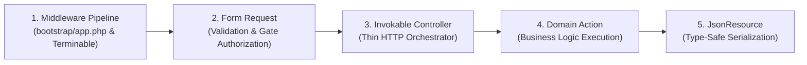

# Laravel 13 & PHP 8.5+ Controller & Middleware Skill

This skill guides the design, scaffolding, refactoring, and verification of thin controllers and high-performance middleware in Laravel 13 applications.

> 📖 **Master Specification**: For complete architectural blueprints, terminable middleware lifecycles, and Pest 3 tests, see **[docs/architecture/controllers-and-middleware.md](file:///C:/Users/SHAMIM.IT/.gemini/config/plugins/laravel/docs/architecture/controllers-and-middleware.md)**.

---

## 🚀 The Controller & Middleware Pipeline



---

## 1. Single-Action Invokable Controller Standard (`__invoke`)

Enterprise Laravel codebases standardize on Single-Action Invokables:

```php
<?php

declare(strict_types=1);

namespace App\Http\Controllers\Api\V1\Orders;

use App\Actions\Orders\CreateOrderAction;
use App\Http\Requests\Api\V1\Orders\StoreOrderRequest;
use App\Http\Resources\Orders\OrderResource;
use Illuminate\Http\JsonResponse;
use Symfony\Component\HttpFoundation\Response;

final class StoreOrderController
{
    public function __invoke(
        StoreOrderRequest $request,
        CreateOrderAction $action,
    ): JsonResponse {
        $order = $action->execute($request->toDto());

        return OrderResource::make($order)
            ->response()
            ->setStatusCode(Response::HTTP_CREATED)
            ->header('Location', route('api.v1.orders.show', ['order' => $order->id]));
    }
}
```

### The 7 Canonical Resourceful Verbs
If using resource controllers, stick strictly to the 7 verbs:
- `index()`, `create()`, `store()`, `show()`, `edit()`, `update()`, `destroy()`.
- **Never add custom verbs** (`cancel()`, `approve()`). Always create separate invokable controllers: `CancelOrderController`.

---

## 2. Middleware Configuration in `bootstrap/app.php`

In Laravel 13, all middleware is configured fluently in `bootstrap/app.php` (`app/Http/Kernel.php` is dead):

```php
use App\Http\Middleware\EnsureJsonRequest;
use App\Http\Middleware\EnsureUserHasRole;
use App\Http\Middleware\EnsureUserIsSubscribed;
use App\Http\Middleware\SecurityHeadersMiddleware;
use Illuminate\Foundation\Configuration\Middleware;

return Application::configure(basePath: dirname(__DIR__))
    // ...
    ->withMiddleware(function (Middleware $middleware): void {
        // 1. Global Middleware
        $middleware->append(SecurityHeadersMiddleware::class);
        $middleware->prepend(EnsureJsonRequest::class);

        // 2. Middleware Aliases (Clean imports at top of file)
        $middleware->alias([
            'role' => EnsureUserHasRole::class,
            'subscribed' => EnsureUserIsSubscribed::class,
        ]);

        // 3. Execution Priority
        $middleware->priority([
            EnsureJsonRequest::class,
            SecurityHeadersMiddleware::class,
            EnsureUserHasRole::class,
        ]);

        // 4. CSRF Exemptions
        $middleware->validateCsrfTokens(except: [
            'stripe/*',
            'webhooks/*',
        ]);
    });
```

---

## 3. Terminable Middleware: Zero-Latency Background Work

Avoid blocking the client's HTTP response for background tasks like logging or metric collection:

```php
<?php

declare(strict_types=1);

namespace App\Http\Middleware;

use App\Jobs\RecordMetricJob;
use Closure;
use Illuminate\Http\Request;
use Symfony\Component\HttpFoundation\Response;

final class TrackApiMetricsMiddleware
{
    private float $startTime;

    public function handle(Request $request, Closure $next): Response
    {
        $this->startTime = microtime(true);

        return $next($request);
    }

    /**
     * Executes AFTER the HTTP response has been flushed to the client.
     */
    public function terminate(Request $request, Response $response): void
    {
        $durationMs = (microtime(true) - $this->startTime) * 1000;

        RecordMetricJob::dispatch(
            endpoint: $request->path(),
            statusCode: $response->getStatusCode(),
            durationMs: $durationMs,
        );
    }
}
```

---

## 4. Parameterized Middleware: Variadic Arguments

```php
namespace App\Http\Middleware;

use Closure;
use Illuminate\Http\Request;
use Symfony\Component\HttpFoundation\Response;

final class EnsureUserHasRole
{
    public function handle(Request $request, Closure $next, string ...$roles): Response
    {
        $user = $request->user();

        if ($user === null || ! in_array($user->role->value, $roles, strict: true)) {
            abort(Response::HTTP_FORBIDDEN, 'Access denied.');
        }

        return $next($request);
    }
}
```

---

## 5. Pest 3 Architecture Boundary Tests

Enforce controller and middleware rules automatically in CI:

```php
// tests/Feature/ControllerMiddlewareArchTest.php

arch('controllers must be thin, final, and invokable')
    ->expect('App\Http\Controllers')
    ->classes()
    ->toBeFinal()
    ->toHaveSuffix('Controller')
    ->toBeInvokable();

arch('controllers must not query database directly')
    ->expect('App\Http\Controllers')
    ->not->toUse('Illuminate\Support\Facades\DB');

arch('middleware classes must implement handle method')
    ->expect('App\Http\Middleware')
    ->classes()
    ->toBeFinal()
    ->toHaveMethod('handle');
```
