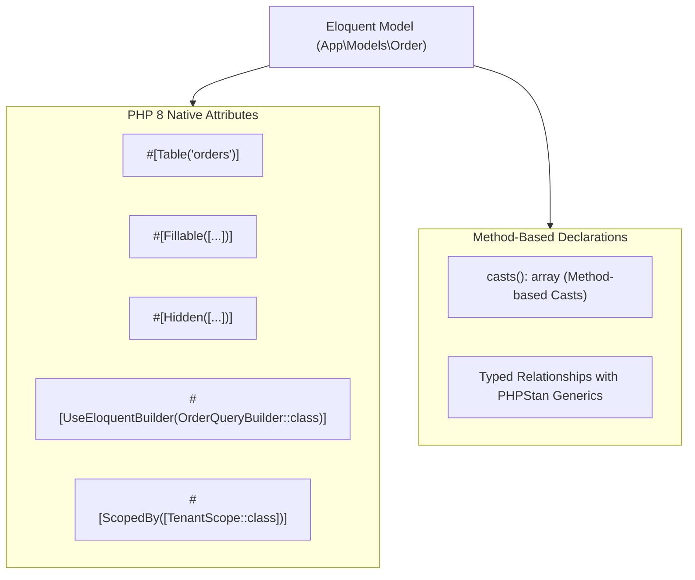
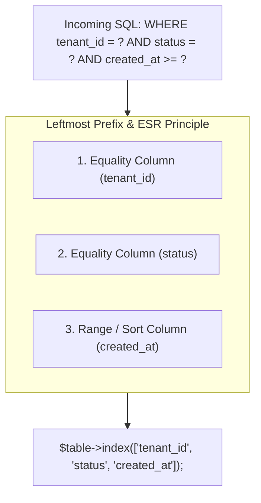

# Laravel 13 & Modern PHP 8.6+ Database Architecture, Eloquent Attributes & Indexing

This skill establishes comprehensive architectural standards for database schema design, Eloquent attribute declarations, relationship modeling, primary and foreign key strategies, and high-performance indexing in **Laravel 13** and **PHP 8.6+**.

---

## 🧭 Database Architectural Decision Matrices

### 1. Primary Key (PK) Strategy Decision Matrix

| Strategy | Primary Key Column Type | Size | Sortable? | URL-Safe? | Best Architectural Use Case |
| :--- | :--- | :--- | :--- | :--- | :--- |
| **ULID** *(Recommended)* | `$table->ulid('id')->primary()` | 128-bit (26 chars) | Yes (Millisecond time-ordered) | Yes (Base32, clean URLs) | **Default Standard**: Modern distributed SaaS, multi-tenant apps, public entity IDs. |
| **UUIDv7** | `$table->uuid('id')->primary()` | 128-bit (36 chars) | Yes (Time-ordered RFC 9562) | Yes (Hexadecimal) | Cross-system enterprise integrations (Kafka, Snowflake, external microservices). |
| **Auto-Increment BigInt** | `$table->id()` | 64-bit BigInt | Yes (Sequential integers) | No (Sequential leaks business volume) | High-throughput internal append-only tables (system logs, metrics, internal pivot tables). |
| **Composite PK** | `$table->primary(['tenant_id', 'id'])` | Varies | Varies | No (Multi-column) | Range-partitioned database tables, multi-tenant sharding, strict many-to-many pivots. |

### 2. Multi-Tenancy Architecture Decision Matrix

| Tenancy Model | Isolation Level | Complexity | Infrastructure Cost | Scalability | Best Architectural Fit |
| :--- | :--- | :--- | :--- | :--- | :--- |
| **Single DB, Scoped Column** | Low (Application level) | Low | Low (Shared pool) | High (100k+ tenants) | B2B SaaS, standard multi-tenant web platforms. |
| **Single DB, Schema-per-Tenant** | Medium (Postgres schemas) | Medium | Medium | Medium (1k–10k tenants) | Compliance requirements, isolated search paths per client. |
| **Database-per-Tenant** | Maximum (Physical separation) | High | High (Connection pools) | High (Enterprise tier) | Strict banking, healthcare (HIPAA), or government isolation. |

---

## 1. Eloquent Model Attributes & Anatomy (PHP 8.6+)

Declare all Eloquent metadata using **native PHP 8 attributes** instead of legacy protected array properties.



### Complete Canonical Model Definition

```php
<?php

declare(strict_types=1);

namespace App\Models;

use App\Builders\OrderQueryBuilder;
use App\Enums\OrderStatus;
use App\Models\Scopes\TenantScope;
use Illuminate\Database\Eloquent\Attributes\Fillable;
use Illuminate\Database\Eloquent\Attributes\Hidden;
use Illuminate\Database\Eloquent\Attributes\ScopedBy;
use Illuminate\Database\Eloquent\Attributes\Table;
use Illuminate\Database\Eloquent\Attributes\UseEloquentBuilder;
use Illuminate\Database\Eloquent\Casts\AsFluent;
use Illuminate\Database\Eloquent\Concerns\HasUlids;
use Illuminate\Database\Eloquent\Factories\HasFactory;
use Illuminate\Database\Eloquent\Model;
use Illuminate\Database\Eloquent\Relations\BelongsTo;
use Illuminate\Database\Eloquent\Relations\HasMany;
use Illuminate\Database\Eloquent\SoftDeletes;

#[Table('orders')]
#[Fillable([
    'tenant_id',
    'customer_id',
    'order_number',
    'status',
    'total_amount_cents',
    'currency',
    'metadata',
    'placed_at',
])]
#[Hidden(['internal_notes', 'gateway_payload'])]
#[UseEloquentBuilder(OrderQueryBuilder::class)]
#[ScopedBy([TenantScope::class])]
class Order extends Model
{
    use HasFactory;
    use HasUlids;
    use SoftDeletes;

    /**
     * Method-based attribute casts declaration.
     *
     * @return array<string, string|class-string>
     */
    protected function casts(): array
    {
        return [
            'status' => OrderStatus::class,
            'total_amount_cents' => 'integer',
            'metadata' => AsFluent::class,
            'placed_at' => 'immutable_datetime',
            'created_at' => 'immutable_datetime',
            'updated_at' => 'immutable_datetime',
            'deleted_at' => 'immutable_datetime',
        ];
    }

    /**
     * @return BelongsTo<Customer, $this>
     */
    public function customer(): BelongsTo
    {
        return $this->belongsTo(Customer::class, 'customer_id');
    }

    /**
     * @return HasMany<OrderItem, $this>
     */
    public function items(): HasMany
    {
        return $this->hasMany(OrderItem::class, 'order_id');
    }
}
```

---

## 2. Complete Relationship Architecture & PHPStan Generics

All Eloquent relationship methods must declare native return types and **PHPStan generic docblocks** to achieve Level 8 static analysis compliance:

| Relationship | Method Signature | Generics Annotation | Migration Definition |
| :--- | :--- | :--- | :--- |
| **BelongsTo** | `public function user(): BelongsTo` | `@return BelongsTo<User, $this>` | `$table->foreignUlid('user_id')->constrained('users');` |
| **HasOne** | `public function profile(): HasOne` | `@return HasOne<Profile, $this>` | `$table->foreignUlid('user_id')->unique()->constrained();` |
| **HasMany** | `public function orders(): HasMany` | `@return HasMany<Order, $this>` | `$table->foreignUlid('user_id')->constrained();` |
| **BelongsToMany** | `public function roles(): BelongsToMany` | `@return BelongsToMany<Role, $this>` | Pivot table: `user_id` + `role_id` composite primary |
| **HasOneThrough** | `public function history(): HasOneThrough` | `@return HasOneThrough<History, User, $this>` | Target through intermediate model |
| **HasManyThrough** | `public function payments(): HasManyThrough`| `@return HasManyThrough<Payment, Order, $this>`| Target through intermediate model |
| **MorphTo** | `public function commentable(): MorphTo` | `@return MorphTo<Model, $this>` | `$table->ulidMorphs('commentable');` |
| **MorphMany** | `public function comments(): MorphMany` | `@return MorphMany<Comment, $this>` | Target polymorphic items |

### Global Strict Mode Enforcement (`AppServiceProvider.php`)

Ensure zero un-eager-loaded relationships or silently discarded attributes in development:

```php
public function boot(): void
{
    // 1. Prevent N+1 query lazy loading in development and testing
    Model::preventLazyLoading(! app()->isProduction());

    // 2. Prevent mass-assignment silently discarding fillable attributes
    Model::preventSilentlyDiscardingAttributes(! app()->isProduction());

    // 3. Prevent accessing attributes that weren't selected in queries
    Model::preventAccessingMissingAttributes(! app()->isProduction());
}
```

---

## 3. Foreign Key (FK) Integrity & Cascades

Always specify explicit foreign keys with database-level cascade constraints in anonymous migrations:

```php
return new class extends Migration
{
    public function up(): void
    {
        Schema::create('order_items', function (Blueprint $table): void {
            $table->ulid('id')->primary();

            // Strict cascade on delete when parent order is pruned
            $table->foreignUlid('order_id')
                ->constrained('orders')
                ->cascadeOnDelete();

            // Prevent deletion of product if referenced by active line items
            $table->foreignUlid('product_id')
                ->constrained('products')
                ->restrictOnDelete();

            $table->integer('quantity');
            $table->bigInteger('unit_price_cents');
            $table->timestamps();

            // Composite index for fast order item lookups
            $table->index(['order_id', 'product_id']);
        });
    }

    public function down(): void
    {
        Schema::dropIfExists('order_items');
    }
};
```

---

## 4. Indexing Architecture & Strategy

Indexes are essential for query performance but incur a write amplification penalty. Design indexes following the **Equality-then-Range (ESR)** principle.



### 1. Composite Index Column Ordering (Leftmost Prefix Rule)
- **Column 1**: High-cardinality equality filter (e.g. `tenant_id` or `company_id`).
- **Column 2**: Secondary equality filter (e.g. `status` or `type`).
- **Column 3**: Range filter or sort order column (e.g. `created_at` or `total_amount_cents`).
- **Correct Index**: `$table->index(['tenant_id', 'status', 'created_at']);`
- **Avoid**: Putting range columns (`created_at`) *before* equality columns (`status`), which renders subsequent columns unusable by the B-Tree index scanner.

### 2. Partial / Conditional Indexes (PostgreSQL)
In tables with soft deletes or archive flags, create partial indexes that exclude soft-deleted rows:

```php
// PostgreSQL Partial Index
DB::statement('CREATE INDEX idx_orders_active_tenant ON orders (tenant_id, status) WHERE deleted_at IS NULL');
```

### 3. AI Vector Similarity Indexes (pgvector)
For vector embeddings in Laravel 13, configure HNSW (Hierarchical Navigable Small World) indexes:

```php
// PostgreSQL pgvector HNSW index for Cosine Distance
DB::statement('CREATE INDEX idx_documents_embedding ON documents USING hnsw (embedding vector_cosine_ops) WITH (m = 16, ef_construction = 64)');
```

### 4. Over-Indexing & Write Amplification Defense
- **Prohibition**: Never index low-cardinality columns (e.g., boolean `is_active`) on their own; MySQL will perform a full table scan instead of using the index.
- **Rule**: Combine low-cardinality flags into composite indexes (`index(['tenant_id', 'is_active'])`).

---

## 5. Pest 3 Architecture & Database Integrity Tests

Codify database rules in `tests/Arch/DatabaseTest.php`:

```php
declare(strict_types=1);

namespace Tests\Arch;

use Illuminate\Database\Eloquent\Model;

// 1. All models must extend Eloquent Model
arch('models extend eloquent')
    ->expect('App\Models')
    ->toExtend(Model::class);

// 2. All models must have #[Table] attribute
arch('models declare Table attribute')
    ->expect('App\Models')
    ->toHaveAttribute('Illuminate\Database\Eloquent\Attributes\Table');

// 3. Models must declare custom query builder attribute
arch('models declare UseEloquentBuilder attribute')
    ->expect('App\Models')
    ->toHaveAttribute('Illuminate\Database\Eloquent\Attributes\UseEloquentBuilder');

// 4. Query Builders must reside in App\Builders and extend Builder
arch('query builders reside in Builders and extend Eloquent Builder')
    ->expect('App\Builders')
    ->toHaveSuffix('QueryBuilder')
    ->toExtend('Illuminate\Database\Eloquent\Builder');
```
