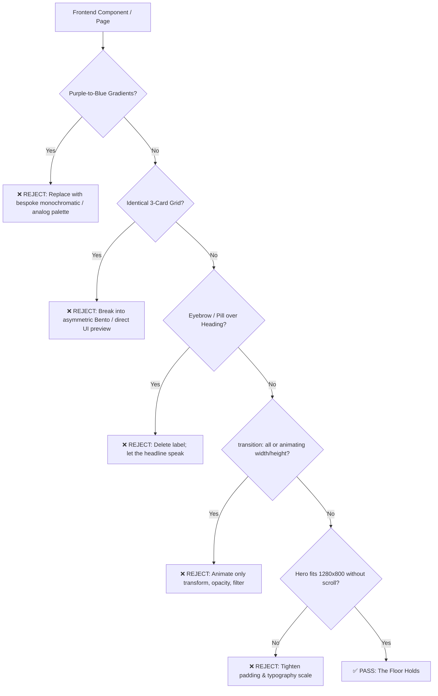

# Laravel 13 Frontend Design Craft & Anti-AI-Slop Skill

This skill transforms your Laravel 13 frontend engineering into an award-winning design-directed discipline. It incorporates the distilled principles of the three premier AI frontend design systems:

1. **Impeccable** (`pbakaus/impeccable`): Design vocabulary (`shape`, `audit`, `polish`, `bolder`, `quieter`, `typeset`, `harden`), `PRODUCT.md` & `DESIGN.md` design governance, and automated anti-pattern detection (`npx impeccable detect`).
2. **Taste Skill** (`Leonxlnx/taste-skill`): Anti-slop frontend taste (the bar is figma.com, x.ai, linear.app), business-kind driven art direction (Software/AI vs Physical Products vs Places), one-section-per-screen rhythm, and quiet micro-interactions.
3. **Hallmark** (`nutlope/hallmark`): The Hard Floor against model defaults, the Hero Viewport Invariant (headline + 1 sentence + CTA at 1280x800 without scrolling), thematic materials, and zero fake metrics or placeholder logos.

---

## 1. The Anti-AI-Slop Quality & Craft Floor

Every frontend template, view, component, and page in Laravel 13 must strictly uphold this non-negotiable floor:



### The 10 Invariant House Rules:

1. **Absolute Ban on Cliché Purple-to-Blue Gradients**:
   - `bg-gradient-to-r from-purple-600 to-blue-500` and `from-indigo-500 to-pink-500` are strictly forbidden.
   - Use intentional monochromatic palettes with subtle tonal depth, warm analog neutrals (sand, ivory, warm zinc), or bold brand-anchored contrast.
2. **Absolute Ban on Identical 3-Card Feature Grids**:
   - Do not repeat `[Icon in colored circle + H3 + 2 lines of text]` across 3 uniform cards. Cards are the lazy container; nested cards are always wrong.
   - Replace with asymmetric Bento grids, direct interactive component previews, live data tables, or editorial columns.
3. **Absolute Ban on Eyebrows and Tracked Pill Badges Above Headings**:
   - Delete formulaic labels like `[✨ AI-POWERED PLATFORM]` or `[NEW FEATURE]`.
   - The headline must carry its own semantic weight.
4. **The Hero Viewport Invariant (1280x800 & 1440x900)**:
   - The hero headline, single supporting sentence, and primary action button must be 100% visible without scrolling.
   - Maximum ~80 words in the entire initial viewport. Avoid massive empty vertical paddings (`py-32`) that push the CTA off-screen.
5. **Material Honesty (Zero Fake Proof)**:
   - Never invent testimonials, metric counts ("Trusted by 10,000+ teams", "99.99% accuracy"), or fake partner logo walls.
   - If user material is not yet provided, show the real application interface or use clearly labeled structural mockups.
6. **Strict Motion & Animation Restraint**:
   - **Never `transition: all`**. Only transition explicit GPU-accelerated properties (`transform`, `opacity`, `filter`).
   - Never animate layout triggers (`width`, `height`, `top`, `left`).
   - Always wrap CSS animations and transitions in `@media (prefers-reduced-motion: reduce)` fallbacks.
   - Motion is quiet: card hover lift `2px` (`translate-y-[-2px]`), photo zoom `1.02` inside frame, button active press `0.98` scale.
7. **Themed Browser Native Surfaces**:
   - Custom theme text selection (`::selection { background: var(--color-accent-subtle); color: var(--color-foreground); }`).
   - Theme the text input caret (`caret-color: var(--color-accent)`).
   - Theme custom scrollbars (`scrollbar-color: var(--color-border) transparent`).
   - High-contrast `:focus-visible` ring on every interactive control; never default browser blue halos.
8. **Real SVG Icons Only**:
   - Strict ban on unicode emoji or dingbats (`🚀`, `✨`, `🔥`, `💡`) serving as UI icons.
   - Use clean, single-weight SVG vector primitives from Blade icons (`<x-icon.search />`), Lucide, or Heroicons.
9. **Typography Hygiene**:
   - Body measure constrained to `65–75ch`. Display headings max `5rem` (`clamp(2.5rem, 5vw, 5rem)`).
   - Letter-spacing (tracking) floor: `-0.03em` on display headings; never negative tracking on body or captions.
   - Never mix an italic word inside a roman display heading.
10. **One Section Per Screen Rhythm**:
    - At `1440x900`, each section occupies its own purposeful viewport. No orphaned headings peeking in from the bottom edge.

---

## 2. Surface Modes Decision Matrix

Every frontend surface in Laravel 13 serves a distinct user objective. Align visual ambition to the surface mode:

| Surface Mode | Target Surfaces | Visual Character | Ambition & Expression | Canonical Example |
| :--- | :--- | :--- | :--- | :--- |
| **`Persuade`** | Landing pages, marketing, product releases, pricing | High visual tension, bold typography, authentic product UI previews, rich ambient lighting | Bold, distinctive, memorable, bespoke art direction | `pages/home/index.blade.php` |
| **`Operate`** | Admin panels, customer portals, billing dashboards, data tables | High scanability, compact padding, monospace data tables, restrained neutral chrome | Precision, clarity, low friction, established UX patterns | `pages/admin/dashboard/index.blade.php` |
| **`Read`** | Documentation, guides, changelogs, knowledge base | Optimal line length (`65ch`), generous line-height (`leading-relaxed`), structured hierarchy | Readability, calm hierarchy, zero distracting motion | `pages/docs/show.blade.php` |
| **`Experience`**| Interactive showcases, onboarding wizards, portfolios | Artifact leads from the first viewport, UI recedes into the background | Immersive, fluid, gesture-friendly | `pages/onboarding/wizard.blade.php` |

---

## 3. Business Kind Drives the Art Direction

In accordance with `Leonxlnx/taste-skill`, the client's business category dictates the layout and media strategy:

### 1. Software, SaaS & AI Tools (`site-kind: software`)
- **Visual Anchor**: Real product UI, high-fidelity app previews, interactive sandbox components.
- **Graphic Elements**: Clean vector system diagrams (inputs $\rightarrow$ processor $\rightarrow$ parallel queues with pulse indicators).
- **Tone**: Modern minimal, technical, dark or crisp neutral themes. Subtle glass/glow only when representing real compute or data flow.

### 2. Physical Products & Hardware (`site-kind: product`)
- **Visual Anchor**: High-resolution studio photography of the physical object (2+ photos per screen).
- **Graphic Elements**: Technical specs tables, dimensional blueprints, exploded diagrams.
- **Tone**: Tactile, material-focused, restrained editorial typography.

### 3. Hospitality, Food & Local Places (`site-kind: place`)
- **Visual Anchor**: Authentic environmental photography (the dining room, the counter, the landscape). 12–20 photos across the full page.
- **Graphic Elements**: Large typographic moments (address, hours, signature dish), visit & booking block on screen 2.
- **Strict Prohibition**: Zero tech effects, zero WebGL shaders, zero animated particle loops.

---

## 4. Laravel 13 Multi-Stack Implementation Patterns

### Pattern A: Modern Blade Component with Authored Hover & Focus States

```blade
{{-- resources/views/components/ui/card.blade.php --}}
@props([
    'variant' => 'default',
    'as' => 'div',
])

@php
$baseClasses = 'relative rounded-xl border p-6 transition-all duration-200 focus-within:ring-2 focus-within:ring-accent focus-within:ring-offset-2';

$variants = [
    'default' => 'border-zinc-800 bg-zinc-900/60 text-zinc-100 hover:border-zinc-700 hover:-translate-y-0.5 shadow-sm hover:shadow-md',
    'subtle'  => 'border-zinc-800/60 bg-transparent text-zinc-200 hover:bg-zinc-900/40',
    'accent'  => 'border-accent/30 bg-accent/5 text-zinc-100 hover:border-accent/50',
];

$classes = $baseClasses . ' ' . ($variants[$variant] ?? $variants['default']);
@endphp

<{{ $as }} {{ $attributes->merge(['class' => $classes]) }}>
    {{ $slot }}
</{{ $as }}>
```

### Pattern B: Livewire v4 Anti-Slop Component with Streamlined State

```php
declare(strict_types=1);

namespace App\Livewire\Customer;

use App\Enums\InvoiceStatus;
use App\Models\Invoice;
use Illuminate\Contracts\View\View;
use Illuminate\Database\Eloquent\Collection;
use Livewire\Attributes\Computed;
use Livewire\Attributes\Locked;
use Livewire\Component;

final class InvoiceLedger extends Component
{
    #[Locked]
    public string $tenantId;

    public string $search = '';
    public string $statusFilter = 'all';

    /**
     * @return Collection<int, Invoice>
     */
    #[Computed]
    public function invoices(): Collection
    {
        return Invoice::query()
            ->where('tenant_id', $this->tenantId)
            ->when($this->statusFilter !== 'all', fn ($q) => $q->where('status', $this->statusFilter))
            ->when($this->search !== '', fn ($q) => $q->where('reference', 'like', "%{$this->search}%"))
            ->orderBy('issued_at', 'desc')
            ->take(20)
            ->get();
    }

    public function render(): View
    {
        return view('pages.customer.invoices.ledger');
    }
}
```

```blade
{{-- resources/views/pages/customer/invoices/ledger.blade.php --}}
<div class="space-y-6">
    <div class="flex items-center justify-between gap-4">
        <div>
            <h1 class="text-2xl font-semibold tracking-tight text-zinc-100">Invoices</h1>
            <p class="text-sm text-zinc-400 mt-1">Review your billing history and download tax statements.</p>
        </div>
        <div class="flex items-center gap-3">
            <input 
                type="search" 
                wire:model.live.debounce.300ms="search" 
                placeholder="Search reference..."
                class="rounded-lg border border-zinc-700 bg-zinc-900 px-3 py-1.5 text-sm text-zinc-100 placeholder-zinc-500 focus:border-accent focus:outline-none focus:ring-1 focus:ring-accent"
            />
        </div>
    </div>

    {{-- Data Table: Restrained, Scanable (Operate Mode) --}}
    <div class="overflow-hidden rounded-xl border border-zinc-800 bg-zinc-900/50">
        <table class="w-full text-left text-sm">
            <thead class="border-b border-zinc-800 bg-zinc-900/80 text-xs uppercase tracking-wider text-zinc-400 font-mono">
                <tr>
                    <th class="px-6 py-3">Reference</th>
                    <th class="px-6 py-3">Issued Date</th>
                    <th class="px-6 py-3">Status</th>
                    <th class="px-6 py-3 text-right">Amount</th>
                </tr>
            </thead>
            <tbody class="divide-y divide-zinc-800/60 font-sans">
                @forelse ($this->invoices as $invoice)
                    <tr class="transition-colors hover:bg-zinc-800/30" wire:key="invoice-{{ $invoice->id }}">
                        <td class="px-6 py-4 font-mono font-medium text-zinc-200">{{ $invoice->reference }}</td>
                        <td class="px-6 py-4 text-zinc-400">{{ $invoice->issued_at->format('M d, Y') }}</td>
                        <td class="px-6 py-4">
                            <span class="inline-flex items-center px-2 py-0.5 rounded text-xs font-medium {{ $invoice->status->badgeClasses() }}">
                                {{ $invoice->status->label() }}
                            </span>
                        </td>
                        <td class="px-6 py-4 text-right font-mono font-medium text-zinc-100">
                            {{ $invoice->formattedAmount() }}
                        </td>
                    </tr>
                @empty
                    <tr>
                        <td colspan="4" class="px-6 py-12 text-center text-zinc-500">
                            No invoices match your criteria.
                        </td>
                    </tr>
                @endforelse
            </tbody>
        </table>
    </div>
</div>
```

### Pattern C: Inertia.js v3 Vue 3 TypeScript Hero Section (Anti-AI-Slop)

```vue
<!-- resources/js/pages/home/Hero.vue -->
<script setup lang="ts">
import { Link } from '@inertiajs/vue3';

interface Props {
  headline: string;
  subheadline: string;
  ctaText: string;
  ctaHref: string;
}

defineProps<Props>();
</script>

<template>
  <section class="relative min-h-[85vh] flex items-center justify-center overflow-x-clip px-6 py-12 md:py-16">
    <div class="mx-auto max-w-5xl text-center">
      <!-- Clean, Impactful Display Heading (No Eyebrow Cliché, No Gradient Text) -->
      <h1 class="text-4xl font-semibold tracking-tight text-zinc-100 sm:text-6xl md:text-7xl lg:leading-[1.1] text-balance">
        {{ headline }}
      </h1>

      <!-- One Crisp Sentence (Under 80 Words Total Viewport) -->
      <p class="mx-auto mt-6 max-w-2xl text-lg text-zinc-400 sm:text-xl text-pretty leading-relaxed">
        {{ subheadline }}
      </p>

      <!-- Primary Action: Visible at 1280x800 Without Scrolling -->
      <div class="mt-8 flex flex-wrap items-center justify-center gap-4">
        <Link 
          :href="ctaHref" 
          class="inline-flex items-center justify-center rounded-lg bg-zinc-100 px-6 py-3 text-sm font-medium text-zinc-900 transition-all duration-150 hover:bg-white hover:-translate-y-0.5 active:translate-y-0 active:scale-[0.98] focus-visible:outline focus-visible:outline-2 focus-visible:outline-offset-2 focus-visible:outline-white"
        >
          {{ ctaText }}
        </Link>
        <a 
          href="#preview" 
          class="inline-flex items-center justify-center rounded-lg border border-zinc-800 bg-zinc-900/60 px-6 py-3 text-sm font-medium text-zinc-300 transition-colors hover:border-zinc-700 hover:text-zinc-100 focus-visible:outline focus-visible:outline-2 focus-visible:outline-offset-2 focus-visible:outline-zinc-500"
        >
          Explore Live Engine
        </a>
      </div>

      <!-- Real Product UI Preview (Anchors the Viewport) -->
      <div class="mt-12 rounded-2xl border border-zinc-800 bg-zinc-900/40 p-2 shadow-2xl backdrop-blur-sm sm:p-4">
        <div class="aspect-[16/9] w-full rounded-xl border border-zinc-800/80 bg-zinc-950 flex items-center justify-center text-zinc-600 font-mono text-sm">
          [Interactive Terminal & Architecture Pipeline Preview]
        </div>
      </div>
    </div>
  </section>
</template>
```

---

## 5. Design Governance CLI Tools (`impeccable`, `hallmark`, `taste-skill`)

Antigravity provides direct command integration to audit and refine your Laravel views and components:

```bash
# 1. Run Impeccable Anti-Pattern Detection across views
npx impeccable detect resources/views/

# 2. Audit a specific Blade or Inertia page
npx impeccable audit resources/views/pages/home/index.blade.php

# 3. Shape a new feature before writing templates
npx impeccable shape "Subscription checkout with invoice selector"

# 4. Polish typography, rhythm, and tone
npx impeccable polish resources/views/pages/admin/dashboard/index.blade.php

# 5. Check UI with Hallmark sloplint
node ~/.gemini/config/skills/hallmark/scripts/sloplint.mjs resources/views/pages/home/index.blade.php --render
```

---

## 6. Automated Pest 3 Architecture Tests

Enforce design craft boundaries in `tests/Arch/FrontendDesignTest.php`:

```php
<?php

declare(strict_types=1);

test('blade views do not contain forbidden anti-pattern classes')
    ->expect('resources/views')
    ->not->toUse([
        'bg-gradient-to-r from-purple',
        'from-purple-600 to-blue-500',
        'transition-all',
    ]);

test('svg icon primitives exist and are organized')
    ->expect('resources/views/components/icon')
    ->toHaveFiles();
```
