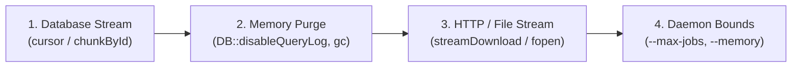

# Laravel 13 & PHP 8.5+ Memory Safety & Leak Prevention Skill

This skill guides the design, auditing, and optimization of memory-safe code in Laravel 13 applications, especially in long-running environments like **Laravel Octane (FrankenPHP / Swoole / RoadRunner)**, Horizon, and Queue Workers.

> 📖 **Master Specification**: For in-depth guidelines, benchmarks, and Pest 3 arch tests, see **[docs/architecture/memory-safety-and-performance.md](file:///C:/Users/SHAMIM.IT/.gemini/config/plugins/laravel/docs/architecture/memory-safety-and-performance.md)**.

---

## 🚀 Quick Memory Defense Blueprint



---

## 1. Large Database Query Safety: $O(1)$ Memory

### A. Reading with `cursor()` (Lazy Collections)
Never load 100,000 models with `->get()` or `Model::all()`. Stream records 1-by-1 using unbuffered PDO cursors:

```php
use App\Models\Order;
use Illuminate\Support\LazyCollection;
use NoDiscard;

#[NoDiscard]
public function getPendingOrders(): LazyCollection
{
    // Flat ~15MB RAM consumption regardless of row count
    return Order::query()
        ->where('status', OrderStatus::Pending)
        ->cursor();
}
```

### B. Mutating with `chunkById()` (Never `chunk()`)
Avoid the "Page Shifting Bug" where updating rows during pagination causes subsequent pages to be skipped:

```php
Order::query()
    ->where('status', OrderStatus::Pending)
    ->chunkById(500, function ($orders): void {
        foreach ($orders as $order) {
            $order->update(['status' => OrderStatus::Processing]);
        }
    });
```

### C. Disable Query Logging in Long Batches
```php
use Illuminate\Support\Facades\DB;

// Disable to prevent Laravel from storing every SQL query in RAM
DB::disableQueryLog();
```

---

## 2. Laravel Octane & FrankenPHP State Safety

In Octane, the application lives across requests. Storing state in static properties or singletons causes memory bloat and cross-user data leakage.

### A. Never Store Request State in Static Properties
```php
// ❌ Dangerous Octane Anti-Pattern
final class SecurityContext
{
    private static ?User $user = null; // Leaks between requests!
}

// ✅ Correct: Bind per-request or use Octane request context
```

### B. Use `WeakMap` for Object Caching
`WeakMap` allows garbage collection of cached keys as soon as the object is unset:

```php
namespace App\Support;

use App\Models\User;
use WeakMap;

final class UserPermissionCache
{
    /** @var WeakMap<User, array<string, bool>> */
    private WeakMap $cache;

    public function __construct()
    {
        $this->cache = new WeakMap();
    }

    public function get(User $user, string $permission): bool
    {
        return $this->cache[$user][$permission] ?? false;
    }

    public function set(User $user, string $permission, bool $value): void
    {
        $permissions = $this->cache[$user] ?? [];
        $permissions[$permission] = $value;
        $this->cache[$user] = $permissions;
    }
}
```

---

## 3. Zero-Memory File Streaming

### A. Streaming CSV Exports with `streamDownload()`
Stream data directly to the HTTP output buffer (`php://output`) without allocating memory for the file:

```php
namespace App\Http\Controllers\Api\V1\Orders;

use App\Models\Order;
use Symfony\Component\HttpFoundation\StreamedResponse;

final class ExportOrdersCsvController
{
    public function __invoke(): StreamedResponse
    {
        return response()->streamDownload(function (): void {
            $handle = fopen('php://output', 'w');
            if ($handle === false) {
                return;
            }

            fputcsv($handle, ['ID', 'Order Number', 'Total Cents', 'Status']);

            Order::query()
                ->select(['id', 'order_number', 'total_cents', 'status'])
                ->cursor()
                ->each(function (Order $order) use ($handle): void {
                    fputcsv($handle, [
                        $order->id,
                        $order->order_number,
                        $order->total_cents,
                        $order->status->value,
                    ]);
                });

            fclose($handle);
        }, 'orders.csv', ['Content-Type' => 'text/csv']);
    }
}
```

---

## 4. Cyclic Garbage Collection in Batch Workers

When processing hundreds of thousands of models in CLI jobs, break circular references and invoke cycle collection:

```php
$count = 0;

Order::query()->chunkById(1000, function ($orders) use (&$count): void {
    foreach ($orders as $order) {
        $this->process($order);
        $count++;
    }

    // Force cyclic collection every 5,000 items
    if ($count % 5000 === 0) {
        gc_collect_cycles();
        gc_mem_caches();
    }
});
```

---

## 5. Queue Worker Production Flags

Always safeguard queue workers with hard memory and time limits:

```bash
php artisan queue:work redis \
    --max-jobs=1000 \
    --max-time=3600 \
    --memory=512 \
    --tries=3
```
