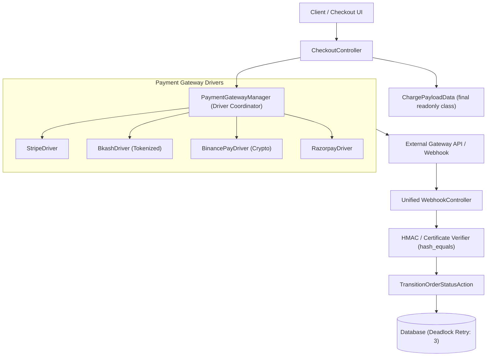
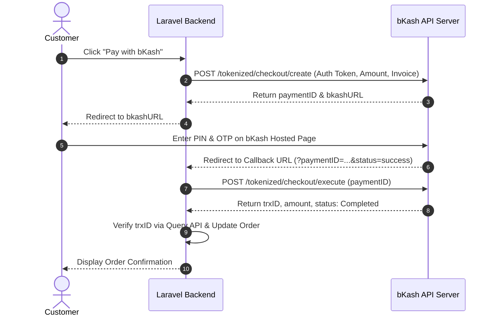
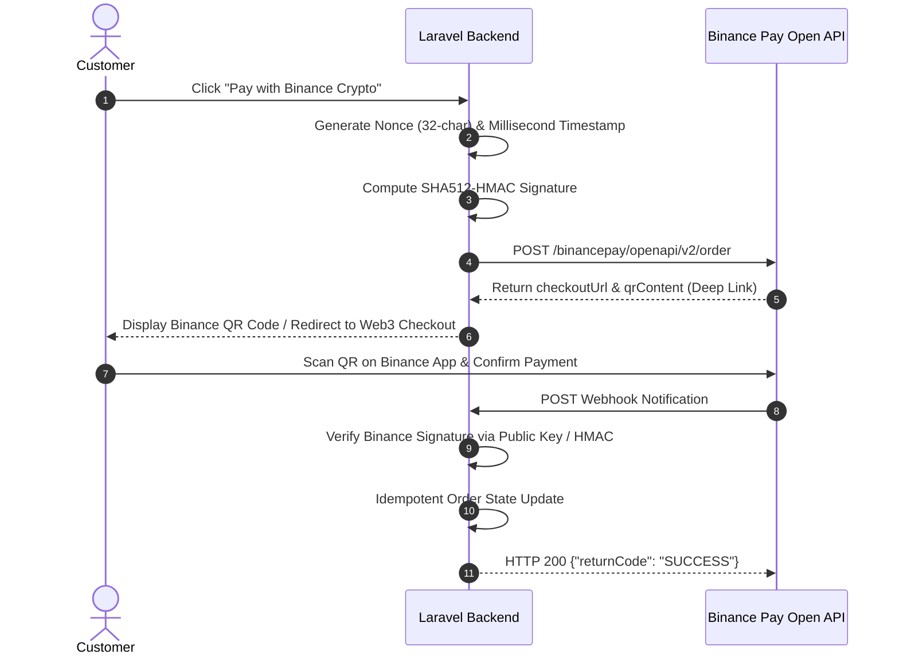
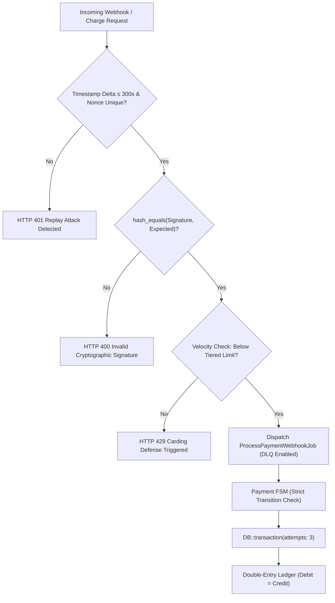
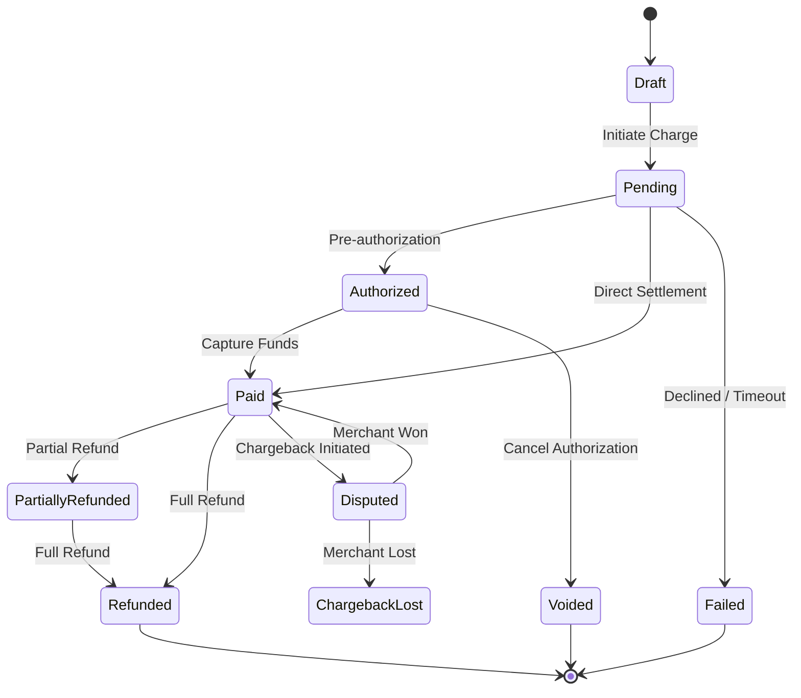
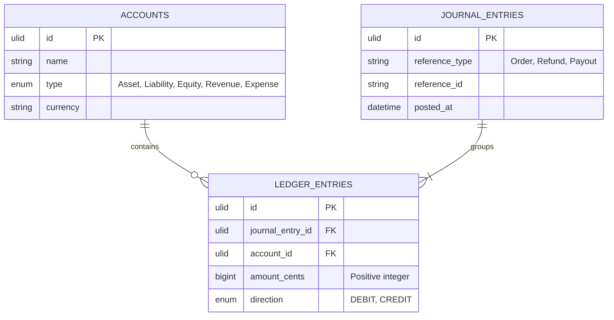

# Laravel 13 & Modern PHP 8.6+ Payment Gateway Architecture & Fintech Integrations

This skill provides an enterprise-grade, multi-driver architecture for integrating global and regional payment gateways into **Laravel 13** and **PHP 8.6+** applications. It establishes rigorous standards for **bKash Tokenized Checkout**, **Binance Pay (Crypto)**, and the **Top 10 Global Payment Gateways** with strict cryptographic signature verification, atomic idempotency locks, and PCI-DSS compliance.

---

## 🧭 The Top 10 Payment Gateways Matrix

| # | Gateway | Category / Region | Primary Rails | Key Security Protocol | Webhook Verification |
| :-: | :--- | :--- | :--- | :--- | :--- |
| **1** | **Stripe** | Global Leader | Credit/Debit Cards, Apple Pay, SEPA, Klarna | PCI-DSS SAQ A, 3D Secure 2 (SCA) | HMAC-SHA256 (`Stripe-Signature`) |
| **2** | **bKash** | South Asia / MFS Leader | Mobile Financial Services, Digital Wallet | Tokenized Checkout (Grant/Refresh Token) | Asymmetric Token + Payment Status Query |
| **3** | **Binance Pay** | Global Crypto Web3 | USDT, BTC, ETH, BNB (300+ Crypto) | SHA512-HMAC + Timestamp/Nonce Non-repudiation | Public Key Certificate / SHA512-HMAC |
| **4** | **PayPal / Braintree** | Global Wallets & Cards | PayPal Balance, Venmo, Pay in 4, Cards | OAuth 2.0 Bearer, Vault Tokenization | Webhook ID & CRC32/RSA Signature |
| **5** | **Razorpay** | India / APAC Leader | UPI, Netbanking, Credit Cards, BharatQR | PCI-DSS Level 1, Mandatory Order IDs | HMAC-SHA256 (`X-Razorpay-Signature`) |
| **6** | **Paddle** | Global SaaS Merchant of Record | Cards, PayPal, Wire Transfer, Global VAT | MoR Compliance, Tax Automation | Ed25519 or RSA-SHA256 Signatures |
| **7** | **Mollie** | Europe (iDEAL, Bancontact) | SEPA, iDEAL, Bancontact, Cartes Bancaires | European PSD2 / SCA Compliance | Idempotent Webhook Ping (`id` verification) |
| **8** | **Adyen** | Global Enterprise Omnichannel | 250+ Local Payment Methods, Global Cards | Point-of-Sale & Online Unified Commerce | HMAC-SHA256 Signature Calculation |
| **9** | **Square** | SMB & Unified POS / Web | In-person Terminal, Cards, Cash App Pay | OAuth 2.0, End-to-End Encryption | SHA256-HMAC (`x-square-hmacsha256-signature`) |
| **10**| **SSLCommerz** | Bangladesh Multi-Gateway | Cards (Visa/Mastercard/Amex), MFS (Nagad/Rocket)| 3D Secure, Dual-token IPN validation | MD5/SHA256 Validation Hash Query |

---

## 1. Unified Multi-Driver Payment Gateway Architecture

Use Laravel's native **Manager Pattern** to switch seamlessly between payment gateways via configuration (`config/payments.php`).



### Payment Contract (`app/Contracts/Payments/PaymentGatewayInterface.php`)

```php
<?php

declare(strict_types=1);

namespace App\Contracts\Payments;

use App\Data\Payments\ChargePayloadData;
use App\Data\Payments\PaymentResponseData;
use App\Data\Payments\RefundPayloadData;
use App\Data\Payments\RefundResponseData;
use Illuminate\Http\Request;

interface PaymentGatewayInterface
{
    /**
     * Initiate a charge or generate a checkout redirect / QR payload.
     */
    public function charge(ChargePayloadData $payload): PaymentResponseData;

    /**
     * Verify and process incoming webhook payload from the gateway.
     */
    public function handleWebhook(Request $request): PaymentResponseData;

    /**
     * Execute a partial or full refund.
     */
    public function refund(RefundPayloadData $payload): RefundResponseData;

    /**
     * Query gateway transaction status directly (out-of-band verification).
     */
    public function query(string $transactionId): PaymentResponseData;
}
```

---

## 2. bKash Tokenized Checkout Integration Blueprint

bKash Tokenized Checkout (v1.2.0-beta) enables one-time payments and recurring token agreements in Bangladesh without exposing credentials.



### Concrete bKash Driver (`app/Services/Payments/Drivers/BkashDriver.php`)

```php
<?php

declare(strict_types=1);

namespace App\Services\Payments\Drivers;

use App\Contracts\Payments\PaymentGatewayInterface;
use App\Data\Payments\ChargePayloadData;
use App\Data\Payments\PaymentResponseData;
use App\Data\Payments\RefundPayloadData;
use App\Data\Payments\RefundResponseData;
use App\Enums\PaymentStatus;
use Illuminate\Http\Client\Factory as HttpFactory;
use Illuminate\Http\Request;
use Illuminate\Support\Facades\Cache;
use RuntimeException;

final readonly class BkashDriver implements PaymentGatewayInterface
{
    private string $baseUrl;

    public function __construct(
        private HttpFactory $http,
        private string $appKey,
        private string $appSecret,
        private string $username,
        private string $password,
        bool $sandbox = false,
    ) {
        $this->baseUrl = $sandbox 
            ? 'https://tokenized.sandbox.bka.sh/v1.2.0-beta' 
            : 'https://tokenized.pay.bka.sh/v1.2.0-beta';
    }

    #[\Override]
    public function charge(ChargePayloadData $payload): PaymentResponseData
    {
        $token = $this->grantToken();

        $response = $this->http->baseUrl($this->baseUrl)
            ->withHeaders([
                'Authorization' => $token,
                'X-APP-Key' => $this->appKey,
                'Content-Type' => 'application/json',
            ])
            ->post('/tokenized/checkout/create', [
                'mode' => '0011',
                'payerReference' => $payload->customerPhone ?? 'N/A',
                'callbackURL' => route('payments.bkash.callback'),
                'amount' => number_format($payload->amountCents / 100, 2, '.', ''),
                'currency' => 'BDT',
                'intent' => 'sale',
                'merchantInvoiceNumber' => $payload->orderId,
            ])
            ->throw()
            ->json();

        return new PaymentResponseData(
            transactionId: $response['paymentID'],
            status: PaymentStatus::Pending,
            redirectUrl: $response['bkashURL'],
            raw: $response,
        );
    }

    /**
     * Execute the bKash payment after customer authorizes with PIN/OTP.
     */
    public function execute(string $paymentId): PaymentResponseData
    {
        $token = $this->grantToken();

        $response = $this->http->baseUrl($this->baseUrl)
            ->withHeaders([
                'Authorization' => $token,
                'X-APP-Key' => $this->appKey,
                'Content-Type' => 'application/json',
            ])
            ->post('/tokenized/checkout/execute', [
                'paymentID' => $paymentId,
            ])
            ->throw()
            ->json();

        $statusCode = $response['statusCode'] ?? '';
        $isSuccessful = $statusCode === '0000' && ($response['transactionStatus'] ?? '') === 'Completed';

        return new PaymentResponseData(
            transactionId: $response['trxID'] ?? $paymentId,
            status: $isSuccessful ? PaymentStatus::Paid : PaymentStatus::Failed,
            redirectUrl: null,
            raw: $response,
        );
    }

    #[\Override]
    public function query(string $transactionId): PaymentResponseData
    {
        $token = $this->grantToken();

        $response = $this->http->baseUrl($this->baseUrl)
            ->withHeaders([
                'Authorization' => $token,
                'X-APP-Key' => $this->appKey,
            ])
            ->post('/tokenized/checkout/payment/status', [
                'paymentID' => $transactionId,
            ])
            ->throw()
            ->json();

        $isCompleted = ($response['transactionStatus'] ?? '') === 'Completed';

        return new PaymentResponseData(
            transactionId: $response['trxID'] ?? $transactionId,
            status: $isCompleted ? PaymentStatus::Paid : PaymentStatus::Failed,
            redirectUrl: null,
            raw: $response,
        );
    }

    #[\Override]
    public function handleWebhook(Request $request): PaymentResponseData
    {
        $paymentId = $request->string('paymentID')->toString();
        return $this->query($paymentId);
    }

    #[\Override]
    public function refund(RefundPayloadData $payload): RefundResponseData
    {
        $token = $this->grantToken();

        $response = $this->http->baseUrl($this->baseUrl)
            ->withHeaders([
                'Authorization' => $token,
                'X-APP-Key' => $this->appKey,
            ])
            ->post('/tokenized/checkout/payment/refund', [
                'paymentID' => $payload->paymentId,
                'amount' => number_format($payload->amountCents / 100, 2, '.', ''),
                'trxID' => $payload->transactionId,
                'sku' => $payload->reason ?? 'Refund',
            ])
            ->throw()
            ->json();

        return new RefundResponseData(
            refundId: $response['refundTrxID'] ?? '',
            status: ($response['statusCode'] ?? '') === '0000',
            raw: $response,
        );
    }

    /**
     * Retrieve or refresh bKash access token with atomic Redis caching.
     */
    private function grantToken(): string
    {
        return Cache::remember('bkash_token', now()->addMinutes(50), function (): string {
            $response = $this->http->baseUrl($this->baseUrl)
                ->withHeaders([
                    'username' => $this->username,
                    'password' => $this->password,
                ])
                ->post('/tokenized/checkout/token/grant', [
                    'app_key' => $this->appKey,
                    'app_secret' => $this->appSecret,
                ])
                ->throw()
                ->json();

            return $response['id_token'] ?? throw new RuntimeException('Failed to retrieve bKash id_token.');
        });
    }
}
```

---

## 3. Binance Pay (Cryptocurrency Web3) Integration Blueprint

Binance Pay is a contactless, borderless cryptocurrency payment gateway supporting instant settlements in USDT, BTC, ETH, and 300+ crypto pairs.



### Concrete Binance Pay Driver (`app/Services/Payments/Drivers/BinancePayDriver.php`)

```php
<?php

declare(strict_types=1);

namespace App\Services\Payments\Drivers;

use App\Contracts\Payments\PaymentGatewayInterface;
use App\Data\Payments\ChargePayloadData;
use App\Data\Payments\PaymentResponseData;
use App\Data\Payments\RefundPayloadData;
use App\Data\Payments\RefundResponseData;
use App\Enums\PaymentStatus;
use Illuminate\Http\Client\Factory as HttpFactory;
use Illuminate\Http\Request;
use Illuminate\Support\Str;
use RuntimeException;

final readonly class BinancePayDriver implements PaymentGatewayInterface
{
    private string $baseUrl;

    public function __construct(
        private HttpFactory $http,
        private string $apiKey,
        private string $secretKey,
        bool $sandbox = false,
    ) {
        $this->baseUrl = $sandbox 
            ? 'https://bpay.binanceapi.com' 
            : 'https://bpay.binanceapi.com';
    }

    #[\Override]
    public function charge(ChargePayloadData $payload): PaymentResponseData
    {
        $endpoint = '/binancepay/openapi/v2/order';
        $body = [
            'env' => [
                'terminalType' => 'WEB',
            ],
            'merchantTradeNo' => $payload->orderId,
            'orderAmount' => number_format($payload->amountCents / 100, 2, '.', ''),
            'currency' => $payload->currency ?? 'USDT',
            'goods' => [
                'goodsType' => '02', // Virtual goods / digital checkout
                'goodsCategory' => 'Z000',
                'referenceGoodsId' => $payload->orderId,
                'goodsName' => 'Order #' . $payload->orderId,
            ],
            'returnUrl' => route('payments.binance.success', ['order' => $payload->orderId]),
            'cancelUrl' => route('payments.binance.cancel', ['order' => $payload->orderId]),
        ];

        $jsonPayload = json_encode($body, JSON_THROW_ON_ERROR);
        $headers = $this->generateHeaders($jsonPayload);

        $response = $this->http->baseUrl($this->baseUrl)
            ->withHeaders($headers)
            ->withBody($jsonPayload, 'application/json')
            ->post($endpoint)
            ->throw()
            ->json();

        if (($response['status'] ?? '') !== 'SUCCESS') {
            throw new RuntimeException("Binance Pay Error: " . ($response['errorMessage'] ?? 'Unknown'));
        }

        $data = $response['data'];

        return new PaymentResponseData(
            transactionId: (string) $data['prepayId'],
            status: PaymentStatus::Pending,
            redirectUrl: $data['checkoutUrl'],
            raw: $data,
        );
    }

    #[\Override]
    public function handleWebhook(Request $request): PaymentResponseData
    {
        // 1. Verify Binance Webhook Signature
        $timestamp = $request->header('BinancePay-Timestamp', '');
        $nonce = $request->header('BinancePay-Nonce', '');
        $signature = $request->header('BinancePay-Signature', '');
        $rawPayload = $request->getContent();

        $payloadToSign = $timestamp . "\n" . $nonce . "\n" . $rawPayload . "\n";
        $computedSignature = strtoupper(hash_hmac('sha512', $payloadToSign, $this->secretKey));

        if (! hash_equals($computedSignature, $signature)) {
            throw new RuntimeException('Invalid Binance Pay webhook signature.');
        }

        $data = $request->json('data');
        $bizStatus = $data['bizStatus'] ?? '';

        return new PaymentResponseData(
            transactionId: (string) ($data['merchantTradeNo'] ?? ''),
            status: $bizStatus === 'PAY_SUCCESS' ? PaymentStatus::Paid : PaymentStatus::Failed,
            redirectUrl: null,
            raw: $data,
        );
    }

    #[\Override]
    public function query(string $transactionId): PaymentResponseData
    {
        $endpoint = '/binancepay/openapi/v2/order/query';
        $body = ['merchantTradeNo' => $transactionId];
        $jsonPayload = json_encode($body, JSON_THROW_ON_ERROR);

        $response = $this->http->baseUrl($this->baseUrl)
            ->withHeaders($this->generateHeaders($jsonPayload))
            ->withBody($jsonPayload, 'application/json')
            ->post($endpoint)
            ->throw()
            ->json();

        $data = $response['data'];
        $isSuccess = ($data['status'] ?? '') === 'PAID';

        return new PaymentResponseData(
            transactionId: (string) $data['merchantTradeNo'],
            status: $isSuccess ? PaymentStatus::Paid : PaymentStatus::Pending,
            redirectUrl: null,
            raw: $data,
        );
    }

    #[\Override]
    public function refund(RefundPayloadData $payload): RefundResponseData
    {
        $endpoint = '/binancepay/openapi/v1/refund/order';
        $body = [
            'refundRequestId' => Str::ulid()->toBase32(),
            'prepayId' => $payload->transactionId,
            'refundAmount' => number_format($payload->amountCents / 100, 2, '.', ''),
            'refundReason' => $payload->reason ?? 'Customer Refund Request',
        ];

        $jsonPayload = json_encode($body, JSON_THROW_ON_ERROR);

        $response = $this->http->baseUrl($this->baseUrl)
            ->withHeaders($this->generateHeaders($jsonPayload))
            ->withBody($jsonPayload, 'application/json')
            ->post($endpoint)
            ->throw()
            ->json();

        return new RefundResponseData(
            refundId: (string) ($response['data']['refundId'] ?? ''),
            status: ($response['status'] ?? '') === 'SUCCESS',
            raw: $response,
        );
    }

    /**
     * Generate Binance Pay Non-Repudiation Authentication Headers.
     *
     * @return array<string, string>
     */
    private function generateHeaders(string $jsonPayload): array
    {
        $timestamp = (string) (int) (microtime(true) * 1000);
        $nonce = Str::random(32);
        $payloadToSign = $timestamp . "\n" . $nonce . "\n" . $jsonPayload . "\n";
        $signature = strtoupper(hash_hmac('sha512', $payloadToSign, $this->secretKey));

        return [
            'Content-Type' => 'application/json',
            'BinancePay-Timestamp' => $timestamp,
            'BinancePay-Nonce' => $nonce,
            'BinancePay-Certificate-SN' => $this->apiKey,
            'BinancePay-Signature' => $signature,
        ];
    }
}
```

---

## 4. Stripe, Razorpay & PayPal Driver Blueprints

### Stripe Driver (`app/Services/Payments/Drivers/StripeDriver.php`)

```php
<?php

declare(strict_types=1);

namespace App\Services\Payments\Drivers;

use App\Contracts\Payments\PaymentGatewayInterface;
use App\Data\Payments\ChargePayloadData;
use App\Data\Payments\PaymentResponseData;
use App\Data\Payments\RefundPayloadData;
use App\Data\Payments\RefundResponseData;
use App\Enums\PaymentStatus;
use Illuminate\Http\Request;
use Stripe\Exception\SignatureVerificationException;
use Stripe\PaymentIntent;
use Stripe\Refund;
use Stripe\Stripe;
use Stripe\Webhook;
use Symfony\Component\HttpKernel\Exception\BadRequestHttpException;

final readonly class StripeDriver implements PaymentGatewayInterface
{
    public function __construct(
        private string $secretKey,
        private string $webhookSecret,
    ) {
        Stripe::setApiKey($this->secretKey);
    }

    #[\Override]
    public function charge(ChargePayloadData $payload): PaymentResponseData
    {
        $intent = PaymentIntent::create([
            'amount' => $payload->amountCents,
            'currency' => strtolower($payload->currency ?? 'usd'),
            'metadata' => [
                'order_id' => $payload->orderId,
            ],
            'automatic_payment_methods' => ['enabled' => true],
        ]);

        return new PaymentResponseData(
            transactionId: $intent->id,
            status: PaymentStatus::Pending,
            redirectUrl: null, // Client secret used by Stripe Elements
            raw: $intent->toArray(),
        );
    }

    #[\Override]
    public function handleWebhook(Request $request): PaymentResponseData
    {
        $signature = $request->header('Stripe-Signature', '');
        $payload = $request->getContent();

        try {
            $event = Webhook::constructEvent($payload, $signature, $this->webhookSecret);
        } catch (SignatureVerificationException $e) {
            throw new BadRequestHttpException('Invalid Stripe webhook signature.', $e);
        }

        $status = match ($event->type) {
            'payment_intent.succeeded' => PaymentStatus::Paid,
            'payment_intent.payment_failed' => PaymentStatus::Failed,
            default => PaymentStatus::Pending,
        };

        /** @var PaymentIntent $intent */
        $intent = $event->data->object;

        return new PaymentResponseData(
            transactionId: $intent->id,
            status: $status,
            redirectUrl: null,
            raw: $event->toArray(),
        );
    }

    #[\Override]
    public function query(string $transactionId): PaymentResponseData
    {
        $intent = PaymentIntent::retrieve($transactionId);

        $status = match ($intent->status) {
            'succeeded' => PaymentStatus::Paid,
            'requires_payment_method', 'canceled' => PaymentStatus::Failed,
            default => PaymentStatus::Pending,
        };

        return new PaymentResponseData(
            transactionId: $intent->id,
            status: $status,
            redirectUrl: null,
            raw: $intent->toArray(),
        );
    }

    #[\Override]
    public function refund(RefundPayloadData $payload): RefundResponseData
    {
        $refund = Refund::create([
            'payment_intent' => $payload->transactionId,
            'amount' => $payload->amountCents,
            'reason' => 'requested_by_customer',
        ]);

        return new RefundResponseData(
            refundId: $refund->id,
            status: $refund->status === 'succeeded',
            raw: $refund->toArray(),
        );
    }
}
```

---

## 5. Advanced Fintech Security Architecture & Attack Mitigation

Financial processing requires dedicated security guardrails to protect against fraud, side-channels, and race conditions.



### 1. Replay Attack Mitigation (Timestamp Sliding Window & Nonces)

Every webhook or signed API request must enforce a strict **$\pm 300\text{s}$ (5-minute) sliding time window** and store nonces in Redis to prevent attackers from replaying captured transmissions:

```php
final readonly class WebhookReplayGuard
{
    private const int MAX_TOLERANCE_SECONDS = 300;

    public static function verify(string $timestamp, string $nonce): void
    {
        $time = (int) $timestamp;
        $currentTime = time();

        // 1. Sliding window validation
        if (abs($currentTime - $time) > self::MAX_TOLERANCE_SECONDS) {
            throw new BadRequestHttpException('Webhook timestamp outside acceptable tolerance window.');
        }

        // 2. Atomic Nonce verification via Redis
        $nonceKey = "fintech:nonce:{$nonce}";
        $acquired = Cache::add($nonceKey, true, now()->addMinutes(10));

        if (! $acquired) {
            throw new BadRequestHttpException('Replay attack detected: Nonce has already been utilized.');
        }
    }
}
```

### 2. Log Redaction & Monolog Sensitive Data Sanitizer

PCI-DSS SAQ A mandates that credit cards, bank account numbers, CVVs, and fintech API tokens NEVER enter server logs:

```php
namespace App\Logging;

use Monolog\LogRecord;
use Monolog\Processor\ProcessorInterface;

final class MaskSensitivePaymentData implements ProcessorInterface
{
    private const array PATTERNS = [
        '/\b\d{4}[ -]?\d{4}[ -]?\d{4}[ -]?\d{4}\b/' => '[MASKED_CARD_PAN]',
        '/\b\d{3,4}\b(?=.*(?:cvv|cvc|security_code))/i' => '[MASKED_CVV]',
        '/(Bearer\s+)[A-Za-z0-9\-_.]+/i' => '$1[MASKED_TOKEN]',
    ];

    #[\Override]
    public function __invoke(LogRecord $record): LogRecord
    {
        $message = $record->message;

        foreach (self::PATTERNS as $pattern => $replacement) {
            $message = preg_replace($pattern, $replacement, $message) ?? $message;
        }

        return $record->with(message: $message);
    }
}
```

### 3. Multi-Currency Decimal Safety (Zero Float Rule)

**NEVER use PHP `float` or `double` for currency math** due to binary floating-point rounding errors (e.g., `0.1 + 0.2 !== 0.3`).

- **Rule**: All currency values must be handled as **integer cents** (e.g. `$10.50` = `1050`) or computed using arbitrary-precision arithmetic (`bcadd`, `bcsub`, `bcmul`, `bcdiv` with scale 4).

```php
// Integer Cents representation
$amountCents = 1050; // $10.50 USD

// BCMath representation for micro-settlements or Crypto
$cryptoAmount = bcmul('0.00452391', '1.05', 8); // 8-decimal Bitcoin precision
```

### 4. Rate Limiting & Velocity Defense against Carding Attacks

Card testing attacks occur when fraudsters use bots to test stolen credit cards with micro-charges. Defend payment endpoints with tiered rate limiters in `app/Providers/AppServiceProvider.php`:

```php
RateLimiter::for('payment.checkout', function (Request $request) {
    return [
        // 5 payment attempts per minute per IP address
        Limit::perMinute(5)->by($request->ip())->response(function () {
            return response()->json(['message' => 'Too many checkout attempts. Please try again later.'], 429);
        }),
        // 10 payment attempts per hour per authenticated user
        Limit::perHour(10)->by($request->user()?->id ?: $request->ip()),
    ];
});
```

---

## 6. Payment Finite State Machine (FSM)

Enforce strict, unidirectional state transitions to prevent illegal state changes (such as transitioning an already refunded order back to paid):



### Transition Guard Implementation

```php
namespace App\Enums;

enum PaymentStatus: string
{
    case Draft = 'draft';
    case Pending = 'pending';
    case Authorized = 'authorized';
    case Paid = 'paid';
    case PartiallyRefunded = 'partially_refunded';
    case Refunded = 'refunded';
    case Failed = 'failed';
    case Voided = 'voided';
    case Disputed = 'disputed';

    public function canTransitionTo(self $next): bool
    {
        return match ($this) {
            self::Draft => in_array($next, [self::Pending, self::Failed], true),
            self::Pending => in_array($next, [self::Authorized, self::Paid, self::Failed], true),
            self::Authorized => in_array($next, [self::Paid, self::Voided], true),
            self::Paid => in_array($next, [self::PartiallyRefunded, self::Refunded, self::Disputed], true),
            self::PartiallyRefunded => in_array($next, [self::PartiallyRefunded, self::Refunded, self::Disputed], true),
            self::Disputed => in_array($next, [self::Paid, self::Refunded], true),
            self::Failed, self::Refunded, self::Voided => false, // Terminal states
        };
    }
}
```

---

## 7. Double-Entry Bookkeeping Ledger Architecture

For high-volume fintech and multi-currency applications, never rely solely on a single mutable `balance` column. Maintain an immutable, double-entry financial ledger where every credit has an equal and opposite debit:



```php
// Creating a balanced journal entry in DB transaction:
DB::transaction(attempts: 3, callback: function () use ($order): void {
    $journal = JournalEntry::create([
        'reference_type' => Order::class,
        'reference_id' => $order->id,
        'posted_at' => now(),
    ]);

    // Debit: Customer Accounts Receivable / Cash in Transit (Asset increases)
    $journal->entries()->create([
        'account_id' => Account::cashInTransitId(),
        'amount_cents' => $order->total_cents,
        'direction' => 'DEBIT',
    ]);

    // Credit: Sales Revenue (Revenue increases)
    $journal->entries()->create([
        'account_id' => Account::salesRevenueId(),
        'amount_cents' => $order->total_cents,
        'direction' => 'CREDIT',
    ]);
});
```

---

## 8. Pest 3 Fintech & Payment Testing Suite

```php
declare(strict_types=1);

use App\Contracts\Payments\PaymentGatewayInterface;
use App\Data\Payments\ChargePayloadData;
use App\Enums\PaymentStatus;
use Illuminate\Support\Facades\Http;

test('bkash driver initiates tokenized checkout and returns payment url', function () {
    Http::fake([
        '*/token/grant' => Http::response(['id_token' => 'mock_token_123']),
        '*/checkout/create' => Http::response([
            'paymentID' => 'BK_12345678',
            'bkashURL' => 'https://tokenized.sandbox.bka.sh/checkout?paymentID=BK_12345678',
        ]),
    ]);

    $driver = app(PaymentGatewayInterface::class);
    $payload = new ChargePayloadData(orderId: 'ORD-101', amountCents: 150000, currency: 'BDT');

    $response = $driver->charge($payload);

    expect($response->status)->toBe(PaymentStatus::Pending)
        ->and($response->transactionId)->toBe('BK_12345678')
        ->and($response->redirectUrl)->toContain('checkout?paymentID=BK_12345678');
});

test('binance driver verifies webhook signature with constant time comparison', function () {
    $secret = 'mock_secret_key';
    $timestamp = '1690000000000';
    $nonce = 'abcdef1234567890abcdef1234567890';
    $rawPayload = json_encode(['bizStatus' => 'PAY_SUCCESS', 'data' => ['merchantTradeNo' => 'ORD-999']]);
    
    $payloadToSign = $timestamp . "\n" . $nonce . "\n" . $rawPayload . "\n";
    $signature = strtoupper(hash_hmac('sha512', $payloadToSign, $secret));

    expect(hash_equals($signature, strtoupper(hash_hmac('sha512', $payloadToSign, $secret))))->toBeTrue();
});

test('payment state machine forbids illegal status transitions', function () {
    expect(PaymentStatus::Draft->canTransitionTo(PaymentStatus::Pending))->toBeTrue()
        ->and(PaymentStatus::Pending->canTransitionTo(PaymentStatus::Paid))->toBeTrue()
        ->and(PaymentStatus::Paid->canTransitionTo(PaymentStatus::Refunded))->toBeTrue()
        ->and(PaymentStatus::Refunded->canTransitionTo(PaymentStatus::Paid))->toBeFalse(); // Illegal
});

test('webhook replay guard rejects expired timestamps', function () {
    expect(fn() => \App\Logging\WebhookReplayGuard::verify((string) (time() - 400), 'nonce_123'))
        ->toThrow(\Symfony\Component\HttpKernel\Exception\BadRequestHttpException::class);
});
```

