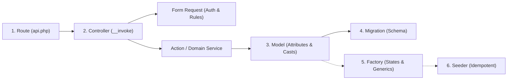

# Laravel 13 Feature Scaffolding Blueprint (PHP 8.5+)

This skill provides the comprehensive reference architecture for implementing a complete domain feature across all 6 layers in Laravel 13 with PHP 8.5+ and PHPStan Level 8 compliance.

---

## The 6-Layer Architecture Overview



### All-in-One Artisan Generator
```bash
php artisan make:model Article -mfs --controller --requests --resource --pest
```

---

## Layer 1: Anonymous Migration (`database/migrations`)

**Artisan Command**:
```bash
php artisan make:migration create_articles_table
```

- Always return an anonymous class extending `Migration`.
- Use typed parameter signatures: `Blueprint $table`.
- Use ULIDs/UUIDs or bigIncrements for primary keys.
- Create explicit indexes and foreign key cascade constraints.

```php
<?php

declare(strict_types=1);

use Illuminate\Database\Migrations\Migration;
use Illuminate\Database\Schema\Blueprint;
use Illuminate\Support\Facades\Schema;

return new class extends Migration
{
    public function up(): void
    {
        Schema::create('articles', function (Blueprint $table): void {
            $table->ulid('id')->primary();
            $table->foreignUlid('user_id')
                ->constrained('users')
                ->cascadeOnDelete();
            
            $table->string('title');
            $table->string('slug')->unique();
            $table->text('summary')->nullable();
            $table->longText('body');
            $table->string('status')->default('draft')->index();
            $table->json('metadata')->nullable();
            $table->timestamp('published_at')->nullable()->index();
            $table->timestamps();
            $table->softDeletes();

            $table->index(['status', 'published_at']);
        });
    }

    public function down(): void
    {
        Schema::dropIfExists('articles');
    }
};
```

---

## Layer 2: Model with PHP 8 Attributes & Generics (`app/Models`)

- Declare configuration with PHP 8 `#[Attribute]` syntax (`#[Table]`, `#[Fillable]`, `#[UseEloquentBuilder]`).
- Implement method-based casting `casts(): array` with backed enums and `AsFluent`.
- PHP 8.4 Property Hooks for computed attributes.
- PHPStan generics for relationships and query builders.

```php
<?php

declare(strict_types=1);

namespace App\Models;

use App\Builders\ArticleQueryBuilder;
use App\Enums\ArticleStatus;
use Illuminate\Database\Eloquent\Attributes\Fillable;
use Illuminate\Database\Eloquent\Attributes\Table;
use Illuminate\Database\Eloquent\Attributes\UseEloquentBuilder;
use Illuminate\Database\Eloquent\Casts\AsFluent;
use Illuminate\Database\Eloquent\Concerns\HasUlids;
use Illuminate\Database\Eloquent\Factories\HasFactory;
use Illuminate\Database\Eloquent\Model;
use Illuminate\Database\Eloquent\Relations\BelongsTo;
use Illuminate\Database\Eloquent\Relations\HasMany;
use Illuminate\Database\Eloquent\SoftDeletes;

#[Table('articles')]
#[Fillable(['title', 'slug', 'summary', 'body', 'status', 'metadata', 'published_at', 'user_id'])]
#[UseEloquentBuilder(ArticleQueryBuilder::class)]
class Article extends Model
{
    /** @use HasFactory<\Database\Factories\ArticleFactory> */
    use HasFactory, HasUlids, SoftDeletes;

    // PHP 8.4 Property Hook
    public int $readingMinutes {
        get => max(1, (int) ceil(str_word_count($this->body) / 200));
    }

    /**
     * @return array<string, string|class-string>
     */
    protected function casts(): array
    {
        return [
            'status' => ArticleStatus::class,
            'metadata' => AsFluent::class,
            'published_at' => 'datetime',
        ];
    }

    /**
     * @return BelongsTo<User, $this>
     */
    public function author(): BelongsTo
    {
        return $this->belongsTo(User::class, 'user_id');
    }

    /**
     * @return HasMany<Comment, $this>
     */
    public function comments(): HasMany
    {
        return $this->hasMany(Comment::class);
    }
}
```

---

## Layer 3: Model Factory with Generic Types (`database/factories`)

- Provide PHPStan `@extends Factory<Article>` docblock.
- Define flexible state methods (`published`, `draft`).
- Use backed enum values and random fluent JSON data.

```php
<?php

declare(strict_types=1);

namespace Database\Factories;

use App\Enums\ArticleStatus;
use App\Models\Article;
use App\Models\User;
use Illuminate\Database\Eloquent\Factories\Factory;
use Illuminate\Support\Str;

/**
 * @extends Factory<Article>
 */
final class ArticleFactory extends Factory
{
    protected $model = Article::class;

    /**
     * @return array<string, mixed>
     */
    public function definition(): array
    {
        $title = fake()->sentence(6);

        return [
            'user_id' => User::factory(),
            'title' => $title,
            'slug' => Str::slug($title),
            'summary' => fake()->paragraph(),
            'body' => fake()->paragraphs(4, true),
            'status' => ArticleStatus::Draft,
            'metadata' => [
                'seo_title' => $title,
                'tags' => fake()->words(3),
            ],
            'published_at' => null,
        ];
    }

    public function published(): static
    {
        return $this->state(fn(array $attributes): array => [
            'status' => ArticleStatus::Published,
            'published_at' => fake()->dateTimeBetween('-1 year', 'now'),
        ]);
    }
}
```

---

## Layer 4: Idempotent Seeder (`database/seeders`)

- Use `firstOrCreate()` or batch inserts with factories to ensure rerunnable (idempotent) seeds.
- Eagerly associate relationships without running queries in loops.

```php
<?php

declare(strict_types=1);

namespace Database\Seeders;

use App\Models\Article;
use App\Models\User;
use Illuminate\Database\Seeder;

final class ArticleSeeder extends Seeder
{
    public function run(): void
    {
        $author = User::query()->firstOrCreate(
            ['email' => 'editor@example.com'],
            [
                'name' => 'Lead Editor',
                'password' => bcrypt('password123'),
                'email_verified_at' => now(),
            ]
        );

        Article::factory()
            ->count(15)
            ->published()
            ->for($author, 'author')
            ->create();

        Article::factory()
            ->count(5)
            ->for($author, 'author')
            ->create();
    }
}
```

---

## Layer 5: Controller, Form Request & Resource (`app/Http`)

### Form Request
```php
<?php

declare(strict_types=1);

namespace App\Http\Requests\Articles;

use App\Data\CreateArticleDto;
use App\Models\Article;
use App\Models\User;
use Illuminate\Foundation\Http\FormRequest;
use Illuminate\Support\Str;

final class StoreArticleRequest extends FormRequest
{
    public function authorize(): bool
    {
        return $this->user()?->can('create', Article::class) ?? false;
    }

    /**
     * @return array<string, list<mixed>>
     */
    public function rules(): array
    {
        return [
            'title' => ['required', 'string', 'max:255'],
            'body' => ['required', 'string'],
            'summary' => ['nullable', 'string', 'max:500'],
            'tags' => ['nullable', 'array'],
            'tags.*' => ['string', 'max:50'],
        ];
    }

    public function userOrFail(): User
    {
        /** @var User|null $user */
        $user = $this->user();
        if ($user === null) {
            abort(401, 'Unauthenticated');
        }
        return $user;
    }

    public function toDto(): CreateArticleDto
    {
        /** @var array{title: string, body: string, summary?: string, tags?: list<string>} $validated */
        $validated = $this->validated();

        return new CreateArticleDto(
            title: $validated['title'],
            slug: Str::slug($validated['title']),
            body: $validated['body'],
            summary: $validated['summary'] ?? null,
            tags: $validated['tags'] ?? [],
        );
    }
}
```

### Thin Invokable Controller
```php
<?php

declare(strict_types=1);

namespace App\Http\Controllers\Articles;

use App\Actions\Articles\CreateArticleAction;
use App\Http\Requests\Articles\StoreArticleRequest;
use App\Http\Resources\Articles\ArticleResource;
use Illuminate\Http\JsonResponse;
use Symfony\Component\HttpFoundation\Response;

final class StoreArticleController
{
    public function __invoke(
        StoreArticleRequest $request,
        CreateArticleAction $action,
    ): JsonResponse {
        $article = $action->execute(
            author: $request->userOrFail(),
            dto: $request->toDto(),
        );

        return ArticleResource::make($article)
            ->response()
            ->setStatusCode(Response::HTTP_CREATED);
    }
}
```

### API Resource
```php
<?php

declare(strict_types=1);

namespace App\Http\Resources\Articles;

use App\Models\Article;
use Illuminate\Http\Request;
use Illuminate\Http\Resources\Json\JsonResource;

/**
 * @mixin Article
 */
final class ArticleResource extends JsonResource
{
    /**
     * @return array<string, mixed>
     */
    public function toArray(Request $request): array
    {
        return [
            'id' => $this->id,
            'title' => $this->title,
            'slug' => $this->slug,
            'summary' => $this->summary,
            'reading_minutes' => $this->readingMinutes,
            'status' => $this->status->value,
            'metadata' => $this->metadata,
            'published_at' => $this->published_at?->toIso8601String(),
            'author' => $this->whenLoaded('author', fn() => [
                'id' => $this->author->id,
                'name' => $this->author->name,
            ]),
        ];
    }
}
```

---

## Layer 6: Route Registration (`routes/api.php`)

Group routes cleanly with typed model bindings and per-second throttling:

```php
<?php

declare(strict_types=1);

use App\Http\Controllers\Articles\IndexArticleController;
use App\Http\Controllers\Articles\ShowArticleController;
use App\Http\Controllers\Articles\StoreArticleController;
use Illuminate\Support\Facades\Route;

Route::prefix('v1/articles')
    ->name('api.v1.articles.')
    ->group(function (): void {
        // Public reading endpoints
        Route::get('/', IndexArticleController::class)->name('index');
        Route::get('/{article:slug}', ShowArticleController::class)->name('show');

        // Authenticated write endpoints with throttling
        Route::middleware(['auth:sanctum', 'throttle:60,1'])->group(function (): void {
            Route::post('/', StoreArticleController::class)->name('store');
        });
    });
```
