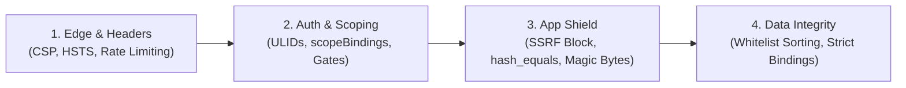

# Laravel 13 & PHP 8.5+ Security Hardening & Hacker Defense Skill

This skill guides the auditing, implementation, and verification of enterprise-grade security defenses in Laravel 13 applications, protecting against OWASP Top 10 vulnerabilities, IDOR, SSRF, timing attacks, and malicious file uploads.

> 📖 **Master Specification**: For complete threat modeling, security headers, and SSRF filters, see **[docs/architecture/security-and-hacker-protection.md](file:///C:/Users/SHAMIM.IT/.gemini/config/plugins/laravel/docs/architecture/security-and-hacker-protection.md)**.
> 🛡️ **CVE Auditing & Supply Chain**: For discovering, auditing, and patching all CVEs via `composer audit`, Dependabot, and OSV-Scanner, see **[docs/architecture/cve-management.md](file:///C:/Users/SHAMIM.IT/.gemini/config/plugins/laravel/docs/architecture/cve-management.md)**.

---

## 🚀 Quick Security Defense Blueprint



---

## 1. Dynamic Query Injection Defense: Whitelist Sorting

Never allow raw user input in `orderBy()` or `whereRaw()`:

```php
use Illuminate\Database\Eloquent\Builder;

final class SortArticlesAction
{
    private const array ALLOWED_SORTS = [
        'created_at' => 'created_at',
        'title'      => 'title',
        'popularity' => 'views_count',
    ];

    public function execute(Builder $query, ?string $sortBy, string $direction = 'desc'): Builder
    {
        $column = self::ALLOWED_SORTS[$sortBy] ?? 'created_at';
        $dir = strtolower($direction) === 'asc' ? 'asc' : 'desc';

        return $query->orderBy($column, $dir);
    }
}
```

---

## 2. Insecure Direct Object References (IDOR) Defense

### A. Scoped Route Model Binding
Automatically verify child-parent relationships in nested routes:

```php
Route::get('/organizations/{organization}/invoices/{invoice}', ShowInvoiceController::class)
    ->scopeBindings();
```

### B. ULIDs over Auto-Increment IDs
Prevent chronological enumeration and scraping attacks:

```php
$table->ulid('id')->primary();
```

---

## 3. Server-Side Request Forgery (SSRF) Defense

Reject private, loopback, or reserved IP addresses when downloading user-provided URLs:

```php
namespace App\Support;

use InvalidArgumentException;

final class SafeHttpClient
{
    public static function assertPublicUrl(string $url): void
    {
        $host = parse_url($url, PHP_URL_HOST);
        if (! is_string($host)) {
            throw new InvalidArgumentException("Invalid URL: {$url}");
        }

        $ip = gethostbyname($host);

        // Disallow private ranges (10.x, 192.168.x, 172.16.x) and loopbacks (127.0.0.1)
        if (! filter_var(
            $ip,
            FILTER_VALIDATE_IP,
            FILTER_FLAG_IPV4 | FILTER_FLAG_NO_PRIV_RANGE | FILTER_FLAG_NO_RES_RANGE
        )) {
            throw new InvalidArgumentException("Security violation: Target IP [{$ip}] is on an internal subnet.");
        }
    }
}
```

---

## 4. Timing Attack Defense: `hash_equals()`

Prevent side-channel timing analysis when verifying signatures, HMACs, or tokens:

```php
namespace App\Support;

final class WebhookSecurity
{
    public static function verify(string $payload, string $signature, string $secret): bool
    {
        $expected = hash_hmac('sha256', $payload, $secret);

        // Constant-time execution prevents timing side-channel attacks
        return hash_equals($expected, $signature);
    }
}
```

---

## 5. File Upload Hardening: Binary Magic Bytes

Never trust client-reported extensions or MIME types. Always inspect disk magic bytes:

```php
namespace App\Actions\Uploads;

use Illuminate\Http\UploadedFile;
use Illuminate\Support\Facades\Storage;
use Illuminate\Support\Str;
use InvalidArgumentException;

final class SecureUploadAction
{
    private const array VALID_MIMES = [
        'image/jpeg' => 'jpg',
        'image/png'  => 'png',
        'image/webp' => 'webp',
    ];

    #[\NoDiscard]
    public function execute(UploadedFile $file): string
    {
        // 1. Inspect real binary bytes via finfo
        $realMime = $file->getMimeType();
        $ext = self::VALID_MIMES[$realMime] ?? null;

        if ($ext === null) {
            throw new InvalidArgumentException('Invalid file type detected.');
        }

        // 2. Cryptographically secure random filename
        $filename = sprintf('%s.%s', Str::random(40), $ext);

        // 3. Store on private disk outside web document root
        Storage::disk('private')->putFileAs('documents', $file, $filename);

        return $filename;
    }
}
```

---

## 6. Pest 3 Security Architecture Tests

Run automated security boundary tests in CI:

```php
// tests/Feature/SecurityArchTest.php

arch('dangerous execution functions are strictly banned')
    ->expect(['eval', 'exec', 'shell_exec', 'passthru', 'system', 'unserialize'])
    ->not->toBeUsed();

arch('weak hashing functions are strictly banned')
    ->expect(['md5', 'sha1'])
    ->not->toBeUsed();

arch('superglobals are strictly banned in controllers')
    ->expect(['_GET', '_POST', '_REQUEST', '_COOKIE', '_SERVER'])
    ->not->toBeUsed();

---

## 7. CVE Discovery & Dependency Auditing Commands

Continuously scan your dependency tree for known CVEs:

```bash
# 1. Native composer audit against Packagist/FriendsOfPHP database
composer audit

# 2. Strict CI check: Block builds on CVEs or abandoned packages
composer audit --abandoned=fail --format=table

# 3. Google OSV-Scanner against composer.lock
osv-scanner --lockfile=composer.lock

# 4. SAST security scan with Semgrep
semgrep --config p/laravel --error
```
```
